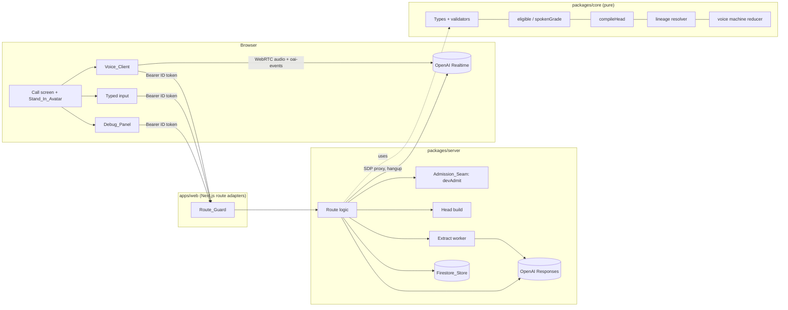

# Design Document: first-spoken-call

## Overview

This design builds Brief 001 as specified in `requirements.md`, with the fixes from `docs/briefs/001-review-requirements.md` and `docs/briefs/001-review-design.md`. Requirement numbers are cited as R*n.m*. Contract sections are cited as "C§n" (`docs/design/memory-contracts-v2.md`) and "MS§n" (`docs/design/memory-spec-v3.md`). `docs/design/` is read-only. Every conflict found is listed under [Contract questions](#contract-questions).

The slice is the F0 and F1 floors plus the parts of F3 and F5 needed to prove memory. The demo path is: sign in, call, speak, hang up, call again, hear the memory, and see it in the Debug_Panel.

Decisions from the review that shape the design:

- **Voice admission waits for the transcript.** There is no judge until F2, so ASR admits the turn (the MS§3 fallback "ASR plus Decisions can admit instead"). The browser posts `/api/turn` once the final transcript arrives, with `judge:"timeout"` and `transcriptState:"final"`. Replies start about 1.1 to 1.6 s after speech ends until F2.
- **KV13's ack-age check applies to `fastO` only.** This slice issues no `fastO` Permits. No reply is ever built from an expired Deck, and every 45 s refresh re-issues the Deck.
- **The Extractor is an in-process server worker** in `packages/server`. `jobWake` is not used in this slice.
- **Debug data comes from a separate route, `GET /api/debug/memory`,** which refuses in production. The contract's `/api/memory` is not built here.

## Architecture



- **Audio** goes directly between the browser and OpenAI over WebRTC. The server sees only the SDP exchange (R12) and the hangup calls (R14).
- **The browser never reads Firestore.** The rules are deny-all (R8), and every read and write goes through a route.
- **Background work** runs in the Next.js server process. A route adapter schedules it with Next's post-response hook (`after` from `next/server`; read `node_modules/next/dist/docs/` before using it). The Server_Library cannot import `next` (R5.3), so each adapter passes a `schedule(fn)` function into the Server_Library call; tests pass one that records the work and runs it on demand. Session open and session close also drain the Owner's remaining jobs (see [Extraction worker](#extraction-worker)). `functions/` keeps only its existing heartbeat in this slice.
- **No route awaits background work it doesn't own.** `/api/session/state` and `/api/receipt` only `schedule` the `tick` work and never await it. Session open races its drain against a fixed limit. No OpenAI deadline can extend a route's own limit (R13.6, R11.2).
- **Nothing recompiles the Head during a call.** A Memory written mid-call reaches the Head at the next session open and reaches the call only through `recall`. Extraction does not change `epoch`, `policyRev`, `bundleRev` or `rulesRev`, so a mid-call `seen` mismatch cannot come from extraction.
- **Time** comes only from the Clock_Port (R6). The browser has its own opsClock, built from a server offset plus a monotonic read, as an allow-listed Clock_Port file.

## Module layout

```
packages/core/src/
  schema/        closed validators: primitives (sN, i, Signed, ID, Hash, TS), records (C§1), wire (C§6), debug wire
  types/         generated from schema (one source of truth)
  clock.ts       ClockPair type, no reads
  ids.ts         canonicalJSON, id input builders (hashing injected)
  text.ts        LF normalization, UTF-16 offsets, surrogate checks, token split (NFKC, lowercase, letter/digit runs)
  lexicon.ts     code Sensitivity floor and gravity floor (closed word lists)
  slices.ts      turn slice classification (U/T, sens), slice hash input
  eligible.ts    eligible(x,c,s) (C§4)
  spoken.ts      spokenGrade (C§2, C§4)
  head.ts        compileHead (C§7), token estimator
  lineage.ts     resolveLineage (R24.4)
  extract.ts     ExtractV1 packet build + output validation + item→memory plan (pure)
  admission.ts   payloadHash input, devPermitKind (pure parts of devAdmit)
  voice/machine.ts  browser call-state reducer (pure; effects returned as commands)
  recall.ts      recall line build, explicitRequest test, note citation filter
packages/server/src/
  config/models.ts   the only module that reads Model_Config; holds the /api/health fallbacks
  config/env.ts      OPENAI_API_KEY, FRANKI_ID_HMAC_KEY, FRANKI_FIREBASE_PROJECT_ID, NODE_ENV readers (names only in errors)
  config/admin.ts    initializeApp({ projectId: FRANKI_FIREBASE_PROJECT_ID }) once; shared by live.ts and the Firestore_Store
  clock/live-clock.ts   Clock_Port live implementation (allow-listed); live.ts's `now` calls it
  store/port.ts, store/memory-store.ts, store/firestore-store.ts, store/conformance.ts
  crypto.ts      sha256, hmacId (node:crypto)
  auth/guard.ts  token verify (revocation), origin check, body caps
  ledger/request.ts  idempotency (lease 15 s, TTL 24 h)
  core-docs.ts   ensureCoreDocs (R10.13, new)
  routes/{open,sdp,state,close,turn,tool,receipt,debug-memory}.ts
  admission/seam.ts, admission/dev-admit.ts
  openai/{realtime-calls,responses}.ts + openai/fake.ts (Fake_OpenAI)
  worker/{extract,hangup,tick}.ts
  health.ts, live.ts (existing)
apps/web/src/
  app/api/**/route.ts   thin adapters (R5.4)
  client/clock.ts       browser Clock_Port (allow-listed)
  client/auth.ts, client/api.ts, client/voice-client.ts, client/hash.ts (crypto.subtle)
  app/page.tsx, components/{CallScreen,StandInAvatar,TypedInput,DebugPanel}.tsx
.kiro/steering/{product,tech,structure,memory-rules}.md
.kiro/hooks/clock-guard.json, .kiro/hooks/invariants-on-save.json
functions/src/clock.ts   one-function ops clock for the heartbeat (allow-listed)
scripts/clock-allowlist.json, scripts/clock-guard.mjs
scripts/sync-local-env.mjs   apphosting.yaml plain values → apps/web/.env.development.local (R30.10)
```

**Clock allow-list (R2.1).** `scripts/clock-allowlist.json` holds three files: `packages/server/src/clock/live-clock.ts`, `apps/web/src/client/clock.ts` and `functions/src/clock.ts`. Two existing reads move behind them before the static check is turned on:

- `packages/server/src/live.ts:16` (`now: () => Date.now()`) becomes `now: () => liveClock().opsClock.now`.
- `functions/src/index.ts:50` (the KMS heartbeat plaintext) calls `opsNowMs()` from `functions/src/clock.ts`. `functions` does not import `packages/server`, so it gets its own one-line clock file.

`packages/server/src/health.ts:73` calls `new Date(deps.now())` with an argument. That only formats a supplied time. The static check matches `new Date()` with an empty argument list only (regex `new\s+Date\s*\(\s*\)`), so it passes; a test case pins this. The check builds its search patterns from string pieces, so its own source does not trip it.

**Local config (R30.10).** `next dev` does not read `apphosting.yaml`. `apps/web/package.json` gets `"predev": "node ../../scripts/sync-local-env.mjs"`. The script:

- parses the `env:` list in `apps/web/apphosting.yaml` with the `yaml` package;
- writes every entry that has `value:` (and no `secret:`) as `NAME=value` lines into `apps/web/.env.development.local`, with a generated-file header;
- skips every `secret:` entry;
- prints only `synced N plain values`, never a name's value.

Next loads `.env.development.local` and `.env.local` together in development, so the two secrets stay in `.env.local` and everything else comes from `apphosting.yaml`. The existing `apps/web/.gitignore` pattern `.env*` must cover the generated file; the task checks `git check-ignore` and adds a pattern only if needed. The parser is a pure function `parsePlainEnv(yamlText)` with a unit test (plain copied, secret skipped, unknown keys ignored, output has no values).

**Admin SDK project (fix 5).** `FRANKI_FIREBASE_PROJECT_ID` is a plain value, `frankirocks`, added to `apphosting.yaml`. `config/admin.ts` initializes `firebase-admin` with it explicitly, because Application Default Credentials from a user account do not reliably supply a project ID. Missing → `CONFIG` naming the variable (R30.11).

Core does no hashing, because Node's `crypto` is unavailable in the browser bundle. It builds canonical byte inputs. The server hashes with `node:crypto`, and the browser hashes with `crypto.subtle`.

## Data model notes

All stored shapes are C§1 exactly. These are this slice's choices within them.

**IDs.** `ID = base64url(HMAC-SHA256(FRANKI_ID_HMAC_KEY, canonicalJSON(parts)))`, which is 43 characters. The server derives these IDs:

| ID | Parts |
|---|---|
| sessionId | `["session", uid, requestId]` |
| user turnId | client-supplied (see contract question 23) |
| assistant turnId | `["aturn", sessionId, responseId]` |
| evidence logicalId / eid | `["ev", turnId]` / `[logicalId, version]` |
| memory id | `["mem", jobId, itemIndex]` (C§1 "memory ID=assertion") |
| jobId | `["job", "extract", eid]`, `["job", "hangup", sessionId]` |
| permitId | `["permit", stamp, kind, approvedPayloadHash]` |
| ledger request key | `["req", uid, route, requestId]` |

**Hashes.** `Hash` is lowercase hex SHA-256. A Slice `contentHash` is the hash of the UTF-8 encoding of the LF-normalized substring `[start, end)`. Ranges that split a surrogate pair are rejected before hashing. A root key is `H(canonicalJSON(slice))`.

**`rev`.** A record is created with `rev: 1`, and each committed write sets `rev` to the prior value plus 1. Compare-and-set compares the `rev` read inside the transaction (R7.4, R7.5; contract question 21).

**Core documents (R10.13, new).** `ensureCoreDocs(uid, clock)` runs at the start of every authenticated route except `/api/debug/memory`, which only reads. It runs one transaction: if `core/epoch` exists it does nothing; otherwise it creates all five documents:

| Doc | Initial values (plus C fields: `v:1, rev:1, epoch:1, policyRev:1`, empty lineage arrays, `dirty:false, dependenciesComplete:true`) |
|---|---|
| epoch | `epoch:1, policyRev:1, barrier:null, activeSessionId:null, activeCallId:null, activeLeaseToken:null, leaseUntil:null` |
| state | `audience:"private", audienceSessionId:null, currentZone/homeZone:` request `clientZone` if present else `"UTC"`, `holidayLocale:"US", memoryOn:true, isolatedInputProven:false, careSubjectIds:[], lastInteractionAt:null, modifiers:{rushed:null,crisis:null}, clockMode:"live", worldClock:null, nextNightAt:` ops now + 24 h (placeholder, nightly is L), `projectionDirty:false, coverage:{state:"unknown",from:null,to:null,missingRanges:[],generation:0}, fixtureNamespace:null, visitId:null` |
| counters | `day:` civil date in `currentZone`, all micros 0, `heavy:0, senderAsks:[], counts:[], connectorOffers:[], warmth:{sessionId:null,turnsWithoutReference:0}` |
| rules | `rulesRev:1, allergies:[], standing:[], rulePages:0, gazetteerVersion:"none", noneConfirmed:[]` |
| bundle | `state:"dirty", bundleRev:0, rulesRev:1, head:null, headHash:null, selectedRefs:[], compiledAt:null, expiresAt:null` |

**Zone.** `worldClock.zone` is `core/state.currentZone`. Each session open sets `currentZone` to the request's `clientZone` in the open transaction and leaves `homeZone` unchanged (contract question 15).

**Session timing.** `expiresAt` is ops now + 10 min (C§6 idle expiry). It is pushed forward on every turn, state and receipt call. `generation` stays 1 for the life of a Session in this slice. Reconnect after a failure (R15.8) opens a new Session, and the server closes the old one (KV09).

**Turn evidence.** One Evidence per committed user Turn with a final transcript: `kind:"turn"`, `source:"voice"` (also used for ordinary typed turns) or `"pasted"`, `text` holding the whole transcript, `transcriptState:"complete"`, `transcriptDeadline:null`, `occurredAt` and `assertedAt` from worldClock, `receivedAt` from opsClock. `fieldSlices` is one Slice over the whole `text`, with class U, or T for pasted text, and `sens` set to the lexicon floor of the text (R20.3, R20.4). Every other content field is `null` or `[]` (R4.8).

**Indexes (R7.8, KS08).** `firestore.indexes.json` declares exactly these:

| Query | Collection | Fields | Used by |
|---|---|---|---|
| Q03 | memories | key A, status A, validFromKey D | single-valued supersede lookup (R23.5) |
| Q13 | sessions (collection scope) | status A, expiresAt A | expiry close in `tick` (R14.4) |
| Q17 | jobs (collection scope) | status A, nextAttemptAt A | job drain and redrive |
| Q18 | jobs (collection scope) | status A, leaseUntil A | expired-lease requeue |
| Q33 | ledger | kind A, at D | Debug_Panel admission entries (R29.6) |

Q14 (turns by `seq`) uses the single-field index. Q28 (paged `__name__ > cursor`) is built in. Head build, recall lines and debug pages read through Q28.

## Data flow

### Session open (R11, R26, KV09, Q13, Q28)

1. The Route_Guard runs, then `ensureCoreDocs`, idempotency (R10.8), and the Q13 expiry close from `tick` (bounded: Firestore writes only, hangups scheduled). The rest of `tick` is scheduled, not awaited.
2. **Drain (fix 3).** Start `drainExtractJobs(uid)` and race it against a **3,000 ms** opsClock timer: `await Promise.race([drain, timer(3000)])`. The drain claims every due `queued` or `retry` Extract_Job and waits on jobs leased elsewhere. If the timer wins, open proceeds at once; the drain keeps running through `schedule`, and the unfinished jobs stay visible in the Debug_Panel (R29.6). A job's 10 s Extract deadline never extends the wait.
3. **One transaction** (fix 6):
   1. Read `core/epoch`, `state`, `rules` and `bundle`, plus all Memories through Q28 pages inside the transaction. If `barrier` is set, return `blocked` (R11.6).
   2. Compile the Head with `compileHead`.
   3. Close the prior Session (it becomes `closing`; hangups run after commit, see step 4).
   4. Write `core/bundle` with `bundleRev + 1`, the Head, `headHash`, `selectedRefs`, `state:"clean"`, `compiledAt` and `expiresAt = compiledAt + 60 s`.
   5. Create the Session (`minting`, `generation:1`, `stateAck`), set `core/epoch.activeSessionId`, set `core/state.currentZone`, and write the request ledger entry.

   The Deck, the returned StateAck and `Session.stateAck` all carry the post-compile `bundleRev`.
4. After commit, hang up the prior Session's calls. Any failure becomes a `hangup` Job (R11.3, R14.3).

If any step fails, nothing commits and `core/bundle` is unchanged (R26.11). The total budget is 5 s (R11.2, R16.6): at most 3 s of drain plus about 1 s for the transaction and compile. The browser's 5 s `CONNECTING` limit starts only when this response arrives (fix 2), so a slow drain cannot push a re-call into `RECOVERY`.

### Call setup (R12, R13)

`CONNECTING`: the browser creates the peer connection and data channel, then posts `/api/session/sdp`. The server proxies to `/v1/realtime/calls` with `FRANKI_VOICE_MODEL`, persists the call ID from `Location`, and only then returns the answer. On a write failure it hangs up the call and returns `DEPENDENCY`.

`CONFIGURING`: once the data channel is open, the browser sends one `session.update` with `instructions = Head.text`, `tools = [recall]`, transcription model `FRANKI_TRANSCRIBE_MODEL`, and the C§6 `turn_detection`. It then calls `/api/session/state`. A matching StateAck within 1.5 s moves the call to `LISTENING`; otherwise it closes with `error` and enters `RECOVERY` (R13.9).

**Refresh (fix 2).** Every 45 s, `/api/session/state` returns a fresh StateAck and a re-issued Deck. The re-issued Deck has new `issuedAt` and `expiresAt` (+60 s) and is built from the stored `core/bundle`. If any revision in `seen` changed, the Deck carries the new Head, and the browser sends `session.update` only when `Head.text` differs (R13.5). A failed refresh never extends the ack or the Deck (R13.8). If the Deck expires anyway, the Voice_Client builds no reply until a refresh succeeds.

Re-issue depends only on the stored `core/bundle.head` and the current four revisions. It ignores `core/bundle.expiresAt`, which is written once at open and not used again in this slice. Since nothing recompiles the Head during a call, the re-issued Head equals the one sent at open unless another session open (another device) raised `bundleRev`, and that case closes this Session first (KV09).

The state route does its own work (read Session and core docs, write `Session.stateAck` and `expiresAt`) and schedules `tick`. It never awaits extraction or hangups, so it meets 1.5 s (R13.6) even when OpenAI never answers.

### One voice turn (R15, R17, R19, R20, R22; KV02, KV04, KV12)

```mermaid
sequenceDiagram
  participant RT as Realtime
  participant VC as Voice_Client
  participant API as /api/turn
  participant W as Extract worker
  RT->>VC: input_audio_buffer.committed (t_end = opsClock now)
  RT->>VC: conversation.item.added (same item id) → record commitSeq
  Note over VC: HELD (muted, avatar "thinking")
  RT->>VC: input_audio_transcription.completed (item id)
  VC->>API: TurnRequest{source:"asr", judge:"timeout", transcriptState:"final", items, clientSeq}
  API->>API: tx: CAS nextClientSeq; Turn + Evidence + Extract_Job + request ledger
  API->>API: devAdmit → Permit slowOrdinary + ledger decision
  API-->>VC: TurnResponse{status:"ordinary", permit, deck}
  API-)W: after(): run Extract_Job
  VC->>VC: verify Permit (stamp, generation, payload hash, expiry)
  VC->>RT: response.create{conversation:"none", instructions, input: safe turns + item refs, metadata}
  VC->>VC: re-check Permit, unmute → SPEAKING
  VC->>API: /api/receipt playbackStarted / transcript / playbackEnded
```

Details:

- **End of speech** (`t_end`) is the Voice_Client's opsClock time at `input_audio_buffer.committed` (C§6 "t0=committed").
- **Turn grouping.** A Turn holds every item committed since the last TurnRequest was posted, from 1 to 8 items. If speech starts again before the transcript arrives, the next item joins the same Turn and `t_end` resets. The transcript is the item transcripts joined by a single space in `commitSeq` order.
- **Transcript wait.** A Turn is admitted only when **all** of its items have a final transcript. If the matching `item.added` or **any** item's final transcript is missing at `t_end + 1.5 s`, or a `...transcription.failed` event arrives, the Voice_Client posts the TurnRequest with `transcriptState:"missing"` or `"failed"` and an empty `transcript`. The server commits the Turn with state `transcriptMissing` or `failed` and advances `nextClientSeq`, but writes no Evidence and no Extract_Job (contract question 20). `devAdmit` returns a `recoveryOnly` Permit for the fixed neutral line "Sorry, say that again?". The browser goes to `RECOVERY`, plays only that line through the Permit check, and returns to `LISTENING`. A transcript that arrives later is dropped for this Turn. No audio ever plays without a Permit.
- **Missing item.** If `committed` has no matching `item.added` within 600 ms, the Turn goes to `HELD` (R15.10), and the same 1.5 s rule decides whether it is admitted or sent to recovery.
- **Reply input.** The Deck's `turns` holds up to 4 SafeTurns from the Session's earlier Turns that pass Spoken_Grade's sensitivity rule. `TurnResponse.deck` returns the updated set. The current Turn is sent as item references, not text.
- **Barge-in** (R15.4): on `speech_started` while speaking or in flight, mute first, cancel every recorded response ID, send `output_audio_buffer.clear`, and return to `LISTENING`. Permits for older Turns are discarded.

### One typed turn (R18; C§6 "Typed/chip")

1. **Classification.** The server classifies the text: pasted/T if it is over 280 code units, contains CR or LF, `From:` or `Subject:`, or a URL; otherwise ordinary/U.
2. **Session.** A typed turn needs a Stamp. With no call open, the Browser_Client opens a Session and never sends SDP. This is the C§6 `/api/control` "open session without SDP" pattern. The Session closes on sign-out, on the next call open (KV09), or on expiry.
3. **Commit.** One transaction writes the Turn (`source:"typed"`), the Evidence (`source:"voice"` for U or `"pasted"` for T), the request ledger entry and, for U only, the Extract_Job (R22.1). `devAdmit` issues `slowOrdinary` for U, or `postCommitControl` with scope `reply` and no S1+ notes for T.
4. **Reply in a call.** The browser sends `response.create` with the typed text as a user text input after the safe turns, then follows the voice path.
5. **Reply with no call** (contract question 24). The server makes one Responses call (`FRANKI_BRAIN_MODEL`, effort `low`, `store:false`, `tools:[]`, Head text as instructions, the typed text and safe turns as input, 4 s deadline). It returns the reply as one `W` note with `kind:"result"`, `unprompted:false`, the Head's `selectedRefs` roots as `rootKeys` and `dependsOn`, and `sens` equal to the highest sensitivity of the Head lines. The browser shows it as text and plays no audio.
6. **Extraction.** After the TurnResponse is sent, `schedule` (backed by `after()`) starts the Extract_Job (R18.4, R22.12).

### Tool turn (R27, F5 floor)

1. The Realtime model calls `recall`. The browser enters `TOOL_WAIT` and posts `/api/tool`.
2. The server checks the Stamp (`stale` if it does not match) and waits for **parse committed**, meaning the current user Turn and Evidence transaction has committed (fix 7). That transaction normally committed before the reply was created, so the wait is usually zero. The cap is 1.5 s, after which the status is `hold`.
3. **Asked test.** `explicitRequest` is true only if the Turn's text contains a query term, using the same tokenizer as chunking. The signed-in Owner's turn counts as a certain speaker; a speaker model replaces this later (fix 8). If the test fails, the server returns `ready` with empty notes.
4. **Read.** The server reads lines through Q28 pages: eligible, Spoken_Grade, at most 200 lines, each at most 160 characters, formatted `[ref] predicate: value`. It packs as many as fit in 8,000 tokens and runs one `RecallAllV1` call (`FRANKI_BG_MODEL`, which is L in C§5; 768 output tokens; 1.5 s deadline).
5. **Notes.** Statements without a supplied citation are dropped. Each note carries the cited rows' `rootKeys` and `dependsOn`. Any failure returns empty notes with coverage `unknown`.
6. **Admission.** In the same response, `devAdmit` issues a new `slowOrdinary` Permit for the tool continuation. The payload hash includes the tool output. The browser sends `function_call_output` and then `response.create` (C§6 Tools).

### Close (R14, KS07, Q13)

1. The browser stops the microphone, closes the channel and peer connection, then posts `close`.
2. The server sets the Session to `closing`, hangs up each registered call ID in parallel within the 1.5 s budget, and sets `closed` with `closedAt`. If a hangup fails, it writes a `hangup` Job and returns `closing` instead.
3. On `closed`, the server makes sure an Extract_Job exists for each committed user Turn with Evidence (R14.5). It then hands a drain to `schedule` and does not await it.

The `hangup` Job retries with backoff of 1, 2, 5, 10 s and then every 60 s. It never completes until OpenAI confirms the hangup or reports the call already gone (KS07).

### Tick (`tick`, C§9)

At most once per ops minute per Owner, on open and on state, `tick` runs:

- Q13: close expired Sessions (at most 100 per run).
- Q17: run due `queued` and `retry` jobs.
- Q18: requeue jobs whose lease expired.

`tick(uid, deps)` returns a promise that the caller hands to `schedule`. The state and receipt routes never await it. Session open awaits only the Q13 part (Firestore writes, hangups scheduled) and races the drain as above. The once-per-minute gate is a compare-and-set on `core/state` so two concurrent routes don't both run it.

## Browser state machine

`packages/core/src/voice/machine.ts` is a pure reducer: `(state, event, now) → (state, commands[])`. Events are Realtime events, route results, timers and button presses. Commands are things like `mute`, `cancel(ids)`, `clear`, `post(route, body)` and `armTimer`. The Voice_Client runs the commands. The machine uses this subset of C§6 States:

| State | Entered on | Leaves to | Avatar |
|---|---|---|---|
| CLOSED | start, or close done | CONNECTING on press | closed |
| CONNECTING | open sent | CONFIGURING when the channel opens; CLOSED with an error if open fails or takes over 5 s (R16.6); RECOVERY if SDP and channel take over 5 s **counted from the open response** (R15.8) | connecting |
| CONFIGURING | `session.update` sent | LISTENING on a matching ack; close + RECOVERY after 1.5 s | connecting |
| LISTENING | ack, end of speech, or barge-in | WAIT_ITEM on commit; HELD on typed send | listening |
| WAIT_ITEM | `committed` | HELD on matching `item.added`, or after 600 ms | thinking |
| HELD | item recorded, or typed send | SPEAKING on a valid Permit and first audio; RECOVERY on missing/failed ASR at t_end + 1.5 s, or `hold` past 2.5 s | thinking |
| SPEAKING | first permitted audio | LISTENING when done or on barge-in; TOOL_WAIT on a function call; HELD on a higher revision (KV05) | speaking |
| TOOL_WAIT | `recall` call | HELD with the new Permit; LISTENING after 3 s with no result | thinking |
| RECOVERY | failure or missing ASR | LISTENING after the neutral line, if the call is live; reconnect after 1, 2, 5 s; retry button at 30 s | recovery |

JUDGING, SPECULATING (F2), QUARANTINED and CLEAN_READY (F4) are not built.

Rules that apply in every state:

- The output `audioElement` is muted unless the state is SPEAKING with a Permit that passes its check.
- Events whose metadata `generation` is not the local generation are dropped (R15.7).
- A higher stamp cancels and clears all output (KV05).
- Mute affects only the microphone track (R15.6).

## Admission seam (R17; KV02, KV03)

`admit(ctx): Permit | Hold` in `admission/seam.ts` is the only function that creates a Permit. `seam.ts` calls `devAdmit`, which throws `CONFIG` before doing any work when `NODE_ENV === "production"`. The route returns `CONFIG` with no Permit and writes no ledger entry (R17.5).

`devPermitKind` (pure):

| Turn | Kind | Scope |
|---|---|---|
| voice, transcript final | `slowOrdinary` (deviation: C§6 requires judge `O` for audio; F2 restores it) | reply |
| voice, missing or failed | `recoveryOnly` | reply |
| typed U | `slowOrdinary` | reply |
| typed T (pasted) | `postCommitControl`, no S1+ notes | reply |
| tool continuation | `slowOrdinary` | reply |

Every Permit has `expiresAt = opsNow + 10,000 ms`, `momentIds:[]` and `noteIds:[]`. `approvedPayloadHash = SHA256(canonicalJSON({stamp, head, notes, turns, audioIds, toolOutput, candidates:[], attendees:[]}))` (C§6 Hash). The browser recomputes the hash and re-checks the Permit at unmute.

**Ledger.** Each outcome writes one `ledger` entry, kind `decision`, before returning. A Permit's entry is keyed by `permitId`, with `state:"complete"`. A hold's entry is keyed by `H("hold", stamp, requestId)`, with `state:"blocked"`. The payload is `{purpose:"answer", acceptedRefs:[turnRef], heldRefs:[] or [turnRef], reasonCodes:[], audience:"private"}`. The closed payload has no field for the issuer or the Permit kind, so `/api/debug/memory` reports `issuer:"devAdmit"` (the active seam implementation) and the kind from `devPermitKind` on the stored Turn (contract questions 16 and 17).

## Extraction worker

`worker/extract.ts` exposes `runExtractJob(uid, jobId, deps)` and `drainExtractJobs(uid, deps)`. The drain has no wait limit of its own; callers bound it. Session open races it against 3,000 ms, and close and `/api/turn` only `schedule` it.

1. **Claim.** A transaction checks that the job is `queued` or `retry` and due, then sets `leased`, a new `leaseToken`, `leaseUntil = now + 30 s` and `generation + 1`.
2. **Packet.** Build the packet from that Turn's Evidence only (R22.2): `sourceClass:"U"`, `open:[]`, `lastTurns:[]`, and a roster of mentions in that text only, with no global roster. **Known limit:** C§5 allows `lastTurns` to carry recorded pronoun antecedents, but this slice records none, so `lastTurns` is always `[]`. "She's a beagle" said after "I have a dog named Pip" cannot be attributed to Pip. No mechanism is added for this here.
3. **Call.** Responses API with `FRANKI_BRAIN_MODEL`, effort `low`, `store:false`, `tools:[]`, strict schema, PREFIX plus the ExtractV1 literal, 12,000/4,096 tokens and a 10 s deadline. On invalid output, refusal, incomplete output or timeout, make one repair call. If that also fails, set the job to `retry` with `error`, `attempts + 1` and `nextAttemptAt = now + 60 s`. After 3 attempts the job becomes `failed` (contract question 25).
4. **Validate items** (pure, `core/extract.ts`):
   - Check spans (R22.5, R24.7), predicate and args (R23.8), and the kind map (R23.9).
   - Apply act and target rules (R22.6, R23.10).
   - Hold allergy, rule, `hard_rule`, correction and transition items, each with a ledger `decision` (R23.3, R23.4).
   - Set Authority: U only if every span sits in a U Slice (R23.1, R23.2). T and M never become `active` (R23.11, R23.12).
   - Apply the floors: sensitivity, gravity and `flow` can only tighten (R22.11).
   - Compute `key = H(subject, predicate, scope)` (KC05).
5. **Commit.** One transaction:
   1. Compare the lease token, job generation, captured `epoch` and captured `policyRev` with stored values (KS06). On mismatch, requeue the job, or mark it `failed` if `epoch` or `policyRev` changed.
   2. Write the Memories, with lineage per R24.1 and R24.2: one root Slice per span, `rootKeys = H(slice)`, `dependsOn = ["e:<eid>"]`, `packetEids = [eid]`, and `supportingIds` = an evidence Ref with its `rev`.
   3. Supersede single-valued keys through a Q03 read (R23.5).
   4. Set the job to `complete` with `resultRefs`.
   5. Write a ledger `usage` entry.

   The Store_Port runs the W-LINEAGE check on every Memory write (R24.3).

**Placeholders (R4.8).** Memory fields with no behavior yet get placeholder values: `endWhen:{kind:"standing"}`, `nextReviewAt = assertedAt + 365 days` on worldClock, `when:{kind:"none"}`, `time:null`, `validFrom = assertedAt`, `validFromKey = assertedAt`, `validFromKnown:true`, `scheduleRev:0`, `gravity` from the floor, and empty arrays or `null` for everything else (contract question 7).

**Draining.** Drain uses Q17 and Q18 shapes filtered to `kind:"extract"`. It runs jobs one after another, which the sequential floor requires. While waiting on jobs leased elsewhere, it polls every 100 ms until they finish or their lease expires (then Q18 requeues them).

**Runtime caveat.** Post-response work on App Hosting (Cloud Run) may be CPU-throttled. Session open's drain covers this, because it runs inside a request.

## Eligibility (R25; KC06)

`eligible` covers every clause of the C§4 pseudocode:

| # | Clause | Status | Reason |
|---|---|---|---|
| 1 | tenant match | implemented | `tenant` |
| 1b | snapshot complete | implemented | `freshness` |
| 2 | barrier, non-maintenance | implemented | `barrier` |
| 3 | barrier maintenance: allow only matching-op resolve/sanitize/purge; never speech or tool | partial: speech and toolReturn are denied; all other maintenance reads are denied until F4 | `barrier` |
| 4 | purge removal-only allow | unimplemented, F4 | — |
| 5 | current epoch and policyRev | implemented | `freshness` |
| 6 | browser `generation == localGeneration` | implemented | `freshness` |
| 7 | foreground `generation >= session.generation` | implemented | `freshness` |
| 8 | worker lease token and job generation | implemented | `freshness` |
| 9 | readable revision, `dependenciesComplete`, not dirty | implemented | `dirty` |
| 10 | row blocked or purged | implemented | `blocked` |
| 11 | dependency missing, blocked, purged, dirty, wrong or retracted (an older `@rev` alone is allowed) | implemented | `blocked`, or `dirty` for a dirty dependency |
| 12 | root/provider/semantic/topic blocks | unimplemented, F4 (no `blocks` rows exist) | — |
| 13 | `validForPurpose` | partial: `validFrom <= worldNow < validTo`; `asOf` and `queryTargetTime` in F6 | `time` |
| 14 | authority | partial: speech and project stages need class U, C or O; full Power table in F3 and F11 | `authority` |
| 15 | `freshEnough(opsNow)` | unimplemented, F6 | — |
| 16 | silent use, or Policy plus quiet | unimplemented, F4 (quiet) and F11 (Policy verbs) | — |
| 17 | allow | implemented | `ok` |

A missing or invalid input returns `{allow:false, reason:"ineligible"}` and never throws.

**`spokenGrade`.** It requires all of the following: `eligible` at stage `project`; status `active`; no review; `flow:"open"`; no posture (no effects exist in this slice); `sens` of S0 or S1; class U, C or O (C§2).

## Head compiler (R26)

`compileHead(memories, core, clock)` sorts its input by `(section, predicate, key, id)` so output does not depend on input order.

| Section | Content |
|---|---|
| persona | Fixed core text |
| policy | Fixed core text |
| rules | Standing rules (empty, so it shows the line "No hard rules recorded.") |
| now | `YYYY-MM-DD`, weekday and IANA zone from worldClock, with no relative words |
| style | Fixed default |
| people | `person.*` lines, at most 40 |
| next72 | Empty (F6) |
| apply | S0–S1 `preference.*` and `handling` lines |
| know | Every other eligible line, under "background; don't raise; answer if asked", at most 450 tokens |
| openers | Empty (F11) |

Tokens are estimated as `ceil(utf16Length / 4)` per line. This is deterministic and needs no tokenizer dependency. The drop order follows R26.4. `selectedRefs` holds the refs of every line that remains. `headHash = SHA256(Head.text)`, computed by the server.

## Routes and error handling

Every route adapter does the same steps: parse, guard, call one Server_Library function, return (R5.4).

**Guard.**

- Verify the ID token with `checkRevoked: true`.
- For non-GET requests, the `Origin` header must exactly match `http://localhost:3000` or `https://franki-web--frankirocks.us-central1.hosted.app`. With bearer tokens and no cookies, this check is the CSRF check; no token or cookie mechanism is added.
- Enforce body caps: 128 KiB, or 256 KiB for SDP.

**Idempotency** (R10.8–12) uses ledger `request` entries keyed by `H(uid, route, requestId)`. Each entry holds a 15 s processing lease and is kept for 24 h (`retainUntil`).

| ErrorCode | HTTP | Used for |
|---|---|---|
| AUTH | 401 (token) / 403 (origin) | R10.2, R10.4 |
| PARSE | 400 | Closed schema failure |
| SCOPE | 404 | ID not in the tenant |
| STALE | 409 | Stamp, generation or Session status mismatch |
| HASH | 409 | Same `requestId`, different request hash (contract question 13) |
| LIMIT | 413 (oversize, `retryAfterMs:0`), 429 (in-flight duplicate, `retryAfterMs:1000`), 409 (4 call IDs) | R10.7, R10.11, R12.9 |
| BARRIER | 423 | Barrier set (normally unreachable in this slice) |
| DEPENDENCY | 503 | OpenAI or Firestore failure or timeout, `retryAfterMs` 1–5000 |
| CONFIG | 500, or 404 for the debug route in production | Missing env var (named, no value), `devAdmit` in production |

Kernel errors (`staleRevision`, `invalidInput`, `oversize`, `unsupported`, tenant mismatch) are thrown inside the Server_Library and mapped to the codes above at the route edge. Error bodies never carry Memory content (R28.1).

**`GET /api/debug/memory`** takes `?section=turns|evidence|memories|jobs|ledger|head` with an optional `sessionId` and `cursor`. It returns a closed `DebugPage` type defined in core: 50 items per page, Q28 cursors, and `coverage`. Memory items include fields, lineage, spans and a mismatch flag from `resolveLineage`. When `NODE_ENV === "production"` it returns 404 `CONFIG` before any read.

S2 content is allowed here as a development-only owner-inspection path. It is not the logged `inspect` carve-out (KC09). Each response that reveals S2 content writes one structured server log line with `uid`, the Memory IDs and the ops time, and no content (R28.4).

**Browser rendering.** All stored text is rendered as React text nodes. There is no `dangerouslySetInnerHTML` (R29.10).

## Testing strategy

All tests use Vitest 5 and fast-check. `npm test` runs with no network, no `OPENAI_API_KEY` and no Java (R31.1, R31.6). A setup file replaces `fetch`, `http(s).request` and `net.connect` with throwing stubs, and the clock guard catches wall-clock reads (R31.2).

| Layer | What | Where |
|---|---|---|
| **Lineage property, written first and run red** (R24.5, R24.6, R31.3) | 1–50 ops of commits, job runs, retries and bad Fake_OpenAI spans; every Memory resolves with zero failed links; 1,000 runs | `packages/server/src/worker/extract.lineage.property.test.ts` |
| Other properties (≥100 runs) | serialization (R19.7), slice hash (R20.7), T/M authority (R23.11), Head determinism (R26.12), Head lineage (R26.13), schema round trip (R31.4), spoken grade on the wire (R28.6) | next to each module |
| Unit | validators (R4); `eligible` per deny reason (R25.7); `devPermitKind` and production refusal (R17); guard and idempotency (R10); Head drop order (R26.4); recall citation filter (R27.6) | core and server |
| Voice machine | scripted Realtime event sequences: barge-in, 600 ms HELD, t_end + 1.5 s recovery, KV05 higher stamp, generation drop, Permit mismatch | `core/voice/machine.test.ts` |
| Store conformance | one suite against the Memory_Store (`npm test`) and the Firestore_Store (emulator) | `store/conformance.ts` |
| Static checks | clock (R2.7), import boundaries (R5.7), model-ID literals (R30.2; exempts `config/models.ts`) | `scripts/*.test.ts` |
| Emulator (`npm run test:emulator`, CI Java 21, `demo-franki`) | rules deny-all (R8); Firestore_Store conformance | `firestore/*.test.ts` |
| Route tests | each route handler with the Memory_Store, fake clock, Fake_OpenAI and a fake token verifier; R22.12 end-to-end: commit, extract, close, open, Memory in the Head | `server/routes/*.test.ts` |
| Route deadlines (fix 3) | Fake_OpenAI that never answers, with a queued Extract_Job: `/api/session/state` returns within 1.5 s and `/api/session/open` within 5 s (drain loses the 3,000 ms race), both measured on the fake opsClock with the scheduled work still pending | `server/routes/deadlines.test.ts` |
| Local env sync | `parsePlainEnv`: plain values copied, `secret:` entries skipped, output text contains no values | `scripts/sync-local-env.test.ts` |
| Clock check cases | `Date.now()` in a non-allow-listed file fails; `new Date(x)` (as in `health.ts:73`) passes; allow-listed files pass | `scripts/clock-guard.test.ts` |
| Manual / live (once, at the end, after notice; R31.10) | real call on localhost: speak, hang up, call again, hear it; Debug_Panel check | steps in `tasks.md` |

The save hook runs `npm run test:fast`, which covers lineage, closed schemas and Store invariants on the Memory_Store only, within 30 s (R3).

## Traceability (R32.1)

| Component | Contract rows | Queries |
|---|---|---|
| Schemas and validators | KC01, KC02 | — |
| Store_Port | KC01, KC02, KS06 | Q03, Q13, Q14, Q17, Q18, Q28, Q33 |
| Route_Guard and idempotency | KV10 | — |
| Session open, close, tick | KV09, KS07 | Q13, Q17, Q18, Q28 |
| `/api/turn` | KV12, KC01 | Q14 |
| Admission seam and Voice_Client | KV02, KV03, KV04, KV05, KV06, KV13 (fastO only, not issued) | — |
| Extract worker | KS01, KS06, KC03, KC04, KC05 | Q03, Q17, Q18 |
| `eligible` / `spokenGrade` | KC06, KC09 | — |
| Head compiler | KC06, KC09 | Q28 |
| Recall tool | KC06, KC09, KS01 | Q28 |
| Debug route | KC03, KC09 | Q14, Q28, Q33 |
| `firestore.indexes.json` | KS08 | Q03, Q13, Q17, Q18, Q33 |

## Contract questions

**Answered by the owner** (from the review; not reopened):

| # | Answer |
|---|---|
| 1 | Secret `FRANKI_ID_HMAC_KEY`, read locally from `apps/web/.env.local`. Tests use a fixed fake key. |
| 2, 3 | Voice turns post after the final transcript with `judge:"timeout"` and `transcriptState:"final"`, and `devAdmit` issues `slowOrdinary`. **Deviation:** C§6 requires judge `O` for `slowOrdinary` audio; F2 restores it. |
| 4 | Hold allergies and hard rules; F3 adds FastSlots. |
| 5 | Development-only `GET /api/debug/memory`, same auth, refused in production. The contract's `/api/memory` views are untouched. This is the development carve-out from R28.4, not `inspect`. |
| 6 | In-process server worker, started after each `/api/turn` response; drained at close (scheduled) and at open (raced against 3,000 ms). |
| 9 | `/api/health` behavior is unchanged. Its fallbacks move into `packages/server/src/config/models.ts`, the only module allowed to hold model literals. |
| 10 | `FRANKI_TRANSCRIBE_MODEL`. |
| 11 | The exact `Origin` check is the CSRF check. |
| 12 | Ordinary typed turns store Evidence `source:"voice"`, class U, with `Turn.source:"typed"`. **Deviation**, recorded here. |

**Proposed in this design:**

7. **Placeholder fields:** `endWhen:{kind:"standing"}`, `nextReviewAt = assertedAt + 365 d`, `when:{kind:"none"}`. Placeholders until F6 `derive`.
8. **Recall source:** the Owner's own Memories through Q28, at most 200 lines. The seed is F8.
13. **Hash mismatch:** C§6 already has `HASH`. A hash mismatch returns 409 `HASH`. An in-flight duplicate returns 429 `LIMIT` with `retryAfterMs:1000`.
14. **Oversize:** `LIMIT` returns 413.
15. **Zone:** `worldClock.zone = core/state.currentZone`. Each open sets it from `clientZone`; `homeZone` is left alone.
16. **Issuer:** no stored field carries it. `devAdmit` is the only seam implementation, the admission ledger entry is keyed by `permitId`, and the debug route reports `issuer:"devAdmit"`. If F2 needs a stored issuer, contracts v3 should add one.
17. **Ledger payloads:** `delivery` requires a non-null `momentId` and `decision` has no `permitKind`. Admission therefore writes `decision` (purpose `answer`), and the kind is derived by `devPermitKind` from the stored Turn. Proposal for contracts v3: add `permitKind` to `decision`, or make `delivery.momentId` nullable.
18. **Franki's authorship:** the enum has no Franki value. Assistant Evidence uses `authorship:"unknown"`, `authorId:null` and a Slice with class M. The Turn's `role:"assistant"` marks the author, and assistant Evidence is never extracted (R21.4). Proposal: add `franki` in v3.
19. **Barge-in receipt:** `playbackEnded` when audio that already started stops for any reason, including barge-in. `cancelled` when a permitted response is cancelled before its first audio.
20. **Failed or missing transcripts:** the Turn commits with state `failed` or `transcriptMissing` and consumes its `clientSeq`. `nextClientSeq` and `committedParseSeq` advance, with no Evidence and no job. This is how this design reads "Failedsequence advances processing only".
21. **`rev`:** confirmed. Records are created with `rev: 1`, and each commit adds 1 with compare-and-set.
22. **Act `rule`:** it is an ExtractV1 act (C§5 `Item.act`). Holding it with `hard_rule` is correct, because standing rules need the F3 rule path.
23. **User `turnId` origin (new):** the Stamp includes `turnId`, which the browser must send before the server has made any ID. The browser generates a random 32-byte base64url ID (43 characters, shape-checked). The server binds `(sessionId, clientSeq)` to that ID at commit, and a replay with a different ID returns `HASH`. `requestId` is generated the same way.
24. **Typed reply with no call (new):** `TurnResponse` has no reply-text field. The design returns the text as one `W` note with `kind:"result"` from a Responses call. Proposal for v3: a `replyText` field, or define typed-without-call.
25. **Job "pending" (new):** R22.4 and C§5 say "pending", but the job status union has no `pending`. This design maps it to `retry` with `error` set, then `failed` after 3 attempts. "Done" maps to `complete`.
26. **Deck re-issue (new):** C§6 Deck lasts 60 s and refreshes every 45 s, and the contract route returns `deck` as optional. Every state response now re-issues the Deck from the stored Head and current revisions, ignoring `core/bundle.expiresAt` (R13.3 as amended).
27. **Generation (new):** the C§6 note "Speech/control increments generation" belongs to F2. Here `generation` stays 1 per Session, and reconnects open a new Session.
28. **TS representation (new, task 7):** C§1 allows "Firestore Timestamp/RFC3339UTC". Both stores keep `TS` as the fixed-width RFC3339 UTC string `YYYY-MM-DDTHH:mm:ss.sssZ`, so a record reads back byte-identical from either store and string order equals time order for range queries (Q13, Q17, Q18, Q03). The Clock_Port's integer milliseconds convert through `tsFromMs`. Proposal for v3: name one stored form.
29. **Snapshot refs and rows (new, task 16):** C§4 gives `Snapshot.refs:DocRef[]` and `rows:Row[]` without saying how they relate. This slice reads them as parallel arrays: `refs[i]` is the DocRef of `rows[i]`, and both have the same length (a Snapshot that breaks this is `ineligible`). A `dependsOn` entry `e:<eid>` or `m:<mid>`, with an optional `@<rev>`, is found by collection and ID. Clause 3 (barrier maintenance) denies every read while a barrier is set, because no maintenance task exists until F4. Proposal for v3: define Snapshot rows as `Dependent[]`.
30. **Mentions without entities (new, task 22):** ExtractV1 Items name subjects and entity arguments by mention token, but this slice writes no `entities` rows and sends an empty roster. "self" resolves to the Owner; any other token resolves to the code-derived ID `H("mention", type, normalized observedName)`, used as `subjectId` and inside `args`. The ID is stable for the same name and type, so keys stay consistent, but nothing yet links it to an entity record. Proposal: the entity feature backfills these IDs as entity IDs.
31. **Tick gate (new, task 18):** the design gates `tick` with a compare-and-set on `core/state`, which has no field for it. The gate is in-process per Store_Port and Owner; duplicate runs across processes are harmless. Proposal for v3: add `core/state.lastTickOpsAt`.
32. **Hangup Job for an unstored call ID (new, task 30):** R12.4 asks for a `hangup` Job for a call whose ID could not be written to the Session. The closed Job schema has no field for a raw Realtime call ID (`sourceIds`, `targets`, `inputRevs` and the job ID are 43-character IDs), and the Session `hangup` Job hangs up `registeredCallIds`, which lacks this call. This slice hangs the call up at once and retries in the background through `schedule` for 10 minutes; the retry does not survive a restart. Proposal for v3: add `callIds: s128[0..4]` to the `hangup` work payload.
33. **Cost in usage entries (new, Brief 002):** `costMicros` is written as a hard-coded 0 in `worker/extract.ts`, while token counts are correct. Real cost needs a dated price table (price per token by model and date). None exists in the contracts, and none was invented. Proposal: a dated price table owned by the contracts, read by the worker.

## Owner actions

The build changes none of these settings itself (R9.3, R30.6).

Already done: Google sign-in is enabled, `localhost` is an authorized domain (Nov 3, 2026), and Application Default Credentials exist on this machine.

Required for the local demo:

1. **`apps/web/.env.local`** holds exactly `OPENAI_API_KEY` and `FRANKI_ID_HMAC_KEY` (a random value of at least 32 bytes, base64url). Everything else reaches localhost from `apphosting.yaml` through `predev` (R30.10).
2. **Firebase web config.** The owner's operator supplies the public `NEXT_PUBLIC_FIREBASE_API_KEY`, `NEXT_PUBLIC_FIREBASE_AUTH_DOMAIN`, `NEXT_PUBLIC_FIREBASE_PROJECT_ID` and `NEXT_PUBLIC_FIREBASE_APP_ID` values for `apphosting.yaml` (plain, BUILD and RUNTIME).
3. **Firestore index deploy, before the first live call.** Approve `firebase deploy --only firestore:indexes` for `firestore.indexes.json`. Job draining (Q17, Q18), supersede lookups (Q03), the expiry close (Q13) and the debug ledger view (Q33) depend on these indexes. The build stops at a task and asks; it never runs the deploy.

Only for testing the deployed app (where `devAdmit` refuses replies until F2):

4. **Authorized domain.** Firebase console → project `frankirocks` → Authentication → Settings → Authorized domains → add `franki-web--frankirocks.us-central1.hosted.app`.
5. **`FRANKI_ID_HMAC_KEY` in Secret Manager** on `frankirocks`, with access granted to backend `franki-web` (`firebase apphosting:secrets:grantaccess FRANKI_ID_HMAC_KEY --backend franki-web`). The build adds the matching RUNTIME `secret:` entry to `apphosting.yaml`.

On a fresh machine only: run `gcloud auth application-default login` with an account that can reach `frankirocks`.

Plain values the build adds to `apphosting.yaml`: `FRANKI_TRANSCRIBE_MODEL` (the transcription model ID that C§6 names; this file is the only place the ID is written) and `FRANKI_FIREBASE_PROJECT_ID: frankirocks`. Neither is a secret.
