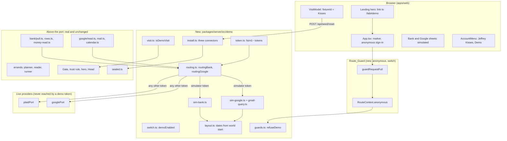

# Design Document: kiroween-demo

## Overview

This design builds Brief 054 (`docs/briefs/054-kiroween-demo.md`) as specified in `requirements.md`. Requirement criteria are cited as R*n.m*. Contract sections are cited as "C§n" (`docs/design/memory-contracts-v2.md`) and "MS§n" (`docs/design/memory-spec-v3.md`). `docs/design/` is read-only. Every departure from a contract or an earlier ruling is under [Contract questions](#contract-questions), numbered on from question 95, the last in any spec (`.kiro/specs/voice-control/design.md`).

A visitor presses **Kiroween Demo**. The browser signs in with Firebase anonymous sign-in, so each visitor has a tenant of their own. The reset route clones a second `SeedFixture`, Jeffrey Kisses, into that tenant, and installs a bank connector and the two Google connectors, each holding a sealed *simulator token*. A routing port, built from the live port and a simulator, sends every bank and Google call to the simulator when the unsealed token is a simulator token, and to the live provider otherwise. Everything above the port stays the real product.

Key decisions:

- **A demo tenant is an anonymous one, and the server reads that from the verified token on every request.** `TokenVerifier.verify` returns `{ uid, anonymous }`; `runRoute` puts `anonymous` on `RouteContext`. No body, no stored field, no browser value is read for it (R4).
- **Where there is no token, the connector answers.** The errand run endpoint and background jobs carry no `anonymous`. For those, a tenant is a demo visit when one of its three fixed connector documents unseals to a simulator token (`isDemoVisit`, R28.3). This is the only other source, and nothing is stored for it.
- **Tokens route, flags do not.** A simulator token is a plaintext inside the existing sealed token (`fsim1~<kind>~<fixtureId>~<worldStart>~<zone>`). The routing ports read the unsealed string only. A string with the marker that does not parse is refused and never forwarded (R10.6).
- **One authored list, two readers.** The fixture's bank, mail and calendar lines are built by the unchanged seed builder (the hero reads them) and served by the simulators through the unchanged pull and read code (`read_money` and the errands read them). Both sides date a line from the visit's world start, so the two agree to the cent and to the minute (R12).
- **Reads over a simulated connector use the world clock.** The ops clock stays for leases, freshness and deadlines (R28).
- **No new record kind, no new closed record schema.** Fixture line types gain optional fields. Two wire answers gain one optional field each (`simulated`). The connector records are the existing ones.
- **The switch fails closed.** `FRANKI_DEMO` must equal `on`. The guard refuses anonymous tokens otherwise, before any route logic (R15).

## Architecture



### What stays and what is new

| Above the port, untouched | New | Changed in place (small) |
|---|---|---|
| `bank/pull.ts`, `bank/rows.ts`, `bank/seal.ts`, `bank/connector.ts`, `google/read.ts`, `google/mail.ts`, `google/calendar.ts`, `google/rows.ts`, `google/port.ts`, `bank/plaid.ts`, the errand runner, planner, reader and `errands/gate.ts`, the Gate, `TAKEOUT_LATE_V1`, the Admission_Seam, the Clock_Port, `account/delete.ts`, `seed/load.ts`, `seed/live.ts` | `packages/server/src/demo/*`, `packages/server/src/seed/kisses/*`, `seed/pairing.ts`, `apps/web/src/app/api/demo/route.ts`, `apps/web/src/client/demo.ts`, `ui/demo/marker.ts`, `DemoButton`, `DemoSwitchLine`, `DemoLink` | fixture types and builder, guard and runtime, the two route files, reset, money read, Google agents, Head inputs, meet, tool offering, the voice reducer's tool list, and the web files in [The browser](#the-browser) |

## Module layout

Paths are from the repo root. "Calls" names the existing code that calls the new or changed function.

### Fixture types and the builder (part C0)

`packages/server/src/seed/fixture.ts` (changed). New optional fields only. Lines that omit them build exactly the rows they build today.

```ts
import type { BankCategory } from "@franki/core";

export interface DemoAccount {
  /** The provider-style account ID the simulator answers. 1 to 128 characters, unique in the profile. */
  accountId: string;
  name: string;            // at most 128
  mask: string | null;     // at most 8
  type: string;            // at most 32, for example "depository"
  subtype: string | null;  // at most 64
}

/** What marks a fixture as a demo fixture: the persona the visitor plays, and the simulated accounts behind it. */
export interface DemoProfile {
  /** The name the account menu shows. Pinned to the browser's `DEMO_NAME` by `scripts/kisses-fixture-id.test.ts`. */
  displayName: string;
  bank: {
    itemId: string;            // 1 to 128, stored as `BankConnection.itemId`
    institutionId: string;     // at most 64
    institutionName: string;   // at most 128, passes `safeName`
    accounts: DemoAccount[];   // 1 to BANK_ACCOUNTS_MAX (32)
  };
  google: {
    /** Jeffrey's invented address: the connector's `email`, and the From of his own sent mail. */
    email: string;
  };
}

export interface SeedFixture {
  id: string;
  origin: "authored" | "regenerated";
  windowDays: number;
  lines: SeedLine[];
  /** Present only on a demo fixture. Its presence is what pairs the fixture with an anonymous tenant (R5). */
  demo?: DemoProfile;
}

export interface BankLine {
  /* existing fields */
  /** Plaid's detailed category code, for `read_money`'s groups. Omitted: `bankCodeOf` takes the default. */
  code?: string;
  /** An `accountId` of `demo.bank.accounts`. Omitted: the first account. */
  account?: string;
}

export interface MailLine {
  /* existing fields */
  /** Gmail's DMARC verdict for the From domain. Omitted reads as "pass", as every seeded message does today. */
  dmarc?: "pass" | "fail" | "none";
  /** Inbound mail only: carries Gmail's UNREAD label. Omitted: read. */
  unread?: boolean;
}

/** The default detailed code of a category; "other" has none. */
export const DEFAULT_BANK_CODE: Readonly<Record<BankCategory, string | null>> = {
  takeout: "FOOD_AND_DRINK_FAST_FOOD",
  groceries: "FOOD_AND_DRINK_GROCERIES",
  restaurant: "FOOD_AND_DRINK_RESTAURANT",
  other: null,
};
export const bankCodeOf = (l: BankLine): string | null => l.code ?? DEFAULT_BANK_CODE[l.category];

/** The stored `senderAuth` of a mail line, from its `dmarc`: pass is "aligned", fail is "failed", none is "unknown". */
export const senderAuthOfLine = (l: MailLine): "aligned" | "failed" | "unknown" => (l.dmarc === "fail" ? "failed" : l.dmarc === "none" ? "unknown" : "aligned");
```

`packages/server/src/seed/build.ts` (changed). Called by `loadSeed` (`seed/load.ts`), which `resetVisit` calls. Changes:

- `buildMail`: `senderAuth: senderAuthOfLine(line)` in place of the literal `"aligned"` (same value when `dmarc` is omitted).
- `buildBank`: `accountKey: ids.key("account", line.account ?? "checking")` in place of `ids.key("account", "checking")`.
- New checks in `buildSeed`, each `fail("packetInvalid", line.id, …)`:
  1. A bank line's `amountCents` is an integer with `Math.abs(amountCents) <= BANK_CENTS_MAX` (all fixtures).
  2. A bank line's `code`, when present, matches `BANK_CATEGORY_CODE` and `bankCategoryOf(code) === line.category`.
  3. A bank line's `account`, when present, is in `fixture.demo.bank.accounts` (and `fixture.demo` exists).
  4. When `fixture.demo` exists: `accounts` are 1 to 32 with unique `accountId`; `google.email` passes `FIXTURE_ADDRESS`, the pattern of `ADDRESS` in `google/read.ts` copied into `build.ts` (that constant is module-private); every `fromSelf` mail line's `from.address` equals `google.email` (lower-cased); `displayName` passes `promotableName`.
  5. A calendar line's simulated event ID (`simEventId`, below) and a mail line's thread name are unique after mapping, so two lines never answer one Google ID.
- The Riley_Fixture sets none of the new fields, so `persona.test.ts` and `build.test.ts` pass unchanged.

`packages/server/src/seed/kisses/index.ts` (new; part C0 lands the stub, part E fills the lines):

```ts
export const KISSES_FIXTURE_ID = "seed-persona-kisses-v1-00000000000000000000"; // 23 + 20 = 43 characters
export const KISSES: SeedFixture = { id: KISSES_FIXTURE_ID, origin: "authored", windowDays: 21, lines: [...TURNS, ...MAIL, ...BULK, ...CALENDAR, ...BANK], demo: PROFILE };
```

The stub holds empty arrays and a placeholder profile that passes check 4. Files `turns.ts`, `mail.ts`, `bulk.ts`, `calendar.ts`, `bank.ts` and `profile.ts` mirror `seed/persona/`.

`packages/server/src/seed/persona/index.ts` (changed): `FIXTURES = new Map([[PERSONA.id, PERSONA], [KISSES.id, KISSES]])`. `seed/kisses/` imports only `../fixture`, so no cycle with `seed/persona/` (R6.8). `PERSONA_FIXTURE_ID` and the Riley lines are untouched.

### Pairing and reset (part C3)

`packages/server/src/seed/pairing.ts` (new):

```ts
import { scopeError } from "../routes/errors";
export function pairedFixture(anonymous: boolean | undefined, fixtureId: string, fixtures: ReadonlyMap<string, SeedFixture> = FIXTURES): SeedFixture {
  const f = fixtures.get(fixtureId);
  if (f === undefined) throw scopeError();
  if ((f.demo !== undefined) !== (anonymous === true)) throw scopeError();
  return f;
}
```

It is the one rule: a demo fixture goes to an anonymous tenant and only to one; a non-demo fixture goes to a non-anonymous tenant and only to one. A request whose `anonymous` is absent counts as not anonymous. The refusal is the same `scopeError` (404 SCOPE) as an unknown ID, so a probe learns nothing (R5.2, R5.3).

`packages/server/src/routes/seed-reset.ts` (changed). `seedReset(ctx, req, callStatus)` calls `pairedFixture(ctx.anonymous, req.fixtureId)` as its first line, before `ensureCoreDocs`, so a refusal writes nothing and raises no barrier (R5.4).

`packages/server/src/seed/reset.ts` (changed). `resetVisit(ctx, req, key)`:

1. `const fixture = pairedFixture(ctx.anonymous, req.fixtureId)` replaces `FIXTURES.get`, with the same `scopeError`. Tests that call `resetVisit` directly with a Riley request and no `anonymous` pass.
2. When `fixture.demo !== undefined`, before the fence: `const keys = sealKeysFrom(deps.env, BANK_ENV_VARS.tokenKey)` (a missing key is a `ConfigError`, answered CONFIG with nothing written).
3. After `worldStart` is known: `const demoDocs = fixture.demo === undefined ? null : buildDemoConnectors({ uid, hasher: deps.hasher, fixture, keys, worldStart, zone, opsNow: deps.clock.read().opsClock.now, core: { epoch: prior.epoch.data.epoch, policyRev: prior.epoch.data.policyRev } })`.
4. In the last transaction, `await resetBankCursors(tx, uid, ops)` becomes `demoDocs === null ? await resetBankCursors(tx, uid, ops) : await writeDemoConnectors(tx, uid, demoDocs)`. The three connector documents are written in the same transaction that clears the barrier (R11.1, R11.8).
5. Nothing else changes. `clearTenant` still skips the `connectors` collection and still keeps provider blocks (contract question 101).

### Auth, switch and flag (parts C0 and C1)

`packages/server/src/auth/guard.ts` (changed):

```ts
export interface TokenVerifier {
  /** `anonymous` is true exactly when the verified token's `firebase.sign_in_provider` is "anonymous". Absent reads false. */
  verify(idToken: string): Promise<{ uid: string; anonymous?: boolean }>;
}
export interface GuardResult { uid: string; anonymous: boolean }
export async function guardRequestFull(input: GuardInput, verifier: TokenVerifier, origins?: readonly string[], log?: GuardLog, opts?: { demoOn?: boolean }): Promise<GuardResult>;
/** Unchanged signature and behavior: `(await guardRequestFull(input, verifier, origins, log, { demoOn: true })).uid`. */
export async function guardRequest(input: GuardInput, verifier: TokenVerifier, origins?: readonly string[], log?: GuardLog): Promise<string>;
```

`guardRequestFull` runs the existing steps in the existing order, with one step added straight after a successful `verify` and the uid check: `if (anonymous && opts?.demoOn !== true) throw authError("demo off")`. It sits before the origin check and the body cap, so a refusal reads and writes nothing (R15.3, R15.4). `anonymous` is `r.anonymous === true`. `guardRequest` keeps `demoOn: true`, so the existing guard tests are unchanged.

`packages/server/src/auth/admin-verifier.ts` (changed): `return { uid: decoded.uid, anonymous: decoded.firebase?.sign_in_provider === "anonymous" }`. The claim is part of the token `verifyIdToken(idToken, true)` has just verified, revocation check included (R4.2). A token with no `firebase` claim, or another provider (`custom`, `google.com`, `password`), reads false (R4.5).

`packages/server/src/routes/runtime.ts` (changed). `RouteContext` gains `anonymous?: boolean` (part C0, type only). `runRoute` (part C1) calls `guardRequestFull({ method, header, bodyText, bodyCap }, deps.tokens, undefined, deps.log, { demoOn: demoEnabled(deps.env) })`, keeps `guarded = g.uid`, and builds the context as `{ uid: g.uid, deps, schedule, startedOpsAt, origin, anonymous: g.anonymous }`. Contexts built outside `runRoute` (`errandRunEndpoint`, webhooks, tests) leave `anonymous` absent.

`packages/server/src/demo/switch.ts` (new, part C0):

```ts
export const DEMO_ENV_VAR = "FRANKI_DEMO";
export const demoEnabled = (env: Env): boolean => env[DEMO_ENV_VAR] === "on";   // exactly "on": no trim, no case folding
export const demoStatus = (env: Env): { enabled: boolean } => ({ enabled: demoEnabled(env) });
```

Exported from `packages/server/src/index.ts` (C0). `apps/web/src/app/api/demo/route.ts` (new, C1):

```ts
import { demoStatus } from "@franki/server";
export const dynamic = "force-dynamic";
/** Whether the demo is on. No tenant, no auth, nothing else in the answer. */
export function GET() {
  return Response.json(demoStatus(process.env), { headers: { "cache-control": "no-store" } });
}
```

It uses no `adapt`, as `/api/health` does. `/api/health` is not changed (R15.7). `apps/web/apphosting.yaml` gains `- variable: FRANKI_DEMO` with `value: "on"` and `availability: [RUNTIME]` for the Kiroween deployment (R15.6). `scripts/sync-local-env.mjs` copies it into `.env.development.local` with the other plain values, so local dev has the demo on; it needs no change.

`packages/server/src/demo/guards.ts` (new, C1):

```ts
export function refuseDemo(ctx: Pick<RouteContext, "anonymous">): void;   // throws scopeError() when ctx.anonymous === true
export const DEMO_PHONE_LINE = "Phone calls aren't available in the demo.";
```

### Demo core (parts C0 and C2)

`packages/server/src/demo/token.ts` (new, C0). The simulator token and how it is told apart.

```ts
export const SIM_PREFIX = "fsim1~";
export const SIM_KINDS = ["bank", "refresh", "access"] as const;   // a bank access token; a Google refresh token; a Google access token
export type SimKind = (typeof SIM_KINDS)[number];
export interface SimToken { kind: SimKind; fixtureId: string; worldStart: number; zone: string }

/** `fsim1~<kind>~<fixtureId>~<worldStart>~<zone>`. Printable, no space, at most 128 characters. */
export function simToken(t: SimToken): string;

/** null: not a simulator token (it does not start with SIM_PREFIX). "malformed": it does, and does not parse. */
export function readSimToken(token: string): SimToken | "malformed" | null;
```

The grammar is `^fsim1~(bank|refresh|access)~([A-Za-z0-9_-]{43})~(\d{1,15})~([A-Za-z0-9_+/-]{1,64})$`, with `zone` also passing `isZone` from `@franki/core`. `~` is in none of the other classes, so the parse is unambiguous. Why a live token never reads as a simulator token: Plaid access tokens start `access-`, Google refresh tokens `1//` and access tokens `ya29.`, and `readSimToken` tests the prefix first. Why a simulator token never reaches a live port: the routing ports test `readSimToken` before anything else and treat `"malformed"` as a refusal. Why a visitor cannot make one: it is only ever stored sealed (AES-256-GCM, AAD bound to label, uid and connector ID), by `buildDemoConnectors`; the simulated access token exists in memory only, inside one read.

`packages/server/src/demo/visit.ts` (new, C0). The one place that answers "is this a demo visit when no token is at hand".

```ts
export interface VisitKey { uid: string; anonymous?: boolean; env: Env; hasher: Pick<Hasher, "id"> }

/** Whether one connector document's token, unsealed, is a simulator token. Never throws: a missing key, a bad seal or a disconnected document is false. */
export function connectorSimulated(env: Env, uid: string, doc: { id: string; data: Connector }): boolean;

/**
 * `k.anonymous` when it is defined (a verified token decided it, true or false: no connector is opened for false).
 * Otherwise true when any of the tenant's three fixed connector documents is simulated: `demoBankConnectorId`,
 * `googleConnectorId(..., "gmail")`, `googleConnectorId(..., "calendar")`. At most three point reads.
 */
export async function isDemoVisit(k: VisitKey, reader: Pick<Reader, "get">): Promise<boolean>;

/** The "now" a read measures from: the world clock on a demo visit, else the ops clock. */
export const readNow = (pair: ClockPair, demo: boolean): number => (demo ? pair.worldClock.now : pair.opsClock.now);
```

`demoBankConnectorId(hasher, uid)` is `hasher.id(["demo-connector", uid, "plaid"])`, exported from this file; `demo/install.ts` imports it. `connectorSimulated` opens a bank connector's token under label `franki-bank-token` and a Google connector's under `franki-google-token`, with the document's own ID as the AAD, through `unseal` (`sealed.ts`) and the key from `sealKeysFrom(env, "FRANKI_BANK_TOKEN_KEY")`, then `readSimToken(...)` is an object. Called by: `open.ts`, `audience-swap.ts`, `forget/executor.ts`, `bank/money-read.ts`, `errands/google-agents.ts`.

`packages/server/src/demo/config.ts` (new, C2). The settings a demo needs and no more (R10.11):

```ts
export function demoBankConfig(env: Env): BankConfig;      // { clientId: "demo", secret: "demo", environment: "sandbox", tokenKeys: sealKeysFrom(env, BANK_ENV_VARS.tokenKey) }
export function demoGoogleConfig(env: Env): GoogleConfig;  // placeholders for the OAuth fields, tokenKeys from the same key
```

The placeholders are only ever paired with a refusing live port (below), so they cannot reach a provider.

`packages/server/src/demo/layout.ts` (new, C2). Dates are laid out from the visit's world start, as `seed/build.ts` lays out a line:

```ts
export interface SimLayout {
  fixture: SeedFixture;      // has `demo`
  demo: DemoProfile;
  zone: string;
  worldStart: number;
  /** localDate(worldStart, zone): the clone's Friday. */
  friday: string;
  /** relInstant(friday, rel, zone) from seed/clock.ts. */
  at(rel: RelTime): number;
}
export function layoutOf(t: SimToken, fixtures?: ReadonlyMap<string, SeedFixture>): SimLayout | null;  // null: no such fixture, or no `demo`
```

### The simulated bank (part C2)

`packages/server/src/demo/sim-bank.ts` (new):

```ts
export const SIM_SYNC_PAGE = 100;
export function simulatedBank(fixtures?: ReadonlyMap<string, SeedFixture>): BankPort;
/** Every bank line as the provider's transaction, in (purchase instant, line ID) order. Exported for the Agreement property. */
export function simTransactions(layout: SimLayout): PlaidTransaction[];
/** `cents / 100`; centsOf(simAmount(c)) === c for every integer |c| <= BANK_CENTS_MAX. */
export const simAmount = (cents: number): number => cents / 100;
```

Every method first reads the token with `readSimToken`; a token that is not `kind: "bank"`, or whose `layoutOf` is null, throws `new BankCallError(null, true)` (a definite refusal). The `config` argument is ignored. No method calls `fetch` or reads `process.env`.

| Method | Answer |
|---|---|
| `linkToken`, `exchange` | `throw new BankCallError(null, true)`. Never reached by a visitor (R14.3). |
| `accounts(config, token)` | `{ itemId: demo.bank.itemId, institutionId: demo.bank.institutionId, institutionName: demo.bank.institutionName, accounts: demo.bank.accounts.map(toPlaidAccount) }` where `toPlaidAccount` maps `accountId` to `account_id`. |
| `sync(config, token, cursor)` | The transactions of `simTransactions(layout)`, paged `SIM_SYNC_PAGE` at a time. `cursor` is `null` or `sim:<n>` (`^sim:\d{1,6}$`, `n` at most the line count; anything else throws `BankCallError(null, true)`). The page holds items `n` to `n + 99` in `added`; `modified` and `removed` are empty; `nextCursor` is `sim:<n + page length>`; `hasMore` is true while that is below the total; `accounts` is the whole profile on every page; `updateStatus` is `"INITIAL_UPDATE_COMPLETE"` on a page with more after it and `"HISTORICAL_UPDATE_COMPLETE"` on the last. A sync from `sim:<total>` answers no additions, so the real `pullBank` writes nothing the second time (R8.4). |
| `remove(config, token)` | Resolves. No effect outside the process (R8.7). |

Each `PlaidTransaction` is built from a `BankLine` `l` and `layout`:

| Field | Value |
|---|---|
| `transaction_id` | `l.id` |
| `account_id` | `l.account ?? demo.bank.accounts[0].accountId` |
| `amount` | `simAmount(l.amountCents)` (Plaid's sign: a purchase positive, a refund or deposit negative) |
| `iso_currency_code` | `"USD"` |
| `authorized_datetime`, `authorized_date` | `new Date(layout.at(l.at)).toISOString()` and `localDate(thatMs, zone)` |
| `date`, `datetime` | Posted rows: the instant `layout.at({ day: l.at.day + 1, minute: 360 })`, as `buildBank` posts at 06:00 the next local day, and its civil date. Pending rows: `date` is the purchase date and `datetime` is null. |
| `pending` | `l.pending === true`; `pending_transaction_id` is null |
| `merchant_name`, `name` | `l.merchant` |
| `personal_finance_category` | `{ detailed: bankCodeOf(l) }`, or null when that is null |

`bankRowContent` (`bank/rows.ts`) then stores `purchaseAt.instant` equal to the seeded row's purchase instant, `postedAt` equal to its posting instant, the amount in the same cents and the same merchant text. `merchantKey` and `providerKey` differ from the seeded row's (they hash the connector, not the namespace), which is correct: two readers, two rows.

### The simulated Google (part C2)

`packages/server/src/demo/sim-google.ts` and `packages/server/src/demo/gmail-query.ts` (new):

```ts
export function simulatedGoogle(fixtures?: ReadonlyMap<string, SeedFixture>): GooglePort;

export interface SimMessage { id: string; threadId: string; line: MailLine; internalDate: number; labelIds: string[]; message: GmailMessage }
/** Newest first, ties by ID. IDs are `m` + the line's index among the fixture's mail lines in base 36, 4 digits: they fit `^[A-Za-z0-9]{1,64}$`. */
export function simMessages(layout: SimLayout): SimMessage[];

export interface SimEvent { id: string; line: CalendarLine; startMs: number; endMs: number; item: Record<string, unknown> }
/** The latest revision of each line, cancelled ones left out (Google answers none without showDeleted), in start order. */
export function simEvents(layout: SimLayout): SimEvent[];
/** `line.id` with every character outside [A-Za-z0-9_-] replaced by `_`: it fits Google's event ID. */
export const simEventId = (lineId: string): string => lineId.replace(/[^A-Za-z0-9_-]/g, "_");

// gmail-query.ts
export type QueryTerm =
  | { neg: boolean; op: "from" | "to" | "in" | "category" | "is" | "word"; value: string }
  | { neg: boolean; op: "after" | "before"; seconds: number };
export function parseGmailQuery(q: string): QueryTerm[] | null;   // null: not readable (an unknown shape): the port answers "refused"
export function matchesQuery(m: SimMessage, terms: readonly QueryTerm[]): boolean;
```

Every method reads its token first (`readSimToken`). The kind and the layout must fit the call, else `GoogleCallError("refused", true)`.

| Method | Token kind | Answer |
|---|---|---|
| `exchangeCode` | none | `throw new GoogleCallError("refused", true)`. Never reached (R14.4). |
| `refresh(config, refreshToken)` | `refresh` | `{ accessToken: simToken({ ...t, kind: "access" }), scope: [GMAIL_SCOPE, CALENDAR_SCOPE] }`. `google/read.ts` requires the provider's scope in the answer; both are present. |
| `revoke(token)` | `refresh` or `access` | Resolves. |
| `listMessages(accessToken, q, max)` | `access` | `parseGmailQuery(q)`, then the `simMessages` that `matchesQuery`, newest first, cut to `clamp(max, 1, MESSAGES_LIST_MAX)`, as `{ id, threadId }`. |
| `getMessage(accessToken, id)` | `access` | The `SimMessage.message` with that ID, or `GoogleCallError("notFound", true)`. |
| `listEvents(accessToken, { timeMin, timeMax, max, pageToken })` | `access` | The `simEvents` that overlap `[timeMin, timeMax)` (`startMs < timeMax && endMs > timeMin`), paged by the integer in `pageToken` (`PAGE_TOKEN` shape), `max` at a time (clamped to `EVENTS_LIST_MAX`), `timeZone` the layout's zone, `nextPageToken` set while more follow. |

**The Gmail query forms.** The mail agent builds its query with `gmailQuery` (`packages/core/src/google/index.ts`); the trust check sends `in:sent to:<address>`. The parser reads exactly these forms, each term separated by one space, all terms ANDed:

| Form | Sent by | Match |
|---|---|---|
| `from:"<name or address>"` | `gmailQuery`, `from` | Case-insensitive substring of the From header (display name or address). |
| `"<word>"` | `gmailQuery`, `words` (up to 5) | Case-insensitive substring of the subject, the plain body or the From header. |
| `after:<epoch seconds>`, `before:<epoch seconds>` | `gmailQuery`, `afterMs`, `beforeMs` | `internalDate >= seconds * 1000` and `internalDate < seconds * 1000`. |
| `is:unread` | `gmailQuery`, `unread` | The `UNREAD` label. |
| `-in:spam`, `-in:trash`, `-category:promotions`, `-category:social` | `gmailQuery`, always | Negated: the labels `SPAM`, `TRASH`, `CATEGORY_PROMOTIONS`, `CATEGORY_SOCIAL` are absent. |
| `in:sent` | `ownerHasMailed` | The `SENT` label. |
| `to:<address>` | `ownerHasMailed` | The address is in the `To` or `Cc` header's addresses (exact, lower-cased). |

Any other operator, or a term that does not parse, makes `parseGmailQuery` return null and the call answers `GoogleCallError("refused", true)`. This fails closed, and it means the real `gmailQuery` cannot start sending a form the simulator does not know without a test failing (property P16).

**A message** (`SimMessage.message`, a `GmailMessage` as `format=full` answers) is built from a `MailLine` `l`:

| Part | Value |
|---|---|
| `id`, `threadId` | `m<index>` and `t<index of the thread's first line>`, base 36 |
| `internalDate` | `layout.at(l.at)` |
| `labelIds` | Own mail (`l.fromSelf`): `["SENT"]`. Inbound: `["INBOX"]`, plus `"UNREAD"` when `l.unread`, plus `"CATEGORY_UPDATES"` when `l.bulk`. |
| `payload` | `{ mimeType: "multipart/alternative", headers, parts: [{ mimeType: "text/plain", body: { data: base64url(l.body), size } }] }` |
| headers | `From: "<name>" <address>`; `To: <l.to joined by ", ">`; `Subject`; `Date: <toUTCString of internalDate>`; `Message-ID: <id@sim.invalid>`; `In-Reply-To` when `l.inReplyTo` names a line (that line's `Message-ID`); for bulk mail `List-Id: <list.<from domain>>` and `List-Unsubscribe: <mailto:unsubscribe@<from domain>>` |
| `Authentication-Results` | Inbound mail with `dmarc` other than `"none"`: `mx.google.com; dmarc=pass (p=NONE) header.from=<domain>` for pass, `dmarc=fail (p=REJECT) header.from=<domain>` for fail. Own mail and `dmarc: "none"` have none. `senderAuthOf` (`google/mail.ts`) reads it as `aligned`, `failed` or `unknown`. |

`mailContent` (`google/mail.ts`) turns that into the same `subject`, `body`, `sender`, `recipient` and `occurredAtMs` the seed stored, with `fromSelf` from the `SENT` label and `bulk` from `bulkOf` (the `List-Id` header). So `senderMailed` (`google/read.ts`) runs unchanged: DMARC `aligned`, not bulk, and `ownerHasMailed`'s `in:sent to:<address>` finds one of Jeffrey's sent lines whose `To` holds the address (R13.3).

**An event** (`SimEvent.item`) is built from a `CalendarLine` `l` and its last revision `r`:

```ts
{
  id: simEventId(l.id), etag: `"sim-${l.revisions.length}"`, status: r.status, summary: l.title,
  start: { dateTime: iso(layout.at(r.start)) }, end: { dateTime: iso(layout.at(r.start) + r.minutes * 60_000) },
  organizer: { email: demo.google.email, self: l.organizerSelf }, creator: { email: demo.google.email, self: l.organizerSelf },
  attendees: r.selfResponse === "none" ? [] : [{ email: demo.google.email, self: true, responseStatus: r.selfResponse }],
  ...(r.transparency === "transparent" ? { transparency: "transparent" } : {}),
}
```

`eventContent` (`google/calendar.ts`) reads it as the same title, start, length, status, response and transparency as the seeded revision. An event the seed holds with older revisions answers only its last, as Google does.

### The routing ports (part C2)

`packages/server/src/demo/routing.ts` (new):

```ts
export function routingBank(live: BankPort, sim: BankPort = simulatedBank()): BankPort;
export function routingGoogle(live: GooglePort, sim: GooglePort = simulatedGoogle()): GooglePort;
/** The live half of a demo-only deployment: every method refuses. */
export const refusingBank: BankPort;      // throws BankCallError(null, true)
export const refusingGoogle: GooglePort;  // throws GoogleCallError("refused", true)
```

Per method, with `t = readSimToken(<the token argument>)`: `t === null` goes to `live`; an object goes to `sim`; `"malformed"` throws `BankCallError(null, true)` or `GoogleCallError("refused", true)` and calls neither. The token argument is `accessToken` for `accounts`, `sync` and `remove`; `refreshToken` for `refresh`; `token` for `revoke`; `accessToken` for `listMessages`, `getMessage` and `listEvents`. `linkToken`, `exchange` and `exchangeCode` carry no token, so they go to `live`: a Demo_Visit never reaches them, because the routes refuse first (R14.3, R14.4, R10.8).

**Where they are composed.** Only here:

- `packages/server/src/bank/routes.ts`: `bankRuntime(ctx)` becomes

  ```ts
  export function bankRuntime(ctx: RouteContext): BankRuntime {
    const { config, liveConfigured } = bankConfigFor(ctx.deps.env);
    return { port: ctx.deps.bank ?? routingBank(liveConfigured ? livePlaid : refusingBank), config };
  }
  function bankConfigFor(env: Env): { config: BankConfig; liveConfigured: boolean } {
    try { return { config: bankConfig(env), liveConfigured: true }; }
    catch (e) { if (e instanceof ConfigError && demoEnabled(env)) return { config: demoBankConfig(env), liveConfigured: false }; throw e; }
  }
  ```

  `bankStatus` calls `bankConfigFor(ctx.deps.env)` where it called `bankConfig(ctx.deps.env)`. A `deps.bank` override replaces the whole port, routing included, so every existing test is unchanged.
- `packages/server/src/google/routes.ts`: `googleRuntime(ctx)` likewise, with `googleConfigFor`, `routingGoogle(liveConfigured ? liveGoogle : refusingGoogle)` and `demoGoogleConfig`. `googleStatus` calls `googleConfigFor`.
- `packages/server/src/errands/agent.ts`: `errandAgentsOf(ctx)` registers `liveGoogleAgents()` when `googleConfigured(env) || demoEnabled(env)`.
- `packages/server/src/errands/google-agents.ts`: `readiness` returns `"unavailable"` only when `!googleConfigured(env) && !demoEnabled(env)`.

### The connectors at seed (part C3)

`packages/server/src/demo/install.ts` (new):

```ts
export interface DemoInstallInput {
  uid: string; hasher: Hasher; fixture: SeedFixture;   // fixture.demo is defined
  keys: SealKeys; worldStart: number; zone: string; opsNow: number;
  core: { epoch: number; policyRev: number };
}
export interface DemoConnectors { bank: { id: string; data: Connector }; gmail: { id: string; data: Connector }; calendar: { id: string; data: Connector } }

/** Pure apart from the random IV of each seal. */
export function buildDemoConnectors(x: DemoInstallInput): DemoConnectors;
/** For each document: `tx.get`, then `tx.update` keeping `createdAt` and `activeGeneration`, or `tx.create`. */
export async function writeDemoConnectors(tx: Tx, uid: string, docs: DemoConnectors): Promise<void>;
```

Called by `resetVisit` only. The three documents:

- **Bank** (`provider: "plaid"`): `state: "connected"`, `activeGeneration: 0`, `cursor: null`, `coverage: UNKNOWN_COVERAGE`, `lastSuccessAt: null`, `quota` released, `bank: { itemId, institutionId, institutionName, accounts, token: sealToken(keys, uid, id, simToken({ kind: "bank", fixtureId, worldStart, zone })), connectedAt: now, historicalComplete: true, problem: null, lastPullSkipped: { noCurrency: 0, badAmount: 0, badDate: 0 } }`, `google: null`. `accounts` are `demo.bank.accounts` as `BankAccount`. With `historicalComplete: true` the sheet shows a connected bank with its accounts, and with `lastSuccessAt: null` the first `read_money` runs `pullIfStale`, which pulls, so the rows arrive through the real pull.
- **Gmail and Calendar**: `newGoogleConnector(uid, provider, opsNow, core)` with `state: "connected"` and `google: { accountKey: googleAccountKey(hasher, uid, "sim:" + fixtureId), email: demo.google.email, granted: true, token: seal("franki-google-token", keys, uid, googleConnectorId(hasher, uid, provider), simToken({ kind: "refresh", ... })), connectedAt: now, pending: null }`. `isReadableGoogle` is true for both.

**Start over.** The reset calls `buildDemoConnectors` again with the new `worldStart` and `zone`, so the sealed tokens carry the new visit's values and no earlier token stays (R11.5). The documents keep their IDs (they are functions of `uid`), `createdAt` and `activeGeneration`; their `rev` is raised by the store. Rows the earlier visit imported are cleared with the rest of the evidence; the first read imports again.

**Account delete and sign-out.** `account/delete.ts` is unchanged. It lists connectors, calls `disconnectBank` for each with a token and `disconnectGoogle` once. Those call `bankRuntime(ctx)` and `googleRuntime(ctx)`, so `port.remove(...)` and `port.revoke(...)` get an unsealed simulator token and go to the simulators (R16.2, R16.3). The refusal guards sit in the route specs, not in `disconnectBank` and `disconnectGoogle`, so this internal path works for an anonymous `ctx`. `deleteUser` removes the Firebase user. The browser calls delete, then signs out (see [The browser](#the-browser)).

### Head, first meeting and tool offering (part C4)

**Plays owner.** `packages/core/src/owner-name.ts` (changed):

```ts
function restsOnOwnerWords(m: Memory, snapshot: Snapshot, playsOwner = false): boolean;
// playsOwner: every Evidence the Memory names is in the Snapshot, whatever its source. Otherwise as today.
export function ownerName(input: { memories: readonly HeadMemory[]; ec: EC; snapshot: Snapshot; audience?: Au; playsOwner?: boolean }): OwnerName | null;
export function ownerNamed(input: { memories: readonly HeadMemory[]; ec: EC; snapshot: Snapshot; audience?: Au; playsOwner?: boolean }): boolean;
```

`packages/core/src/head.ts` (changed): `HeadInput.playsOwner?: boolean`; `compileHead` passes it to both calls, and the line `if (isSelfNameRow(hm.memory) && restsOnlyOnFixture(hm.memory, input.snapshot)) continue;` becomes `... && input.playsOwner !== true`. Audience rules are untouched: the name still reaches only a private Head. With `playsOwner` absent or false, `compileHead` returns exactly what it returns today (P13).

`packages/server/src/head-build.ts` (changed): `buildHead(reader, uid, core, clock, generation, audience?, playsOwner?)`, passing `...(playsOwner === true ? { playsOwner: true } : {})` to `compileHead`. Every call site computes `demo = await isDemoVisit({ uid, anonymous: ctx.anonymous, env: deps.env, hasher: deps.hasher }, reader)`:

| Call site | Change |
|---|---|
| `routes/open.ts` (the `buildHead` call in the open's transaction) | pass `demo` as the last argument; compute it before the transaction |
| `audience-swap.ts`, `precompileAudienceHead(ctx: Pick<RouteContext, "uid" \| "deps" \| "anonymous">, ...)` | compute `demo` inside its `readSnapshot` reader, pass it |
| `audience-swap.ts`, `withNarrowHead(tx, uid, eff, x)` | `x` gains `playsOwner?: boolean`; passed through; `routes/turn.ts` supplies it |
| `onturn/execute.ts`, `recompiled(run, ...)` | `CompileRun` (a `Pick` of `HardRuleRun`) gains `"playsOwner"`; `HardRuleRun.playsOwner?: boolean`; every `HardRuleRun` built in `routes/turn.ts` sets it from the turn's `demo` |
| `forget/executor.ts`, `compileCleared(deps, uid, ...)` | `ForgetDeps` gains `env?: Env` and `anonymous?: boolean`; `forget/drive.ts` `forgetDeps(ctx)` sets both from `ctx`; `compileCleared` calls `isDemoVisit` (tokenless: the connectors answer) |

**First meeting.** `packages/server/src/meet.ts` (changed): `MeetConditions.demo?: boolean`, and `mayAsk` gains `&& c.demo !== true`. `routes/open.ts` sets `demo` in both objects it builds for `meetSessionsToRead` and `meetOffer`. With `demo` true, `meetOffer` returns null, so no first-meeting line is said and no delivery row is written for it. `closeMeet` still runs when `compiled.ownerNamed` is true (R7.2). The Sample_Visit's conditions have `demo` absent, so M-1 holds for it (R7.3).

**Tool offering.**

- `packages/core/src/voice/machine.ts` (changed): `VoiceState.phoneOff?: boolean` (beside `lastSpeechAt`: read outside nothing, never reset by an exit, set once at construction); `initialVoiceState(config, zone = "UTC", opts: { phoneOff?: boolean } = {})` sets it only when true; `Capabilities` gains `phoneOff?: boolean`; `callTools(st)` removes `make_phone_call`, `read_phone_result` and the activity variant when `st.phoneOff === true`, and returns today's list otherwise. The tool list is therefore without phone from the first `session.update`, before any state poll. A transition test `CLOSED + connect -> CONNECTING (phoneOff kept)` pins that no exit clears it. `docs/machines/voice-call.md` gains the field in its reset table (state-machine rule 6).
- `packages/server/src/errands/agent.ts` (changed, built by C3 with the rest of that file): `specialistCatalog(ctx)` skips the `dialConfig` check when `ctx.anonymous === true`, so `phone` stays `"unavailable"`; mail and calendar are read from the connectors as for any account, and are `"ready"` on a demo visit.
- `packages/server/src/phone/outbound.ts` (changed): `placePhoneCall(ctx, stamp)` begins `if (ctx.anonymous === true) return DEMO_PHONE_LINE;`, before `dialConfig`, the claim and any ledger row. It is the one function both callers use (`routes/tool.ts` and `phone/typed.ts`), so no dial, no `phoneCall` row and no `deps.dial` call can follow (R14.2).
- `packages/server/src/routes/typed-reply.ts` (changed): the fifth parameter of `typedReplyRequest` and `typedReplyOutcome`, `allowPhone: boolean`, becomes `allow: boolean | TypedTools` with `interface TypedTools { phone: boolean; money: boolean }`. `true` means both, so every existing caller and test is unchanged. The tool list is `[phone && PHONE_TOOL, money && MONEY_TOOL, phone && READ_PHONE_TOOL]` in today's order; the `read_phone_result` and `make_phone_call` outcomes need `phone`; the `readMoney` outcome needs `money`. `routes/turn.ts` passes `{ phone: typed && ctx.anonymous !== true, money: typed }` with `typed = cls.cls === "U" && req.source === "typed"`.
- Errands stay call-only: nothing in the typed path offers `start_errand` (R19.6).

### Money read and Google agents on the world clock (part C3)

`packages/server/src/bank/money-read.ts` (changed). In `readMoney`: `const demo = await isDemoVisit({ uid, anonymous: ctx.anonymous, env: deps.env, hasher: deps.hasher }, reader)` after the connectors are listed; then `const now = readNow(pair, demo)` replaces `pair.opsClock.now` as the `now` handed to `moneyPeriod` and `moneyAnswer`. The freshness line keeps the ops clock: `freshnessLine(oldest, pair.opsClock.now)`. `freshen` (the pulls and their deadline) is untouched.

`packages/server/src/errands/google-agents.ts` (changed). `googleNow(ctx)` becomes `const demo = await isDemoVisit({ uid: ctx.uid, anonymous: ctx.anonymous, env: ctx.deps.env, hasher: ctx.deps.hasher }, reader); return { nowMs: readNow(pair, demo), zone: core.state.data.currentZone }`. Its two callers (`search_mail` and `inCalendarZone`) are unchanged. Inside the errand run endpoint `ctx.anonymous` is absent, so the Gmail connector answers. The module's comment on review fix E3 is updated to say a *live* account reads on the ops clock.

`bank/routes.ts` `bankStatus(ctx)`: `canConnect: ctx.anonymous === true ? false : canConnectMore(all)`, and the answer carries `...(ctx.anonymous === true ? { simulated: true as const } : {})`. `google/routes.ts` `googleStatus(ctx)` likewise adds `simulated: true`. The route specs `bankLinkTokenRoute`, `bankConnectRoute`, `bankDisconnectRoute`, `googleStartRoute`, `googleConnectRoute` and `googleDisconnectRoute` become `run: (ctx, req) => { refuseDemo(ctx); return <the function>(ctx, req); }`.

## Data changes

### Fixture types

As in [Fixture types and the builder](#fixture-types-and-the-builder-part-c0): `SeedFixture.demo`, `DemoProfile`, `DemoAccount`, `BankLine.code`, `BankLine.account`, `MailLine.dmarc`, `MailLine.unread`. Nothing stored changes shape. The seeded Evidence of a Riley line is byte-equal to today's.

### The simulator token

`fsim1~<kind>~<fixtureId>~<worldStart>~<zone>`, for example `fsim1~refresh~seed-persona-kisses-v1-00000000000000000000~1767254400000~America/Chicago`. Stored sealed in the existing fields: `Connector.bank.token` (label `franki-bank-token`) and `Connector.google.token` (label `franki-google-token`), both `SealedToken` (`records.ts`, body up to 4,096 characters; a simulator token is about 110). The seal binds label, uid and connector ID (`sealed.ts`). `access` tokens are never stored.

### The flag on the route context

`RouteContext.anonymous?: boolean` (not a wire field). Set by `runRoute` from the guard; absent elsewhere. `ForgetDeps` gains `env?: Env` and `anonymous?: boolean`. No stored field anywhere holds "demo" (R4.4, R4.8).

### Wire fields and the closed-schema changes

In `packages/core/src/schema/wire.ts`, the two status answers become unions, the pattern the file already uses for answers that gained a field (`StateRequest`):

```ts
export const BankStatusResponse = union(
  obj({ banks: arr(BankView, 64), canConnect: bool, simulated: literal(true) }),
  obj({ banks: arr(BankView, 64), canConnect: bool }),
);
export const GoogleStatusResponse = union(obj({ google: GoogleView, simulated: literal(true) }), obj({ google: GoogleView }));
```

`simulated` is present only when true, so every existing answer, test and recorded fixture still validates. The closed schemas that change are `BankStatusResponse` and `GoogleStatusResponse` and no other. `BankView`, `GoogleView`, `Connector`, `Evidence` and every record schema are unchanged. `SpecialistCatalog` is unchanged.

## The seed: Start over, delete and sign-out

| Event | What happens |
|---|---|
| First press | The browser signs in anonymously and runs the usual first reset with `fixtureId: KISSES_FIXTURE_ID`. `seedReset` checks pairing, `ensureCoreDocs` writes the core documents, `resetVisit` fences, closes calls, clears, loads the Kisses lines, builds the connector documents and writes them with the core documents in the last transaction. |
| First `read_money` | `readableBankIds` finds the bank connector (`isActiveBank`: state `connected`, token present). `freshen` calls `pullIfStale`; `lastSuccessAt` is null, so `pullBank` runs against `routingBank(...)`, which sends the unsealed `fsim1~bank~...` token to the simulator. The rows arrive as `source: "plaid"` Evidence. |
| Start over | `VisitModel.reset` sends `fixtureId: KISSES_FIXTURE_ID` again with a new `visitId`. The same steps run: a new namespace, clear (connectors are skipped by `clearTenant`), reload, and the three connector documents are rewritten with tokens for the new world start and zone. |
| Delete my data and sign-out | See [The browser](#the-browser). `deleteAccount` removes simulated connections through the simulators, deletes the tenant, deletes the Firebase user, deletes the tenant again. |

## Guards

One row per route or tool. "Demo" means `ctx.anonymous === true`. The refusal for a demo visit is `scopeError()` (404 `SCOPE`, no body detail) unless another answer is named. The guard step in `guardRequestFull` comes first for every route.

| Route or tool | Demo visit | Anyone else |
|---|---|---|
| Any route, switch off (`FRANKI_DEMO` is not `on`) | 401 `AUTH` (`authError("demo off")`) in `guardRequestFull`, before the origin check, the body cap, parse or any store call | unchanged |
| `GET /api/demo` | not a guarded route: answers `{ enabled }` to anyone | same |
| `POST /api/seed/reset` | Kisses ID: proceeds. Any other ID: 404 `SCOPE` before `ensureCoreDocs` | Kisses ID: 404 `SCOPE`. Other IDs: as today |
| `POST /api/seed/advance` | proceeds (the bolts) | as today |
| `POST /api/bank/link-token` | 404 `SCOPE` | as today |
| `POST /api/bank/connect` | 404 `SCOPE` | as today |
| `POST /api/bank/disconnect` | 404 `SCOPE` | as today |
| `POST /api/bank/sync` | proceeds: `pullBank` over the simulator | as today |
| `GET /api/bank/status` | proceeds; `canConnect: false`, `simulated: true` | as today |
| `POST /api/google/start` | 404 `SCOPE` | as today |
| `POST /api/google/connect` | 404 `SCOPE` | as today |
| `POST /api/google/disconnect` | 404 `SCOPE` | as today |
| `GET /api/google/status` | proceeds; `simulated: true` | as today |
| `POST /api/account/delete` | proceeds; disconnects go to the simulators; the user is deleted | as today |
| Tool `make_phone_call` (`POST /api/tool`) and a typed phone request (`phone/typed.ts`) | `placePhoneCall` returns `DEMO_PHONE_LINE`: no claim, no `phoneCall` row, no `deps.dial` | as today |
| Typed turn tools | `{ phone: false, money: true }` | `{ phone: true, money: true }` for a typed owner line |
| Call tool list (`callTools`) | no `make_phone_call`, `read_phone_result` or activity variant, from the first `session.update` | as today |
| `POST /api/session/state` (the specialist catalog) | `phone: "unavailable"`; `mail` and `calendar` from the connectors | as today |
| Tool `read_money` | proceeds; world clock | as today |
| Tool `start_errand`, `POST /api/errand/run` | proceeds; the run reads the connectors; the world clock follows the Gmail connector | as today |
| Tool `search_web` | as for any visit | as today |
| Twilio and OpenAI phone webhooks, `POST /api/errand/run` (capability-signed) | not tenant requests; unchanged | unchanged |

The browser's `isAnonymous` only drops phone tools from the list it offers (`phoneOff`); the server refuses the call whatever the browser offers.

## The browser

All paths are under `apps/web/src/`. Copy lives in `ui/copy.ts` (Lab) and `ui/copy-landing.ts` (landing), is sentence case, and has no Banned_Cause_Words (`scripts/copy-check.mjs`).

**`client/demo.ts` (new).**

```ts
export const KISSES_FIXTURE_ID = "seed-persona-kisses-v1-00000000000000000000";
export const DEMO_NAME = "Jeffrey Kisses";
export const DEMO_HASH = "#demo";
export const DEMO_HREF = "/lab#demo";
export const DEMO_PATH = "/api/demo";
export const hasDemoMarker = (hash: string): boolean => hash === DEMO_HASH;
/** GET /api/demo. true only for { enabled: true } as the closed shape; any failure or other answer is false. */
export function fetchDemoEnabled(fetchFn: (input: string, init: RequestInit) => Promise<Response>): Promise<boolean>;
```

`scripts/kisses-fixture-id.test.ts` (new) imports `KISSES_FIXTURE_ID` and `DEMO_NAME` from here and `KISSES` from `packages/server/src/seed/kisses`, and fails if the ID or `KISSES.demo.displayName` differs (R3.3, R6.7), as `scripts/persona-fixture-id.test.ts` does for the first fixture.

**The button.**

- `components/landing/DemoLink.tsx` (new): a client component. An effect calls `fetchDemoEnabled(fetch)`; until it answers true it renders nothing (R1.3). Then it renders `<a href={DEMO_HREF}>` with the label `LANDING.hero.demo`, the same brass target and focus classes as the hero's other link. `landing/Hero.tsx` renders it beside its two links. `TopBar.tsx` is not changed (R1.1). It imports nothing from Firebase.
- `components/DemoButton.tsx` (new, in the Lab, not under `landing/`): a `<button>` with `COPY.demo.button` ("Kiroween Demo"). `AuthPanel.tsx` gains optional `demoEnabled?: boolean` and `onDemo?: () => void`, and renders the button under the Google button when both are set. Existing tests pass the old props.

**The marker, in `components/App.tsx` (changed) with the pure decision in `ui/demo/marker.ts` (new).**

```ts
export type MarkerAction = "none" | "clear" | "signInAnonymously" | "offerSwitch";
/** Decides what to do with `/lab#demo`. Never "signInAnonymously" while a non-anonymous user is signed in. */
export function markerAction(x: { hash: string; auth: "loading" | "signedOut" | "signedInReal" | "signedInDemo"; enabled: boolean | null }): MarkerAction;
```

| hash | auth | enabled | action |
|---|---|---|---|
| not `#demo` | any | any | `none` |
| `#demo` | `loading` | any | `none` (wait) |
| `#demo` | any | `null` (not answered) | `none` (wait) |
| `#demo` | any | `false` | `clear` |
| `#demo` | `signedOut` | `true` | `signInAnonymously` |
| `#demo` | `signedInDemo` | `true` | `clear` |
| `#demo` | `signedInReal` | `true` | `offerSwitch` |

`App.tsx` fetches `fetchDemoEnabled` once, runs `markerAction` in an effect when the auth state or the answer changes, and acts once (a ref guards a second run): `signInAnonymously` calls `auth.signInAnonymously()` and then `history.replaceState(null, "", location.pathname + location.search)` to remove the marker (R2.6); `clear` removes the marker; `offerSwitch` shows `DemoSwitchLine` and leaves the marker until the press or a dismissal by leaving. The signed-out panel's `onDemo` calls the same sign-in.

`components/DemoSwitchLine.tsx` (new): one line of text and one brass button, "Sign out and open the demo" (`COPY.demo.switchButton`). Its press runs the app's existing `signOut()` (closes calls and Sessions, waits at most `SIGN_OUT_LIMIT_MS`, signs out) and then `auth.signInAnonymously()`; only that press does (R2.7).

**Anonymous sign-in, `client/auth.ts` (changed).** `AuthState` signed-in gains `anonymous?: true`. `AuthClient` gains `signInAnonymously(): Promise<{ cause: SignInFailure; message: string } | null>` (Firebase's `signInAnonymously(auth)`; a failure is `providerError` with `DEMO_SIGN_IN_FAILED` and `providerDetail(code)`, never a token). In `App.tsx`'s `subscribe`: an anonymous user becomes `{ kind: "signedIn", email: DEMO_NAME, uid, anonymous: true }` (so `"(no email)"` is not shown, R3.2) and every other user is as today. `tokens` carries `anonymous: user.isAnonymous`.

**The visit's fixture.** `components/app-controllers.ts`: `ControllerDeps` gains `fixtureId?: string` and `demo?: boolean`; `VisitModel` gets `fixtureId`, `VoiceClient` gets `phoneOff: deps.demo`. `client/visit-model.ts`: `VisitModelDeps.fixtureId?: string`, and `reset()` sends `fixtureId: this.deps.fixtureId ?? PERSONA_FIXTURE_ID`. `App.tsx` passes `fixtureId: KISSES_FIXTURE_ID, demo: true` when `tokens.anonymous` and nothing otherwise. `client/voice-client.ts`: `VoiceClientDeps.phoneOff?: boolean` passed as the third argument of `initialVoiceState` (part D2, after C4).

**The account menu.** `components/AccountMenu.tsx` gains `demo?: boolean`; the trigger shows `email` (which is `DEMO_NAME`) and a small mark `COPY.demo.mark` ("Demo"). `AuthPanel` passes `demo={state.anonymous === true}`. Sign out and Delete my data stay.

**Sign-out and delete on a demo visit.** In `App.tsx` `signOut()`: after the existing `Promise.race` that closes the call and the typed Session, `if (state.kind === "signedIn" && state.anonymous === true && signedIn !== null) await Promise.race([deleteAccountCall(signedIn.api), limit])` with a fresh `SIGN_OUT_LIMIT_MS` timer, then `await auth.signOut()` whatever happened (R16.1, R16.5). `deleteAccount()` (Delete my data) is unchanged: on success it signs out.

**The two sheets.**

- `client/api.ts` `bankStatus` and `client/google-api.ts` `googleStatus` return `simulated: true` in their answers when the validated body carries it, and nothing when it does not.
- `ui/bank/bank-machine.ts`: `BankStatusAnswer` gains `simulated?: true`; `BankState` gains `simulated?: true` (absent in `INITIAL_BANK`, so existing state comparisons hold), set by the status event; `canStartLink(s)` is false when `s.simulated`. `ui/google/google-machine.ts`: the same for `GoogleStatusAnswer` and `GoogleState`, and `canConnectGoogle(s)` is false when `s.simulated`.
- `components/bank/BankSheet.tsx`: when `state.simulated`, shows `COPY.bank.simulated` and omits each bank's Disconnect button. Connect already needs `canStartLink`. `components/google/GoogleSheet.tsx`: when `state.simulated`, shows `COPY.google.simulated`, omits Disconnect, and omits the in-app browser hint and the list of Google's scopes (nothing is asked). `BankWayIn` and `GoogleWayIn` are unchanged: they open the sheets.
- Docs: `docs/machines/bank.md`, `google.md`, `visit.md` and `landing.md` gain the new fields and rows in the same change (state-machine rule "the index stays true").

Proposed copy (part D writes the final words and runs `scripts/copy-check.mjs`): `COPY.demo.button` "Kiroween Demo"; `COPY.demo.mark` "Demo"; `COPY.demo.switchLine` "You're signed in as yourself, and the demo is a separate visit."; `COPY.demo.switchButton` "Sign out and open the demo"; `COPY.bank.simulated` "This bank is simulated. No real bank is connected."; `COPY.google.simulated` "This mail and calendar are simulated. No real Google account is connected."; `DEMO_SIGN_IN_FAILED` "The demo didn't start. Try again in a moment."

## Correctness Properties

Each property is one fast-check file, 1,000 runs, with the header the other property files use. A fix starts as an `it.fails` case with its seed (state-machine rules). `scripts/property-guard.mjs` blocks edits to committed property files. Generators draw zones from `SEED_ZONES` (`testing/seed.ts`) and world starts from `cloneWorldStart` over arbitrary instants.

1. **Agreement, bank.** For any fixture bank line set, zone, period, group and merchant, the total that `moneyAnswer` gives over the rows `bankRowContent` builds from every page of `simulatedBank().sync` equals the sum of `amountCents` of the fixture bank lines that are posted, ordinary (`codeKind`), dated in the period, in the group (`groupMatches`) and, when a merchant is asked, named that merchant; and `centsOf(simAmount(c)) === c` for every integer `|c| <= BANK_CENTS_MAX`. Validates R8.3, R8.9, R12.2, R12.6. File `packages/server/src/demo/agreement-bank.property.test.ts`.
2. **Agreement, mail and calendar.** For any Kisses mail or calendar line and any world start and zone, the `GmailMessage` or event the simulator answers, read by `mailContent` or `eventContent`, has the same sender, address, subject, body, instant, recipients, title, start, length, status, response and transparency as the Evidence `buildMail` or `buildCalendar` builds for that line (a calendar line's last revision). Validates R9.4, R9.5, R12.3, R12.4. File `packages/server/src/demo/agreement-google.property.test.ts`.
3. **No crossing.** For any sequence of calls to `routingBank` or `routingGoogle` with tokens drawn from simulator tokens (every kind), live-shaped tokens (`access-sandbox-…`, `1//…`, `ya29.…`) and strings with the marker that do not parse, a call whose token reads as a simulator token reaches only the simulator, a call whose token has no marker reaches only the live port, and a call whose token is malformed reaches neither and throws a definite refusal. Validates R10.2, R10.3, R10.5, R10.6, R10.9. File `packages/server/src/demo/no-crossing.property.test.ts`.
4. **Token shape.** For any `SimToken`, `readSimToken(simToken(t))` equals `t`; for any string without the prefix, `readSimToken` is null; for any string with the prefix that is not `simToken` of some `SimToken`, it is `"malformed"`; and no `simToken` output matches the shape of a Plaid or Google token. Validates R10.4, R10.5. File `packages/server/src/demo/token.property.test.ts`.
5. **Pairing.** For any reset request (any fixture ID drawn from `FIXTURES` and unknown IDs, any `anonymous` of true, false or absent), `pairedFixture` returns a demo fixture exactly when `anonymous` is true and the fixture has `demo`, returns a non-demo fixture exactly when `anonymous` is not true and the fixture is in `FIXTURES`, and otherwise throws `scopeError`; and through `seedResetRoute` an anonymous tenant ends with the Kisses fixture or nothing written, and a non-anonymous tenant never holds a row of the Kisses fixture. Validates R5.1, R5.2, R5.3, R5.4, R5.5. File `packages/server/src/seed/pairing.property.test.ts`.
6. **No way out.** For any sequence of tool calls (`make_phone_call`, `read_money` with any `MoneyArgs`, `start_errand` with any `about`, `read_phone_result`, `search_web`) and route calls (`bank/link-token`, `bank/connect`, `bank/disconnect`, `google/start`, `google/connect`, `google/disconnect`) made as an anonymous tenant over a rig whose `dial` and live ports are recorders, the recorders hold no call and no `phoneCall` row is written. Validates R14.2, R14.3, R14.4, R14.7, R14.8, R16.3. File `packages/server/src/demo/no-way-out.property.test.ts`.
7. **Trust.** For any Kisses mail line `L`, the sender the mail agent registers for `L` over the simulator is mailed exactly when `L.fromSelf`, or `L.dmarc` is not `"fail"` or `"none"`, `L` is not bulk, and some Kisses line with `fromSelf` has `L.from.address` in its `to`; and the Gate's decision to speak or card a line citing `L` equals what the taint rule (`errands/gate.ts`) gives for that sender. Validates R13.3, R13.5, R13.6, R22.2. File `packages/server/src/demo/trust.property.test.ts`.
8. **Taste.** For any string field of the Kisses fixture (turn text, mail names, addresses, subjects and bodies, thread names, calendar titles, bank merchants and the demo profile), no word of the Denied_List appears, compared after NFKC normalisation and case folding on word boundaries. Validates R25.1, R25.2. File `packages/server/src/demo/taste.property.test.ts`.
9. **Taste scanner is sound.** For any Denied_List word, any string and any insertion point, the scanner flags the string with the word inserted at a word boundary, and flags no string that holds none of the words. Validates R25.2. File `packages/server/src/demo/taste-scanner.property.test.ts`.
10. **The flag comes from the token.** For any verified claim set (`firebase.sign_in_provider` any string or absent) and any request body, query and headers, the `anonymous` the guard reports is true exactly when the provider is `"anonymous"`, and it does not change when the body, query or other headers change. Validates R4.1 to R4.5. File `packages/server/src/auth/anonymous-flag.property.test.ts`.
11. **The switch fails closed.** For any value of `FRANKI_DEMO` (any string or absent), `demoEnabled` is true exactly when the value is `"on"`; and for any request with an anonymous token while the value is not `"on"`, `runRoute` answers 401 `AUTH` and the store records no read and no write; while a non-anonymous token is unaffected. Validates R15.1, R15.3, R15.4, R15.5. File `packages/server/src/demo/switch.property.test.ts`.
12. **The world clock decides by token, then by connector.** For any `RouteContext.anonymous` of true, false or absent, and any set of the three connector documents (each simulated, live or missing), `isDemoVisit` is `anonymous` when it is defined, opens no connector when it is false, and otherwise is true exactly when some document unseals to a simulator token; and `readNow` is the world clock exactly then. Validates R4.8, R28.1, R28.2, R28.3, R28.5. File `packages/server/src/demo/world-clock.property.test.ts`.
13. **Plays owner changes nothing else.** For any `HeadInput`, `compileHead` with `playsOwner` absent or false returns a result equal to today's; with `playsOwner` true, the name line appears exactly when a self name Memory of a promotable text passes the Head's filter for a private audience, whatever its Evidence source; and no company or unknown audience Head holds a name. Validates R7.1, R7.3, R7.4, R7.8. File `packages/core/src/plays-owner.property.test.ts`.
14. **No first meeting for Jeffrey.** For any `MeetConditions` and any delivery rows, `meetOffer` returns null when `demo` is true, and returns what it returns today when `demo` is absent or false. Validates R7.2, R7.3, R7.9. File `packages/server/src/demo/first-meeting.property.test.ts`.
15. **Start over reinstalls.** For any sequence of Kisses resets with any world starts and zones, after each reset the three connector documents are connected, each unseals to a simulator token whose `worldStart` and `zone` equal that reset's, their `createdAt` is the first reset's, and the bank rows imported by the next pull carry the dates of the seeded rows laid out from that reset's world start. Validates R11.1, R11.5, R11.7, R11.8. File `packages/server/src/demo/reinstall.property.test.ts`.
16. **The simulator reads the queries the product writes.** For any `MailQuery` and any Kisses fixture, `listMessages` over `gmailQuery(q)` returns exactly the messages an oracle selects (From substring, words in subject, body or From, `after` and `before` in epoch seconds, `is:unread`, the four exclusions), newest first and cut to `max`; and `in:sent to:<a>` returns exactly the sent lines whose recipients hold `a`. Validates R9.3, R13.3. File `packages/server/src/demo/gmail-query.property.test.ts`.
17. **Typed tools split.** For any pair of flags `{ phone, money }` and any `boolean`, `typedReplyRequest(...).tools` holds `make_phone_call` and `read_phone_result` exactly when phone is allowed and `read_money` exactly when money is allowed, in today's order, and `true` gives today's list. Validates R14.1. File `packages/server/src/routes/typed-tools.property.test.ts`.
18. **The phone is not offered on a call.** For any `VoiceState` with `phoneOff` true, `callTools` returns no `make_phone_call`, no `read_phone_result` and no activity variant, whatever `specialists`, `errandsReady` and `webSearchStatus` are; and with `phoneOff` absent it returns today's list. Validates R14.1. File `packages/core/src/voice/phone-off.property.test.ts`.
19. **Delete leaves nothing and calls nothing live.** For any Kisses tenant state (with or without imported rows, one or several resets), `POST /api/account/delete` makes no call to a live port, leaves no document under the tenant, deletes the user once, and a second call is harmless. Validates R16.2, R16.3. File `packages/server/src/demo/delete.property.test.ts`.
20. **The marker never replaces a real user.** For any hash, auth state and switch answer, `markerAction` is `signInAnonymously` only when the hash is `#demo`, the user is signed out and the switch is on; is `offerSwitch` only when a non-anonymous user is signed in; and is `none` or `clear` otherwise. Validates R2.6, R2.7, R2.8. File `apps/web/src/ui/demo/marker.property.test.ts`.
21. **A simulated sheet offers no way out.** For any sequence of bank status answers, and for any sequence of Google status answers, once an answer carries `simulated` the bank state's `canStartLink` and the Google state's `canConnectGoogle` are false, and a later answer without `simulated` clears the mark. Validates R17.3, R17.4. Files `apps/web/src/ui/bank/simulated.property.test.ts` and `apps/web/src/ui/google/simulated.property.test.ts`.

## Testing strategy

- **Properties first.** Each file above lands before its code, `it.fails` where today's code can state it (Pairing, typed tools, phone off, plays owner, first meeting, the flag, the switch) and as a failing import where the module does not exist yet. The fix commit removes `.fails`.
- **The persona loads.** `packages/server/src/seed/kisses/kisses.test.ts`: the real `loadSeed` over the Kisses fixture raises no `SeedLoadError`; `takeoutLateMeetingV1` over the seeded rows is `eligible` and `mostly` on the clone's Friday for every `SEED_ZONES` zone (the way `testing/hero-offer.ts` and `seed/persona.test.ts` test the Riley fixture); the fixture has one `identity.name` item for `self` resting on a turn, exactly one allergy item stated in Jeffrey's words, at least one mailed sender and one stranger, a stranger line with `directiveCount > 0`, every amount at most `BANK_CENTS_MAX`, a rocket-fuel row in the last days of the window, and an event on the clone's Friday.
- **Poison.** The stranger's line is run through the harness in `packages/server/src/scripts/gate-poison.ts` as one more attack: its words are never said, shown or sent to a model as an instruction.
- **Rigs.** New tests use `testRig`, `callRoute`, `googleRig`, `bankRig` and `moneyRig` (`packages/server/src/testing/`). `testing/fakes.ts` gains a token form `anon:<uid>` that the fake verifier reports as `{ uid, anonymous: true }` (`token:<uid>` stays non-anonymous). An end-to-end demo test resets as an anonymous tenant, asks `read_money` (rocket fuel, this month), runs the mail and calendar errands over the simulators with the fake planner, and checks the answers' figures against the fixture.
- **Unchanged.** The Sample_Visit's tests are not edited. Interfaces that grew take optional fields or a union that accepts the old value (`TokenVerifier`, `MeetConditions`, `HeadInput`, `typedReply*`, the two status schemas, `AuthState`, the visit and sheet states), so they pass as written (R23.3).
- **Browser.** Component tests render the demo button (switch on, off, not answered), `AuthPanel` with and without `demoEnabled`, `AccountMenu` with `demo`, `DemoSwitchLine`, both sheets with and without `simulated`. `scripts/kisses-fixture-id.test.ts`, `scripts/copy-check.mjs` and `scripts/token-check.mjs` run in `npm test`. Specimens (development only) gain one tile each for the demo button states and the simulated sheets.
- **The walk.** Part F walks a demo visit in the browser: press the button on the landing page; check the menu says Jeffrey Kisses and Demo; no "What should I call you?"; ask the five things to try; open both sheets; Start over; sign out and check the tenant and the Firebase user are gone; arrive at `/lab#demo` signed in with Google and check the one line and the one button. Checked in the browser, as for every lane.
- **Gates.** `npm test`, `npm run lint`, `npm run typecheck`, `npm run build`; `scripts/import-boundaries.mjs` (core imports no I/O; server imports neither `next` nor `apps/web`); `scripts/clock-guard.mjs` (the simulators use `new Date(ms)` with an argument only, and `scripts/clock-allowlist.json` does not grow); `scripts/machines-index.test.ts` (no new file matches `*machine*`, `step`, `*Step` or `next*`; the field and state changes are on the pages).
- **Live check.** None. The demo calls neither OpenAI nor a provider except through the existing model calls the product already makes for any visit; no paid call runs in this lane's tests.

## Contract questions

Numbered on from question 95 in `.kiro/specs/voice-control/design.md`. "Owner" marks the ones that need the owner's confirmation. None edits `docs/design/`.

96. **A demo visit reads money and mail on the world clock (departs from brief 046 ruling 10 and review fix E3).** Both rulings read a connected account against the ops clock, "as facts in real time". The clone's world starts on the latest local Friday at 08:40 and every fixture row is dated from it, so on the ops clock "this month" can be nearly empty and "today" can be up to six days after the fixture's Friday, and the visit bar and bolts would disagree with the answers. For a simulated connector only, `readNow` takes the world clock (R28). A live connector keeps the ops clock, and freshness, leases and deadlines keep it for every account. The owner ruled this in the answers to the requirements' questions (Resolved questions, question 6). Proposal for v3: say the money and calendar reads follow the visit's clock when the connector is simulated.
97. **A demo visit's first meeting and name (exception to owner ruling M-1 and brief 052 review F3).** M-1 (Nov 18) says a sample visit is asked what to call them, and F3 says a name resting only on fixture Evidence never reaches the Head. On a demo visit the visitor plays the persona, so the persona's name reaches the Head and the first-meeting line is never offered (R7). Both rules hold unchanged for every other visit; the exception is keyed on `playsOwner` and `demo`, which come from the verified token or the connector. The owner ruled this (Resolved questions, question 13).
98. **An unauthenticated route (against KV10, "every route enforces auth").** `GET /api/demo` answers `{ enabled }` to anyone. The page needs the switch before it can sign anyone in, and the answer carries no tenant, no secret and no value but one boolean. `/api/health` is the existing public route and is not changed. Proposal for v3: list `/api/demo` beside `/api/health` as a public route.
99. **Two new refusals with existing answers (contracts §6 names no pairing rule).** The reset's role rule is one "no contract defines" (brief 038 finding 1). Pairing refuses with the existing 404 `SCOPE` (the answer for an unknown fixture), and the switch refuses an anonymous token with the existing 401 `AUTH`. No new error code is added, and an anonymous visitor cannot tell "wrong fixture" from "no such fixture". Proposal for v3: add the pairing rule to the reset row of §6.
100. **Two status answers gain `simulated` (the wire shapes of brief 046 and 049).** `GET /api/bank/status` and `GET /api/google/status` carry one optional closed boolean, present only when true, set from the verified token. It is a union with the old shape, so every recorded answer still validates. The owner ruled the field (Resolved questions, question 11).
101. **Provider blocks survive Start over on a demo visit (review D6, kept). Owner.** A forget of a connected message writes a provider block that `clearTenant` keeps because the connection survives Start over. For a demo tenant the "provider" is a simulator inside the process, so Start over could drop those blocks and give a fresh visit. This design keeps review D6 as it is, so a message a visitor forgot stays unreadable after Start over; it fails toward forgotten. If the owner wants a fresh visit, `clearTenant` takes an option to drop the kept blocks and `resetVisit` passes it for a demo fixture; the code change is five lines and the property is "for any forget then Start over, the message is readable again".
102. **Start over rewrites the connectors (departs from brief 046 ruling 9).** Ruling 9 keeps a connected bank on a reset and only clears its cursor. A demo reset rewrites all three documents with new simulator tokens, because the token carries the visit's world start and zone (R11.5). The documents keep their IDs, `createdAt` and `activeGeneration`. The owner ruled this (Resolved questions, question 7).
103. **Google readiness when the demo is on and Google is not configured.** `readiness` returned `"unavailable"` for anyone when Google was not configured. With `FRANKI_DEMO=on` and no Google settings, a non-demo user with no connector now reads `"notConnected"` instead. Neither is `"ready"`, so no tool changes; the Head's specialist line says `notConnected` instead of `unavailable`. No deployment is in this state today, since Kiroween's has Google configured.

## Build order

The persona (part E) needs the fixture types and their checks, the stub fixture, and the taste files. Nothing else blocks it. Every wave below changes disjoint files, so the builders in one wave do not touch the same file. A file that two tracks need is named under the earlier one.

### Wave 0: types first (part C0, one builder, lands before anything else)

Part E and every later track compile against these.

- `packages/server/src/seed/fixture.ts`: `DemoProfile`, `DemoAccount`, `SeedFixture.demo`, `BankLine.code` and `account`, `MailLine.dmarc` and `unread`, `DEFAULT_BANK_CODE`, `bankCodeOf`, `senderAuthOfLine`.
- `packages/server/src/seed/build.ts`: the `senderAuth` and `accountKey` changes and the five checks, with tests in a new `packages/server/src/seed/kisses-types.test.ts`.
- `packages/server/src/seed/kisses/index.ts`: `KISSES_FIXTURE_ID`, `KISSES` with empty line arrays and a placeholder profile that passes the checks.
- `packages/server/src/seed/persona/index.ts`: `FIXTURES` registers `KISSES`.
- `packages/core/src/schema/wire.ts`: the two status unions.
- `packages/server/src/routes/runtime.ts`: the `anonymous?: boolean` field on `RouteContext`, type only.
- `packages/server/src/demo/token.ts`, `demo/visit.ts`, `demo/switch.ts`, and the exports in `packages/server/src/index.ts` (`demoEnabled`, `demoStatus`, `KISSES_FIXTURE_ID`).

### Alongside wave 0: part B (Kiro, `.kiro/` and one data file; no code conflict)

- `.kiro/skills/persona-author/SKILL.md` and `.kiro/steering/kisses-taste.md`.
- `packages/server/src/testing/denied-words.ts`: the Denied_List as data, kept broad (R25.2).

### After wave 0 and part B: part E (Kiro, through the `stitch-persona` workflow)

Only these files, all under `packages/server/src/seed/kisses/`: `turns.ts`, `mail.ts`, `bulk.ts`, `calendar.ts`, `bank.ts`, `profile.ts`, and the arrays in `index.ts`. It runs in parallel with waves 1 and 2, and needs none of their code. Its contract: one `identity.name` item for `self` (a text fact, promotable, resting on a turn line); exactly one allergy in Jeffrey's words; every `fromSelf` mail line from `demo.google.email`; at least one mailed sender and one stranger with a body that gives an instruction; "mission control" as an invented sender; bulk lines with `bulk: true`; an event on the clone's Friday and late meetings; rocket-fuel rows in the last days of the window; bank `code` on every `other` line; every amount at most `BANK_CENTS_MAX`; no word of the Denied_List.

### Wave 1: four tracks in parallel, after wave 0

| Track | Files |
|---|---|
| **C1 Guard and switch** | `packages/server/src/auth/guard.ts`, `auth/admin-verifier.ts`, `routes/runtime.ts` (the `runRoute` body), `demo/guards.ts`, `testing/fakes.ts`, `apps/web/src/app/api/demo/route.ts`, `apps/web/apphosting.yaml`; properties 10 and 11 |
| **C2 Simulators and routing** | `demo/config.ts`, `demo/layout.ts`, `demo/sim-bank.ts`, `demo/sim-google.ts`, `demo/gmail-query.ts`, `demo/routing.ts`; properties 1, 2, 3, 4 and 16 |
| **C4 Head, meet and tools** | `packages/core/src/owner-name.ts`, `core/head.ts`, `core/voice/machine.ts`, `packages/server/src/head-build.ts`, `meet.ts`, `routes/open.ts`, `routes/turn.ts`, `routes/typed-reply.ts`, `audience-swap.ts`, `onturn/execute.ts`, `forget/executor.ts`, `forget/drive.ts`, `phone/outbound.ts`, `docs/machines/voice-call.md`; properties 13, 14, 17 and 18 |
| **D1 Browser** | `apps/web/src/client/auth.ts`, `client/demo.ts`, `client/api.ts`, `client/google-api.ts`, `client/visit-model.ts`, `ui/demo/marker.ts`, `ui/copy.ts`, `ui/copy-landing.ts`, `ui/bank/bank-machine.ts`, `ui/google/google-machine.ts`, `components/App.tsx`, `AuthPanel.tsx`, `AccountMenu.tsx`, `DemoButton.tsx`, `DemoSwitchLine.tsx`, `components/landing/Hero.tsx`, `landing/DemoLink.tsx`, `components/bank/BankSheet.tsx`, `components/google/GoogleSheet.tsx`, `components/app-controllers.ts` (fixtureId and demo), the specimens tiles, `scripts/kisses-fixture-id.test.ts`, `docs/machines/bank.md`, `google.md`, `visit.md`, `landing.md`; properties 20 and 21 |

C4 reads `ctx.anonymous` and `isDemoVisit`, which wave 0 landed. D1 compiles against `wire.ts` and `client/demo.ts` only.

### Wave 2: server wiring and the last browser line, after wave 1

| Track | Files |
|---|---|
| **C3 Wiring and seed** | `packages/server/src/bank/routes.ts`, `google/routes.ts`, `bank/money-read.ts`, `errands/agent.ts`, `errands/google-agents.ts`, `demo/install.ts`, `seed/pairing.ts`, `seed/reset.ts`, `routes/seed-reset.ts`; properties 5, 6, 7, 12, 15, 19 and the end-to-end test. It needs C1 (`refuseDemo`, the flag on the context) and C2 (the routing ports, the simulators). |
| **D2 Voice client line** | `apps/web/src/client/voice-client.ts` (`phoneOff` into `initialVoiceState`) and the `app-controllers.ts` line that passes it. It needs C4's `initialVoiceState` third argument. |

### Wave 3: part F (Claude)

Review, the whole suite, the browser walk, and `docs/briefs/054-report.md`.

### Files that two tracks need, and the owner

`routes/runtime.ts`: C0 adds the field, C1 changes `runRoute`, one after the other. `errands/agent.ts`: C3 only (both the catalog and the registry). `docs/machines/*.md`: D1 owns `bank.md`, `google.md`, `visit.md`, `landing.md`; C4 owns `voice-call.md`. `packages/server/src/index.ts`: C0 only. `ui/copy.ts`: D1 only.
