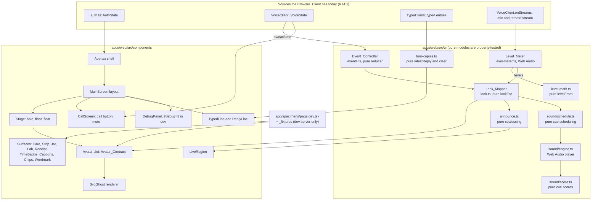
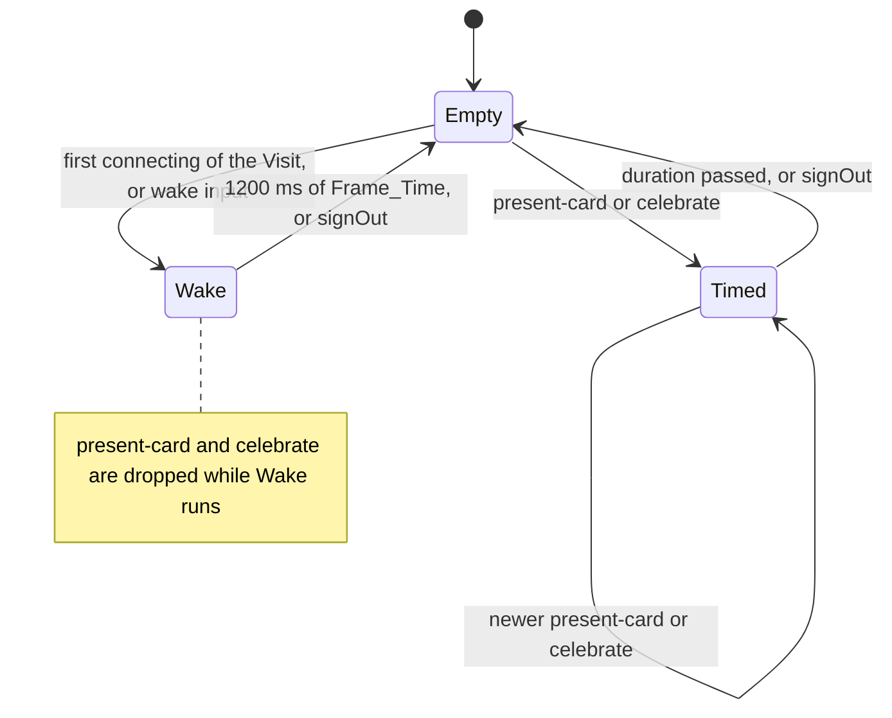

# Design Document: lab-ui-foundation

## Overview

This design builds Brief 003 (`docs/briefs/003-lab-ui-foundation.md`) as specified in `requirements.md`. Requirement criteria are cited as R*n.m*. "UI direction" is `docs/design/ui-direction.md`; "C§n" is `docs/design/memory-contracts-v2.md`; "FSC R*n.m*" is a `first-spoken-call` requirement. `docs/design/` is read-only. Every conflict found is listed under [Contract questions](#contract-questions).

The work is browser-only. It adds a token source, a pure avatar model (Look_Mapper and Event_Controller), an SVG renderer, a Level_Meter, a synthesized sound engine, props-only Surface components, a rebuilt main screen and a development-only `/specimens` page. It changes nothing in `packages/server`, adds no API route, and changes `voice-client.ts` by one optional callback.

Key decisions:

- **The avatar model lives in `apps/web/src/ui/`, not `@franki/core`.** It is pure, but it is presentation logic, and `@franki/core` is shared with the server. Purity is enforced by a check (see [Module layout](#module-layout)).
- **One active event at a time.** The Event_Controller keeps one timed slot (`wake`, `present-card`, `celebrate`) and one approval slot (`await-approval`), and hands the Look_Mapper a single Avatar_Event. A fixed priority order then settles every combination of state and event.
- **`/specimens` exists only in the development server.** Its page file is `page.dev.tsx`, and `next.config.ts` adds the `dev.tsx` page extension only in the `PHASE_DEVELOPMENT_SERVER` phase. A production build has no `/specimens` route at all, so Next answers with its default 404, and a post-build check proves no specimens code shipped.
- **`motion` is pinned to `14.9.1`** (see [Dependency: motion](#dependency-motion)).
- **Forget is a full clear on the client** until the contract carries turn IDs (contract question 1).

## Architecture



Data flows one way. The App shell reads today's sources and feeds the pure functions on each animation frame or state change. Pure functions return plain records. Components render those records and call their callback props. Surfaces other than the call controls, typed line, reply line, stage and header are rendered only on the Specimens_Page (R14.2).

**Time.** The only times the avatar model sees are Frame_Times from `requestAnimationFrame` callbacks, carried on each Event_Controller input as `at`. The sound engine schedules on `AudioContext.currentTime`, which is not a Wall_Clock_Read as defined in requirements. No file in `components/` or `ui/` makes a Wall_Clock_Read (R10.6).

## Research findings

### Next.js 16.4.3: leaving `/specimens` out of production

`next` is hoisted to the root `node_modules`, so the local docs are at `node_modules/next/dist/docs/`. Files read:

- `01-app/03-api-reference/05-config/01-next-config-js/pageExtensions.md`: App Router accepts `.tsx`, `.ts`, `.jsx` and `.js` by default; `pageExtensions` changes which file extensions count as pages.
- `01-app/03-api-reference/05-config/01-next-config-js/index.md`, "Phase": the config may be a function of `phase`, with phases such as `PHASE_DEVELOPMENT_SERVER` importable from `next/constants`.
- `01-app/01-getting-started/02-project-structure.md`, "Colocation", "Private folders" and "Route groups": files other than `page` and `route` in a segment are not routable; an `_folder` and all its subfolders are opted out of routing; a `(group)` only changes the URL path, not whether a route exists.
- `01-app/03-api-reference/03-file-conventions/not-found.md`: unmatched URLs get the default not-found UI with a 404 status before streaming starts.
- Implementation check, `node_modules/next/dist/server/lib/find-page-file.js`, `createValidFileMatcher`: a page file must match `(^|[\\/])page\.(?:<ext1>|<ext2>|…)$`, with each extension escaped. With the default list, `page.dev.tsx` does not match (the text before `.tsx` is `page.dev`, not `page`). With `dev.tsx` in the list it matches as `page` + `.dev.tsx`.

Options compared:

| Option | Route in prod build | Specimens code shipped | Verdict |
|---|---|---|---|
| `page.tsx` that calls `notFound()` when `NODE_ENV` is production | Yes | Yes (the module is bundled) | Rejected: R20.3 |
| Private folder `_specimens` | Never routable, also not in dev | No | Rejected: no dev route |
| Route group `(dev)/specimens` | Yes | Yes | Rejected: groups don't remove routes |
| Redirect or rewrite in `proxy.ts` | Yes | Yes | Rejected |
| **`page.dev.tsx` plus `pageExtensions` extended only in `PHASE_DEVELOPMENT_SERVER`** | **No** | **No** (nothing imports it) | **Chosen** |

`next.config.ts` becomes a function of `phase`:

```ts
import { PHASE_DEVELOPMENT_SERVER } from "next/constants";
const BASE_EXTENSIONS = ["tsx", "ts", "jsx", "js"];
export default function config(phase: string): NextConfig {
  return {
    ...nextConfig, // the existing env, transpilePackages, serverExternalPackages, tracing root and turbopack settings
    pageExtensions: phase === PHASE_DEVELOPMENT_SERVER ? [...BASE_EXTENSIONS, "dev.tsx"] : BASE_EXTENSIONS,
  };
}
```

The phase, not `NODE_ENV`, decides, because `next build` and `next start` load the config in their own production phases whatever the shell's `NODE_ENV` is. Only `app/specimens/page.dev.tsx` uses the `.dev.tsx` extension; the check below fails if any other file does. No other special file (`proxy`, `instrumentation`, `layout`) is renamed, because the base extensions stay in the list.

**Proof.**

1. `apps/web/src/next-config.test.ts` calls the exported config function with each phase constant and asserts `dev.tsx` appears only for `PHASE_DEVELOPMENT_SERVER`.
2. `scripts/specimens-absent.mjs` runs as the `postbuild` script of `apps/web` (npm runs it after `next build`, including under Turborepo's `npm run build`). It reads the build's route manifests under `apps/web/.next/` (`app-path-routes-manifest.json` and `server/app-paths-manifest.json`; the task confirms the exact names in the 16.4.3 output before writing the check) and fails if any key contains `specimens`. It then scans every file under `.next/server` and `.next/static` for the sentinel string `SPECIMENS_SENTINEL_9c41` that `_fixtures/index.ts` exports, and fails if it is found. A failing `postbuild` makes `npm run build` exit non-zero.
3. `scripts/specimens-absent.test.ts` tests the check itself on temporary fake `.next` trees: a manifest with `/specimens/page` fails, a file with the sentinel fails, a clean tree passes.
4. The R20.4 status (HTTP 404 from `next start`) follows from the route not existing. It is checked by hand once at the end of the build and listed in the final report as a manual check, because `npm test` does not start a production server.

Banned features: the page is a plain Server Component that renders client components. It uses no Server Action, `use cache`, `next/og` or ISR (R20.6), and calls no `/api/` route.

### Dependency: motion

Read-only npm queries on Nov 6:

- `npm view motion dist-tags`: `latest` is `14.10.1`, published Nov 6 14:25 UTC. `14.10.0` was published the same morning; `14.9.1` on Nov 4; `14.9.0` on Oct 30.
- `npm view motion@14.9.1 peerDependencies peerDependenciesMeta`: `react` and `react-dom` `^18.0.0 || ^19.0.0`, and `remix` `^3.1.0`, all marked optional. React 19.3.1 (the repo's pinned version) satisfies it. Optional peers are not installed, so `remix` adds nothing.
- `dependencies`: `framer-motion` `14.9.1` (exact) and `tslib` `^2.4.0`. `framer-motion@14.9.1` depends on `motion-dom` `14.9.1` and `motion-utils` `14.7.0`. These are transitive packages of `motion`, not separate additions (R22.2).
- `exports` includes `./react` (ESM `dist/es/react.mjs` and CJS) and `./react-client` (for use from Server Components).

**Choice: `motion@14.9.1`, exact.** It is the newest release that has been out for more than a day, while `14.10.x` shipped twice within hours on the day of this design. Its peers accept React 19.3.1. Components import from `motion/react` and carry `"use client"`; nothing imports `motion` from a Server Component. `.npmrc` already has `save-exact=true`, so `npm install motion@14.9.1 -w @franki/web` writes `"motion": "14.9.1"`.

The tasks phase installs it, then reads its docs and type definitions in `node_modules/motion` (and `framer-motion`) before writing motion code, and confirms: `MotionConfig` with `reducedMotion`, `AnimatePresence`, spring options `stiffness` and `damping`, and that `motion/react` builds under Turbopack with Next 16.4.3. If any of these fails, the task stops and asks the owner before choosing another version.

### Tailwind 4.3.3 and tokens

The app uses Tailwind 4 through `@tailwindcss/turbopack`. Tailwind emits only the theme variables that utilities use unless the block is `@theme static`. The JS side and inline SVG styles read variables that no utility uses, so the token block is `@theme static`. The task confirms `static` in the installed Tailwind docs before relying on it. Colour tokens use the `--color-*` namespace (so `bg-night-0`, `text-ink`, `ring-brass` work), fonts `--font-*`, sizes `--text-*`, radii `--radius-*`, shadows `--shadow-*` and easing `--ease-*`. Durations, springs and stagger have no Tailwind namespace and are plain custom properties in the same block.

### Contrast

UI direction requires WCAG AA. Computed relative luminance for the token pairs the Surfaces use (rounded):

| Foreground | Background | Ratio | Use | Result |
|---|---|---|---|---|
| `ink` | `night-0`, `night-1`, `night-2` | above 14:1 | body text | Pass |
| `ink-dim` | `night-2` | about 7.5:1 | secondary text | Pass |
| `brass` | `night-0` | about 8:1 | control labels, rings | Pass |
| `night-0` | `brass` | about 8:1 | text on brass buttons | Pass |
| `ember` | `night-2` | about 6:1 | errors, hang-up | Pass |
| `stitch` | `night-0` | about 2.2:1 | seams | **Fails 3:1** as a control boundary |

So `stitch` is decorative only: seams and dividers, never the only boundary of a control. Controls take their boundary from `brass` or `ink-dim` (contract question 6). The R18.4 test computes these ratios from the token values rather than trusting this table.

## Components and Interfaces

### Avatar types and the Avatar_Contract

`apps/web/src/ui/avatar/types.ts`:

```ts
import type { AvatarState } from "@franki/core";

export type AvatarEvent = "wake" | "present-card" | "await-approval" | "celebrate";
export type TimedEvent = Exclude<AvatarEvent, "await-approval">;

export type LookName =
  | "Dormant" | "Waking" | "Connecting" | "Listening" | "Thinking" | "Speaking"
  | "Recovery" | "Presenting" | "Awaiting_Approval" | "Celebrate";
// Ghost_Mode is an overlay (AvatarLook.ghost), never a LookName (R6.11).

export interface AvatarInput {
  state: AvatarState;
  micMuted: boolean;
  outputMuted: boolean;
  inputLevel: number;          // 0..1 expected; anything else is treated as 0 (R5.5)
  outputLevel: number;
  event: AvatarEvent | null;   // decided by the Event_Controller
  eventElapsedMs: number;      // Frame_Time since the event began; 0 when event is null
  firstConnecting: boolean;    // true only while the Visit's wake ritual runs
  reducedMotion: boolean;
}

export type Eyes = "closed" | "wide" | "half" | "open" | "glance-up" | "squint" | "glance-card" | "expectant" | "happy";
export type Glow = "dim" | "flare" | "flicker" | "level" | "steady" | "low" | "gold";
export type Posture = "sunk" | "rising" | "neutral" | "lean" | "wobble" | "turn" | "nod";
export type Bolts = "off" | "strike" | "flicker" | "idle" | "arc" | "fizzle" | "sparks" | "glow" | "one-dark" | "gold-glow";
export type BodyMotion = "breathe" | "rise" | "still" | "squish" | "wobble" | "nod";
export type AnimationId = "float" | "breathe" | "blink" | "strike" | "rise" | "flicker" | "arc" | "glance" | "wobble" | "fizzle" | "nod" | "sparks" | "fade";

export interface AvatarLook {
  name: LookName;
  ghost: boolean;              // true exactly when micMuted
  eyes: Eyes;
  glow: Glow;
  posture: Posture;
  bolts: Bolts;
  body: BodyMotion;
  bodyOpacity: number;         // 1, or 0.35 in Ghost_Mode
  eyeOpacity: 1;
  follows: "none" | "input" | "output";
  drive: number;               // the followed level after sanitizing, 0..1; 0 when follows is "none"
  electric: boolean;           // any Electricity in this look
  blur: boolean;               // SVG blur filters for glows
  animations: readonly { id: AnimationId; iterations: number | "infinite" }[];
  label: string;               // accessible label, from the state only (R5.4)
}

/** The Avatar_Contract (R4.1). Every renderer implements it; the Rive renderer will too. */
export interface AvatarRendererProps {
  look: AvatarLook;
  input: AvatarInput;
}
export type AvatarRenderer = (props: AvatarRendererProps) => React.ReactElement;
```

`components/avatar/Avatar.tsx` is the only place a renderer is chosen: `export function Avatar(props: AvatarRendererProps & { renderer?: AvatarRenderer })`, defaulting to `SvgGhost`. The Main_Screen and the Specimens_Page render `<Avatar>` only (R4.2). The wrapper also renders `role="img"` and `aria-label={look.label}` and sets `data-look`, `data-ghost` and `data-reduced` attributes for tests.

### Look_Mapper

`apps/web/src/ui/avatar/look.ts` exports `lookFor(input: AvatarInput): AvatarLook`, the only code that decides a look (R5.6). It is pure (R5.1): no Wall_Clock_Read, no random source, no DOM, storage or network. It works in four steps.

**Step 1. Sanitize.** `clampLevel(x) = Number.isFinite(x) && x >= 0 && x <= 1 ? x : 0` (R5.5). Out-of-range values become 0 rather than being clamped to the nearest bound, as R5.5 states. A negative or non-finite `eventElapsedMs` counts as 0.

**Step 2. Effective event.** A timed event whose `eventElapsedMs` has reached its duration counts as none (R8.2). `await-approval` has no duration.

| Event | Duration | Source |
|---|---|---|
| `wake` | 1200 ms (`dur.ritual`) | R6.2 |
| `present-card` | 800 ms | This design (R6.8): a glance toward the dock and back |
| `celebrate` | 1600 ms | This design (R6.10): rise and one burst of sparks |
| `await-approval` | none; cleared by the Event_Controller | R6.9, R8.3 |

The durations live in `motion.ts` as `EVENT_MS`. The longest timed duration is 1600 ms.

**Step 3. Look_Name by the fixed priority order.** The first row that applies wins.

| Priority | Look_Name | Applies when |
|---|---|---|
| 1 | Recovery | `state` is `recovery`, whatever the event (R5.7) |
| 2 | Dormant | `state` is `closed`, whatever the event (R5.7; this design extends it to `wake`) |
| 3 | Waking | effective event is `wake`, or `state` is `connecting` and `firstConnecting` is true (R5.3) |
| 4 | Celebrate | effective event is `celebrate` |
| 5 | Presenting | effective event is `present-card` |
| 6 | Awaiting_Approval | effective event is `await-approval` |
| 7 | the state's look | `connecting` → Connecting; `listening` → Listening; `thinking` → Thinking; `speaking` with `outputMuted` false → Speaking; `speaking` with `outputMuted` true → Thinking (R6.5, R6.6) |
| overlay | Ghost_Mode | `micMuted` is true: applied after the row above, over any Look_Name (R6.11) |

Cases this settles:

- **Wake against connecting:** Waking (row 3), and the Visit's later `connecting` periods give Connecting because `firstConnecting` is false.
- **Wake after the state moves on:** if the call reaches `listening` or `thinking` within the 1200 ms ritual, Waking continues to the end of the ritual. A hang-up (`closed`) or an error (`recovery`) ends it at once.
- **Events during listening, thinking or speaking:** the event's look shows (rows 4 to 6). The state still decides `follows` and `drive` (step 4), so an event over Speaking still squishes with the voice, and an event over Listening still glows with the mic.
- **Speaking with output muted:** Thinking (row 7), labelled "Franki is thinking", because the reply is held or cancelled and nothing is audible (contract question 3).
- **Among events:** the Event_Controller passes at most one, so rows 4 to 6 only order cases that the Specimens_Page builds by hand.

**Step 4. Build the record.**

- `label` comes from the state alone (R5.4): `closed` "Franki is asleep", `connecting` "Franki is waking up", `listening` "Franki is listening", `thinking` "Franki is thinking", `speaking` "Franki is speaking" (or "Franki is thinking" while `outputMuted`), `recovery` "Franki is having trouble connecting". Labels live in `ui/copy.ts`.
- `follows` comes from the state alone: `listening` → `input`; `speaking` with `outputMuted` false → `output`; anything else → `none`. Recovery, Dormant and Waking override it to `none`. So `follows` is `output` only while output is audible (R7.1).
- `drive` is the sanitized level that `follows` names, or 0.
- `body` is `squish` whenever `follows` is `output` and Reduced_Motion is off. Otherwise it comes from the table below.
- The other fields come from this table, one row per Look_Name and Reduced_Motion setting.

| Look_Name | Motion | eyes | glow | posture | bolts | body | electric | animations (∞ = infinite) |
|---|---|---|---|---|---|---|---|---|
| Dormant | full | closed | dim | sunk | off | breathe | no | float ∞, breathe ∞ |
| | reduced | closed | dim | sunk | off | still | no | none |
| Waking | full | wide | flare | rising | strike | rise | yes | float ∞, strike 1, rise 1 |
| | reduced | wide | flare | rising | glow | still | no | fade 1 |
| Connecting | full | half | flicker | neutral | flicker | still | yes | float ∞, flicker ∞ |
| | reduced | half | low | neutral | glow | still | no | none |
| Listening | full | open | level | lean | idle | still | no | float ∞, blink ∞ |
| | reduced | open | level | lean | idle | still | no | none |
| Thinking | full | glance-up | steady | neutral | arc | still | yes | float ∞, arc ∞, glance 1 |
| | reduced | glance-up | steady | neutral | glow | still | no | none |
| Speaking | full | open | steady | neutral | idle | squish | no | float ∞ |
| | reduced | open | steady | neutral | idle | still | no | none |
| Recovery | full | squint | low | wobble | fizzle | wobble | yes | float ∞, wobble 2, fizzle 1 |
| | reduced | squint | low | wobble | one-dark | still | no | none |
| Presenting | full | glance-card | steady | turn | idle | still | no | float ∞, glance 1 |
| | reduced | glance-card | steady | turn | idle | still | no | fade 1 |
| Awaiting_Approval | full | expectant | steady | nod | idle | nod | no | float ∞, nod ∞ |
| | reduced | expectant | steady | nod | idle | still | no | none |
| Celebrate | full | happy | gold | rising | sparks | rise | yes | float ∞, rise 1, sparks 1 |
| | reduced | happy | gold | rising | gold-glow | still | no | fade 1 |

`blur` is true in every full-motion look (glows use an SVG blur) and false in every reduced look (glows become radial gradients) (R9.1). With Reduced_Motion on, a "reduced" posture is a static pose: `wobble` is a fixed tilt, `nod` a fixed lowered head, `rising` a fixed raised position. In reduced mode, `follows: output` drives glow opacity only, never a transform.

Every pair of Look_Names differs in `eyes`, except Listening and Speaking (both `open`), which differ in `posture` and `follows`. This holds in both motion settings (R6.12, R9.2).

**Ghost overlay.** When `micMuted` is true, the record is built with `micMuted` treated as false, then `ghost` is set true and `bodyOpacity` to 0.35. Nothing else changes, including the label (R6.11).

### Event_Controller

`apps/web/src/ui/avatar/events.ts`:

```ts
export type EventInput =
  | { kind: "frame"; at: number }
  | { kind: "state"; state: AvatarState; at: number }
  | { kind: "event"; event: TimedEvent; at: number }
  | { kind: "await"; approvalId: string; at: number }
  | { kind: "approvalDone"; approvalId: string; at: number } // answered or removed
  | { kind: "signOut"; at: number };

export interface EventState {
  now: number | null;                                   // latest Frame_Time seen
  state: AvatarState;
  woke: boolean;                                         // the Visit's wake has started
  timed: { event: TimedEvent; startedAt: number } | null;
  awaiting: string | null;                               // approvalId
}

export const initialEventState: EventState; // state "closed", woke false, slots empty
export function reduceEvents(s: EventState, input: EventInput): EventState;
export function currentEvent(s: EventState): { event: AvatarEvent | null; eventElapsedMs: number; firstConnecting: boolean };
```

Rules:

1. **Time.** `now = max(now ?? at, at)`. A Frame_Time older than `now` never moves time backward. The controller has no timers (R8.3).
2. **Expiry.** After updating `now`, a timed slot whose `now - startedAt` has reached its `EVENT_MS` is cleared. This runs on every input.
3. **Wake.** A `state` input with `connecting` while `woke` is false sets `woke`, and fills the timed slot with `wake` at `now`. This automatic start counts as a new event for R8.4. An explicit `wake` input does the same if `woke` is false, and is ignored otherwise, so wake shows at most once per Visit (R6.2). A Visit is one controller instance; a page reload makes a new one.
4. **Other timed events.** `present-card` or `celebrate` replaces any timed event except an active `wake`; arriving during `wake`, it is dropped. The replacement starts at `now`.
5. **Approval.** `await` sets `awaiting`. `approvalDone` with the same ID clears it. A `state` input of `closed`, and `signOut`, clear it (R8.3). `signOut` also clears the timed slot.
6. **Selection.** `currentEvent` returns the timed event if one is active, else `await-approval` if `awaiting` is set, else none. `eventElapsedMs = now - startedAt` for a timed event and 0 otherwise. `firstConnecting` is true exactly while the timed slot holds `wake`.



The approval slot runs beside this diagram: set by `await`, cleared by `approvalDone`, `closed` or `signOut`.

On the Main_Screen today, only rule 3 ever fires, because no Card or approval exists yet. The other inputs are exercised by tests and the Specimens_Page.

### Level_Meter

`apps/web/src/ui/levels/level-math.ts` (pure):

```ts
/** RMS of 8-bit time-domain samples centred on 128, scaled and clamped to 0..1. Empty or invalid input gives 0. */
export function rawLevel(samples: ArrayLike<number>): number;
/** One smoothing step: attack 0.5 when rising, release 0.12 when falling. Result is in 0..1; non-finite prev counts as 0. */
export function smoothLevel(prev: number, raw: number): number;
export function levelFrom(samples: ArrayLike<number>, prev: number): number; // smoothLevel(prev, rawLevel(samples))
```

`apps/web/src/ui/levels/level-meter.ts` (browser I/O):

```ts
export interface Levels { input: number; output: number }
export interface LevelMeter {
  setStreams(s: { mic: MediaStream | null; output: MediaStream | null }): void; // disconnects old nodes first (R11.5)
  sample(): Levels;   // one analyser read per call; 0 and 0 when a stream or the context is missing (R11.4)
  pause(): void;      // document hidden (R10.7)
  resume(): void;
  dispose(): void;
}
export function createLevelMeter(getContext: () => AudioContext | null): LevelMeter;
```

Each stream gets a `MediaStreamAudioSourceNode` connected to an `AnalyserNode` (`fftSize` 512) and to nothing else, so the meter never plays audio and never doubles Franki's voice. The remote stream stays attached to the existing output `<audio>` element, which Chromium needs before Web Audio reads a remote WebRTC stream. The analyser reads the stream before the element's mute, so Output_Level is non-zero even while the reply is held. That is why the Look_Mapper, not the meter, decides whether the body follows it (R7). The meter writes no Record, calls no route, and uses no storage, network or `MediaRecorder` (R11.2). Its methods catch Web Audio errors and fall back to 0.

`apps/web/src/ui/audio/context.ts` holds the single shared `AudioContext`. It is created on the first `pointerdown` or `keydown` of the Visit (the call button press counts), never before (R11.7, R19.2). `getContext()` returns null until then.

### Voice_Client change

The only change to `apps/web/src/client/voice-client.ts` (R11.3):

```ts
export interface VoiceClientDeps {
  // …existing fields unchanged…
  /** Told when the mic or remote stream appears or goes away. For the Level_Meter only; never changes call behavior. */
  onStreams?: (s: { mic: StreamLike | null; output: unknown | null }) => void;
}
```

The client calls a private `reportStreams()` (which wraps `deps.onStreams` in `try`/`catch` so a meter error can never reach the call) at three points: after `this.mic = mic` in `connect`, inside the `ontrack` handler after setting `srcObject`, and at the end of `teardown` with both null. It keeps its own last-known values for this. Muting, Permits, admission, timers, routes and the reducer are untouched, and the option is optional, so `voice-client.test.ts` passes unchanged. A new test file, `voice-client.streams.test.ts`, checks the three reporting points and that a throwing callback leaves call state unchanged.

### Announcements

`apps/web/src/ui/announce.ts` (pure):

```ts
export interface AnnounceView { avatar: string; call: string; error: string | null }
/** One polite announcement for one render, or null when nothing changed (R18.5–R18.8). */
export function announcement(prev: AnnounceView | null, next: AnnounceView): string | null;
```

The parts that changed are joined in the fixed order avatar, call, error, each ending with a full stop, with one space between them ("Franki is listening. Call connected."). A part that did not change is left out. A cleared error is not announced. `prev` null (first render) announces nothing. The call part is a short label from `callStatus(voice)`: "Call idle", "Connecting", "Call connected", "Hanging up" or "Reconnecting". The error part is the `CALL_ERRORS` text.

`components/LiveRegion.tsx` renders one visually hidden `<div aria-live="polite" aria-atomic="true">`. The App computes the announcement once per render of the main screen and writes it there, so a moment with several changes is spoken once (R4.6, R18.8). Identical consecutive announcements are made distinct by alternating two child nodes, the usual way to make screen readers repeat a message.

### Sound engine

- `ui/sound/score.ts` (pure): `scoreFor(cue: Cue): Note[]`, where a `Note` is `{ type: "sine" | "triangle" | "noise", freq, startMs, durMs, peakGain }`. Cues: `wake` (three rising notes, 330, 440 and 660 Hz, plus a noise crackle, total under 1500 ms), `thinking` (a 400 ms filtered-noise crackle at very low gain), `card` (an 80 ms triangle tap with a fast decay), `celebrate` (a two-note sine chime), `receipt` (a 600 ms band-passed noise whirr). Every `peakGain` is at most 0.25 (R19.5).
- `ui/sound/schedule.ts` (pure):

  ```ts
  export interface SoundGate { gestured: boolean; soundOn: boolean; outputMuted: boolean }
  export interface SoundTrack { name: LookName | null; since: number | null; thinkingCued: boolean }
  export function scheduleCues(prev: SoundTrack, look: { name: LookName; at: number }, extra: { cardArrived: boolean; receiptShown: boolean }, gate: SoundGate): { track: SoundTrack; cues: Cue[] };
  ```

  It returns `wake` when the look becomes Waking, `thinking` once when Thinking has lasted more than 1000 ms of Frame_Time, `card` on `cardArrived`, `celebrate` when the look becomes Celebrate, and `receipt` on `receiptShown` (R19.3). It returns no cue unless `gestured`, `soundOn` and `outputMuted` are all true (R19.2, R19.4, R19.7). The track still updates when the gate is closed, so a cue blocked at its moment does not play later.
- `ui/sound/engine.ts` (browser I/O): plays a score on the shared context through a master `GainNode` whose value is never above 0.25. When `outputMuted` becomes false it ramps the master gain to 0 over 40 ms with `linearRampToValueAtTime` (within R19.4's 50 ms) and stops the sources.
- `ui/sound/preference.ts`: reads and writes `localStorage["franki.sound"]` as `"on"` or `"off"`, defaulting to on when the key is missing or storage throws (R19.6).
- `components/SoundToggle.tsx`: one button in the header, `aria-pressed` equal to the setting, accessible name "Sound effects".

### Reduced motion and visibility

- `ui/hooks/reduced-motion.ts`: a `ReducedMotionWatcher` class over a `MediaQueryList`-shaped object (`matches`, `addEventListener("change")`), and a `useReducedMotion()` hook built on `useSyncExternalStore`. The server snapshot is `true`, so the first paint is calm and never mismatches hydration. The `change` event applies at once, well within R9.4's 500 ms. A `ReducedMotionOverride` context lets the Specimens_Page force it on (R20.2).
- The App wraps the tree in `<MotionConfig reducedMotion={reduced ? "always" : "never"}>`, so every `motion` component follows the same value, and sets `data-reduced` on the root element. CSS loops are written inside `@media (prefers-reduced-motion: no-preference)` and also switched off by `[data-reduced="true"]`, so a forced specimen and the media query agree (R9.3).
- `ui/hooks/page-visible.ts`: a `VisibilityGate` over a `document`-shaped object. While hidden, the frame loop stops scheduling `requestAnimationFrame`, Electricity stops regenerating, the Level_Meter is paused, and the root gets `data-paused="true"`, which sets `animation-play-state: paused` on every CSS loop. It resumes on `visible` (R10.7).
- `ui/hooks/frame-loop.ts`: one `requestAnimationFrame` loop for the whole screen. Each frame it calls `meter.sample()`, feeds `{kind:"frame", at}` to the Event_Controller, calls `lookFor`, and updates React state only when the look's discrete fields change or `drive` moves by at least 1/32. That keeps React renders well below the frame rate while the body still follows the voice.

### Electricity

`ui/electricity.ts` (pure): `boltPath(a: Point, b: Point, seed: number, depth: number): Point[]` by midpoint displacement with a seeded PRNG (mulberry32), and `regenGapMs(seed): number` in 60 to 90 (R10.3). `components/avatar/Electricity.tsx` draws the path as an SVG polyline stroked `spark` with a `gold` glow, regenerating when Frame_Time passes the gap. `ui/electricity-budget.ts` holds a counter with at most two grants. A third effect that asks gets no grant and draws a steady bolt glow instead. Electricity never renders under Reduced_Motion.

### Surfaces

All Surface components are presentational: props in, callbacks out, no fetching, no route calls, no storage reads and no import of `client/api.ts` (R16.1). Each returns `null` when its props have nothing true to show (R16.12). Enter and exit use `components/motion/Materialize.tsx`, an `AnimatePresence` wrapper with Materialize and Dematerialize variants (R10.1), which become plain opacity fades under Reduced_Motion (R9.3).

| Component | File | Props (see Data Models) | Notes |
|---|---|---|---|
| Card | `surfaces/Card.tsx` | `CardProps` | Title, content, sources, actions, in that order. Approval: **Yes** (brass) and **Not now** (quiet), neither focused or pre-selected (R15.3). Food: "Checked for" line with seals; no "safe" copy (R15.4). Hard rules: a locked, read-only line with a `Seal`; no control on a Card removes them, and no swipe or dismiss affects them. Removal lives only in the What_I_Know_Sheet (R15.5, amended Nov 6). |
| Card_Dock | `surfaces/CardDock.tsx` | `{ cards: CardProps[] }` | First card primary; up to two older ones behind at scale 0.96 and 0.92. Right column at 1024 px and wider, bottom sheet below. Enters from the stage side with `spring.settle` (R15.6, R15.7). |
| Strip | `surfaces/Strip.tsx` | `StripProps` | Five terminals; current runs along the wire to each newly filled one (stagger 40 ms); last terminal `gold` when filled (R16.2). Null when `open` is false. |
| Jar | `surfaces/Jar.tsx` | `JarProps` | Motes up to a cap of 48; solid, dashed, brass and frosted by kind; button with accessible name "What I know" (R16.3). |
| What_I_Know_Sheet | `surfaces/WhatIKnowSheet.tsx` | `WhatIKnowProps` | Hard rules first under their seal, then the five areas in order; guesses labelled "Guessed" with a dashed outline; **Wrong**, **Forget**, **Don't bring it up** on each item (R16.4). |
| Lab | `surfaces/Lab.tsx`, `surfaces/Odometer.tsx` | `LabProps` | Mono tabular figures; `null` shows `—`; odometer roll on change; a `<details>` fold for honest limits (R16.5). |
| Receipt | `surfaces/Receipt.tsx` | `ReceiptProps` | Prints up over `dur.ritual`: "Blocked now", "Cleaned up", "Kept: …", counts by kind (R16.6, R16.7). |
| Time_Badge | `surfaces/TimeBadge.tsx` | `TimeBadgeProps` | "Simulated: Thu 6:00 PM" with a bolt glyph; shown whenever `simulated` is true (R16.8). Formatting is pure (`ui/format-time.ts`, `Intl.DateTimeFormat` over a `Date` built from the supplied milliseconds). |
| Captions | `surfaces/Captions.tsx` | `CaptionsProps` | One line, fades after it ends, no history; off by default with a toggle "Captions" (R16.9). |
| Chips | `surfaces/Chips.tsx` | `ChipsProps` | Glass capsules with a stitched outline; `onChip(text)` (R16.10). |
| Wordmark | `surfaces/Wordmark.tsx` | `{ variant: "header" \| "signedOut" }` | "Franki", or `FRANKIROCKS` with K, I, R, O (letters 5 to 8) lighting gold once by a one-iteration CSS animation; fade only under Reduced_Motion (R13.2, R16.11). |
| Seal, Seam | `surfaces/Seal.tsx`, `surfaces/Seam.tsx` | | Brass lock seal; stitched dashed divider with cross-ticks in `stitch` (decorative). |

### Main screen

`components/App.tsx` stays the shell (auth, controllers, sign-in and sign-out flow, unchanged). It renders `components/screen/MainScreen.tsx`, a CSS grid with named areas that follows the UI direction diagram (R12.1):

```
header    : wordmark · time-badge slot · sound toggle · email and sign-out
strip     : (empty slot)
stage     : Stage (Avatar, halo, floor)     | dock (empty slot, ≥1024 px)
chips     : (empty slot)
controls  : call button · mute · retry · errors · typed-line glyph
reply     : Reply_Line
corners   : jar slot (left) · lab slot (right)
footer    : Footer (from the root layout)
```

The empty slots keep their grid area and render nothing (R12.1, R14.2). Below 1024 px the dock area moves to a fixed bottom sheet; below 640 px the corners stack under the controls. No element has a fixed width larger than 343 px (375 minus 2 × 16 px padding), so nothing scrolls sideways at 375 px (R12.3). `components/screen/Backdrop.tsx` draws the blueprint grid (a CSS gradient at 3% opacity, masked toward the edges), film grain (an inline SVG `feTurbulence` at 4% opacity) and the vignette (R12.4). It is `aria-hidden`.

Wiring (R14.1):

| Source | Feeds |
|---|---|
| `AuthState` | Signed-out or signed-in layout, Wordmark variant, header email and sign-out, call button `enabled` |
| `VoiceState` via `avatarState()` | Event_Controller `state` input, `AvatarInput.state`, announcement avatar part |
| `VoiceState` via `callButton()`, `muteVisible()` | `CallScreen` button form, disabled state, mute visibility |
| `micMuted`, `outputMuted` | `AvatarInput`, mute `aria-pressed`, sound gate |
| Level_Meter `Levels` | `AvatarInput.inputLevel`, `outputLevel` |
| `TypedTurns` snapshot | `TypedLine` text, sending and error; `ReplyLine` via `latestReply(entries)` |

Nothing else reaches the Main_Screen. The Card_Dock, Strip, Jar, Lab, Receipt, Time_Badge, Chips and Captions are not rendered there (R14.2), and the check in [Module layout](#module-layout) proves no Fixture is reachable from `page.tsx` (R14.3).

`components/CallScreen.tsx` keeps its file name, its `CALL_ERRORS` export and its props, and is rebuilt (R14.4 to R14.6):

- One `<button>` with `data-form="start"` or `"hangup"`, `aria-label` "Call Franki" or "Hang up", a 64 px target. Start: `data-shape="round"`, a brass ring (`ring-brass`) around a power glyph with an `ecto` core. Hang-up: `data-shape="square"`, a squared `bg-ember` form. Disabled exactly as today: signed out, open pending, hang-up in progress, transcription model missing.
- On press, the button moves down 2 px with `spring.press`, and, with Reduced_Motion off and an Electricity grant, a spark runs once around the ring (R10.4).
- The mute toggle, shown only while `muteVisible()`, is a brass toggle with `aria-pressed={micMuted}` and the labels "Mute microphone" and "Unmute microphone", with the indicator text "Your microphone is muted." (`data-testid="muted-indicator"`) (R14.5).
- Retry and the call errors stay inline text and buttons (R14.6).

`components/TypedLine.tsx` replaces the visible part of `TypedInput.tsx` (R14.7). Collapsed, it is a keyboard-glyph button "Type to Franki". Open, it is a one-row `<textarea>` styled as a single line: Enter sends, Shift+Enter and pasted text keep line feeds, IME composition is respected, and the existing send rules apply (FSC R18.1, R18.8 to R18.10). Escape collapses it when empty. `TypedInput` stays exported for the reused logic, and `ConversationView` is removed.

`components/ReplyLine.tsx` shows `latestReply(entries)`: the text of Franki's notes after the last user entry, joined with spaces, as one line in a polite region. No earlier lines show (R14.8).

`components/AuthPanel.tsx` keeps its props. Signed out, it shows one brass button "Sign in to wake Franki" that calls the same Google sign-in, disabled while `loading` or `busy`, with the existing inline error text (R13.1, R13.4, R13.5). Signed in, it shows the email and "Sign out" in the header (R14.9).

Signed out (R13): Dormant avatar (the App passes `state: "closed"`), `FRANKIROCKS` Wordmark, the sign-in button, the call button in its start form disabled, the typed-line glyph disabled. No Chips or other Surface. The App makes no `/api/` request while signed out, as today.

Debug panel (R21): `ui/debug-flag.ts` exports the pure `debugVisible(nodeEnv: string | undefined, search: string): boolean`, true only when `nodeEnv !== "production"` and `search` has `debug=1`. The App reads `window.location.search` once in an effect after mount (no `useSearchParams`, so no Suspense boundary is needed). The `DebugPanelModel` is created, refreshed and polled only when the flag is true, so no `GET /api/debug/memory` is sent otherwise (R21.3, R21.4). `DebugPanel.tsx` is unchanged apart from token colour classes.

Forget (R17.5, R17.6): `ui/turn-copies.ts` exports the pure `clearTurnCopies(s: TurnCopies): TurnCopies`, which empties the reply line, caption line, typed text, cards and jar items. `TypedTurns` gains a `dropTurnCopies()` method that clears `entries` and `text`. The App exposes one `onForgetComplete()` handler that calls both, and the Surfaces leave through Dematerialize. In this slice no forget result reaches the browser (there is no forget route), so the handler is wired but has no caller. It is tested directly and shown on the Specimens_Page.

### Specimens page

`apps/web/src/app/specimens/page.dev.tsx` renders sections from `app/specimens/_sections/` with props from `app/specimens/_fixtures/` (both private folders, so neither is routable even in development). It shows (R20.1, R20.2):

- the avatar for every Look_Name, every Avatar_Event over every state, Ghost_Mode over each state, and each of these twice, with Reduced_Motion off and forced on (built by calling `lookFor` with fixture inputs);
- each Card kind including hard rules and an approval; the Strip at fill levels 0 to 5; the Jar with every mote kind and over the cap; the What_I_Know_Sheet; the Lab with real counts and `—`; the Receipt; the Time_Badge; Captions on and off; Chips; both Wordmarks; the call button in every form; the forget clear before and after.

The root layout wraps it, so the Footer renders there too (R12.5). It calls no `/api/` route (R20.6).

## Module layout

```
apps/web/
  next.config.ts                  CHANGED  config(phase): dev-only "dev.tsx" page extension
  package.json                    CHANGED  motion 14.9.1; postbuild runs scripts/specimens-absent.mjs
  src/
    app/
      globals.css                 CHANGED  Token_File: @theme static tokens, base styles, CSS loops, reduced and paused rules
      layout.tsx                  CHANGED  body classes use tokens; Footer stays last in <body>
      page.tsx                    same     renders <App/>
      specimens/                  NEW      dev server only
        page.dev.tsx                       the Specimens_Page (Server Component)
        _fixtures/*.ts                     Fixtures; exports SPECIMENS_SENTINEL_9c41
        _sections/*.tsx                    one section per Surface
    ui/                           NEW
      motion.ts                   Token_File  colour, motion and EVENT_MS tokens for JS          pure
      copy.ts                              every Surface string and avatar label              pure
      avatar/types.ts                      AvatarInput, AvatarLook, Avatar_Contract           types
      avatar/look.ts                       Look_Mapper lookFor                                pure, property-tested
      avatar/events.ts                     Event_Controller reduceEvents, currentEvent         pure, property-tested
      levels/level-math.ts                 rawLevel, smoothLevel, levelFrom                    pure, property-tested
      levels/level-meter.ts                Web Audio analysers                                 browser I/O
      audio/context.ts                     shared AudioContext after first gesture             browser I/O
      sound/score.ts                       cue scores                                          pure, property-tested
      sound/schedule.ts                    scheduleCues                                        pure, property-tested
      sound/engine.ts                      plays scores, master gain, fade                     browser I/O
      sound/preference.ts                  remembered toggle                                   storage I/O
      announce.ts                          announcement, callStatus                            pure, property-tested
      electricity.ts                       boltPath, regenGapMs                                pure, property-tested
      electricity-budget.ts                at most two grants                                  pure
      turn-copies.ts                       latestReply, clearTurnCopies                        pure, property-tested
      contrast.ts                          WCAG ratio, PAIRINGS                                pure
      format-time.ts                       Time_Badge text                                     pure
      debug-flag.ts                        debugVisible                                        pure
      hooks/reduced-motion.ts              watcher, hook, override context                     React
      hooks/page-visible.ts                VisibilityGate, hook                                React
      hooks/frame-loop.ts                  one rAF loop                                        React
    components/
      App.tsx                     CHANGED  shell; wires today's sources only
      AuthPanel.tsx               CHANGED  "Sign in to wake Franki"; tokens
      CallScreen.tsx              CHANGED  new call button and mute; same exports
      Footer.tsx                  CHANGED  tokens only; same testid and text
      DebugPanel.tsx              CHANGED  token classes only
      TypedInput.tsx              CHANGED  ConversationView removed
      TypedLine.tsx, ReplyLine.tsx, LiveRegion.tsx, SoundToggle.tsx   NEW
      StandInAvatar.tsx           DELETED  retired (requirements "Changes to first-spoken-call")
      screen/MainScreen.tsx, screen/Backdrop.tsx                       NEW
      avatar/Avatar.tsx, avatar/SvgGhost.tsx, avatar/Stage.tsx, avatar/Electricity.tsx   NEW
      motion/Materialize.tsx                                           NEW
      surfaces/*.tsx                                                   NEW (table above)
    client/
      voice-client.ts             CHANGED  optional onStreams only
      typed-turns.ts              CHANGED  dropTurnCopies() only
scripts/
  token-check.mjs + .test.ts      NEW  Token_Check
  ui-boundaries.mjs + .test.ts    NEW  fixture reachability, UI clock reads, pure-module and Surface import rules
  copy-check.mjs + .test.ts       NEW  Banned_Cause_Words
  specimens-absent.mjs + .test.ts NEW  post-build proof
.kiro/steering/ui-design.md       NEW  first task (R1)
```

No file is added to `packages/core` or `packages/server`.

**Why `apps/web/src/ui` and not `@franki/core`.** Both would keep the model pure. Core's rules (no I/O, no wall clock, time as an argument) fit, and `avatarState()` already lives there. But the look tables, labels and event durations are presentation, they change with design rather than with memory contracts, and core is bundled into the server too. Keeping them in `ui/` keeps `@franki/core` about memory and calls, and keeps the UI's churn out of the package every route depends on. The cost is that `ui/` needs its own purity check, which `ui-boundaries.mjs` provides.

**Import rules** (enforced in `npm test`):

1. Browser code (`components/`, `ui/`, `client/`, `app/` outside `app/api/`) imports no `@franki/server`, `firebase-admin`, `openai` or `@openai/*`. The existing `import-boundaries.mjs` already covers `apps/web/src` and keeps passing (R22.3).
2. No module reachable from `app/page.tsx` or `app/layout.tsx` imports anything under `app/specimens/`. `ui-boundaries.mjs` walks the import graph (relative imports and the `@franki/*` workspace names) from both entry points and fails on any match. It also fails if any file other than `app/specimens/page.dev.tsx` uses the `.dev.tsx` suffix, and if any file outside `app/specimens/` imports from it (R14.3, R20.5).
3. Pure modules (the ones marked pure above) may import only types, `@franki/core`, `ui/motion.ts`, `ui/copy.ts` and each other. They must not mention `window`, `document`, `navigator`, `localStorage`, `fetch`, `requestAnimationFrame`, `AudioContext` or `Math.random`. `ui-boundaries.mjs` checks the list.
4. No file in `components/` or `ui/` makes a Wall_Clock_Read. The existing clock check covers the `Date` forms across `apps/web/src`. `ui-boundaries.mjs` adds the `performance` form for these two directories (R10.6). Neither file is added to `scripts/clock-allowlist.json`.
5. Surface components (`components/surfaces/`) import nothing from `client/` (R16.1).

## Data Models

These are browser-side props, not Records. Nothing here is written to Firestore or sent on the wire.

```ts
// Shared
export interface SourceTag { id: string; label: string }            // "Bank · 6 purchases"
export interface HardRule { id: string; person: string; text: string } // shown with a Seal

// Card (R15)
interface CardBase { id: string; title: string; sources: SourceTag[]; onOpenSource: (id: string) => void }
export type CardProps =
  | (CardBase & { kind: "source"; body: string; figures: { label: string; value: string; sourceId: string }[] })
  | (CardBase & { kind: "approval"; effect: string; onYes: () => void; onNotNow: () => void })
  | (CardBase & { kind: "food"; choice: string; ingredients: string[]; checkedFor: { person: string; rules: HardRule[] }[] })
  | (CardBase & { kind: "ask"; question: string; options: { id: string; label: string }[]; onAnswer: (id: string) => void })
  | (CardBase & { kind: "read"; lines: string[] });

// Strip (R16.2)
export interface StripProps { open: boolean; filled: 0 | 1 | 2 | 3 | 4 | 5; resultLabel: string }

// Jar and What_I_Know_Sheet (R16.3, R16.4)
export type MoteKind = "told" | "guessed" | "rule" | "private";
export interface JarProps { motes: { id: string; kind: MoteKind }[]; onOpen: () => void }   // cap 48 drawn
export type Area = "Time and work" | "Food and health" | "Money" | "People" | "Goals";
export interface KnownItem { id: string; area: Area; text: string; from: string; guessed: boolean; hardRule: boolean }
export interface WhatIKnowProps {
  items: KnownItem[];
  onWrong: (id: string) => void; onForget: (id: string) => void; onQuiet: (id: string) => void; onClose: () => void;
}

// Lab (R16.5)
export interface LabProps { counters: { id: string; label: string; value: number | null }[]; limits: string[] }

// Receipt (R16.6, R16.7): kinds and counts only, never text of a forgotten item
export interface ReceiptProps {
  blocked: boolean;                                   // C§1 forgetReceipt.blockedAt != null
  cleaned: boolean;                                   // forgetReceipt.cleanupCompleteAt != null
  kept: { kind: "safety rule"; count: number }[];     // from retainedRuleIds.length
  touched: { kind: string; count: number }[];         // from touched[] collection → plain kind label
}

// Time_Badge (R16.8)
export interface TimeBadgeProps { simulated: boolean; instantMs: number; zone: string }

// Captions (R16.9)
export interface CaptionsProps { on: boolean; line: { id: string; text: string } | null; onToggle: () => void }

// Chips (R16.10)
export interface ChipsProps { chips: readonly string[]; disabled: boolean; onChip: (text: string) => void }

// Turn copies (R14.8, R17.5)
export interface TurnCopies {
  reply: string | null; caption: { id: string; text: string } | null; typedText: string;
  cards: CardProps[]; jarItems: KnownItem[];
}
```

The `Receipt` props hold no free-text field at all, so forgotten words cannot reach it (R16.7). The mapping from `forgetReceipt` is a pure function, `receiptFrom(payload)`, tested on Specimens fixtures only; there is no forget payload on the client in this slice.

**Tokens** (`globals.css`, `@theme static`), all authoritative (R2.5):

| Group | Custom properties |
|---|---|
| Colour (R2.1) | `--color-night-0: #060A09` … `--color-ember: #FF6A4D`, the 14 values of UI direction "Colour" exactly |
| Type (R2.2) | `--font-sans: var(--font-geist-sans)`, `--font-mono: var(--font-geist-mono)`, `--text-xs: 12px`, `--text-sm: 14px`, `--text-base: 16px`, `--text-lg: 20px`, `--text-2xl: 28px`, `--text-display: 44px` |
| Radius, shadow (R2.2) | `--radius-card: 18px`, `--radius-chip: 999px`, `--radius-control: 12px`; `--shadow-ecto-glow`, `--shadow-brass-glow`, `--shadow-card`, built from layered low-opacity shadows of the colour tokens |
| Motion (R2.3) | `--spring-float-stiffness: 60`, `--spring-float-damping: 12`, `--spring-settle-stiffness: 170`, `--spring-settle-damping: 22`, `--spring-press-stiffness: 420`, `--spring-press-damping: 30`, `--dur-quick: 160ms`, `--dur-base: 320ms`, `--dur-ritual: 1200ms`, `--ease-ecto: cubic-bezier(.22, 1, .36, 1)`, `--stagger: 40ms` |

`motion.ts` writes the same values by hand (R2.4): `COLOR` (hex strings), `SPRING.float = { stiffness: 60, damping: 12 }` and so on, `DUR = { quick: 160, base: 320, ritual: 1200 }` in ms, `EASE.ecto = [0.22, 1, 0.36, 1]`, `STAGGER = 40`, and `EVENT_MS`. `scripts/token-sync.test.ts` parses the `@theme static` block and compares every mirrored value, normalizing hex case and `ms` units (R2.6). Body styles use `var(--color-night-0)`, `var(--color-ink)` and `var(--font-sans)`; the starter colours and `Arial`/`Helvetica` are removed (R2.7).

**Token_Check** (`scripts/token-check.mjs`), in the style of the existing checks:

- `findTokenViolations(path, text): { line, match, kind }[]`, pure, with `kind` `"hex"` or `"duration"`.
- Hex (R3.2): `#` followed by exactly 3, 4, 6 or 8 hex digits and then a non-hex, non-word character or end of text. That catches `#fff`, `bg-[#0B1311]` and `fill="#93DDA2"`, and skips `#section-id` and `#123456789`.
- Duration (R3.3):
  - CSS `transition`, `transition-duration`, `animation`, `animation-duration` or `animation-delay` declarations whose value contains a number followed by `ms` or `s`;
  - Tailwind `duration-<n>`, `duration-[…ms|s]`, `delay-<n>` and `delay-[…]` classes, while `duration-(--dur-base)` and `duration-[var(--dur-base)]` pass;
  - in `.ts` and `.tsx`, an object key `duration` or `delay` whose value starts with a numeric literal (`duration: 0.3`, `delay: 200`), while `duration: DUR.base / 1000` passes;
  - SVG `dur="…"` and `begin="…"` attributes with a literal time, which this design adds for SMIL.
- `scanTokens(root)` walks `apps/web/src/components/` and `apps/web/src/ui/` for `.ts`, `.tsx`, `.css` and `.mjs`, skipping the Token_Files and `*.test.*` files (R3.1).
- CLI: `node scripts/token-check.mjs` prints `path:line: match` per violation and exits 1, or exits 0 (R3.4, R3.5).
- `scripts/token-check.test.ts` runs `scanTokens` on the repo and expects none (so every `npm test` runs it, R3.6), and tests each violation form, the accepted token forms and the skipped files (R3.7).

R2.8 (no Tailwind default palette classes) is checked by the same scan: a class matching `(bg|text|border|ring|fill|stroke|from|to|via|shadow|outline|decoration)-(slate|gray|zinc|neutral|stone|red|orange|amber|yellow|lime|green|emerald|teal|cyan|sky|blue|indigo|violet|purple|fuchsia|pink|rose)-\d{2,3}`, or `-white`/`-black`, is reported with kind `"palette"`.

## Correctness Properties

*A property is a characteristic or behavior that should hold true across all valid executions of a system-essentially, a formal statement about what the system should do. Properties serve as the bridge between human-readable specifications and machine-verifiable correctness guarantees.*

Shared fast-check generators (`apps/web/src/ui/test-arbitraries.ts`, imported by tests only):

- `arbState`: `fc.constantFrom("closed", "connecting", "listening", "thinking", "speaking", "recovery")`.
- `arbEvent`: `fc.constantFrom(null, "wake", "present-card", "await-approval", "celebrate")`.
- `arbLevel`: `fc.oneof(fc.double({ min: 0, max: 1, noNaN: true }), fc.double(), fc.constantFrom(NaN, Infinity, -Infinity, -0, 1.0000001, -1e-9))`.
- `arbElapsed`: `fc.oneof(fc.integer({ min: 0, max: 5000 }), fc.double(), fc.constantFrom(1199, 1200, 799, 800, 1599, 1600))`.
- `arbInput`: `fc.record` over the fields above plus `fc.boolean()` for `micMuted`, `outputMuted`, `firstConnecting` and `reducedMotion`.
- `arbEventInputs`: `fc.array` of 1 to 50 `EventInput`s with non-decreasing `at` (built from `fc.integer({min:0,max:400})` gaps), mixing frames, states, timed events, `await`/`approvalDone` over a small ID set, and `signOut`.

Every property test runs at least 100 cases (`{ numRuns: 100 }` or more), is required, and on failure reports the fast-check seed and shrunk counterexample (fast-check's default `fc.assert` report, R23.2).

### Property 1: Look totality and determinism

*For any* Avatar_Input from `arbInput`, `lookFor` returns without throwing exactly one Avatar_Look that passes the closed `isAvatarLook` validator (one `name` from the ten Look_Names, every enum field in range, `drive` in 0 to 1), and calling it again on a deep copy of the same input returns a deep-equal look.

Target: `lookFor`. **Validates: Requirements 5.1, 5.2**

### Property 2: Fixed priority order

*For any* Avatar_Input, the Look_Name of `lookFor` equals the name chosen by the priority table in this design (an oracle written directly from the table in the test), and the label equals the label of the input's state. In particular, every input with state `recovery` gives Recovery and every input with state `closed` gives Dormant, whatever the event.

Target: `lookFor`. Generators: `arbInput`, with extra weight on `recovery` and `closed` states paired with each event. **Validates: Requirements 5.3, 5.4, 5.7, 6.5, 6.6**

### Property 3: Ghost_Mode overlay

*For any* Avatar_Input with `micMuted` true, `lookFor` returns a look with `ghost` true, `bodyOpacity` 0.35 and `eyeOpacity` 1, and every other field, including `name` and `label`, equals the look for the same input with `micMuted` false.

Target: `lookFor`. Generators: `arbInput` mapped to `micMuted: true`. **Validates: Requirements 6.11**

### Property 4: Output muted never drives the body

*For any* Avatar_Input with `outputMuted` true and any two Output_Levels from `arbLevel`, the look has `follows` other than `output` and `body` other than `squish`, and the two looks that differ only in Output_Level are deep-equal.

Target: `lookFor`. **Validates: Requirements 7.1, 7.2, 7.4**

### Property 5: Invalid levels count as zero

*For any* Avatar_Input whose followed level is non-finite or outside 0 to 1, the look is deep-equal to the look for the same input with that level set to 0, and for every input `drive` is in 0 to 1.

Target: `lookFor`. Generators: `arbInput` with `arbLevel` biased to invalid values. **Validates: Requirements 5.5**

### Property 6: Every look returns to rest

*For any* Avatar_Input, setting `event` to null and `state` to `closed` gives Look_Name Dormant, and setting `event` to null, `state` to `listening`, `firstConnecting` to false and `micMuted` to false gives the Idle look (Listening, `ghost` false).

Target: `lookFor`. **Validates: Requirements 8.1**

### Property 7: Timed events expire in the look

*For any* Avatar_Input whose event is `wake`, `present-card` or `celebrate` and whose `eventElapsedMs` is at least that event's `EVENT_MS`, `lookFor` returns the same look as for the same input with `event` null and `eventElapsedMs` 0. (`firstConnecting` is left as generated; the Event_Controller keeps it false once wake has expired, which Property 8 checks.)

Target: `lookFor`. Generators: `arbInput` with `eventElapsedMs` from `fc.integer({ min: EVENT_MS[e], max: EVENT_MS[e] + 10000 })`. **Validates: Requirements 8.2, 6.8, 6.10**

### Property 8: No dead ends in the Event_Controller

*For any* sequence of 1 to 50 Event_Controller inputs, if the last new event happened at Frame_Time `t` (an accepted `present-card` or `celebrate` input, an accepted `wake` input, or the automatic wake on the Visit's first `connecting` state input), then after one more `frame` input at `t + 1600` or later, `currentEvent` reports no `wake`, `present-card` or `celebrate` and `firstConnecting` is false.

Target: `reduceEvents`, `currentEvent`. Generators: `arbEventInputs` plus a final frame at `lastNewEventAt + 1600 + fc.nat(5000)`. **Validates: Requirements 8.3, 8.4**

### Property 9: Approval waits end when the approval ends

*For any* sequence of Event_Controller inputs that contains `await` for an ID and later contains, with no new `await` in between, `approvalDone` for that ID, a `state` input of `closed`, or `signOut`, `currentEvent` after that input does not report `await-approval`.

Target: `reduceEvents`, `currentEvent`. Generators: `arbEventInputs` with an inserted `await`/end pair. **Validates: Requirements 8.3, 6.9**

### Property 10: Wake at most once per Visit

*For any* sequence of Event_Controller inputs, the number of steps at which the timed slot changes to a new `wake` is at most one.

Target: `reduceEvents`. Generators: `arbEventInputs` with many `connecting`/`closed` state flips and explicit `wake` inputs. **Validates: Requirements 6.2**

### Property 11: Reduced motion is calm

*For any* Avatar_Input with `reducedMotion` true, the look has no animation with `iterations: "infinite"`, `electric` false, `blur` false and `body` `still`.

Target: `lookFor`. **Validates: Requirements 9.1, 9.2**

### Property 12: Different looks look different

*For any* two Avatar_Inputs with the same `reducedMotion` value whose looks have different Look_Names, or where exactly one has `ghost` true, the two looks differ in at least one of `eyes`, `glow`, `posture`, `bolts`, `body`, `bodyOpacity` or `follows`.

Target: `lookFor`. Generators: pairs from `arbInput` filtered to different names or ghost values, plus one input per Look_Name built by hand so every pair is covered in each motion setting. **Validates: Requirements 6.12, 9.2**

### Property 13: Levels stay in bounds

*For any* sample buffer (`fc.uint8Array` of length 0 to 2048, and `fc.array(fc.double())` for invalid input) and any prior level from `arbLevel`, `levelFrom` returns a finite number in 0 to 1, a buffer of all 128s from a prior of 0 gives 0, and `smoothLevel` moves toward the raw level without passing it.

Target: `rawLevel`, `smoothLevel`, `levelFrom`. **Validates: Requirements 11.6, 11.1**

### Property 14: One coalesced announcement

*For any* two `AnnounceView`s, `announcement(prev, next)` is null exactly when no part changed (ignoring an error that became null), and otherwise contains the text of each changed part exactly once, in the order avatar, call, error, and contains no unchanged part.

Target: `announcement`. Generators: `fc.record` of strings from the real label sets, `CALL_ERRORS` values and null. **Validates: Requirements 4.6, 18.5, 18.6, 18.7, 18.8**

### Property 15: Sound plays only when allowed

*For any* sequence of look changes, extra flags and gates, `scheduleCues` returns cues only when `gestured`, `soundOn` and `outputMuted` are all true; returns `wake` only on the step the look becomes Waking; and returns `thinking` at most once per Thinking period and only once that period has lasted more than 1000 ms.

Target: `scheduleCues`. Generators: arrays of `{name, at}` with non-decreasing `at`, and `fc.record` of three booleans per step. **Validates: Requirements 19.2, 19.3, 19.4, 19.7, 19.8**

### Property 16: Cue scores stay quiet and short

*For any* cue, every note of `scoreFor(cue)` has `peakGain` greater than 0 and at most 0.25, positive duration and non-negative start, and the `wake` score ends before 1500 ms.

Target: `scoreFor`. Generators: `fc.constantFrom` over the five cues. **Validates: Requirements 19.1, 19.5**

### Property 17: Banned cause words are found

*For any* text built from random words with one Banned_Cause_Word inserted at a word boundary in random letter case, `findBannedCauseWords` reports it; and *for any* text built only from words that are not Banned_Cause_Words and do not contain one as a whole word (such as "becausey" or "leader"), it reports nothing.

Target: `findBannedCauseWords` in `scripts/copy-check.mjs`. **Validates: Requirements 17.1**

### Property 18: Token_Check finds raw values

*For any* source text with a raw hex colour (3, 4, 6 or 8 random hex digits) or an ad hoc duration snippet inserted on a random line, `findTokenViolations` reports a violation on that line with the inserted text; and *for any* text made only of token references (`var(--…)`, `duration-(--…)`, `DUR.*` member expressions), it reports nothing.

Target: `findTokenViolations`. **Validates: Requirements 3.2, 3.3, 3.4**

### Property 19: Electricity paths are well formed

*For any* endpoints, seed and depth from 1 to 6, `boltPath` starts at `a`, ends at `b`, has `2^depth + 1` points, keeps every point within half the segment length of the line from `a` to `b`, and returns the same path for the same seed; and `regenGapMs(seed)` is an integer in 60 to 90.

Target: `boltPath`, `regenGapMs`. **Validates: Requirements 10.3**

### Property 20: Forget clears every turn copy

*For any* `TurnCopies` value, `clearTurnCopies` returns a value with no reply, no caption, empty typed text, no cards and no jar items; and *for any* `TypedTurns` entry list, `dropTurnCopies()` leaves `entries` empty and `text` empty.

Target: `clearTurnCopies`, `TypedTurns.dropTurnCopies`. **Validates: Requirements 17.5**

### Property 21: Only the latest reply shows

*For any* sequence of typed turns and replies, `latestReply(entries)` equals the joined text of the Franki entries after the last user entry, and contains no text from an earlier entry that is absent from those latest entries.

Target: `latestReply`. Generators: arrays of `{role, text}` with unique marker text per entry. **Validates: Requirements 14.8**

## Error Handling

The interface never shows a toast, a badge count or an empty panel (R17.3). Failures either change nothing visible or show inline text that already exists.

| Failure | Behavior |
|---|---|
| `AudioContext` cannot be created, or is suspended | Levels stay 0; sound stays silent; no message. The call is unaffected. |
| `createMediaStreamSource` throws on a stream | That level stays 0; the error is caught inside the meter. |
| `onStreams` callback throws | Caught inside the Voice_Client's `reportStreams`; call state unchanged (tested). |
| `localStorage` unavailable or throws | Sound defaults to on and is not remembered for that Visit. |
| `matchMedia` unavailable | Reduced_Motion stays at its server default (on). |
| Document hidden | Loops, Electricity and meter reads pause; they resume when visible (R10.7). |
| `lookFor` input out of range | Levels count as 0 and elapsed times below 0 count as 0 (R5.5); no throw (Property 1). |
| Frame_Time goes backward | The Event_Controller keeps the larger time; nothing restarts. |
| Electricity budget full | The third effect draws a steady glow. |
| Sign-in fails | The existing inline error with its cause, next to the button (R13.5). |
| Call open, connect or close fails | The existing `CALL_ERRORS` inline text, Retry where the reducer allows it, announced politely (R14.6, R18.7). |
| Firebase config missing | The existing inline "Sign-in is not configured" text; the call button stays disabled. |
| Transcription model missing | The existing inline text; the call button stays disabled. |
| `/specimens` requested in production | Default Next 404, because no route exists (R20.4). |
| Specimens code found in build output | `postbuild` fails and `npm run build` exits non-zero. |

## Testing Strategy

Tests run under Vitest 5 in Node with the existing setup (network blocked). There is no DOM library and this slice adds none (R22.2), so components are tested with `renderToStaticMarkup` and by calling their props, as the existing tests do. Browser-only logic sits behind small classes with injected browser-shaped objects (`ReducedMotionWatcher`, `VisibilityGate`, `createLevelMeter` with a fake `AudioContext`, the sound engine with a fake context that records gain values), so it can be tested without a browser.

**Property tests.** fast-check 4.10.2 (already a root dev dependency). Each of Properties 1 to 21 is one property test, required, with at least 100 runs, tagged with a comment in the form `// Feature: lab-ui-foundation, Property N: <title>`. Files: `ui/avatar/look.property.test.ts` (1 to 7, 11, 12), `ui/avatar/events.property.test.ts` (8 to 10), `ui/levels/level-math.property.test.ts` (13), `ui/announce.property.test.ts` (14), `ui/sound/sound.property.test.ts` (15, 16), `scripts/copy-check.test.ts` (17), `scripts/token-check.test.ts` (18), `ui/electricity.property.test.ts` (19), `ui/turn-copies.property.test.ts` (20, 21).

**Unit and example tests.**

- Token sync (R2.6), starter values gone and body styles (R2.7), palette classes absent (R2.8): `scripts/token-sync.test.ts`, `scripts/token-check.test.ts`.
- Contrast (R18.4): `ui/contrast.test.ts` computes the ratio of every pairing in `PAIRINGS`, fails below 4.5:1 for normal text and 3:1 for large text and control boundaries, and asserts `stitch` is not listed as a control boundary.
- SvgGhost (R4.3 to R4.5, R6.13, R7.3): markup for every Look_Name contains the named parts (`data-part="hem"`, `"hair"`, `"bolt-left"`, `"bolt-right"`, `"scar"`, `"eye-left"`, `"eye-right"`), no mouth part, no ``, `<video>`, `<audio>`, `<canvas>` or `<image>`, `role="img"` and the label; squish scale is 1 at drive 0 and at `outputMuted`; the float class is present only with Reduced_Motion off.
- No raster reference (R4.4): `scripts/ui-boundaries.test.ts` asserts no file under `apps/web/src` or `apps/web/public` references `mascot-reference`.
- Each Surface (R15, R16): one test file per component for its criteria, including approval with two actions and nothing pre-selected, "safe" absent from food copy, hard-rule remove only through the Remove button, `—` for null counters, Receipt prop type with no text field (a type-level test using `expectTypeOf`), and `null` render for empty props.
- Main screen (R12.1, R13, R14, R21): `MainScreen.test.tsx` renders the signed-out and signed-in screens with fake sources and asserts grid areas, which Surfaces are absent, the "Sign in to wake Franki" button, the header email, focusable controls in DOM order with no positive `tabindex`, and a 44 px minimum size class on every control (R18.1 to R18.3). `debug-flag.test.ts` covers R21 and an App test with a fake API asserts no `/api/debug/memory` call without the flag.
- Voice_Client streams (R11.3): `voice-client.streams.test.ts`; the existing `voice-client.test.ts` is not edited.
- Level_Meter (R11.2, R11.4, R11.5, R11.7): fake context; 0 with no streams, disconnect on teardown, no context before the gesture, no network or storage use.
- Sound (R19.4 to R19.6): fake context records a ramp to 0 finishing within 50 ms and master gain never above 0.25; preference default on and remembered.
- Reduced motion and visibility (R9.4, R10.7): watcher applies a `change` event synchronously; the gate pauses and resumes the frame loop and meter.
- Next config (R20.3): `next-config.test.ts`. Build output: `scripts/specimens-absent.test.ts`. Specimens coverage (R20.1, R20.2): `specimens.test.tsx` imports `page.dev.tsx` directly and asserts one `data-look` per Look_Name × Avatar_Event × Reduced_Motion combination and every Surface kind.
- Boundaries (R14.3, R16.1, R10.6, R20.5, R22.3): `scripts/ui-boundaries.test.ts` runs on the repo and on fake trees.

**Specimens page.** The visual review surface. It is where the owner checks looks, motion feel, reduced motion and layout at 375 px. It is not a substitute for the tests above.

**Existing tests that change** (R23.4 to R23.6):

| File | Change | What protects each old check |
|---|---|---|
| `StandInAvatar.test.tsx` | Deleted with `StandInAvatar.tsx` (FSC R16.1 to R16.3 superseded). Its call-control tests move to a new `CallScreen.test.tsx`. | "Six states, distinct non-text styling": Properties 2 and 12. "Accessible labels, `role="img"`": SvgGhost tests. "No image, video, canvas or Rive": SvgGhost test (no raster, video, audio or canvas; `<svg>` is now required, so that one assertion is replaced, citing R4.3). "One call button, start vs hang-up, `bg-emerald-500`/`rounded-full` vs `bg-red-600`": `CallScreen.test.tsx` asserts exactly one `data-form`, `data-shape` round vs square, and `ring-brass`/`bg-ecto` vs `bg-ember` token classes (FSC R16.4, kept). "Mute only while listening, thinking or speaking; `aria-pressed`; muted indicator": moved unchanged. "Disabled signed out, hanging up, open pending": moved unchanged. "Failed step named; retry after 30 s; `data-state="recovery"`": moved; `data-state` becomes `data-look="Recovery"` on the avatar. |
| `Footer.test.tsx` | Sign-in label changes from "Sign in with Google" to "Sign in to wake Franki" (R13.1). Adds the Specimens_Page to the page list (R12.5). | Footer once per page, last in `<body>`, signed-in email, enabled and disabled sign-in states: all kept with the new label. |
| `TypedInput.test.tsx` | The test "shows the reply as text in the conversation view, with stored markup escaped" renders `ReplyLine` instead of `ConversationView`. | Escaping kept; Property 21 covers "latest only" (R14.8, narrowing FSC R18.6). All `TypedTurns` behavior tests unchanged. |
| `DebugPanel.test.tsx` | Unchanged. | Gating is new coverage in `debug-flag.test.ts`. |
| `voice-client.test.ts` | Unchanged (R11.3). | |

**Checks before stopping.** `npm test`, `npm run lint`, `npm run typecheck` and `npm run build` (which runs the `postbuild` specimens check) exit 0 (R23.7). Not checkable in `npm test` and left for the final report (R23.8): contrast and focus rings as seen in a real browser, 60 fps on a mid-range laptop, sound levels by ear, the 404 from `next start`, and layout at 375 px by eye on the Specimens_Page.

## Contract questions

**Proposed in this design** (each needs the owner's answer before or during build; none edits `docs/design/`):

1. **Forgotten turns are not identified on the client (R17.5 to R17.7).** C§1 ledger `forgetReceipt` carries `opId`, `blockedAt`, `cleanupCompleteAt`, `retainedRuleIds`, `scopePending`, `touched[{collection,count}]` and `withdrawnCount`, and no turn IDs. `requestTurnIds` exists only on `QueuedControl` and `ForgetJob`, which stay on the server. UI direction principle 7 needs the client to drop exactly the forgotten turns' copies. **Interim (this slice):** any completed forget result clears every turn copy the client holds (Property 20). No wire field is added. **Proposal for contracts v3:** add `forgottenTurnIds: A<ID,64>` to the forget result the client receives (the route response or `forgetReceipt` view), listing the Turn IDs whose copies the client must drop, and nothing about their content. Until then, full clear stays.
2. **Signed-out chips.** UI direction "Signed out" shows chips disabled; "Surfaces" and principle 8 show chips only when the server offers them, and no server data exists. **Resolution:** no chips row while signed out (R13.3). Proposal: amend UI direction "Signed out" to drop the chips.
3. **Speaking while output is muted.** The avatar table defines Speaking only with `outputMuted` false. **Resolution:** the Thinking look and the label "Franki is thinking" (R6.5). A held or cancelled reply looks like Franki still working, which is true.
4. **Sound default.** UI direction gives no default. **Resolution:** on by default, starting only after the first gesture, with a remembered toggle (R19.6). Cues never play while Franki's voice is audible.
5. **Sign-in label.** UI direction's "Sign in to wake Franki" replaces "Sign in with Google". The method stays Google only (FSC R9.1). `Footer.test.tsx` changes to match.
6. **`stitch` fails 3:1 as a control boundary.** Against `night-0` it is about 2.2:1, below WCAG 2.2 AA for non-text contrast, which UI direction principle 10 requires. **Resolution:** `stitch` is decorative only (seams, dividers, chip outlines over a brass-bordered control). Every control's boundary uses `brass` or `ink-dim`. Proposal: note this in UI direction "Colour".
7. **Receipt kinds come from collections.** `forgetReceipt.touched` counts by collection (`SC`), and UI direction wants counts "by kind". **Resolution:** a fixed client map from collection to a plain kind label ("conversation turns", "memories", "sources"), and "Kept: n safety rule(s)" from `retainedRuleIds.length`. Proposal: confirm the label set when the forget route lands. `scopePending` true is not a Receipt line; per C§8 it is handled by an ask card, so the Receipt shows only what completed.
8. **Simulated time has no source yet.** UI direction principle 5 requires simulated time to be labelled, and the Time_Badge renders from props. Nothing on the client today knows whether the clock is simulated, so the badge is not rendered on the Main_Screen (R14.2). Proposal: when the server can run a simulated `worldClock`, the open or state response says so, and the badge renders whenever it does.
9. **Captions need transcript text that the reducer does not expose as it is spoken.** The call reducer keeps per-response transcript parts in `recent` only for receipts, filled at `response.output_audio_transcript.done`, so a caption would arrive after the speech. **Resolution:** Captions are not on the Main_Screen in this slice (R14.1, R14.2). Proposal: a later slice reads `response.output_audio_transcript.delta` in the Voice_Client, behind the same Permit gate as audio, so text never shows for a reply that was held.
10. **Jar and What I know need audience rules.** UI direction shows private items as frosted motes, and the sheet shows item text. Which items may show text on screen is governed by the C§6 memory views, which this slice does not build. **Resolution:** the components render only what their props hold. Proposal: the later slice that feeds them uses the contract's `/api/memory` views and their audience rules, and shows private items as count-only motes unless those views return their text.
11. **Approvals by voice.** UI direction says a spoken "yes" and a tap do the same thing. No approval or side effect exists in this slice, so the Card only calls `onYes`. Proposal: the effects slice routes both through one approval function so the two paths cannot diverge.
