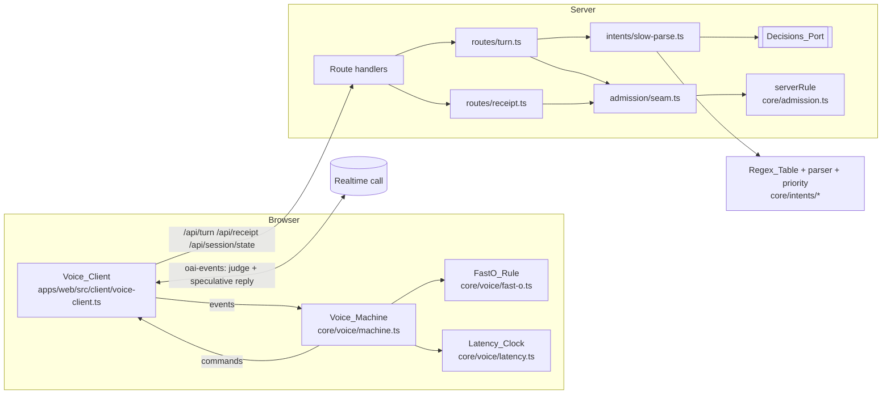
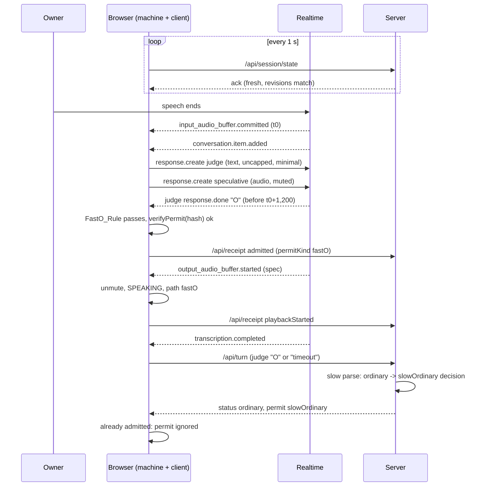
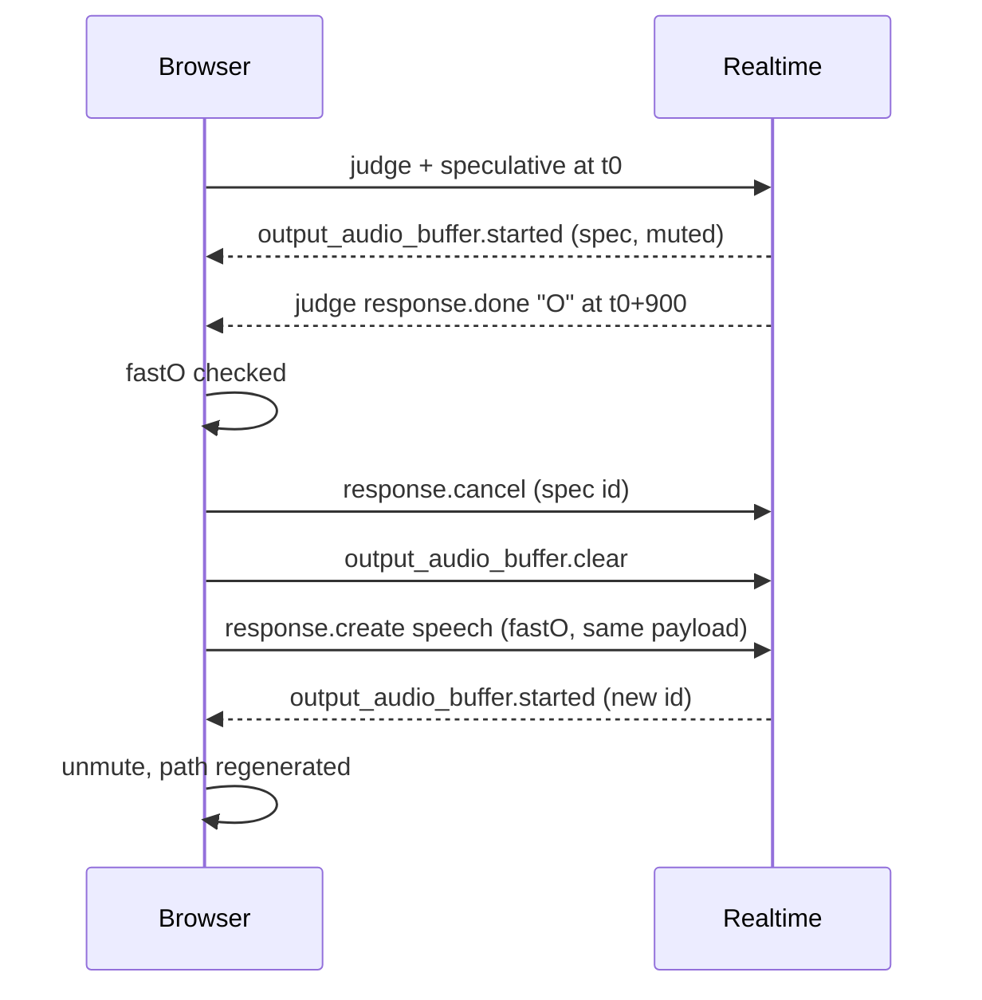
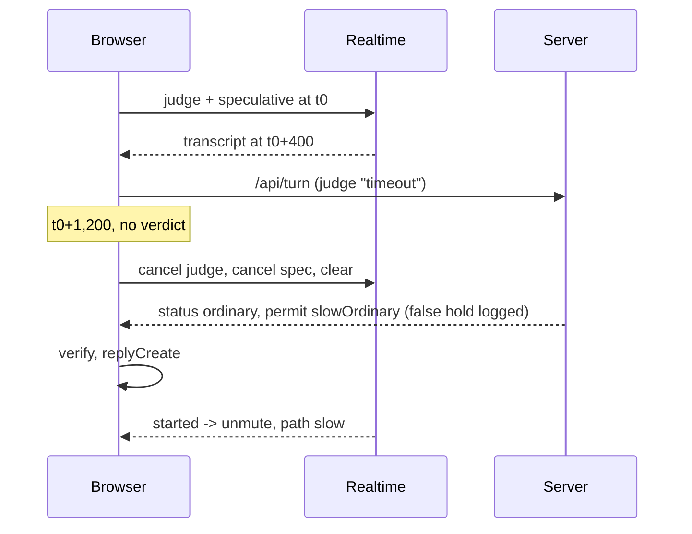
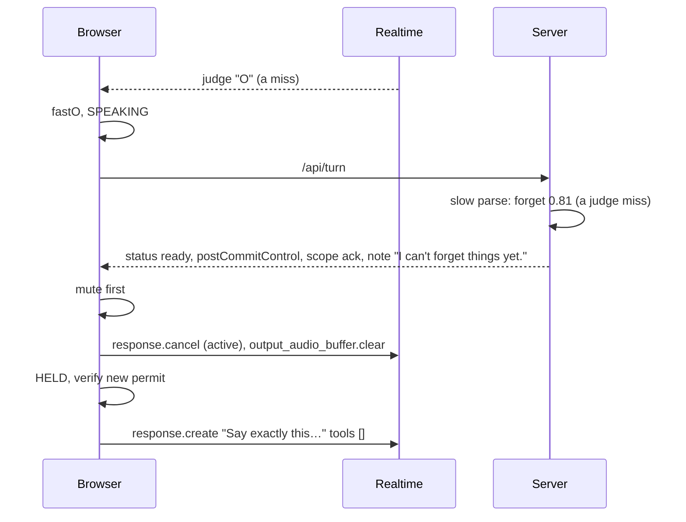

# Design Document: voice-control

## Overview

This design builds `requirements.md` (cited as R*n.m*) for Brief 011 and its reviews (`docs/briefs/011-review-requirements.md`, `docs/briefs/011-review-design.md`). Contract sections are cited as "C§n" (`docs/design/memory-contracts-v2.md`) and "MS§n" (`docs/design/memory-spec-v3.md`); earlier contract questions as "Q*n*" (`.kiro/specs/first-spoken-call/design.md`). `docs/design/` is read-only. Every departure from, or gap-fill in, the contracts is listed under [Contract questions](#contract-questions), numbered from 52.

The change in one paragraph. At each commit the Browser_Client sends two out-of-band responses on the data channel: the judge and a muted speculative reply. A valid `O` plus a fresh StateAck lets the browser issue a `fastO` Permit itself and unmute. Anything else holds the turn, and the server decides from the transcript: every final transcript (and every typed U line) runs the slow parse (a regex table that decides only when the parse fails, then one Decisions call), and a pure `serverRule` in `packages/core` maps the turn to exactly one Permit kind or a hold. A control hit that arrives while a `fastO` reply is playing cuts it. The Admission_Seam stays the only server code that creates a Permit and writes one ledger decision per admission, and it also records the browser's `fastO` from the `admitted` receipt. In wave B, company and quiet hang up and reopen with a narrower Head, and alone widens it again without a hang-up.

What stays: the reducer is still pure (`step(state, event, now)`), the payload hash is still `admissionPayload` (C§6 Hash), the generation stays 1 per Session (R21.3, Q27), and every route keeps its auth and idempotency.

## Architecture



### Module layout

New and changed files. Files not listed are unchanged.

```
packages/core/src/
  admission.ts            serverRule (replaces devPermitKind), RuleInput/RuleOutcome; payload and hash unchanged
  voice/judge.ts          JUDGE_V2_INSTRUCTIONS; JudgeSettings gains contract and deadlineMs; APP_JUDGE_SETTINGS
  voice/machine.ts        new phases JUDGING, SPECULATING, SWAPPING; judge/speculation/outstanding/latency state
  voice/fast-o.ts         FastO_Rule: fastOProblem, issueFastO (pure)
  voice/lines.ts          every Fixed_Line, RECOVERY_LINE moves here (re-exported from admission.ts)
  voice/vad.ts            SEMANTIC_VAD settings as named constants
  voice/latency.ts        LatencyRow, path, refused, late, p50/p95
  voice/testing/          arbCall and every machine generator and trace helper (plain modules, not guarded)
  intents/testing/        probability-vector and RuleInput generators
  intents/regex.ts        Regex_Table and regexMatch
  intents/request.ts      TurnIntents request builder (Decisions body)
  intents/parse.ts        response parser, normalize, CANDIDATE_P, isOrdinary, choose (priority)
packages/server/src/
  admission/seam.ts       admit (server Permits), recordFastO (browser fastO); one decision each
  admission/dev-admit.ts  deleted
  intents/slow-parse.ts   runSlowParse: regex, then Decisions_Port with the 350 ms deadline
  intents/repair.ts       Parse_Repair after the response, 2 s deadline
  openai/*                new endpoint "decisions.create" (POST /v1/decisions) in the port, live and fake
  routes/turn.ts          parse before the transaction, serverRule through the seam, status mapping, audience, Superseding_Post
  routes/receipt.ts       admitted + fastO -> recordFastO
  routes/state.ts         ack:null rule; Session write at most every 30 s
  routes/tool.ts          serverRule row for tool continuations
  routes/open.ts          audience inheritance and the swap line (wave B); compileHead audience
  routes/close.ts         reason "error" keeps a non-private audience for a reconnect (wave B)
  routes/debug-memory.ts  permit kind from the cited request entry; audience and failed-parse count
  turns.ts                Turn.rootSlices carries the turn's Slice; parse fields on the Turn
apps/web/src/client/voice-client.ts   sentAt on stateOk, lastLoudAt on commit, event_id, error events, swap
apps/web/src/components/DebugPanel.tsx latency rows, audience, failed parses, decisions grouped by Turn
scripts/property-guard.mjs (+ test)   R1.5–R1.8
scripts/judge-spike/{harness,cli,summary}.ts   --judge, slow parse per line, new summary rows
```

Import rules hold: `intents/*` in core are pure and import nothing from the server; the Decisions_Port lives in the server and is the only code that calls `/v1/decisions`.

## Browser: the Voice_Machine

### New state

| Field | Type | Meaning |
|---|---|---|
| `judge` | `{turnId, responseId: string\|null, eventId, sentAt, deadline, verdict: JudgeVerdict\|null, valid: boolean}\|null` | The current turn's judge. |
| `spec` | `{turnId, responseId\|null, eventId, payload: PayloadInput, hash: string\|null, mutedStarted: boolean, heldCall: ToolCallItem\|null}\|null` | The speculative reply and the payload it was created from. |
| `unadmitted` | `{itemId, commitSeq}[]` (≤ 8 used) | Unadmitted_Fragments of this generation. Cleared up to a turn's last `commitSeq` when a reply of that turn is admitted. |
| `outstanding` | `{turnId, deadline}[]` | Outstanding_Turns. An entry leaves on its `turnOk`, `turnFailed` or deadline (post + `TURN_RESPONSE_LIMIT_MS`). |
| `missing` | `{turnId, clientSeq, requestId, body: TurnBody, items: VoiceItem[]}[]` (≤ 2) | Turns posted `missing` whose transcripts may still arrive (R7.8). An entry leaves when its Superseding_Post is sent, or 10,000 ms after its post. |
| `lastTurnResponseAt` | `number\|null` | opsClock time the last `/api/turn` response arrived. |
| `stateSentAt` | `number\|null` | When the in-flight `/api/session/state` went out; at most one in flight. |
| `admittedTurnId` | `string\|null` | The turn whose reply is admitted (R3.8). |
| `afterReply` | `"swap"\|null` | Wave B: swap once the admitted care reply ends (R14.7). |
| `latency` | `{current: LatencyRow\|null, rows: LatencyRow[] (≤ 50)}` | Latency_Clock. |

`TimerName` gains `judge`, `poll` and `swap`. `VoicePhase` gains `JUDGING`, `SPECULATING` and, in wave B, `SWAPPING` (local names; see question 86).

**Wait limits** (R7.9), named constants in `voice/machine.ts`, all counted on the browser opsClock:

| Constant | Value | From | Then |
|---|---|---|---|
| `JUDGE_LIMIT_MS` (= `APP_JUDGE_SETTINGS.deadlineMs`) | 1,200 | t0 | cancel judge and spec; slow path |
| `HELD_TRANSCRIPT_LIMIT_MS` | 2,500 | t0 | post `missing`; the server answers `recoveryOnly`; the Neutral_Line plays |
| `ADMITTED_TRANSCRIPT_LIMIT_MS` | 5,000 | t0 | post `missing`; the admitted reply is untouched |
| `TURN_RESPONSE_LIMIT_MS` | 5,000 | the post | RECOVERY with nothing to play, as a failed request does today |
| `LATE_TURN_MS` | 2,500 | t0 | not a cut-off: a Permit arriving later marks the LatencyRow `late` |
| `MISSING_WINDOW_MS` | 10,000 | the `missing` post | the turn leaves `missing`; a later transcript is dropped |

The Voice_Client's `TURN_TIMEOUT_MS` drops from 10,000 to 5,000, and its transient retries stop when that time is used up, so the request's own timeout and the machine's `permit` timer end together.

### New and changed events and commands

- `realtime` events: `input_audio_buffer.committed` carries `lastLoudAt: number | null` from the Voice_Client (Latency_Clock). `RealtimeServerEvent` gains `error: {type:"error", error:{code?, message?, event_id?}}`.
- `stateOk` carries `sentAt`, the opsClock time its request went out (R4.1).
- New `specHashed {eventId, hash}`: the answer to a new `hashPayload {eventId, payload}` command, the same `crypto.subtle` hash as `verifyPermit`.
- `send` commands for the judge and the speculative reply set a client `event_id` (`judge:<turnId>:<n>`, `spec:<turnId>:<n>`), so an `error` event can be matched to the response that failed (question 85).
- The Voice_Client polls `/api/session/state` from a `poll` timer every 1,000 ms while `IN_CALL`, skipping a tick when one is in flight; the 45 s `refresh` stays as the fallback when polling fails.

### The state machine, new and changed rows

Times are browser opsClock milliseconds. `t0` is the turn's Commit (`turn.tEnd`). "Cancel X" means `response.cancel` by response ID, or, when the ID is not known yet, a cancel on its `response.created`. "Clear" means `output_audio_buffer.clear`. Every unmute is preceded by a permit check (`permitProblem`), and every `armTimer` also sets `deadlines` (KV06).

| State | Event | Guard | Next state | Commands |
|---|---|---|---|---|
| LISTENING, WAIT_ITEM, HELD | `committed` | phase admits a commit (as today) | WAIT_ITEM | add item, `tEnd=now`; record `latency.commit=now`, `lastLoud`; arm `item` t0+600, `transcript` t0+2,500 |
| WAIT_ITEM | `item.added` | all items have `commitSeq`; `noteWaiting` false; `judgeCreate` accepts; a Deck is held | SPECULATING | `send(judgeCreate(APP_JUDGE_SETTINGS))`; `send(specCreate)`; `hashPayload(spec)`; mute; arm `judge` t0+1,200; disarm `item`; record `judgeSent` |
| WAIT_ITEM | `item.added` | as above but `noteWaiting` true | JUDGING | `send(judge)` only; arm `judge` t0+1,200 |
| WAIT_ITEM | `item.added` | `judgeCreate` throws (more than 8 fragments or 4 safe turns) | HELD | nothing sent; the slow path decides (R2.7) |
| WAIT_ITEM | `timer item` | an item has no `item.added` | HELD | no judge (R2.5) |
| SPECULATING, JUDGING | `response.created` | metadata purpose `judge`/`speculative`, this turn, this generation | same | record the response ID; add to `inFlight` |
| SPECULATING | `output_audio_buffer.started` | the spec response, not admitted | same | `spec.mutedStarted=true`; `latency.firstMuted=now`; stays muted |
| SPECULATING | `function_call_arguments.done` | the spec response | same | `spec.heldCall=call`; no `/api/tool` (R6.3) |
| SPECULATING | judge `response.done` | `parseJudgeDone` valid `O`; `now < t0+1,200`; `fastOProblem` is null; `spec.hash` known | SPECULATING (admitting) | build the `fastO` Permit; `verifyPermit(permit, replyPayload(st))` |
| SPECULATING | judge `response.done` | valid `O` but `spec.hash` not yet known | same | keep the verdict; act on `specHashed` |
| SPECULATING | `permitChecked` | the `fastO` Permit; hash equal; no problem | SPEAKING if `spec.mutedStarted` is false and audio then starts; see next rows | `admittedTurnId=turn`; clear `unadmitted` to the turn; `receipt admitted (fastO)`; re-arm `transcript` t0+5,000; if `spec.heldCall` then `/api/tool` and TOOL_WAIT |
| SPECULATING | (admitted) | `spec.mutedStarted` false | waits for audio | on spec `output_audio_buffer.started`: `unmuteOutput`, SPEAKING, `receipt playbackStarted`, `latency.audible=now`, path `fastO` |
| SPECULATING | (admitted) | `spec.mutedStarted` true | HELD with `active` | cancel spec; clear; `send(replyCreate(fastO))`; on its started: unmute, SPEAKING, path `regenerated` (R3.2) |
| SPECULATING | judge `response.done` | valid `O` and `fastOProblem` not null | HELD | cancel spec; clear; `latency.refused` = the problem (R3.6, R18.6) |
| SPECULATING, JUDGING | judge `response.done` | `H`, `U` or invalid | HELD | cancel spec; clear; drop `heldCall`; `judge.verdict` kept for the post (R3.3) |
| SPECULATING, JUDGING | judge `error` | `event_id` is this judge's | HELD | as `U` |
| SPECULATING | spec `error` | `event_id` is this spec's | same | `spec=null`; a later valid `O` creates the reply fresh under `fastO` (the sequential fallback) |
| SPECULATING, JUDGING | `timer judge` | no verdict | HELD | cancel judge and spec; clear (R3.5) |
| SPECULATING, JUDGING, HELD | all transcripts in | — | same | `postTurn(final)` with `judge` = verdict or `timeout` (R3.9); keep `ack`; add to `outstanding`; arm `permit` post+5,000 |
| SPECULATING | `turnOk` | `ordinary` + `slowOrdinary`, no notes, hash equals `spec.hash` | as for a checked `fastO`, kind `slowOrdinary` | cancel judge; admit the spec response (unmute at its start, or regenerate if `mutedStarted`) |
| SPECULATING | `turnOk` | `ready` + `postCommitControl` | HELD | cancel judge and spec; clear; `requestVerify` (control reply) |
| SPECULATING | `turnOk` | `ordinary` + `postCommitControl` (a no-cut hit) | HELD | cancel judge and spec; clear; `requestVerify` (the reply is created fresh with the control Permit; nothing played yet) |
| HELD | judge `response.done` | — | HELD | ignored (R3.4) |
| HELD | `turnOk` | `ordinary` + `slowOrdinary` | HELD then SPEAKING | `requestVerify`; reply with Head and plain notes (false hold or judge timeout); `late` if now > t0+2,500 |
| HELD | `turnOk` | `ready`, or `ordinary` + `postCommitControl` | HELD then SPEAKING | `requestVerify`; `replyCreate` with tools by scope (below); an `ack` note is spoken verbatim (R12.4, R12.6, R12.7); `late` if now > t0+2,500 |
| HELD | `turnOk` | `hold` or `clarify` + `recoveryOnly` | RECOVERY | play the Neutral_Line |
| HELD | `turnOk` | `blocked` (wave B) | SWAPPING | see SWAPPING |
| HELD | `timer permit` | no reply admitted (post + 5,000) | RECOVERY | nothing plays; a `turnOk` after this only adopts its Deck (R7.5) |
| SPEAKING, TOOL_WAIT | `turnOk` | turn is `admittedTurnId`; status `ready`, `blocked` or `clarify` | HELD, RECOVERY or SWAPPING | mute first; cancel active; clear; then as the HELD row for that status (R11.6, R10.2) |
| SPEAKING, TOOL_WAIT | `turnOk` | turn is `admittedTurnId`; status `ordinary` or `hold` | same | permit ignored (R3.8, R11.4, R11.7); adopt Deck; leave `outstanding` |
| any in call | `turnOk` | turn is not the current turn | same | adopt Deck (KV05); leave `outstanding`; `lastTurnResponseAt=now`; permit ignored |
| SPEAKING, SPECULATING | `timer transcript` | a reply of this turn is admitted (t0+5,000) | same | `postTurn(missing)`; add to `missing`; the reply plays on (R7.6) |
| SPECULATING, JUDGING, HELD | `timer transcript` | nothing admitted (t0+2,500) | HELD | `postTurn(missing)`; add to `missing`; cancel judge and spec; clear; the `recoveryOnly` answer plays the Neutral_Line (R7.4) |
| any in call | `transcription.completed` | its item belongs to a `missing` entry, and every item of the entry now has a transcript | same | send the Superseding_Post: the entry's body with `transcriptState:"final"`, the joined transcript, items `final:true`, a new `requestId`, `supersedesRequestId` = the entry's `requestId`, the current revisions; remove the entry; no reply follows (R7.8) |
| any in call | `speech_started` | busy, or judge/spec in flight | LISTENING | mute; cancel judge, spec and active; clear; drop pending Permits (KV04, R2.6); an unposted turn is kept, so the next commit judges all of it |
| any in call | `stateOk` | `sentAt > lastTurnResponseAt` | same | adopt Deck; `ack` = response ack (may be null) |
| any in call | `stateOk` | `sentAt <= lastTurnResponseAt` | same | adopt Deck; `ack=null` (R4.4) |
| any in call | `timer poll` | no state request in flight | same | `postState`; `stateSentAt=now`; arm `poll` +1,000 |
| SWAPPING (wave B) | enter | from `turnOk blocked`, no permit | SWAPPING | mute; cancelAll; `teardown`; no `/api/session/close` (the server is hanging up); `open {previousSessionId: current}`; arm `swap` now+12,000 |
| SWAPPING | enter | `turnOk blocked` with a care Permit | HELD then SPEAKING | play the care reply; `afterReply="swap"` |
| SPEAKING | `output_audio_buffer.stopped` or barge-in | `afterReply="swap"` | SWAPPING | as the first SWAPPING row |
| SWAPPING | `openOk`, `channelOpen`, `stateOk` | as CONNECTING/CONFIGURING today | SWAPPING until the ack matches, then LISTENING | the existing open/connect/configure handlers; avatar stays `thinking`; call button stays "hang up" (R14.4) |
| SWAPPING | ack matches and `openOk.proactive` held | — | HELD then SPEAKING | synthetic turn `proactive.turnId`; `requestVerify(proactive.permit, notes:[whisper])`; the Fixed_Line spoken verbatim (R14.3) |
| SWAPPING | `timer swap`, `openFailed`, `sdpFailed`, `connectionLost` | — | RECOVERY | `connectionRecovery` as today (R14.4) |
| any in call | `connectionLost` | an Outstanding_Turn exists | same, muted | wait until its `turnOk` (blocked: SWAPPING; else RECOVERY) or its deadline (RECOVERY) (R14.6) |

`avatarState` maps `WAIT_ITEM`, `JUDGING`, `SPECULATING`, `HELD`, `TOOL_WAIT` and `SWAPPING` to `thinking`, and returns `speaking` only when the phase is `SPEAKING` and `outputMuted` is false (R6.4).

### The speculative reply

`specCreate(st)` is `replyCreate` for a speech reply with three differences: metadata purpose `speculative`, an `event_id`, and no notes (S1+ notes never sit on the Deck; Deck whispers are `[]` in this slice). Its `input` is the Deck's safe turns plus an `item_reference` for each of this turn's items in commit order, the same `audioIds` the server hashes. Its payload is `replyPayload(st, {notes:[], toolOutput:null})`, kept in `spec.payload`, and hashed at once with `hashPayload`.

When the spec response is admitted under a server Permit or `fastO`, the machine moves it into `active`, so the existing `output_audio_buffer.started`, `stopped`, transcript and receipt handling applies unchanged.

### The FastO_Rule

`fastOProblem(st, now)` returns the first failing condition by name, or null (R4.1, KV13, R18.6). The names are the LatencyRow's `refused` values:

1. `verdict`: not `judge.valid && judge.verdict === "O"` for `st.turn` and the session generation, or `now ≥ t0 + 1,200`.
2. `ack`: `st.ack` is null, its four revisions differ from the Deck's, `ack.stamp.generation > session.generation`, or `now - issuedOpsAt ≥ 2,500`.
3. `outstanding`: `st.outstanding` holds a live entry for another Turn. This Turn's own post doesn't count (review of wave A, item 1).
4. `staleAck`: the held ack came from a state request sent at or before `lastTurnResponseAt`. (Such an ack is dropped when it is adopted, so this shows as `staleAck` only when the last ack the machine saw was refused for this reason; the machine keeps `ackDroppedStale: boolean` to tell it from `ack`.)
5. `noteWaiting`: `st.deck.noteWaiting` is true.
6. `hash`: the `verifyPermit` answer differs from `spec.hash` (set on `permitChecked`, not by `fastOProblem`).

`ack:null` from the server (S2 among the last four, a Parse_Gap or `unknown`) shows as `ack`; the Debug_Panel adds "fastO off: parse gap" from the server's Session view when a gap exists (R13.5).

`issueFastO(st, now, permitId)` returns `{permitId, stamp: localStamp(st), kind:"fastO", scope:"reply", approvedPayloadHash: spec.hash, noteIds:[], momentIds:[], expiresAt: now+10,000}` (R4.6). `permitId` is the `freshId` of the judge's `response.done` event (a 43-character random ID from `randomId`). The checked hash is the hash of `replyPayload(st)` at the verdict, so a Deck or turn change between the commit and the verdict fails the check with `hash`.

The S2-among-the-last-four rule, the Parse_Gap rule and the `unknown` rule reach the browser through the server's `ack:null` (R4.2): the browser holds no data that could decide them.

### Replies the code words

- **`ack` notes.** A Permit whose notes include a `W` of kind `ack` is created as `{conversation:"none", instructions:'Say exactly this and nothing else: "<text>"', input:[], tools:[]}`, as `recoveryOnly` is today. Its `noteIds` name the note, and the payload hash covers it (R12.4).
- **Tools by scope** (R12.6, R12.7, question 87). The browser can't see the parse, so the Permit's `scope` tells it: `replyCreate` installs `tools:[]` when the Permit's kind is `recoveryOnly` or its `scope` is `ack`, and the speech tools (`recall`, `tool_choice:"auto"`) otherwise. The Server_Rule gives scope `ack` to the crisis care reply and to every Fixed_Line, and scope `reply` to every other control reply (question 88). The crisis care reply needs nothing else: the Head's persona section already holds the crisis instruction (`packages/core/src/head.ts`), and the reply hears the turn's audio.

### The Latency_Clock

`LatencyRow = {turnId, lastLoud, commit, judgeSent, verdict, verdictAt, firstMuted, permitAt, audible, path, refused, late, commitDelayMs, endToAudibleMs}`, times in browser opsClock milliseconds or null. `path` is `fastO` (admitted, unmuted at the spec's own start), `regenerated` (admitted after muted audio began, or the sequential fallback), `slow` (`slowOrdinary` or `postCommitControl` from the server) or `recovery`. `refused` is the `fastOProblem` name of a turn that had a verdict but didn't take `fastO`, null otherwise. `late` is true when `permitAt > commit + LATE_TURN_MS` (R18.7). `commitDelayMs = commit - lastLoud`; `endToAudibleMs = audible - lastLoud` (R18.1, R18.3).

- **Last loud frame.** The Voice_Client samples the mic analyser every 20 ms while in a call (`LATENCY_SAMPLE_MS = 20`) and keeps the last opsClock time whose unsmoothed `rawLevel` was at least `LOUD_LEVEL = 0.05`. That is the spike's `SPEECH_RMS_THRESHOLD` (400 of 32,767, an RMS of 0.0122) times the Level_Meter's `LEVEL_GAIN` of 4. Three differences make the numbers comparable only roughly: the analyser reads 8-bit samples (one step is 0.0078, so the threshold sits at about 1.6 steps); the browser mic has echo cancellation and noise suppression on, and the spike's WAVs did not; and the 512-sample window is read every 20 ms, so the last loud frame is late by up to 20 ms (R18.5).
- **Audible start** is `max(unmute time, output_audio_buffer.started of the admitted response)`. The spike measured the first `response.output_audio.delta` over its WebSocket; WebRTC gives no deltas, and `started` marks the start of playout to the peer, so the app's number includes the WebRTC jitter buffer. Read the app's p50 against the 1.3 s target, not against the spike's 1,317 ms.
- `latency.ts` holds `percentile(values, p)` (nearest rank) and `summarize(rows)` → `{byPath: {path, n, p50, p95}[], refused: {reason, n}[], late: n}`. The Debug_Panel shows the last row and the summary (R18.2, R18.6, R18.7). No number goes on the wire (R18.4).

### VAD

`SEMANTIC_VAD = {type:"semantic_vad", eagerness: VAD_EAGERNESS, create_response:false, interrupt_response:false}` with `VAD_EAGERNESS = "auto"` in `voice/vad.ts`; `sessionUpdate` uses it (R19). Tuning means changing `VAD_EAGERNESS` after reading `commitDelayMs`.

## Sequence diagrams

### Ordinary turn on `fastO`



### `O` after muted audio began



### `H`, then a control route

```mermaid
sequenceDiagram
  participant O as Owner
  participant B as Browser
  participant R as Realtime
  participant S as Server
  participant D as Decisions
  O->>R: "forget what I said about work"
  B->>R: judge + speculative at t0
  R-->>B: judge "H"
  B->>R: cancel spec, clear
  B->>B: HELD, arm permit (post + 5,000)
  R-->>B: transcript
  B->>S: /api/turn (judge "H")
  par
    S->>S: regex: RX1 matches (recorded; decides only if the parse fails)
  and
    S->>D: TurnIntents (350 ms)
    D-->>S: forget 0.94
  end
  S->>S: serverRule: postCommitControl, scope ack, note "I can't forget things yet."
  S-->>B: status ready, permit, notes [ack]
  B->>B: verify hash
  B->>R: response.create "Say exactly this…" tools []
  R-->>B: started -> unmute
```

### Judge timeout, then `slowOrdinary`



When the `slowOrdinary` response arrives while still SPECULATING (before t0+1,200), it admits the speculative reply itself, if the hashes match, and the judge is cancelled.

### A late control hit cuts audio



Only a route that changes what is said cuts: retained crisis, forget, wave B alone and the company or quiet swap, and a failed parse with a Regex_Match. Every other hit (for example "quick question, what time is it in Denver?" scoring `rushed`) answers `ordinary` with `postCommitControl`, and a reply already playing under `fastO` finishes (question 92).

A parse that **fails** with a Regex_Match answers `clarify` with `recoveryOnly` and cuts the same way, then plays the Neutral_Line. A parse that fails with no Regex_Match answers `hold` with `recoveryOnly`, and a playing `fastO` reply finishes (R10.2, R11.7).

### A transcript after the turn was posted `missing`

```mermaid
sequenceDiagram
  participant B as Browser
  participant R as Realtime
  participant S as Server
  Note over B: t0+2,500, no transcript, nothing admitted
  B->>S: /api/turn (missing, requestId r1)
  S->>S: Turn transcriptMissing; parseLease (window 10 s); Effective_Audience unknown
  S-->>B: hold, recoveryOnly
  B->>R: Neutral_Line
  R-->>B: transcription.completed at t0+3,100
  B->>S: /api/turn (final, same turnId and clientSeq, supersedesRequestId r1)
  S->>S: slow parse ordinary: Turn committed, Evidence, Extract_Job, lease cleared, watermark moves
  S-->>B: ordinary, no permit
  B->>B: nothing spoken; next state poll gets an ack
```

### The company swap (wave B)

```mermaid
sequenceDiagram
  participant O as Owner
  participant B as Browser
  participant R1 as Old call
  participant S as Server
  participant R2 as Fresh call
  O->>R1: "my cousin just sat down"
  B->>S: /api/turn
  S->>S: company hit: audience company, policyRev+1, waitDeadline, Session closing, hangup Job
  S-->>B: status blocked, no permit
  S->>R1: hang up (after the response)
  B->>B: mute, cancel, teardown, SWAPPING (avatar thinking)
  B->>S: /api/session/open (previousSessionId)
  S->>S: inherit company; compileHead(company): no S1+ lines, rules kept; proactive = postCommitControl + ack
  S-->>B: deck, ack, proactive
  B->>S: /api/session/sdp
  B->>R2: connect, session.update
  B->>S: /api/session/state -> ack
  B->>R2: response.create "Got it. I'll keep things general for now."
  R2-->>B: started -> unmute, LISTENING after
```

## Server

### The Server_Rule (pure, `packages/core/src/admission.ts`)

```
RuleInput = {
  source: "asr" | "typed" | "pasted" | "tool",
  transcript: "final" | "missing" | "failed",
  judge: "O" | "H" | "U" | "timeout" | "error" | "typed",
  parse: {kind:"ordinary"} | {kind:"hit", chosen: ControlClass | null, candidates: ControlClass[], uncertain: boolean}
       | {kind:"failed", why: "deadline" | "transport" | "invalid" | "oversize"} | {kind:"none"},
  regexMatch: boolean,         // a Regex_Table hit; decides only when the parse failed
  audience: Au,                // Effective_Audience
  narrowedHere: boolean,       // this Session narrowed during itself (wave B)
  callLive: boolean,           // the Session has a registered call
  parseGap: boolean,
  noteSens: "none" | "S0" | "S1+",
  wordsPer2s: boolean, allFinal: boolean,
  toolParseCommitted: boolean,
  wave: "A" | "B",
}
RuleOutcome = {kind:"permit", permit: PermitKind, scope: "reply" | "ack", notes: "none" | "S0" | "all", line: FixedLine | null,
               swap: "none" | "now" | "afterReply", cut: boolean}
            | {kind:"hold", reasons: ReasonCode[]}
```

No input compares the server clock with a browser timestamp (R8.7): the old `late` input is gone. `cut` is true when the outcome must stop a playing reply; the route turns it into the status.

Rows are checked in order; the first that matches decides. `chosen` is `choose(candidates)` from R10.7; `crisis ∈ candidates` is "crisis".

| # | When | Outcome |
|---|---|---|
| 1 | `narrowedHere` | hold `["audience"]`; the route answers `blocked` (R14.5) |
| 2 | `source=pasted` | `postCommitControl`, scope reply, notes S0 (a pasted turn with an S1+ note holds `["sensitivity"]`, as today) |
| 3 | `source=tool` | `toolParseCommitted` ? `slowOrdinary`, notes `all` if `audience=private` else S0 : hold `["missingDependency"]` (R8.11, R12.7) |
| 4 | `transcript` missing or failed | `recoveryOnly`, notes none, `cut:false` (R7.4, R8.7) |
| 5a | `parse.kind=failed` and `regexMatch` | `recoveryOnly`, notes none, `cut:true`, reasons as 5b (R10.2) |
| 5b | `parse.kind=failed` | `recoveryOnly`, notes none, `cut:false`, reasons `["DEPENDENCY"]` (deadline, transport), `["invalidInput"]` or `["oversize"]` (R11.7) |
| 6 | hit, crisis, wave B, `company` or `quiet` also a candidate, `callLive` | `postCommitControl`, scope ack, notes none, swap `afterReply`, `cut:true` (R14.7) |
| 7 | hit, crisis | `postCommitControl`, scope ack, notes none, `cut:true` (R12.1, R12.6). A typed line (judge `typed`) with no call open: notes `all` in a private audience with no gap, else S0 (R8.6, R8.9; review of wave A, items 17 and 24) |
| 8 | hit, chosen `company` or `quiet`, wave B, `callLive` | hold `["audience"]` + swap `now`; the route answers `blocked` |
| 9 | hit, chosen `company` or `quiet`, wave B, no call | `postCommitControl`, scope ack, line COMPANY, `cut:true` |
| 10 | hit, chosen `alone`, wave B | `postCommitControl`, scope ack, line ALONE, `cut:true` |
| 11 | hit, chosen `forget` | `postCommitControl`, scope ack, line FORGET_NOT_YET, `cut:true` (R12.3) |
| 12 | any other hit (a class, or `uncertainSpeaker` alone) | `postCommitControl`, scope reply, notes S0, `cut:false`: the route doesn't change what is said (R12.2, R12.5, R12.7; question 92). A typed line (judge `typed`) with no call open in a private audience with no gap: notes `all` (R8.6; item 24) |
| 13 | ordinary | `slowOrdinary`, scope reply; notes `all` only if `judge=O` (or `typed`), `wordsPer2s`, `allFinal`, no `parseGap`, `audience=private`; else S0; `cut:false` (R8.4, R8.5) |

A Regex_Match never changes rows 6 to 13 (R10.2). It is logged with the Turn as `turn.regex {turnId, ids}` and returned to the Harness (question 90).

The outcome is the same function for voice and typed U turns (R8.8); `judge` is `typed` for typed lines, which row 13 treats as `O` (C§6: typed text substitutes audio/judge). `devPermitKind` is deleted; its rows map to rows 2, 3, 4 and 13.

### The Admission_Seam

`admit(tx, input, deps)` keeps its signature plus `rule: RuleInput`, `requestEntryId` and `audience`. It calls `serverRule`, then, for a permit outcome, builds the Permit as `devAdmit` did (hash, `permitId = H(permit, stamp, kind, hash)`, TTL 10 s), adding the Fixed_Line `ack` note when `line` is set. It writes one `decision`:

```
{purpose:"answer", acceptedRefs:[turnRef, {type:"ledger", id: requestEntryId, rev:1}] (permit) or [{type:"ledger",…}] (hold),
 heldRefs: [] (permit) or [turnRef] (hold), reasonCodes: outcome reasons, plus "quiet" for a quiet hit,
 audience: Effective_Audience}
```

The `ledger` Ref names the `/api/turn` request entry, whose stored response holds the Permit with its kind, the status and the notes (question 57).

`recordFastO(tx, {uid, stamp, responseId, opsNow, audience})` writes the `fastO` decision with ID `H("fastO", sessionId, turnId)`, if absent: `state:"complete"`, `acceptedRefs:[turnRef]`, `reasonCodes:["ok"]`. It creates no Permit (R9.1). It then updates the Turn, if it exists, with `judge:"O"`, `admittedAt`, `spokenResponseId:responseId`. `/api/turn`, when it creates the Turn, reads that decision ID and, if present, writes the same three Turn fields. Either order gives the same records (R9.2).

Both functions are in `admission/seam.ts`, the only module that writes `decision` entries for purpose `answer` and the only server code that builds a `Permit` (checked by an import-boundary test, as R17.1 is today).

### `/api/turn`

1. `ensureCoreDocs`, `beginRequest`, and **in parallel** `runSlowParse` (regex, then Decisions with a 350 ms deadline) and, for a typed U line with no call, the typed reply's Responses call (R8.9). Pasted lines run neither (R8.10).
2. One transaction, as today, adding: the Turn's `parseState` (`committed` or `failed`), `uncertainSpeaker` (the probability, or 0), `judge` (O/H/U; `timeout`, `error` and `typed` store null), `rootSlices: [the turn's Slice]`; the `fastO` decision lookup; the contiguous parse watermark (`committedParseSeq = clientSeq` only when it was `clientSeq - 1` and this parse committed; question 73); the audience effects below; `serverRule` through `admit`.
3. Status mapping (R11.6, question 60):

| Outcome | `status` | `permit` | `notes` |
|---|---|---|---|
| row 13 | `ordinary` | `slowOrdinary` | per row |
| rows 7, 9–11 | `ready` | `postCommitControl` | ack note when a Fixed_Line |
| rows 2, 12 | `ordinary` | `postCommitControl` | S0 notes; no cut (question 92) |
| rows 4, 5b | `hold` | `recoveryOnly` | none |
| row 5a | `clarify` | `recoveryOnly` | none |
| row 6 | `blocked` | `postCommitControl` (care) | none |
| rows 1, 8 | `blocked` | null | none |
| other holds | `hold`, `retryAfterMs:0` | null | none |
| clientSeq ahead | `hold`, `retryAfterMs:250` | null | none (no writes, as today) |
| Superseding_Post | `ordinary` (or `ready` for a late hit, with no permit) | null | none |

4. After the response: schedule the Parse_Repair (if row 5 with `deadline` or `transport`), the hangup Job for a swap, and extraction as today.

### The Superseding_Post

`checkTurnRequest` accepts `supersedesRequestId` only with `source:"asr"`, `transcriptState:"final"` and items. The route takes this branch before the clientSeq compare-and-set (R11.9, question 89):

1. Read the superseded request entry `H("req", uid, "turn", supersedesRequestId)`. It must be `complete`, and its stored response's `stamp.turnId` must equal this request's `turnId`; else PARSE.
2. Run `runSlowParse` on the transcript, as for any turn.
3. One transaction: the Turn `turnId` must exist with `state:"transcriptMissing"`, `seq = clientSeq` and the same `itemIds`; else `stale` with no writes (a repeat after success is a replay of this request's own entry). Write the Evidence and its Extract_Job as a first post would; update the Turn to `state:"committed"`, `text`, `evidenceId`, `final:true`, `parseState`, `uncertainSpeaker`, `rootSlices`. If the Session's `parseLease.clientSeq` is this turn's, clear it. On an ordinary parse, advance `committedParseSeq` over every contiguous committed user Turn; on a hit, the late-hit effects of the Parse_Repair below; on a failed parse, `audience:"unknown"`. No Permit and no `decision` are written, since nothing is admitted.
4. Revisions are checked as for any turn: a stale stamp answers `stale` and the browser resends once with the new revisions.

The Evidence is new, not an edit (KC02): the first post wrote none, because its transcript was empty.

**Audience effects in the transaction.**

| Turn | Session change |
|---|---|
| transcript `missing` | `parseLease = {clientSeq, token, until: ops + 10,000}` (the Superseding_Post window); the Effective_Audience is `unknown` while it holds (R15.7). If a lease is already held for another turn, `audience:"unknown"` instead |
| transcription `failed` | `audience:"unknown"`, no repair (R15.7) |
| parse failed, deadline or transport | `parseLease = {clientSeq, token, until: ops + 2,500}`; the Effective_Audience is `unknown` while it holds (R15.2, R15.3). If a lease is already held for another turn, `audience:"unknown"` and no repair |
| parse failed, invalid or oversize | `audience:"unknown"`, no repair |
| wave B company or quiet hit | `audience:"company"`, `core/epoch.policyRev + 1`, `waitDeadline = ops + 10,000` (row 8) or `ops + 60,000` (row 6); row 8 also moves the Session to `closing` and writes its hangup Job, as `/api/session/close` does |
| wave B alone hit | `audience:"private"`, `policyRev + 1`, a new full Head (below); `waitDeadline` unchanged |

`Effective_Audience(s, ops) = s.parseLease !== null && msFromTs(s.parseLease.until) > ops ? "unknown" : s.audience`. An expired lease whose repair or Superseding_Post never committed is treated as a failed repair by the next `/api/turn` or state request that sees it: it writes `audience:"unknown"` and clears the lease.

### The slow parse

**Request** (`intents/request.ts`, checked against `DecisionCreateParams` in `node_modules/openai/resources/decisions.d.ts`, openai 7.45.1):

```
{model: FRANKI_BG_MODEL,
 input: [{role:"developer", content: TURN_INTENTS_PREFIX},
         {role:"user", content: "Last question (data): <text or none>\nOwner said (data): <utterance>"}],
 questions: [{type:"predicate", name:"forget", instructions:"Requests deletion rather than a reminder?"}, … 14 fixed rows in C§5 order,
             …{type:"predicate", name:"opens_<topicId>", …} for each door (none in this slice)]}
```

`TURN_INTENTS_PREFIX` is the C§5 literal. `lastQuestion` is null in this slice (no pending questions). The user message rendering is new (question 72). The builder refuses a turn whose prefix, utterance and last question together exceed 2,400 UTF-16 code units (R10.5, question 71); that is parse `failed: oversize`.

**Response** (`intents/parse.ts`, checked against `Decision`): `answers.length` must equal `questions.length`; answer *i* must have `type:"predicate"`, `name === questions[i].name` and a finite `probability` in [0, 1]. A refusal, a wrong type, a missing or extra answer, or a bad probability is `failed: invalid` (R10.6).

**Normalize and choose.** `p` holds the 14 named probabilities. Candidates are the Control_Classes with `p ≥ CANDIDATE_P = 0.20`. `choose` takes the first candidate in `PRIORITY = [forget, company, quiet, alone, crisis, hardRule, correct, transition, why, food, action, answer, rushed]` and retains all. `isOrdinary = no candidate && p.uncertainSpeaker < 0.10` (C§5 "Ordinary=controls<.20,speaker<.10"); a Regex_Match does not enter it. `uncertainSpeaker ≥ 0.10` with no candidate is a hit with `chosen:null` (R10.2, R10.7).

**The port.** `DecisionsPort.decide(body, deadlineMs): Promise<{ok:true, decision: unknown, ms} | {ok:false, why:"deadline"|"transport", ms}>`. The live adapter posts through the OpenAIPort's new `decisions.create` endpoint and races it with a `Timers` deadline on the opsClock (the Decisions API has no timeout or effort parameter, so the deadline is the caller's). The fake records requests and answers from a script, like the existing fake. `npm test` uses only the fake (R11.8).

### The Regex_Table

Applied to the transcript after NFKC, lower-casing, `’` → `'` and whitespace collapse. A match never selects a route and never overrules a parse that succeeded; it is logged with the Turn and returned to the Harness, so the summary can show what the regex caught that the parse missed. It decides only when the parse failed: a failed parse with a match answers `clarify` with `recoveryOnly` and cuts a playing reply (row 5a) (R10.2, R10.3).

| ID | Cue family | Pattern |
|---|---|---|
| RX1 | delete | `\b(forget|delete|erase|unsave)\b` |
| RX2 | quiet | `\b(between us|off the record|keep (it|this|that) (private|quiet|to yourself)|stop (mentioning|bringing))\b` |
| RX3 | company | `\b(on speaker|speakerphone|walked in|can hear (you|us|this|me))\b` |
| RX4 | hard rule | `\b(allerg(y|ies|ic)|anaphyla\w*|epipen|celiac|coeliac|intoleran(t|ce))\b` |
| RX5 | crisis | `\b(suicid\w*|kill myself|end it all|self[- ]harm|hopeless|panic attack|can'?t breathe)\b` |
| RX6 | correction | `\b(that'?s (wrong|not right)|i meant|not what i said)\b` |
| RX7 | life change | `\b(passed away|died|diagnosed|broke up|divorc\w*|laid off|lost my job)\b` |

Notes for review. `\bforget\b` does not match "forgot", "forgets" or "forgetting", and `\bdelete\b` does not match "deleted", so the near-miss probes o-04, o-16, o-19 and o-24 don't match. RX3 matches "I walked in the park", RX7 "my grandmother died ten years ago" and RX4 "I'm allergic to Mondays" (o-10); with a successful parse these change nothing, and with a failed parse they cost a "Sorry, say that again?" instead of a plain reply. "Don't forget to…" matches RX1.

**The close-copy test** (R10.3, and R16.2 for `judge_v2`): render each pattern source and each line of `lines.json` the same way (lower case, every run of non-letters → one space) and assert that no 4-word window of any line, nor any whole line shorter than 4 words, appears in the rendered table. The table above passes this by inspection; the test proves it.

### The Parse_Repair (`intents/repair.ts`)

Scheduled with `ctx.schedule` after the `/api/turn` response is sent, only for `failed: deadline | transport` (R15.3):

1. Run `runSlowParse` again on the stored Turn text with a 2,000 ms deadline.
2. In one transaction, check that the Session's `parseLease.token` is this repair's; then:
   - **ordinary:** Turn `parseState:"committed"`, `uncertainSpeaker`; clear `parseLease`; advance `committedParseSeq` over every contiguous committed user Turn (a query on the Session's turns by `seq`, as `earlierSafeTurns` does); audience untouched (R15.4).
   - **hit:** the same parse commit, then the late-hit effects: `policyRev + 1` (so the next state poll's higher Deck cancels any speech, KV05) and, in wave B, the audience effects of the hit; a company hit with a live call writes the hangup Job (R15.5). No late reply is spoken for reply-only classes; the ledger gets one `decision` with `heldRefs:[turnRef]`.
   - **failed:** `parseState` stays `failed`; clear the lease; `audience:"unknown"` (R15.6).
3. A parsed `alone` sets `private` and, like any committed parse, closes its own Turn's gap; it never moves `committedParseSeq` past another Turn's gap (R15.8; review of wave A, item 20).

### `/api/session/state`

- The Deck carries the Session's current safe turns (the last four user and assistant turns, S2 left out), computed by `safeTurnsOf` from the rows of the S2 check below, as `/api/turn` computes them for the next turn. This is how the browser learns Franki's last reply: the assistant Turn stored from the transcript receipt reaches the next reply within a second (review of wave A, item 2). A poll whose request went out before the last `/api/turn` answer gives the browser only a higher Deck.
- `ack` is null when `Effective_Audience = unknown`, when `committedParseSeq < lastClientSeq` (a Parse_Gap), or when an S2 user Turn is among the last four: one query on the Session's turns with `seq ≥ lastClientSeq - 3`, ordered by `seq`, limit 16, keeping `role:"user"` rows and reading `rootSlices[0].sens` (R4.2). Otherwise as today.
- The route writes the Session only when its `status` or `browserState` would change or its `expiresAt` would move by at least 30 s; on other polls it reads through `readSnapshot` and writes nothing (question 84). `Session.stateAck` is updated only on those writes; nothing reads it for admission.

### `/api/receipt`

An `admitted` receipt with `permitKind:"fastO"` and an accepted Stamp calls `recordFastO` in the receipt's transaction. Other kinds are unchanged.

### `/api/tool`

The parse wait is unchanged (100 ms polls, 1.5 s). The Permit comes from `admit` with `source:"tool"`, row 3: notes limited to S0 while the Effective_Audience isn't `private`.

### Wave B: company, quiet, the swap and alone

- **Narrowing** (row 8): see the audience effects. The response is `blocked`. The hangup Job runs after the response with its usual backoff.
- **Open with inheritance.** `/api/session/open` reads the Session named by `previousSessionId` (one more read). If it belongs to the Owner, its audience is not `private` and `waitDeadline ≥ ops`, the new Session starts with that audience; otherwise `private` (R14.8). `compileHead` takes the audience: when it is not `private`, every Memory line with `sens ≠ "S0"` is skipped, the rules section is unchanged, and the Now line says `Audience: company.` (R14.2).
- **The swap line.** When the open inherited the audience and the previous Session's `modifiers.crisis` is null, the open response's `proactive` is `{turnId: H("swapline", sessionId), permit, whisper, cards:[]}`: `permit` is a `postCommitControl` from `admit` (source typed, `chosen:company`, row 9 shape) over `{stamp, head, notes:[whisper], turns:[], audioIds:[], toolOutput:null}`, and `whisper` is the COMPANY ack note (R14.3).
- **Crisis with company** (row 6): `crisis` modifier set, audience and `policyRev` recorded, `waitDeadline = ops + 60,000`, Session stays `active`, no hang-up; the browser swaps after the care reply (R14.7). Every later `/api/turn` on this Session hits row 1.
- **Reconnect after a drop.** `/api/session/close` with `reason:"error"` on a non-private Session sets `waitDeadline = ops + 60,000`, so the reconnect's open inherits the audience. A close with `reason:"user"` leaves it null, so the next call starts `private`.
- **Alone** (row 10): before the transaction, `readSnapshot` + `buildHead(audience private)` as open does; in the transaction, `core/bundle` with `bundleRev + 1` and the new Head, `policyRev + 1`, `audience:"private"`. The response carries the new Deck and the ALONE ack note; the browser adopts the higher Deck (which sends `session.update` with the new Head) and then plays the line (R15.1).

## Debug_Panel

- **Permit kind.** For a decision whose ID equals `H("fastO", parentId, turnId)` of its turn Ref: `fastO`. Otherwise, read the cited `ledger` Ref (the request entry) and take `response.permit.kind`; a hold shows "hold". The issuer column becomes "seam" or "browser (fastO)" (R13.4).
- **False hold.** A `slowOrdinary` decision on a voice Turn whose stored `judge` is not `O`. "Class: not recorded" on control decisions until contracts v3 (R13.3).
- **Grouping.** Decisions are grouped by their turn Ref, so a Turn with `fastO` and `slowOrdinary` decisions shows as one reply, with the `fastO` one marked as the one that played.
- **Audience and parses.** The Session's stored audience, "unknown (repair pending)" while a `parseLease` holds, and the count of the Session's user Turns with `parseState:"failed"`. While `committedParseSeq < lastClientSeq`, "fastO off: parse gap" with the user Turn at `seq = committedParseSeq + 1` (R13.5).
- **Latency.** The last LatencyRow with its path and `refused` reason, the per-path p50 and p95, the count of each `refused` reason and the count of late turns, from the Voice_Client's machine state (R18.2, R18.6, R18.7).

## `judge_v2` and the Harness

- `JUDGE_V2_INSTRUCTIONS` is `JUDGE_V1_INSTRUCTIONS` with `Another person present, arriving, listening, on speaker or being addressed is company: H, even when said as small talk.` inserted as its own line after the `H:` line (R16.1). `JudgeSettings = {contract: "judge_v1" | "judge_v2", maxOutputTokens, effort, deadlineMs}`; `judgeCreate` picks the instructions by `contract` and writes it to `metadata.contract` (R16.3). `JUDGE_CONTRACT_SETTINGS = {judge_v1, 16, minimal, 600}` stays for C§5; `APP_JUDGE_SETTINGS = {judge_v2, "inf", minimal, 1,200}` is what the browser sends (R16.5; `judge_v2` since the live run of Nov 10, question 52). `JUDGE_DEADLINE_MS` stays 600 as the contract value; nothing in the app reads it.
- **Harness.** `--judge judge_v1|judge_v2` sets `contract`; the deadline defaults to `APP_JUDGE_SETTINGS.deadlineMs` and is recorded with the contract name in the run file's settings (R17.1, R17.6). Old run files without it ran at 600 ms. After each line's transcript, the Harness runs `runSlowParse` through a `DecisionsPort`: the fake (all probabilities 0, 0 ms, marked `fake` in the summary) by default, the live adapter only with `--live` (R17.2). Each row gains `regex: {hit, ids}`, `parse: {probabilities, chosen, ordinary, ms, missedDeadline, failure}`. The summary adds per control class: judge recall, slow-parse recall, joint miss, and false holds for each; plus the share of parses over 350 ms and the parse time's p50 and p95 (R17.4, R17.5). `lines.json` is not touched (R17.7).

## The property guard

`scripts/property-guard.mjs` reuses `toolInputOf` and the path keys of `clock-guard.mjs`. Decision: parse error or no target path → exit 2; target not matching `*.property.test.ts` → exit 0; `git ls-files --error-unmatch <target>` succeeds → exit 2 with "property guard: <file> is a tracked property test. Add the new property in a new *.property.test.ts file, or stop and report."; otherwise exit 0. `decide` is pure, with the tracked check injected, so its tests need no git state (R1.5, R1.6). No file in `.kiro/hooks/` is written (R1.7).

## Request budget for a call

| Source | Per minute of call | Notes |
|---|---|---|
| `/api/session/state` | 60 requests | one per second, never two in flight (R4.5, R23.3) |
| Firestore reads per state request | ≤ 23 | `core/epoch` fast path 1, Session 1, five core documents 5, the last-four turns query ≤ 8 (read once for the S2 check and the Deck's safe turns), the safe turns' Evidence ≤ 8 (review of wave A, item 2) |
| Firestore reads from polling | ≤ 1,380 | |
| Session writes from polling | ≈ 2 | only when `expiresAt` moves 30 s or the status changes |
| `/api/turn` | one per user turn (about 6 to 10) | reads as today, plus 1 (`fastO` decision lookup) |
| Decisions calls | one per final voice transcript and typed U line, plus at most one repair or one Superseding_Post per failed turn | 0 for pasted lines and missing transcripts |
| `/api/receipt` | about 4 per `fastO` turn | `admitted` is new |

That is about 54,000 Firestore reads per call-hour from polling, a few cents at list price. The reason to cap the Session writes is the soft limit of one sustained write per second on one document, which the turn and receipt routes also write.

**Slow path within 2.5 s (R23.2).** On the emulator with 75 ms per round trip: the transcript arrives at about t0 + 150–500 ms; the route spends one round trip on `ensureCoreDocs` and two on `beginRequest` while the Decisions call runs beside them (≤ 350 ms); the transaction makes about 10 round trips (Session, five core documents, the safe-turn query and its Evidence, the `fastO` lookup, the commit), about 750 ms. Worst case is about t0 + 1.6–1.9 s for the response, inside 2.5 s with about 0.6 s to spare. `tests/firestore/` gets a timing test for this, as for open (Q45).

## If two out-of-band responses can't run at once on the data channel

The Harness proved two concurrent `conversation:"none"` responses over a WebSocket (Q51, run c: 58 of 58 lines). If WebRTC's data channel refuses the second, the wave A live check shows:

- an `error` server event whose `event_id` is `spec:<turnId>:<n>` or `judge:<turnId>:<n>`, logged by the Voice_Client with its `code` (for example `conversation_already_has_active_response`), and counted on the Debug_Panel;
- with the spec refused: the machine falls back to sequential (a valid `O` creates the reply fresh), so the ordinary question's LatencyRow has path `regenerated`, no `firstMuted`, and `endToAudibleMs` about the judge time longer than the parallel number;
- with the judge refused: every turn takes the slow path, path `slow`, and every Debug_Panel decision is `slowOrdinary` with judge "none";
- or, if one response cancels the other, a judge `response.done` with status `cancelled`, which parses invalid and holds.

Any one of these is the stop of R23.1: the build reports it and does not work around it.

## Correctness Properties

All machine properties run in `packages/core` with fast-check. Each property's statement goes in its own new `*.property.test.ts` file under `packages/core/src/voice/` (or `packages/core/src/intents/`, `packages/server/src/`), and those files hold only property statements (R1.8, R20.5). `arbCall`, the trace recorder, the *audible* helper and every other generator live in plain modules under `packages/core/src/voice/testing/` (`arb-call.ts`, `trace.ts`), `packages/core/src/intents/testing/` (`arb-intents.ts`, `arb-rule-input.ts`) and `packages/server/src/testing/` (`arb-turns.ts`), so a generator fix is an ordinary edit and the Property_Guard only protects what each property claims. The shared generator `arbCall` builds a live call (Session, Deck, fresh ack) and then a sequence of up to 60 steps drawn from: commits (1 to 3 per turn), `item.added` (possibly missing, repeated or out of order), transcripts (possibly missing or failed), judge `response.created`/`response.done` with `O`, `H`, `U`, invalid output or never, `error` events, speculative `response.created`, `output_audio_buffer.started`/`stopped` for any recorded or unknown response ID, function calls, `speech_started`, `turnOk` with each status row of the mapping table (with valid or wrong hashes and stamps), `stateOk` with fresh, stale, null or mismatched acks and arbitrary `sentAt`, higher Decks, `connectionLost`, events of another generation, late transcripts for turns posted `missing`, and `timer` events at, before and after their deadlines. Time advances by 0 to 2,500 ms per step. The Voice_Client's `verifyPermit`/`hashPayload` answers are generated as matching or not. Each property runs at least 1,000 cases. A trace records, per step, the phase, `outputMuted`, the commands and the active/spec response IDs.

Let *audible(r, i)* mean: after step *i*, `outputMuted` is false and the response playing is *r* (the last `output_audio_buffer.started` for *r* with no later `stopped`, `cancel` or `clear`).

1. **No permit, no sound.** ∀ trace, ∀ *i*: `outputMuted(i) = false` ⇒ `phase(i) = SPEAKING` ∧ `active(i).permit` passed `permitProblem = null` with its hash checked ∧ `active.permit.stamp = localStamp(i)` ∧ `stamp.generation = session.generation`. Validates R3.1, R6.1, R17.2 (first-spoken-call), KV02, KV03.
2. **A held reply never resumes.** ∀ turn *t*, if at step *i* the judge for *t* gave `H`, `U` or invalid, or its `judge` timer fired: ∀ *j ≥ i*, ¬ *audible(spec(t), j)*. Validates R3.3, R3.4, R3.5.
3. **Nothing dispatches before admission.** ∀ turn *t*: the first command among {`tool` with stamp *t*, `receipt admitted` or `playbackStarted` for *t*} comes after the step where a Permit for *t* passed its check (fastO `permitChecked` or server `permitChecked`). Validates R6.2, R6.3, KV02.
4. **No clipped suffix.** ∀ *t*: if `spec(t).mutedStarted` held when *t*'s reply was admitted, then the response audible for *t* is not `spec(t)`, and the `send cancel spec(t)` and `send output_audio_buffer.clear` commands precede the `response.create` of the audible response. Validates R3.2, MS§3.
5. **Stale events are inert.** Generator variant: insert, at any point, events whose metadata generation differs or whose response ID was cancelled. ∀ such event at step *i*: `phase(i) = phase(i-1)`, `outputMuted` does not go from true to false, and the only commands are `response.cancel` for that ID. Validates R7.1, R7.2, R15.7 (first-spoken-call), KV05.
6. **Every wait ends.** ∀ reachable state *s* (the last state of a generated prefix), fire every armed timer at its deadline in deadline order, repeatedly, with no other events: within 20 firings and 70 s of opsClock the phase is `LISTENING`, `RECOVERY` or `CLOSED` (and `RECOVERY` reaches `LISTENING` or a retry state through its own timers). Validates R7.3, KV06.
7. **`fastO` needs a fresh ack.** ∀ trace, ∀ `fastO` Permit issued at step *i*: `ack(i) ≠ null` ∧ its four revisions equal the Deck's ∧ `now(i) − issuedOpsAt < 2,500` ∧ the ack's `stateOk.sentAt > lastTurnResponseAt(i)` ∧ `outstanding(i) = ∅` ∧ the verdict is a valid `O` for the current turn ∧ `now(i) < t0 + 1,200`. Validates R4.1–R4.4, KV13.
8. **The seam is total and closed.** Over the full product of `RuleInput` (every enum value, every boolean including `regexMatch`, candidate sets drawn from subsets of the 13 classes, both waves): `serverRule` returns exactly one outcome; a permit outcome has exactly one `PermitKind`; `notes = "all"` ⇒ `judge ∈ {O, typed}` ∧ `audience = private` ∧ ¬`parseGap`; `crisis ∈ candidates` ⇒ notes `none`, scope `ack` and no Fixed_Line; `transcript ≠ final` ⇒ `recoveryOnly` with `cut:false`; `parse.kind = failed` ⇒ `recoveryOnly` with `cut = regexMatch`; and for every input whose parse did not fail, flipping `regexMatch` leaves the outcome unchanged. Generator: `fc.record` over the closed domains (every class subset and every boolean); plus an exhaustive enumeration of 36,288 inputs: every source, transcript state, judge value, audience, note level and wave, 14 parse shapes (ordinary, each class the rule names on its own with `food` for the eight row-12 classes, crisis with company, uncertain only, each failure, none) and two boolean profiles. The full product (1.7 M inputs) took about 67 s, past vitest's 5 s timeout (accepted in `docs/briefs/011-review-build-a.md`). Validates R8.3–R8.12, R10.2, R12.
9. **Priority is stable.** ∀ probability vector `p ∈ [0,1]^14` and regex outcome: `choose` returns the first class of `PRIORITY` with `p ≥ 0.20`, or null; it retains exactly the classes with `p ≥ 0.20`; `isOrdinary` does not depend on the regex outcome; and `serverRule` with `crisis` retained gives the care outcome whatever `chosen` is. Generator: `fc.array(fc.double({min:0,max:1,noNaN:true}),{minLength:14,maxLength:14})` with boundary values 0.1999 and 0.20 weighted in. Validates R10.2, R10.6, R10.7, R12.1.
10. **Narrowing needs a closed call** (wave B). Machine traces extended with `turnOk blocked` (with and without a care Permit), `openOk`, `connect` and `proactive`. Label each `connect` command a new call *c*. ∀ `turnOk blocked` at step *i* on call *c*: ∀ *j > i*, *audible(r, j)* ⇒ *r* was created on a call opened after *i*, or *r* is the care reply of the blocked turn. Server half: after a narrowing commit, every `/api/turn` on that Session gets row 1. Validates R14.1, R14.5, R14.7.
11. **A repaired gap leaves no trace.** Server model on the Memory_Store with the fake Decisions_Port: generate a sequence of up to 8 typed or ASR turns and, for one of them, a first parse that fails by deadline or transport and a repair that commits an ordinary result. Run the same sequence where that first parse succeeds with the same result. After both runs: the Sessions' `audience`, `committedParseSeq`, `nextClientSeq`, `lastClientSeq`, `parseLease` and `policyRev`, every Turn's `parseState` and `uncertainSpeaker`, the `ack` the state route would return, and the `serverRule` outcome of every later turn are equal. (The failed turn's own reply differs, by design: it heard the Neutral_Line.) **11b, the superseded variant:** one turn is posted `missing` and then superseded with an ordinary final transcript, against a run where its transcript arrived in time; the same fields are equal, plus the Turn's `text`, `evidenceId` and `state`, the Evidence text, and the Extract_Job for it. The ledger is not compared: the in-time run has a `decision` for the reply, and the superseded run has none, because nothing was admitted. Validates R7.8, R11.9, R15.3, R15.4, R15.7, R11.3.

12. **A late Permit plays; a timed-out request doesn't.** Machine traces with `turnOk` arriving at any time after the post. ∀ held turn *t*: a checked server Permit for *t* that arrives before post + 5,000 with no later `speech_started` leads to `response.create` for *t*; one that arrives after the `permit` timer fired leads to none. The LatencyRow of *t* has `late = permitAt > t0 + 2,500`. This is a new property, added by the design review's deadline change; it validates R7.5, R18.7.

The Property_Guard blocks edits to these files once they are tracked. A failing property's seed and shrunk sequence go in the report before any fix (R20.3).

## Testing strategy

- **Unit (Vitest):** `serverRule` rows, `choose`, `isOrdinary`, the request builder against `DecisionCreateParams` (a type-level test: the builder's return type is assignable), the parser against `Decision` fixtures (refusal, wrong order, extra answer, NaN), the Regex_Table near misses and the close-copy test, `JUDGE_V2_INSTRUCTIONS` text, `fastOProblem` per named reason, `specCreate`, `ack`-note replies, tools by scope, the wait-limit constants, `percentile` and `summarize`.
- **Route tests (Memory_Store, fake OpenAI):** each status row of `/api/turn`; `recordFastO` in both orders; the state route's `ack:null` rules and its write throttle; the repair's three outcomes; wave B open inheritance, the swap line and alone.
- **Voice_Client tests:** the existing end-to-end tests updated: the browser's payload hash equals the seam's, now for `fastO` and `slowOrdinary`.
- **Emulator:** the slow-path timing test with 75 ms per round trip (R23.2).
- **Replaced checks** (R21.2): `dev-admit.test.ts` becomes `seam.test.ts` with one case per `serverRule` row through the route, the payload hash test, one decision per outcome, pasted `postCommitControl` with no S1+ note, `recoveryOnly` for missing and failed transcripts, and the import-boundary check that no other module builds a Permit. The production refusal test is replaced by a test that the seam issues Permits with `NODE_ENV=production` (R8.2).

## Requirement changes

This spec supersedes `first-spoken-call` R17.4, R17.5, R17.6, R17.8 and the issuer in R17.10 (stated in `requirements.md`). It also supersedes question 20's reading of the parse watermark (question 73), question 17's derivation of the Permit kind from `devPermitKind` (question 57), R15.11's 1.5 s missing-transcript limit and its rule that a transcript for a posted turn is dropped (question 54 and R7.8: a late transcript now supersedes a `missing` post), and the Voice_Client's 10 s `/api/turn` timeout (now 5 s).

## Contract questions

Numbered on from question 51 in `.kiro/specs/first-spoken-call/design.md`. "Owner" marks the ones that need the owner's confirmation.

52. **The company miss gets both nets (decided Nov 9 on the owner's delegation).** The judge held 1 of 5 company lines (Q51). The slow parse runs on every voice transcript whatever the judge said, and a late hit cuts audio; `judge_v2` adds one sentence about another person and replaces `judge_v1` only after a measured run shows company recall up and nothing else down. Proposal for v3: add `judge_v2` to C§5 if it wins, and say in C§5 TurnIntents that it runs on every transcript (see 66). **Judge half answered (Nov 10, review of the live run, item 2):** on the owner's 60 takes, seed 7, parallel, uncapped, effort `minimal`, `judge_v2` held 30 of 30 control lines at any time against 28 of 30 for `judge_v1` in run (c): company 1 of 5 to 5 of 5, correction 4 of 5 to 5 of 5. False holds went from 1 of 30 to 2 of 30 ("What do you remember about me?" in both runs, and now "I'm allergic to Mondays.", which `judge_v1` also held in run (b)). Judge time from send p50 754 ms, p95 972 ms (run (c): 718 and 1,103). `APP_JUDGE_SETTINGS.contract` is now `judge_v2`; `judge_v1` stays in core as the contract's literal. This rests on one run, and the false holds doubled from 1 to 2. The slow-parse half stays open (question 95).
53. **The VAD stays `semantic_vad` (decided Nov 9; answers Q47 for F2).** Being cut off is worse than a slower commit. Its settings are named constants in `voice/vad.ts`, and the Latency_Clock reports the commit delay. Proposal for v3: replace C§6's `server_vad`/300 ms with `semantic_vad`, and C§6 States' "VAD300" with "VAD (semantic)".
54. **Deadlines, from the measured transcript times (decided Nov 9, revised by the design review). Owner.** Run (c) of Q51 measured the transcript at p50 517 ms and p95 1,899 ms after the commit, so a 1.5 s wait would turn about 1 held turn in 12 into "Sorry, say that again?" while its transcript was on the way, and on `fastO` turns would leave a parse gap that turns `fastO` off for the call. All limits count from the commit t0 on the browser opsClock and are named constants: judge 1,200 ms (cancel judge and reply, slow path); transcript on a held turn 2,500 ms (post `missing`, the server answers `recoveryOnly`, the Neutral_Line plays); transcript on a turn admitted under `fastO` 5,000 ms (post `missing`, the reply is untouched); `/api/turn` response 5,000 ms from the post, the request's own timeout (RECOVERY, as a failed request does today). A server Permit that arrives before the request times out is played, even after t0 + 2.5 s; the LatencyRow marks it `late`, the Debug_Panel counts late turns, and 2.5 s stays the stop line of R23.2 and a reported number, not a cut-off. A transcript that arrives after its turn was posted `missing` is sent as a Superseding_Post (question 89) and repairs the gap. The server takes no input that compares its clock with a browser timestamp, so the earlier rule "the server answers `recoveryOnly` past t0 + 2.3 s" is gone. **This changes two things the owner ruled on:** Q51's 1.5 s neutral line becomes 2.5 s for a held turn, and a late Permit plays. Proposal for v3: C§6 States HELD and SPEAKING with these limits; C§6 Routes `/api/turn` "5 s; a late answer plays".
55. **Company and quiet always hang up (decided Nov 9).** No isolation without a hang-up in this spec (the floor in MS§3 and C§6). Proposal: none; this is the contract's floor.
56. **`judge` on a turn posted before its verdict.** `TurnRequest.judge` has no pending value. It carries the verdict known when the request is sent, and `timeout` when none has arrived. A later `O` reaches the server only through the `admitted` receipt; a later `H` or `U` is not recorded. Proposal for v3: add `pending` to the `judge` union, and a receipt kind for a late verdict.
57. **The ledger can't record kind, verdict, route or false hold.** The closed `decision` payload has none of these (Q16, Q17), and `reasonCodes` is a closed enum without them. This design: the verdict and parse state go on the Turn (`judge`, `parseState`, `uncertainSpeaker`); the decision cites the `/api/turn` request entry with a `{type:"ledger"}` Ref in `acceptedRefs`, whose stored response holds the Permit kind, status and notes; a `fastO` decision is keyed `H("fastO", sessionId, turnId)`; the Debug_Panel derives the kind and the false hold, and shows the class as "not recorded". Proposal for v3: add `permitKind`, `judge`, `route` (a Control_Class or null) and `falseHold` to `decision`.
58. **Two decisions for one turn.** A turn admitted under `fastO` whose parse is ordinary also gets a `slowOrdinary` decision from the server. The browser plays the first admitted Permit and ignores later ones of the same turn, except a cut. The Lab and Debug_Panel group decisions by turn. Proposal for v3: say "first admitted Permit per turn wins; Lab counts turns".
59. **A Fixed_Line is an `ack` note.** `TurnResponse` has no field for "say this exact text". A Fixed_Line travels as one `W` of kind `ack`, S0, named in `Permit.noteIds` and covered by the hash; the browser speaks `ack` notes verbatim with `tools:[]` (question 88). Proposal for v3: say so in C§6.
60. **What each `TurnResponse.status` means.** `ordinary` = nothing to cut: an ordinary parse with `slowOrdinary`, a control hit whose route doesn't change what is said with `postCommitControl` (question 92), a pasted line, or a Superseding_Post with no Permit; `ready` = a control route that changes what is said, with `postCommitControl`; `hold` with `recoveryOnly` = transcript missing or failed, or the parse failed with no Regex_Match; `clarify` with `recoveryOnly` = the parse failed and a Regex_Match exists; `hold` with no Permit and `retryAfterMs > 0` = not processed yet; `blocked` = this call is closed by narrowing (with a care Permit: play it, then swap). `ready`, `clarify` and `blocked` cut a playing reply; `ordinary` and `hold` don't. Proposal for v3: add these meanings to C§6 Routes.
61. **How `fastO` learns what the browser can't see.** The server answers `/api/session/state` with `ack:null` while an S2 user turn is among the last four, a Parse_Gap exists, or the Effective_Audience is `unknown`. The browser keeps its ack when it posts a turn (the ack vouches for every earlier turn, and the turn's own transcript usually arrives before its verdict), drops it when any `/api/turn` answer arrives, and an ack from a state request sent before the last `/api/turn` response arrived can't grant `fastO`; only another turn's outstanding post refuses (review of wave A, item 1) ("no control hit pending"). To check S2 without reading Evidence, a user Turn's `rootSlices` now carries its whole-text Slice. Proposal for v3: write these three conditions into C§6 Admission `fastO`.
62. **No speculation while `noteWaiting`.** The brief says only that no speculation is unmuted; C§6 says "noteWaiting+O=>HELD/nospeculation". This design follows C§6: the judge alone (JUDGING). No note producer exists in this spec. Proposal: none.
63. **A `fastO` reply plays on when the transcript goes missing.** At t0 + 5 s with a reply admitted, the turn is posted `missing` and the reply continues; the Effective_Audience is `unknown` until a Superseding_Post repairs it or its 10 s window ends (question 89). Proposal for v3: add this case to C§6 States SPEAKING.
64. **Typed U lines are parsed.** An ordinary typed U line gets `slowOrdinary` as today; a control hit takes the control route. With no call open, Decisions runs beside the typed reply's Responses call with a 2,000 ms deadline; the typed reply is kept on a hit (a crisis line included, scope `ack`), whatever its Sensitivity in a private audience with no gap, else limited to S0 (item 24: no one else sees typed text, and an ordinary parse would have shown it), a Fixed_Line replaces it, and a failed parse shows the Neutral_Line as text (review of wave A, item 17; property 8 changed by the reviewer in `97d5893`). Pasted T text is unchanged and unparsed. Proposal: none beyond 66.
65. **`slowOrdinary` audio doesn't need judge `O`.** MS§3's permit table says audio additionally requires `O`; C§6 requires `O` only for an S1+ note. This design follows C§6, because a false hold has no `O` and could never play otherwise. Proposal for v3: align MS§3's `slowOrdinary` row with C§6.
66. **Which transcripts get the parse.** C§5 TurnIntents says "every O/typed/chip transcript"; C§6 and MS§3 say every transcript. This design parses every final voice transcript and typed U line. Proposal for v3: C§5 "every final ASR, typed and chip transcript".
67. **Wave A routes for classes without handlers.** `company`, `quiet`, `alone`, `rushed`, an `uncertainSpeaker` hold and a regex-only hold get `postCommitControl`, scope `reply`, no S1+ note in wave A; wave B gives company, quiet and alone their routes. Proposal: none; temporary.
68. **Crisis always takes the reply. Owner.** When `crisis` is a retained candidate at 0.20 or above, the reply is the care reply with `tools:[]`, whichever class wins C§5's order (where crisis ranks below forget, company and quiet). In wave B, with `company` or `quiet` also a candidate, the audience is recorded and `policyRev` rises, but the hang-up and swap wait until the care reply has finished or been interrupted, and the company line is not spoken; this is the one reply property 10 allows on the old call. Proposal for v3: C§5 "crisis, when retained, sets the reply whatever the route"; C§6 "narrowing needs a closed call, except the crisis care reply of the narrowing turn".
69. **Where `why` sits.** "Ledger why before food" places it only against food. This design: directly before `food`, after `transition`. Proposal for v3: write the full order.
70. **The Regex_Table, and where it decides.** C§5 and MS§3 name "regex and alias checks" but give no patterns, and this slice has no aliases or doors. This design's closed table is above, with no probe sentence or close copy in it (tested). C§5 says "Regex hold only" but also defines `Ordinary=controls<.20,speaker<.10` without the regex; this design follows the definition: a match never overrules a parse that succeeded, so "I walked in the park" or "allergic to Mondays" doesn't cut a good reply for a second one on the same call and Head. The regex decides only when the parse failed: then a match answers `clarify` with `recoveryOnly` and cuts a playing reply, and no match lets a `fastO` reply finish. **A regex-only allergy cue will need its own answer when the hard-rule route is built,** because allergies fail closed: a successful parse that misses "I'm allergic to shellfish" would then let it pass on the regex's word alone. Proposal for v3: put the table in C§5, and say "regex decides only when Decisions fails".
71. **The 800-token input cap.** No tokenizer is installed and adding one is a new dependency. The bound is 2,400 UTF-16 code units over prefix, utterance and last question (about 3 code units per token, and `utterance` is already `s2400`). Proposal for v3: state the cap in code units.
72. **The Decisions request.** C§5 gives the prefix and the predicate rows but not the message layout. This design: the prefix as one developer message; one user message `Last question (data): …\nOwner said (data): …`; answers matched by position and name; the 350 ms deadline enforced by the caller, since the API has none; Harness reports the share over 350 ms and its p50 and p95, which decides whether 350 ms stands. Checked against openai 7.45.1's `DecisionCreateParams` and `Decision`; the API accepts only `gpt-6-luna`, which `FRANKI_BG_MODEL` names. Proposal for v3: pin the layout.
73. **The parse watermark (supersedes Q20's reading).** Q20 advanced `committedParseSeq` on failed turns. With a real parse, a failed or missing parse advances `nextClientSeq` only; `committedParseSeq` is contiguous and moves past a gap only when a repair commits it. Proposal for v3: say "contiguous" in C§1 sessions.
74. **The generation stays per Session.** C§6 says "Speech/control increments generation"; Q27 deferred it to F2. This spec keeps one generation per Session and tells responses apart by turn ID, response ID and `event_id`; a company swap opens a new Session anyway. Proposal for v3: drop the increment, or say what it buys over turn IDs.
75. **Fragments across turns.** The judge hears every Unadmitted_Fragment of the generation (up to 8), which can include an earlier posted turn that never got a reply; the speculative reply and the parse use only this turn's audio and transcript. A speech start cancels the judge and reply, and the next commit judges everything again. Proposal for v3: say in C§5 judge_v1 that fragments may span turns and the reply's audio may not.
76. **A function call inside a speculative reply** is held, dispatched once the reply is admitted, and dropped on a hold. Proposal for v3: add to C§6 Tools.
77. **Tool continuations** get `slowOrdinary` once the turn's parse has committed, within the existing 1.5 s parse wait. Proposal: none; this is C§6's tool parse wait.
78. **`fastO` is the browser half of the seam.** The steering rule "every reply goes through the seam" reads, after task 1, "every server Permit comes from the Admission_Seam, and `fastO` only from the FastO_Rule". The seam still records every `fastO` in the ledger. Proposal: none.
79. **Quiet is recorded as company. Owner.** The audience union has no quiet value. A quiet hit sets `audience:"company"`, writes `reasonCodes:["quiet"]` on the decision, and narrows the whole Session; `alone` restores `private`. Proposal for v3: add `quiet` to `Au`, or a Session `quietSince` field, when topic-level quiet arrives with forget.
80. **`unknown`, the Effective_Audience and the repair.** C§6 says a failed sequence means "unknownaudience/S1helduntilrepair/newcleanSession". While a repair or a Superseding_Post is pending, `Session.parseLease` holds the failed turn (2.5 s for a repair, 10 s for a missing transcript) and the Effective_Audience is `unknown`; the stored audience is untouched, so a successful repair leaves no trace (property 11). A failed repair, a refusal, an oversize turn, a failed transcription, a missing transcript whose window ends, or a second failure while a lease is held stores `unknown`. `unknown` means no S1+ note and no `fastO`, but no hang-up and no line; the live call keeps its full Head. Proposal for v3: describe the repair and `parseLease`'s use in C§6.
81. **Swap mechanics (wave B).** The server hangs up when the control commits and answers `blocked`; the browser tears down without posting close and opens with `previousSessionId`. The old Session's `waitDeadline` marks that its audience carries over: `+10 s` for a swap, `+60 s` for a crisis-deferred swap and for a `reason:"error"` close of a non-private Session (so a reconnect stays narrow); a `reason:"user"` close leaves it null, so the next call starts `private`. The swap line arrives in the open response's `proactive` field under `postCommitControl`. The line is spoken whenever an open inherits a narrowed audience and the old Session had no crisis, so a reconnect after a drop in a company Session hears it again. Proposal for v3: a Session field for "audience carries to the next open until", and a C§6 States row for the swap.
82. **Judge settings.** `JUDGE_CONTRACT_SETTINGS` keeps C§5's 16 tokens and 600 ms; `APP_JUDGE_SETTINGS` is Q51's `"inf"`, `minimal`, 1,200 ms; the Harness records the deadline and contract name per run. Proposal for v3: as in Q51.
83. **The Latency_Clock's ends.** "End of audible speech" is the last 20 ms sample with unsmoothed level ≥ 0.05 (the spike's RMS 400 times `LEVEL_GAIN` 4); audible start is `output_audio_buffer.started` of the admitted response, or the unmute if later. These are not the spike's measurements (8-bit analyser, browser noise suppression, WebRTC playout instead of the first delta). Proposal for v3: say in MS§13 that latency is measured from the last loud frame, as Q51 proposed.
84. **The state route's Session write.** Polling once a second would write the Session once a second, past Firestore's sustained one-write-per-second guidance for a document the turn and receipt routes also write. The route writes only when `status` or `browserState` changes or `expiresAt` moves 30 s, and `Session.stateAck` is updated only then. Proposal for v3: say `stateAck` is the last persisted ack, not every ack.
85. **`event_id` on the judge and the speculative reply.** An `error` event carries the client `event_id` that caused it, not a response ID. Both `response.create` events carry `event_id` `judge:<turnId>:<n>` and `spec:<turnId>:<n>`. A judge error is `U`; a spec error drops speculation for the turn, and a valid `O` then creates the reply fresh. Proposal for v3: add to C§6 Realtime.
86. **Local phases.** `JUDGING` and `SPECULATING` are C§6 names; `SWAPPING` is not, and C§6 States has no row for the company swap (CLEAN_READY is the forget fresh call, which forbids control audio, while the swap speaks its line). `BrowserState` on the wire is unchanged; the state route writes `LISTENING` as today. Proposal for v3: a `SWAPPING` row in C§6 States.
87. **Which control replies have tools.** C§6 says only that crisis has none. `tools:[]` for the crisis care reply, every Fixed_Line and `recoveryOnly`. Every other control reply in this spec (`correct`, `transition`, `hardRule`, `food`, `action`, `why`, `answer`, `rushed`, an `uncertainSpeaker` hold, and `company`, `quiet` and `alone` until wave B) keeps the speech tools it has today, because `food` and `action` cover ordinary requests such as "what should I cook tonight?" and `recall` only reads. Their tool continuation follows rule row 3, with notes limited to S0 while the audience isn't `private`. Proposal: revisit when the handlers arrive.
88. **Permit scope `ack` means "no tools".** The browser can't see the parse, so it can't tell a crisis reply from a `food` reply under the same `postCommitControl` kind. The Server_Rule gives scope `ack` to the crisis care reply and every Fixed_Line, and the browser installs `tools:[]` for scope `ack` and for `recoveryOnly`. C§6 lists `ack` among the scopes without a meaning; this design gives it one. Proposal for v3: define `Permit.scope` values, and a separate `tools` binding if scope should keep another meaning.
89. **The Superseding_Post.** `TurnRequest.supersedesRequestId` exists in C§6, but no rule says what it does. This design: a second request for a turn first posted `missing`, with the same `turnId` and `clientSeq`, `transcriptState:"final"` and the late transcript. It skips the clientSeq compare-and-set; it requires the superseded request entry to be complete for the same turn and the Turn to be `transcriptMissing` with the same items; it creates the Evidence and Extract_Job, moves the Turn to `committed` with its text, and commits the parse; it closes the gap like a repair, runs a hit as a late hit, and admits nothing. The Turn moves from `transcriptMissing` back to `committed`, which C§1 doesn't forbid but doesn't describe. Nothing is missing from the closed contract; only the meaning is. Proposal for v3: describe `supersedesRequestId` in C§6 Routes, and the Turn state move in C§1.
90. **A Regex_Match has no field.** The review asks for the match to be recorded on the Turn; the closed Turn record (C§1) has no field for it, and `reasonCodes` has no regex code. This design logs `turn.regex {turnId, ids}` on the server and records the IDs in the Harness row; the Debug_Panel can't show it. Proposal for v3: add `regexIds: A<s16,8>` to the Turn.
91. **Where `alone` sits (new, task 4).** Contracts §5's priority order lists twelve classes and leaves out `alone`, and requirements R10.7 copied that gap. This design puts `alone` directly after `quiet`, so a line that is a candidate for both `company` and `alone` stays narrow, and every audience class outranks the reply classes. Crisis still sets the reply whatever is chosen (question 68). Proposal for v3: write `alone` into the order.
92. **A late hit cuts only when its route changes what is said (new, review of the wave A build).** Contracts §6 says "latehit cancels". The judge's `H` list has no `rushed` or `why`, so "quick question, what time is it in Denver?" gets `O`, starts its reply under `fastO`, and would be cut and restarted when the parse scores `rushed`; the restarted reply is the same kind of reply (same call, Head, tools, no note), so the cut protects nothing and the owner hears a stutter. In this spec only these cut: a retained `crisis` (care reply), `forget` (the fixed line), wave B `alone` (the fixed line) and the wave B company or quiet swap, and a failed parse with a Regex_Match (the Neutral_Line). Every other class, and wave A company, quiet and alone, answers `ordinary` with its `postCommitControl` Permit: a reply already admitted keeps playing and the Permit is ignored, a held turn plays under it, and the decision is written either way. Each control class decides whether it cuts when its handler is built. Proposal for v3: say in contracts §6 that "late hit cancels" applies to classes whose route changes the reply.
93. **A policyRev rise must not lose an extraction (KS06; review of wave A, item 16).** KS06 says a job whose captured epoch or policyRev changed is marked failed and writes no Memory, and nothing recreates it. A late control hit (Parse_Repair or Superseding_Post) raises policyRev, and in wave B every company, quiet and alone hit does, so every queued turn's Evidence would be lost, a safety fact said on a slow parse included. This build: at commit, a job that finds the same epoch and a higher policyRev writes nothing from its call and goes back to `queued` at the new policyRev, and the drain runs it again; a changed epoch (reset or forget) still fails it STALE. Each rise costs one more extraction call per queued job. Proposal for v3: amend KS06 to `epoch changed => failed STALE; policyRev raised => requeue at the new policyRev`.
