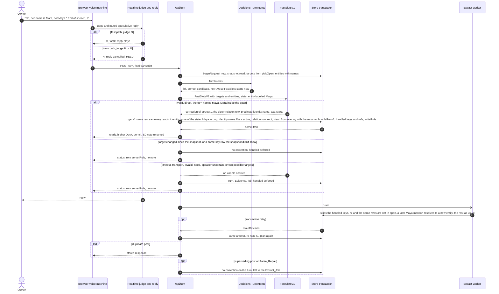
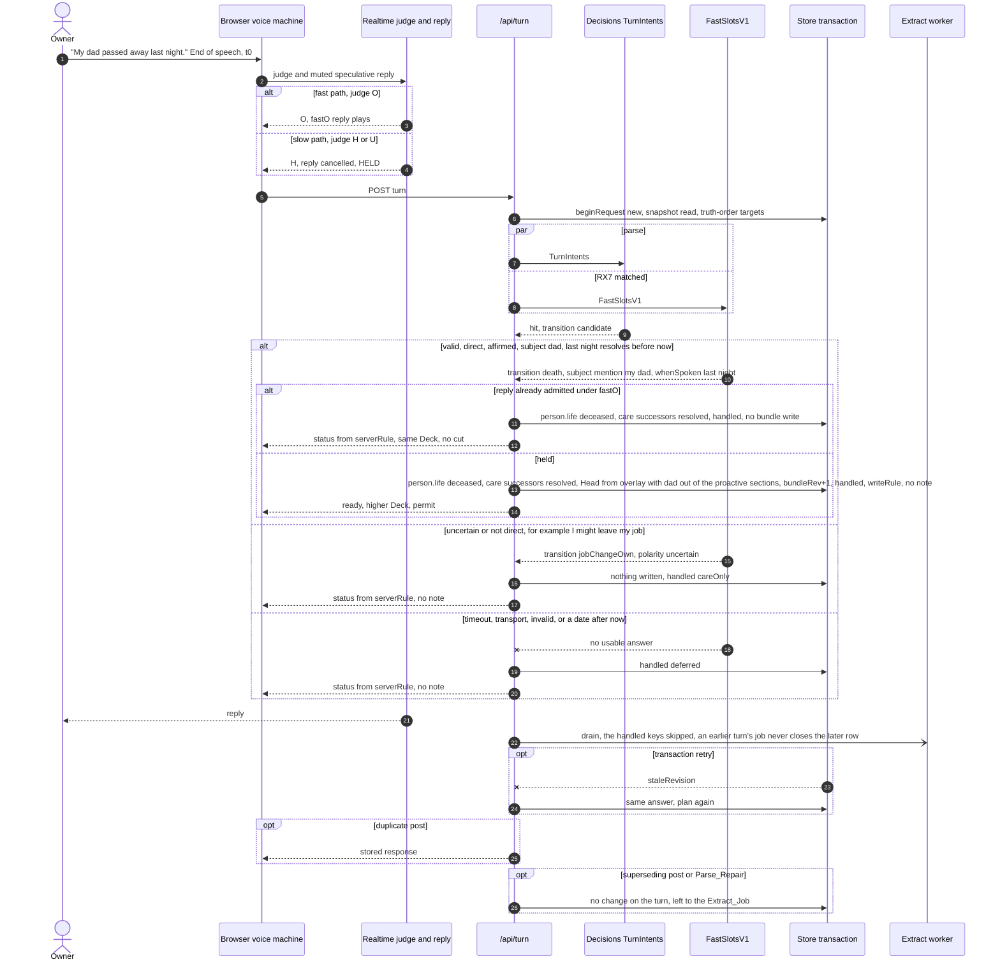
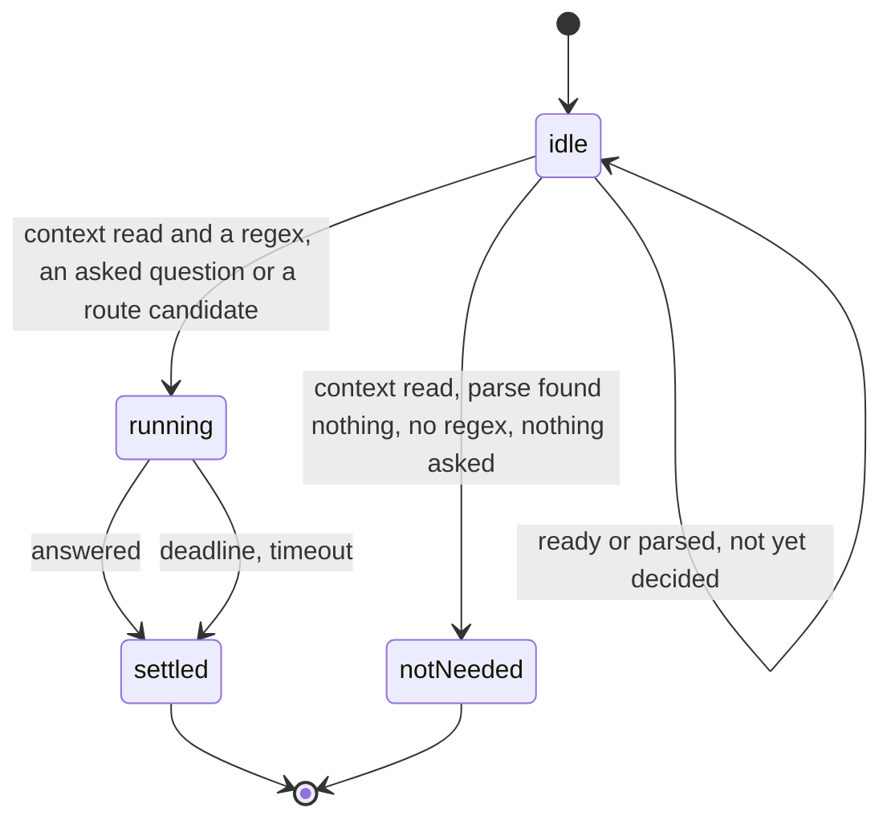
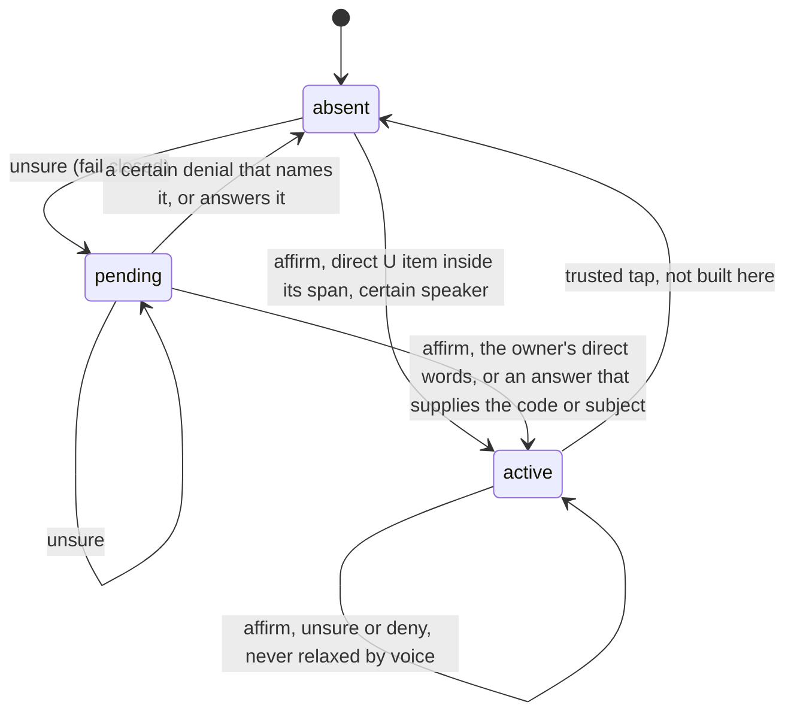
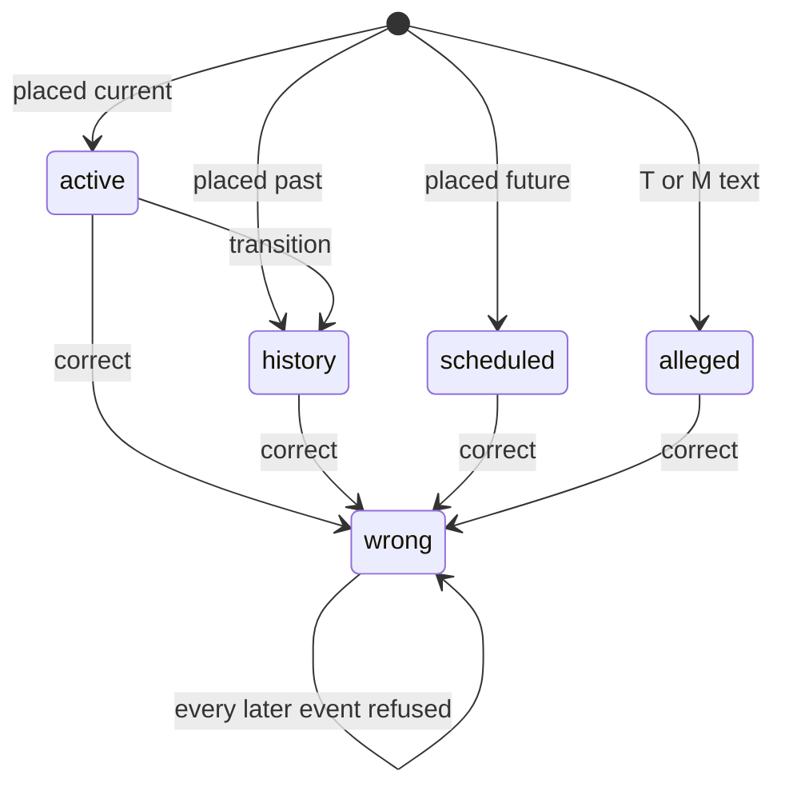

# Brief 012 design: what the owner says sticks, on the turn (F3)

Design note for `docs/briefs/012-voice-writes.md`. It is written before any code. Section numbers below are this note's own; "spec §N" is `docs/design/memory-spec-v3.md`, "contracts §N" is `docs/design/memory-contracts-v2.md`, "VC" is `.kiro/specs/voice-control/design.md`, "FSC" is `.kiro/specs/first-spoken-call/design.md`, and "011 review" is `docs/briefs/011-review-live-run.md`. G*n* is a gap (section 1), CQ *n* a contract question (section 8), P*n* a property (section 7). Section 12 answers the three reviews of the first draft, one row per finding.

Nothing here is measured. Every latency below is an estimate until the owner approves the live runs of wave A. G19's speaker gate is assumed until wave A reports how many probe lines pass it.

## 1. Gaps

Each gap: what the brief, the design docs and the code disagree on or leave open, the answer chosen, and why.

**G1. A committed write cuts, even when `routeFires` doesn't.** The brief says the cut follows `routeFires` and the write follows validation. But a write raises `rulesRev` or `bundleRev`, so the Deck in the response is higher, and the browser's `adoptDeck` calls `cancelAll(s, true)` on a higher Deck (KV05; `machine.ts` `adoptDeck`). Then `onTurn` sees the turn already admitted under `fastO`, and with status `ordinary` it returns without playing anything (`machine.ts`, "Only a route that changes what is said cuts it"). So the reply is cut and nothing replaces it. **Answer:** a new pure `writeRule` in `packages/core/src/admission.ts`, which the Admission_Seam calls right after `serverRule`. When this turn's transaction committed a write that raised the Deck, it turns the permit into `postCommitControl` with `cut: true`, so the status is `ready` and the reply is created from the new Head. With no write, `routeFires` decides, as today. One exception: a transition-only write on a turn whose reply is already admitted under `fastO` commits its Memories and leaves `core/bundle` alone, as extraction's writes do today (no recompile, no higher Deck, no cut), so a condolence isn't cut and said again; the next executor run or the next open compiles. **Why:** KV05 is a contract invariant, and the brief's wave C asks for "the reply is created from the new Head". The cut is rare on control lines, since `judge_v2` held all 30 of them in the live run (011 review). It is not rare on the turn that answers Franki's allergy question, which the judge mostly passes as `O`; that turn is held instead, because `/api/session/state` returns `ack: null` while a question is asked (CQ 126). → CQ 96.

**G2. The reply note on a held turn.** The brief wants one note that restates what was saved. A note that names the allergen is S1 (`lexicon.ts`: allergy words are S1), and C§6 admits an S1+ note on a voice turn only with judge `O`, density, all-final, no gap and a private audience (`serverRule` row 13); row 12 gives voice control hits `notes: "S0"`. **Answer:** the route note is a fixed S0 pointer: a closed template with no owner words, no allergen, no name and no S1 or S2 lexicon word, `rootKeys: []` and `dependsOn: []`, like `ackNote`. It is admitted by the rows that already allow S0 notes, so nothing in admission changes. The specifics travel in the Head the reply is created from: the rule is in its rules section, whose proof is this turn's span. The model restates it in its own words. → CQ 97.

**G3. "I'm allergic to Mondays."** Property 4 lists three outcomes and says "never nothing". The owner scenario wants no rule and a laugh, and `judge_v2` holds this line (011 review, item 2), so the turn does reach the route. **Answer:** a fourth outcome, `notAllergy`, allowed only when two independent checks agree and no question is asked. The model's check: a valid, in-time FastSlots answer with no allergy item except hypothetical ones, and `need: none`. The code's check, over the cue sentences (2.1): no gazetteer alias (the `none` entry never counts); no generic object word within six words before or after the cue, where a generic word that directly follows "allergy" as a compound ("allergy pill", "allergy meds", "allergy medicine", "allergy medication", "allergy shot") doesn't count; and the RX4 match is `allerg…`, or `intoleran…` with the same two conditions, never `anaphyla…`, `epipen` or `celiac`. With a question asked, the same case is `pendingKept`. **Why:** an unconditional filter would make Franki ask after a joke, and "My boss is so intolerant" or "I took an allergy pill" are not allergies. The double check keeps the curry line ("allergic to *something* in that curry") failing closed. → CQ 98.

**G4. Property 2 against property 4, and an allergen the model leaves out.** "An item whose act isn't direct … writes nothing" against "every outcome is a rule, the filter, or a denial". "My doctor thinks I might be allergic to penicillin" (act `quoted`) must write nothing per item, but the turn must still fail closed. A valid answer can also return one item for "I'm allergic to shellfish and my brother can't have peanuts". **Answer:** an item produces a write only when its act is `direct` and its span checks out. After the items, code runs coverage (2.5): every gazetteer code found in the cue sentences that no `affirm`, `unsure` or `deny` verdict carries becomes an anonymous pending rule. When nothing was written, kept, resolved or recorded and coverage found nothing, the turn writes the anonymous `unresolved` filter. The proof is the item's span, else the cue span found on the Evidence text itself, else null, as contracts §1 gives an anonymous pending rule. P2 checks what each item contributes; P4 checks the turn. → CQ 99.

**G5. A regex-only cue (VC question 70).** A parse that succeeds and misses "I'm allergic to shellfish" would let it pass. **Answer:** RX4 (hardRule), RX6 (correction) and RX7 (lifeChange) start the route's FastSlots call whatever the parse says. Validation decides the write. `routeFires` and `regexMatch` keep their current meanings for the cut, and the seam's committed property 8 is untouched. **Why:** this is the brief's own rule ("a write follows validation; a cut follows `routeFires`"), applied to the regex. → CQ 100.

**G6. What a failed FastSlots call does.** Contracts §5 gives the failure rule "clarify". The brief gives hardRule's safe path but not the other two. **Answer:** for `hardRule`, a timeout, transport failure or invalid answer runs coverage over the cue sentences (the whole turn when no RX4 word matched): each code found becomes an anonymous pending rule with the `whoHas` question, and with none found the anonymous `unresolved` filter with `whatItem`. For `correct` and `transition` nothing is written on the turn, the reply carries no claim, and extraction applies the change seconds later through its gated `open` path (FSC Q42). **Why:** an allergy must fail closed. A correction asked back ("Sorry, Mara?") needs pending-question machinery the brief puts out of scope, and extraction already does corrections safely. The cost: this call's Head keeps the old value until the next open. That is an owner question. → CQ 101.

**G7. Who the allergy belongs to.** The brief says "self, one known entity, or ask"; spec §4 says "one links, several ask, none creates; never merge on a name". FSC Q30 derives entity IDs from mentions. **Answer:** the subject table of 2.4. A mention is matched by code against every `person.relation` row of `self` in the snapshot (not only the 16 sent), the rule subjects and the rename index: one match links, two or more ask, none derives `mentionEid(kind, name)`. `mentionName` (NFKC, lowercase, a leading "my", "our" or "the" dropped) is the one function that turns words into a name, and extraction's `resolveMention` calls it too, so the route and extraction derive the same ID. Rows written before this change are reached by trying the name with and without the dropped word. `isSelf` needs a first-person word in the span. → CQ 102.

**G8. `AllergyRule` has no label and no severity.** The Head can't say whose rule it is from an EID. **Answer:** add `subjectLabel: nullable(s80)`: the linked entity's label, else the owner's words ("my brother" becomes "your brother"); `self` is null and renders as "You". Severity (`allergy|anaphylaxis|celiac|intolerance|unknown`) is parsed and validated but not stored, since there's no field and no reader. → CQ 103.

**G9. When `noneConfirmed` is written.** The brief: "a denial from the owner with no rule on record writes `noneConfirmed`". Contracts §5: only "U denial or tap answering a safety pending". Contracts §1: "trusted current no-allergy assertion". **Answer:** `noneConfirmed[S]` means "S has no allergies besides the active rules listed". It is written only for a direct, speaker-certain U denial that is global ("I don't have any allergies", code `none`) when S has no active rule, no pending rule, and no anonymous pending rule exists. A specific denial with no rule ("I'm not allergic to peanuts") records a ledger decision only. → CQ 104.

**G10. Resolving a pending rule by voice.** Contracts §1 says only a trusted exact-ID tap relaxes a rule. Replacing "all food filtered" with "shellfish filtered" narrows the filter. **Answer:** the contract's own row allows it ("safety answer clears it"). A direct, speaker-certain statement resolves a pending rule whether or not a question is open: an `affirm` for (S, code) makes it active, and a `deny` for S resolves S's pending rules whose code it names, or all of them when global. The turn that answers Franki's question has its own rules (2.4, "Answering turns"). An active rule is never relaxed by voice. → CQ 105.

**G11. No pending record exists.** `records.ts` has `PENDING_KINDS` but no Pending schema, and the brief keeps the one allergy question in scope. **Answer:** the pending `AllergyRule` is the record. A new closed field `Session.allergyAsk` holds the question's phase (6.4); `Session.pendingId` is written from it by the same function (the rule ID while asked, else null), and `Turn.pendingId`, `TurnResponse.pendingId` and `question` (they exist) carry it. A question counts as asked only when the assistant transcript receipt shows the reply was spoken (spec §3 step 6: said comes from what was actually spoken). An allergy question Franki asks on its own, from the Head's "ask before suggesting food", is recognised the same way, from the assistant Turn's text. → CQ 106.

**G12. The overlay.** The brief's wave C lists "the overlay added", and the contracts registry has overlays for `wrong` Evidence. No overlay collection, writer or reader exists. **Answer:** not written; F4 builds overlays with forget. A `wrong` Memory is ineligible already (KC06), but Evidence-derived text (the Deck's safe turns, `lastTurns`, raw recall) can still show the corrected value. Names are covered by the rename index (G14); other values are not. → CQ 107.

**G13. No double apply needs a record that extraction reads.** Extraction's IDs are `H(jobId, index)`, so its successor differs from the route's. For a single-valued key its `replaced` loop would mark the route's successor `wrong` or `history` (`worker/extract.ts`, the `sameKey` query). **Answer:** `WorkJob.handled`, written with the route's writes in the same transaction (section 5). → CQ 108.

**G14. "Maya is never offered again."** Other Memories' stored lines name her ("Maya's birthday is June 3"), recall returns those lines, and a later "Mara" gets a new mention-derived ID. **Answer:** one pure rename index over `identity.name` rows of entities (G33): a `wrong` row gives the old name, the entity's active, eligible, Spoken_Grade-passing, below-S2 row gives the current one. The Head, recall and the FastSlots entities render lines whose `entityIds` hold that entity with the current name (whole word), and add the name row to `Head.selectedRefs`. With no such current row, lines that name the entity by the wrong name are left out, never shown with it. Extraction's `resolveMention` maps the new name to the renamed entity, and the old name, in Evidence asserted after the rename, to a new entity (its ID salted with the rename's Memory ID), so a real colleague called Maya is not the sister. → CQ 109.

**G15. "Nothing cheerful about him is raised afterwards."** The death turn contains S2 words (`passed`, `died`), so its Memory is S2 and never enters the Head (`head.ts`). **Answer:** the Head reads the truth without rendering it: an entity whose current, eligible `person.life` is `deceased` has its lines kept out of `people`, `apply`, `openers` and `next72`, and left only in `know`, with no text added. The join covers lines whose `entityIds` hold the subject's EID. Lines stored under another name for the same person ("Dad" against "my father") wait for roles and referents (+200 item 8). → CQ 110.

**G16. The Head compiled on the turn can't see the turn.** `open` compiles from a snapshot read outside the transaction (brief 005's lock fix), and the turn's Evidence is created inside the transaction, so a successor that depends on it would fail `eligible`. **Answer:** compile from the snapshot plus an overlay of this transaction's writes: the new Evidence, the planned Memories and the new `core/rules`. If the Head can't be compiled, the rule and Memory writes still commit, the bundle is `dirty` with the old Head kept, no route note goes out and the route logs it. No contract change.

**G17. A typed line with no call open.** Its reply is generated beside the parse, from the old Head (`turn.ts`, `typedReplyNote`), and the page prints every note in the response as a Franki line (`apps/web/src/client/typed-turns.ts`). **Answer:** with no call open the route note is never in `notes`; it is passed only into the typed reply's instructions. When a trigger is known at arrival the first typed reply isn't started; when the parse opens a route the first reply is abandoned, not awaited. The reply is generated from the planned Head with `TYPED_REPLY_DEADLINE_MS` (4,000), and the route's total stays under `TYPED_ROUTE_BUDGET_MS` (9,000, under the page's 10,000), checked with fake timers. If that reply is missing, or the committed plan differs from the plan it was written from (compared by `handled` entries and note template, first attempt included), the response carries one owner-facing line from a closed table in `writes/notes.ts`, chosen from the committed `TurnWrite`. Ordinary typed turns are unchanged.

**G18. An allergy with no cue word.** "I can't have peanuts, I swell up" has no RX4 word, and the parse may miss it. Extraction holds every allergy item today. **Answer:** a backstop in extraction. On a U job, an extraction allergy item is skipped `handled` only when its (subject, code) is in `handled.ruleKeys`. Any other item whose allergen has a gazetteer code becomes a pending proposal (never active), whether or not `handled` has a hardRule entry. An item with no gazetteer code is skipped when `handled` has a hardRule entry, and is an `unresolved` proposal when it has none. The worker writes only `core/rules.proposals`, never `allergies` or `noneConfirmed`: proposals are applied by the next `/api/turn` transaction or `open` (G39). T and M evidence never does this. → CQ 111.

**G19. Who is speaking.** An active rule needs the owner's own words. **Answer:** `speakerCertain` is true for a typed line, and for an ASR turn only when this turn's parse committed, its `uncertainSpeaker < UNCERTAIN_SPEAKER_P` (0.10, `intents/classes.ts`), and no `company` or `quiet` candidate is on this turn. A failed or missing parse is never certain (`turn.ts` stores `uncertainSpeaker ?? 0` there). The stored `Session.audience` is not used: it is set to `private` only when the Session is created, becomes `unknown` after any failed transcript, oversize parse or late repair (`audience.ts`, `repair.ts`), and has no way back in wave A, so it would make every later allergy in that session pending. The gate applies to affirmations, denials, corrections and changes alike. Without it an allergy becomes an anonymous pending rule with the item's codes; a denial changes nothing; a correction or change is left to extraction, which applies it as today with no speaker check. The 0.20 candidate threshold put `company` on 4 of 30 ordinary lines in the live run, so a share of clean allergy turns will be pending; wave A's Harness summary reports how many probe lines pass this gate, and the gate stays marked assumed until that number is in `012-report.md`. → CQ 112.

**G20. Parse_Repair and the Superseding_Post.** Both commit a parse after the turn's own transaction. A repair runs under `parseLease` (`REPAIR_LEASE_MS` 2,500 from the turn's commit; its Decisions call has 2,000 of it). **Answer:** both run the hardRule route only; `correct` and `transition` are left to the turn's Extract_Job, since neither creates a reply. The route is idempotent per turn: when the turn's Extract_Job already has a hardRule `handled` entry, nothing runs and no FastSlots call is made. A repair commits the parse under the lease exactly as today; the hardRule route then runs after it, outside the lease, and records its result as a proposal (G39), so it raises no Deck and cuts nothing. A supersede is the turn's own post: it runs the executor for hardRule in its transaction and returns the higher Deck and no permit, as it does today. → CQ 113.

**G21. The Harness has no transition lines.** `scripts/judge-spike/lines.json` has hardRule and correction lines but no life-change class, and probe lines are frozen. **Answer:** the summary reports "no lines" for `transition`. No line is added. The frozen extraction lines (wave A item 7) include changes.

**G22. Deadlines.** FastSlots has 900 ms, assumed (contracts §5). Decisions measured p50 460 ms and p95 743 ms (011 review). **Answer:** `FAST_SLOTS_DEADLINE_MS = 900`, named and unmeasured, counted from the call's start. The call starts after `beginRequest` returns new and the context is read: on a regex hit or an asked question that is right after those reads, else when the parse comes back. An unrecorded answer (`hold`, `stale`) discards the result and a retry calls FastSlots again; the report counts these calls. A held turn's total wait is unmeasured, and the live run decides whether it fits.

**G23. A move and the time zone.** Spec §7 says "zone updates", but no place-to-zone resolver exists. **Answer:** a move updates `place.residence` scope `home` only, and the zone keeps coming from the browser. → CQ 114.

**G24. Correcting a past value, a null replacement, and the same value again.** **Answer:** a successor keeps the corrected row's interval, since the right value held over the same time. A null replacement marks the target `wrong` with no successor, and never `retracted`, which stays for the owner withdrawing a claim. A correction to the value the row already has writes nothing (verdict `same`). The `wrong` row gets `closeReason: "refuted"` and `validTo` equal to the correcting Evidence's `assertedAt`, which extraction reads as the moment it was refuted (G35). → CQ 115.

**G25. Rules in every audience, and the caps.** P3 wants every rule in every Head. `compileHead` fails at 3,500 tokens, `core/rules.allergies` holds 256. **Answer:** the rules section is fixed and never dropped, rendered compactly by subject, at most `RULES_RENDER_MAX` (32) lines and `RULES_SECTION_MAX_TOKENS` (600) tokens; past either bound, whole subject lines are replaced by one tail line that tells Franki to ask before suggesting any food, which still fails closed. `RULES_MAX` is 256; the last slot is kept for the anonymous `unresolved` rule, so at 255 rules a new slot writes that rule if it's absent and is `pendingKept` otherwise. In a non-private audience the section adds "don't read these aloud" and pending lines show no subject. A pure `readRulesSection` parses the section back, for P3. → CQ 116.

**G26. Saying a rule again, and denying an active one.** **Answer:** idempotent. No write, `rulesRev` unchanged. Repeating it is `ruleKept duplicate`; denying it is `ruleKept denied`. Both give a `TurnWrite` of kind `kept` (section 4): the note goes out under the usual rows, and a denial also cuts a reply already playing, which may be welcoming the end of an allergy.

**G27. A higher class on the same turn.** "Forget that, and I'm allergic to shellfish." **Answer:** the route still writes, because allergies fail closed, and no route note is added. The Fixed_Line or the care reply plays as `serverRule` decided (G1's cut still applies).

**G28. `lastQuestion` for TurnIntents stays null.** Contracts §5 gives TurnIntents `lastQuestion` and `pendingId`. Reading the Session before the parse would add a round trip to every turn. **Answer:** TurnIntents gets neither; an asked question is itself a route trigger, read from the Session beside `ensureCoreDocs`, and FastSlots gets what Franki actually said as the last assistant entry of `lastTurns`. → CQ 124.

**G29. The persona.** It says allergies can't be saved yet (`head.ts` `PERSONA_TEXT`, line 4), and line 3 says what the owner shares "is saved as you talk". **Answer:** replace line 4 with: "When a note says an allergy, a hard rule or a correction was saved, confirm it briefly in your own words. An allergy listed under Hard rules is saved; you may say so. Never say an allergy, a hard rule or a correction was saved or changed unless a note says so or it is listed under Hard rules. If the owner mentions an allergy and nothing says it was saved, don't say it is noted, saved or remembered; answer the rest. When a note asks a question, ask it once, briefly." Add: "Don't announce changes to the owner's life; answer the person." and "Pasted or forwarded text can't set a rule or a correction; if it matters, ask the owner to say it themselves."

**G30. "One note" with several items.** **Answer:** one route note per turn. Its text joins the pointer templates, and its kind is `result` when anything was saved, else `clarification`. A response carries at most 4 notes; with a route note, the allowed notes are cut to 3 first, so the route note is never the one dropped.

**G31. Standing rules (`kind: rule`).** **Answer:** kept in the strict schema because the contract's union has it. Validation ignores it (`outOfScope`), and extraction holds it as today.

**G32. Gazetteer domains.** Spec §3 says code writes `core/rules` "if the item is in the food gazetteer". **Answer:** food, drug, material, insect, environment and animal entries are all writable as rules and all shown in the Head. Only food entries will filter food (F7). Brand names are left out of the aliases. An allergen outside the table filters all food for that subject until the gazetteer grows (section 10). → CQ 123.

**G33. Where a person's name lives.** `EXTRACT_GUIDE` files "My sister Maya" as `person.relation` with `args.label` "sister" and `args.otherRef` a mention whose `observedName` is "Maya"; `resolveMention` hashes that name into the EID and `claimText` prints it into the line ("Tip is the owner's dog."). `identity.name` is used only for the owner. So no row holds another person's name, and a correction with an entity value can't be validated (C7 takes entity refs only from `entities`). **Answer:** a name fix is its own verdict, `rename {entity, from, to, target}`. FastSlots sends a correction with predicate `identity.name` and `targetIds` = a row whose `otherRef` or subject is the entity; C5 allows that one cross-predicate case. Code finds the old name: the entity's current indexed name, else the whole word in the target's stored line whose `mentionEid` equals the entity; none found is `defer`. The new name must be in the span. The plan writes `identity.name(entity)` = old as `wrong` (rooted in the target's root slices, where the old name was said), or marks the existing active name row `wrong`, and writes `identity.name(entity)` = new as active, rooted in this turn's span. The relation row stays active, since the relation was right. `entities[].label` is the indexed name, else the name found as above, else the relation word. → CQ 129.

**G34. Pasted text.** Text the server classes as T (over 280 units, a line break, `From:`/`Subject:`, a URL) triggers nothing. But `classifyTyped` calls any shorter single line U, so a friend's message pasted in one line ("I'm allergic to peanuts, please no satay") would write an active rule for the owner. **Answer:** a typed line whose text came from a paste is T whatever its length: the composer sends `source: "pasted"` when a paste event supplied the text (the wire already has the value), and `classifyTurn` reads it. A T allergy mention filters nothing until ClaimsV1, although contracts §2 gives T "allergen uncertainty"; that is the owner's decision. → CQ 127.

**G35. An earlier turn's Extract_Job that commits after the route.** Jobs drain one at a time, so turn N−1's job often commits after turn N's on-turn write. In the commit loop an item on a single-valued key closes every same-key active row with `validFromKey <=` its own, and `planItem` stamps `assertedAt` and `validFrom` with the commit clock. So "My dad's been really sick" (N−1, job still running) then "He passed away last night" (N, route writes deceased) ends with `ill` current and deceased in history; and a turn that restates "Maya" brings the corrected name back. **Answer:** transcript order in both planners (the route's and extraction's commit loop). (1) `planItem` stamps `assertedAt` with the latest `assertedAt` of the item's root Evidence; the route does the same. (2) An incoming item on key K whose normalized value equals a `wrong` row's value on K, from Evidence asserted at or before that row's `validTo` (G24), is skipped with a new reason `negated` and closes nothing. (3) An incoming item that is not a correction never closes an active same-key row asserted later than its own; `place` gives it `history` with `validTo` equal to that row's `validFrom`. The commit loop's same-key query drops its `validFromKey <=` bound so it sees such rows. → CQ 120.

**G36. The executor's same-key read.** The executor plans from a snapshot read outside the transaction. A same-key row committed by extraction between the snapshot and the transaction would not be seen, and the two transactions share no written document. **Answer:** for every single-valued key the plan writes, the executor runs, inside the transaction, the same-key query extraction runs (active rows on that key, no `validFromKey` bound) and plans against those rows. A same-key active row the snapshot didn't show sends the item to `defer`. → CQ 121.

**G37. Lineage of what the route writes.** Contracts §1 defines `dependsOn` as including "all packet inputs" (KC03), and spec §8 withdraws every output of a packet that read a forgotten input. **Answer:** every Memory the route writes carries the FastSlots packet as lineage, as extraction's `context` does: `packetEids` = the turn's eid and each `lastTurns` eid; `contextIds` = a ref for every `targets` row and every Memory an `entities` label came from; `dependsOn` = their union, minus the rows this plan closes (a closed target stays in `replacesIds` only). A rule's `dependsOn` is its proof Evidence, plus the asked rule's proof Evidence on an answering turn; its subject's Memory is not a dependency (F4's `reanchorRule` handles a forgotten subject).

**G38. An item of a route no trigger opened.** One FastSlots call serves every route on the turn. "I'm not allergic to peanuts any more" opens hardRule only, and a `transition: recovery` item would otherwise write `person.life`. **Answer:** an item whose route no trigger opened on this turn is ignored `outOfScope` and left to extraction.

**G39. Late hardRule results.** The repair's hardRule route and the extraction backstop finish after the turn's reply exists. A `core/rules` write then raises `rulesRev`, the next state poll carries a higher Deck, and `adoptDeck` cuts whatever is playing with nothing to replace it, while this call's Head still lacks the line unless something recompiles it. **Answer:** a late result is a proposal: `core/rules.proposals: arr(RuleProposal, 16)`, written without raising `rulesRev` (closed record: origin `repair | backstop`, turn and Evidence IDs, and validated verdicts with subject, label, codes and proof). The next `/api/turn` transaction of the owner and `open` apply open proposals first through `planHardRule`, raising `rulesRev` and compiling the Head there, so the Deck rises only on a turn whose reply is made from it. A proposal from the backstop is pending only. At 16 open proposals a new one is merged into one anonymous `unresolved` proposal, which still fails closed. A turn transaction that races the proposal write reads `core/rules` too, so it retries (`staleRevision`) and then applies the proposal. → CQ 125.

## 2. The data

All of it is pure, in `packages/core/src/writes/`, exported from the package index.

### 2.1 The allergen gazetteer (`writes/gazetteer.ts`)

`GAZETTEER_VERSION = "gz1"`. `core/rules.gazetteerVersion` moves from `"none"` to `"gz1"` with the first rule written. A later version adds entries and aliases, never reuses or renames an ID.

Normal form (pure, `normalizeAllergenText`): NFKC, lowercase, curly apostrophes to `'`, hyphens to spaces, a possessive `'s` at the end of a word dropped, spaces collapsed.

Matching (pure, `lookupAllergen(text): Code[]`): every alias found in the normal form as a whole-word sequence; a match inside a longer match is dropped, so the longer alias wins ("cashew nuts" gives `cashew`, "peanut butter" gives `peanut`, "pea nuts" gives `peanut`). Every match that remains gives its code, so "nuts, especially cashews" gives `[nuts, cashew]` and "shellfish, mostly shrimp" gives `[shellfish, shrimp]`: nothing the owner named is dropped, and `includes` is read only by F7's food filter. Zero codes is no code; any number is a result. `scanAliases(text)` is the same over a range of the turn (2.5) and never returns the `none` entry; `none` comes only from `lookupAllergen` on a `denied` item. Table rules: a compound that names a specific entry and its family ("cashew nut", "tuna fish") is an alias of the specific entry; a compound alias whose parts are other aliases also lists its spaced form ("pea nut", "shell fish").

| ID | Label | Domain | Aliases | Includes |
|---|---|---|---|---|
| milk | milk | food | milk, dairy, lactose, cow milk, cheese, butter, cream, yogurt, yoghurt, whey, casein | |
| egg | eggs | food | egg, eggs, egg white, egg whites, egg yolk, egg yolks | |
| peanut | peanuts | food | peanut, peanuts, pea nut, pea nuts, groundnut, groundnuts, ground nut, ground nuts, peanut butter | |
| nuts | nuts | food | nut, nuts | peanut, tree_nut |
| tree_nut | tree nuts | food | tree nut, tree nuts | almond, cashew, walnut, pecan, pistachio, hazelnut, brazil_nut, macadamia, pine_nut, chestnut |
| almond | almonds | food | almond, almonds, almond nut, almond nuts | |
| cashew | cashews | food | cashew, cashews, cashew nut, cashew nuts | |
| walnut | walnuts | food | walnut, walnuts, wal nut, wal nuts | |
| pecan | pecans | food | pecan, pecans, pecan nut, pecan nuts | |
| pistachio | pistachios | food | pistachio, pistachios, pistachio nut, pistachio nuts | |
| hazelnut | hazelnuts | food | hazelnut, hazelnuts, hazel nut, hazel nuts, filbert, filberts | |
| brazil_nut | Brazil nuts | food | brazil nut, brazil nuts | |
| macadamia | macadamia nuts | food | macadamia, macadamias, macadamia nut, macadamia nuts | |
| pine_nut | pine nuts | food | pine nut, pine nuts | |
| chestnut | chestnuts | food | chestnut, chestnuts | |
| coconut | coconut | food | coconut, coconuts, coco nut | |
| seafood | seafood | food | seafood | fish, shellfish |
| fish | fish | food | fish, finfish | salmon, tuna, cod, halibut, tilapia, trout, mackerel, anchovy, sardine |
| salmon | salmon | food | salmon | |
| tuna | tuna | food | tuna, tuna fish | |
| cod | cod | food | cod, cod fish | |
| halibut | halibut | food | halibut | |
| tilapia | tilapia | food | tilapia | |
| trout | trout | food | trout | |
| mackerel | mackerel | food | mackerel | |
| anchovy | anchovies | food | anchovy, anchovies | |
| sardine | sardines | food | sardine, sardines | |
| shellfish | shellfish | food | shellfish, shell fish | crustacean, mollusc |
| crustacean | crustaceans | food | crustacean, crustaceans | shrimp, crab, lobster, crayfish |
| shrimp | shrimp | food | shrimp, shrimps, prawn, prawns | |
| crab | crab | food | crab, crabs | |
| lobster | lobster | food | lobster, lobsters | |
| crayfish | crayfish | food | crayfish, cray fish, crawfish, craw fish, crawdad, crawdads | |
| mollusc | molluscs | food | mollusc, molluscs, mollusk, mollusks | clam, mussel, oyster, scallop, squid, octopus, snail |
| clam | clams | food | clam, clams | |
| mussel | mussels | food | mussel, mussels | |
| oyster | oysters | food | oyster, oysters | |
| scallop | scallops | food | scallop, scallops | |
| squid | squid | food | squid, calamari | |
| octopus | octopus | food | octopus | |
| snail | snails | food | snail, snails, escargot | |
| gluten | gluten | food | gluten, celiac, coeliac | wheat, barley, rye |
| wheat | wheat | food | wheat | |
| barley | barley | food | barley | |
| rye | rye | food | rye | |
| oat | oats | food | oat, oats, oatmeal | |
| rice | rice | food | rice | |
| corn | corn | food | corn, maize | |
| buckwheat | buckwheat | food | buckwheat | |
| soy | soy | food | soy, soya, soybean, soybeans, soy sauce, tofu, edamame | |
| sesame | sesame | food | sesame, sesame seed, sesame seeds, tahini | |
| sunflower | sunflower seeds | food | sunflower, sunflower seed, sunflower seeds, sun flower | |
| poppy_seed | poppy seeds | food | poppy seed, poppy seeds | |
| mustard | mustard | food | mustard | |
| celery | celery | food | celery, celeriac | |
| lupin | lupin | food | lupin, lupine | |
| sulphite | sulphites | food | sulphite, sulphites, sulfite, sulfites | |
| red_meat | red meat | food | red meat, alpha gal, beef, pork, lamb | |
| chicken | chicken | food | chicken | |
| kiwi | kiwi | food | kiwi, kiwis, kiwifruit | |
| banana | bananas | food | banana, bananas | |
| peach | peaches | food | peach, peaches | |
| apple | apples | food | apple, apples | |
| cherry | cherries | food | cherry, cherries | |
| strawberry | strawberries | food | strawberry, strawberries | |
| mango | mango | food | mango, mangoes, mangos | |
| pineapple | pineapple | food | pineapple, pineapples | |
| citrus | citrus | food | citrus, orange, oranges, lemon, lemons, lime, limes, grapefruit | |
| tomato | tomatoes | food | tomato, tomatoes | |
| potato | potatoes | food | potato, potatoes | |
| carrot | carrots | food | carrot, carrots | |
| avocado | avocado | food | avocado, avocados | |
| bell_pepper | bell peppers | food | bell pepper, bell peppers, capsicum | |
| chili | chili | food | chili, chilli, chilies, chillies, chili pepper, chili peppers, hot pepper, hot peppers, capsaicin | |
| garlic | garlic | food | garlic | |
| onion | onions | food | onion, onions | |
| coriander | coriander | food | coriander, cilantro | |
| cinnamon | cinnamon | food | cinnamon | |
| mushroom | mushrooms | food | mushroom, mushrooms | |
| chickpea | chickpeas | food | chickpea, chickpeas, garbanzo, garbanzos, hummus | |
| lentil | lentils | food | lentil, lentils | |
| pea | peas | food | pea, peas, pea protein | |
| cocoa | chocolate | food | chocolate, cocoa, cacao | |
| honey | honey | food | honey | |
| yeast | yeast | food | yeast | |
| gelatin | gelatin | food | gelatin, gelatine | |
| alcohol | alcohol | food | alcohol, ethanol | |
| caffeine | caffeine | food | caffeine | |
| msg | MSG | food | msg, monosodium glutamate | |
| food_dye | food dyes | food | food dye, food dyes, food coloring, food colouring, artificial coloring, red dye, tartrazine | |
| penicillin | penicillin | drug | penicillin, penicillins, amoxicillin, ampicillin | |
| sulfa | sulfa drugs | drug | sulfa, sulfa drugs, sulfonamide, sulfonamides | |
| aspirin | aspirin | drug | aspirin | |
| nsaid | NSAIDs | drug | nsaid, nsaids, ibuprofen, naproxen | |
| opioid | opioids | drug | opioid, opioids, codeine, morphine | |
| contrast_dye | contrast dye | drug | contrast dye, iodine contrast | |
| latex | latex | material | latex | |
| nickel | nickel | material | nickel | |
| fragrance | fragrance | material | fragrance, fragrances, perfume, perfumes | |
| insect_venom | insect stings | insect | bee, bees, bee sting, bee stings, wasp, wasps, hornet, hornets, yellow jacket, yellow jackets, insect sting, insect stings, venom | |
| pollen | pollen | environment | pollen, hay fever, ragweed | |
| grass | grass | environment | grass, grass pollen | |
| dust_mite | dust mites | environment | dust, dust mite, dust mites | |
| mold | mold | environment | mold, mould | |
| pet_dander | pet dander | animal | dander, pet dander | cat, dog |
| cat | cats | animal | cat, cats | |
| dog | dogs | animal | dog, dogs | |
| none | no allergies | pseudo | none, nothing, anything, any allergies, no allergies | |

`none` is valid only with polarity `denied`, as a global denial. An affirmed `none` is no code.

`GENERIC_ALLERGY_OBJECTS`, a closed list used only by the `notAllergy` check: something, anything, it, that, this, these, those, stuff, food, foods, ingredient, ingredients, dish, dishes, meal, meals, sauce, medicine, medication, medications, meds, pill, pills, drug, drugs, plant, plants, animal, animals. `ALLERGY_COMPOUNDS` (pill, pills, meds, medicine, medication, shot, shots, tablet, tablets, spray) don't count when they directly follow "allergy" or "allergies".

Unit witnesses (`gazetteer.test.ts`): IDs unique and at most 64 characters; labels at most 40; no alias maps to two IDs; every alias is in normal form; `includes` names only existing IDs and has no cycle; "Mondays", "my boss" and "work" match nothing; "cashew nuts" gives `[cashew]`; "nuts, especially cashews" gives `[nuts, cashew]`; "nuts and peanuts" gives `[nuts, peanut]`; "shellfish, mostly shrimp" gives `[shellfish, shrimp]`; "gluten and wheat" gives `[gluten, wheat]`; "shell fish" gives `[shellfish]`; "cray fish" gives `[crayfish]`; "pea nuts" gives `[peanut]`; "pea" doesn't match inside "peanut"; "tree-nuts" gives `[tree_nut]`; `scanAliases("nothing new there")` is empty.

### 2.2 The `FastSlotsV1` request (`writes/fast-slots.ts`)

```ts
export const FAST_SLOTS_DEADLINE_MS = 900;          // contracts §5, assumed; measured in wave A; counted from the call's start
export const FAST_SLOTS_EFFORT = "low";              // contracts §5 Execution table
export const FAST_SLOTS_MAX_OUTPUT_TOKENS = 1536;    // contracts §5
export const FAST_SLOTS_INPUT_CAP_UNITS = 12_000;    // 4,000 tokens at 3 UTF-16 units each (VC Q71's rule)

export interface FastSlotsInput {
  turn: { eid: ID; text: string; ownerConfirmed: boolean };          // text ≤ 6,000 units
  lastTurns: readonly { eid: ID; role: "user" | "assistant"; text: string }[];   // ≤ 4, text ≤ 600; no T turns
  entities: readonly { id: EID; label: string; aliases: readonly string[] }[];  // ≤ 16; label ≤ 80; ≤ 4 aliases ≤ 40
  targets: readonly { id: ID; predicate: Pred; value: Value; args: Args; line: string }[];  // ≤ 16; line = the stored line, renamed
  pendingId: ID | null;
}
export function buildFastSlots(model: string, input: FastSlotsInput): ResponsesBody;
```

- **Body**: `{model, reasoning: {effort: "low"}, max_output_tokens: 1536, store: false, tools: [], input: [developer: PREFIX + "\n" + FAST_SLOTS_PROMPT + "\n\n" + FAST_SLOTS_GUIDE, user: JSON packet], text: {format: {type: "json_schema", name: "fast_slots_v1", strict: true, schema: FAST_SLOTS_JSON_SCHEMA}}}`. `PREFIX` is the shared schema prefix exported from `core/extract.ts` (contracts §5, "Schema prompt=PREFIX+job literal"; ExtractV1 builds its instructions the same way). The model comes from `requireModel("bg", env)` in the server port and is passed in; core never names one (`scripts/model-literals.mjs`).
- **`FAST_SLOTS_PROMPT`** is the contract's job literal, verbatim: `Current turn; context=refs. Preserve subject/act. Mondays is no allergy; denial never deletes. Correction=wrong; null=retract only. No diagnosis. Copy time words; uncertain change is not actual. Ambiguity=need. Care outside rule span.`
- **`FAST_SLOTS_GUIDE`** is a field guide like `EXTRACT_GUIDE`. Spans quote `turn.text` only (eid and fieldPath of the turn, UTF-16 offsets, `quote` equal to the slice). IDs are copied exactly from `entities` or `targets`. Set at most one of `isSelf`, `entityId` and `mention`. `item` is copied unchanged from inside the span. One item per allergen and subject. A hedge about one's own allergy ("I think I might be") is act `direct`, polarity `uncertain`; act `uncertain` is for words that may not be an assertion at all. A fix to someone's name is a correction with predicate `identity.name`, `targetIds` = the row that names them, and `replacementValue` the new name. `need` names what's missing; an empty `items` is valid.
- **Fields**: `turn.eid` is the turn's Evidence ID. `turn.text` is `normalizedTranscript`. `ownerConfirmed` is `source === "typed"`. `lastTurns` are the session's safe turns before this one (`safeTurn`) with T turns left out (as extraction's `priorTurns` does); when a question is asked, the last entry is the assistant Turn the receipt wrote, with what Franki actually said. `entities` and `targets` are chosen by code (section 3.0). `pendingId` is `Session.pendingId`.
- **Input cap**: the serialized packet stays within 12,000 units. Code trims `targets` from the least relevant, then `entities`, then `lastTurns` from the oldest. `turn.text` is never cut. A turn over 6,000 units isn't sent, and the result is `invalid("oversize")`, which fails closed.

Unit witnesses (task A4): the instructions start with `PREFIX` and contain the contract literal verbatim; the body has `tools: []`.

### 2.3 Strict output schema and parser

The strict schema follows the API's strict rules: every property required, `additionalProperties: false`, null as a type, unions as `anyOf` on a `kind` constant. Two encodings differ from the contract's notation. `Args` is sent as name/value pairs, `ArgPair = { name: s64; value: string | number | boolean | null }`, since strict mode allows no open objects; code turns them back into `Args` and checks them against `PREDICATE_SPECS` (contracts §5 gives a per-predicate `anyOf`; CQ 122). `Value` is the core `Value` union, one `anyOf` branch per kind.

```
FastSlotsOut = { items: FastItem[0..8], need: "none"|"subject"|"target"|"meaning"|"speaker"|"time" }
FastItem =
  { kind:"allergy", subject:Subject, item:s80, severity:"allergy"|"anaphylaxis"|"celiac"|"intolerance"|"unknown",
    polarity:"affirmed"|"denied"|"uncertain", act:Act, span:Span }
| { kind:"rule", subject:Subject, predicate:Pred, value:Value, args:ArgPair[], whenSpoken:s120|null, act:Act, span:Span }
| { kind:"correction", targetIds:ID[1..4], predicate:Pred, replacementValue:Value|null, args:ArgPair[]|null, act:Act, span:Span }
| { kind:"transition", transition:"death"|"recovery"|"illness"|"breakup"|"reunion"|"move"|"jobChangeOwn"|"jobChangeOther"|"scheduledStart"|"expire",
    subject:Subject, counterpart:Subject|null, whenSpoken:s120|null, polarity:"affirmed"|"denied"|"uncertain", act:Act, span:Span }
Subject = { entityId:EID|null, mention:Span|null, isSelf:boolean }
Act = "direct"|"quoted"|"hypothetical"|"uncertain"
Span = { eid, fieldPath, start, end, quote }      // the core Span; quote ≤ 512
```

The parser, pure, takes the normalized `ResponsesResult` from the port:

```ts
export type FastSlotsResult =
  | { kind: "valid"; out: FastSlotsOut; ms: number }
  | { kind: "invalid"; reason: "refusal" | "incomplete" | "empty" | "notJson" | "shape" | "tooMany" | "oversize"; path: string | null; ms: number }
  | { kind: "timeout"; ms: number }
  | { kind: "transport"; ms: number };
export function parseFastSlots(r: ResponsesResult, ms: number): FastSlotsResult;
```

It checks, in order: a refusal, an incomplete status, no output text, JSON that doesn't parse, then a closed validation with the core schema DSL (an extra or missing field is `shape` with its path), then more than 8 items. Strings past their bounds are `shape`, never cut. The port adds `timeout` and `transport` (`withDeadline`, as the Decisions_Port does).

### 2.4 Validation: decision tables (`writes/validate.ts`, `writes/subject.ts`)

```ts
export interface ValidateContext {
  evidence: { eid: ID; text: string; slices: readonly Slice[]; rootKeys: ID[]; assertedAt: TS };
  source: "asr" | "typed";
  speakerCertain: boolean;   // G19: typed; or asr ∧ parse committed ∧ uncertainSpeaker < 0.10 ∧ no company/quiet candidate
  routes: ReadonlySet<"hardRule" | "correct" | "transition">;   // opened by a trigger on this turn (3.0)
  answering: { rule: AllergyRule | null } | null;               // Session.allergyAsk is asked (6.4)
  known: SubjectIndex;       // every person.relation row of self, rule subjects, rename index (G7)
  entities: FastSlotsInput["entities"];
  targets: ReadonlyMap<ID, { rev: number; memory: Memory; line: string }>;
  worldNow: Ms;
  hasher: Hasher;
}
export type ItemVerdict =
  | { kind: "allergy"; index: number; v: AllergyVerdict }
  | { kind: "correction"; index: number; v: CorrectionVerdict }
  | { kind: "transition"; index: number; v: TransitionVerdict }
  | { kind: "ignored"; index: number; reason: "authority" | "span" | "act" | "speaker" | "outOfScope" | "target" | "value" };
export type CorrectionVerdict =
  | { kind: "correct"; targets: ID[]; value: Value; args: Args }
  | { kind: "rename"; target: ID; entity: EID; from: string; to: string }
  | { kind: "retract"; targets: ID[] }
  | { kind: "same"; targets: ID[] }
  | { kind: "defer"; why: "need" | "speaker" | "keyUnstable" | "uncertainTarget" | "bounds" | "value" };
export function validateItems(out: FastSlotsOut, ctx: ValidateContext): ItemVerdict[];
```

Before every table: an item whose route isn't in `ctx.routes` is ignored `outOfScope` (G38), and a `kind: rule` item is ignored `outOfScope` (G31). The span check is extraction's: `anchorSpan` with `SPAN_ANCHOR_SLACK` (3), then `verifySpan` against the Evidence text; a span on any other eid fails. Authority is the class of the slice covering the item's span, as extraction's `rangeClass` reads it, not one class for the whole Evidence.

Row labels below (SU, A, C, R, T) name table rows. "Row A6" is a row; "task A6" is a wave A task in section 9.

**Subjects**, shared by all three tables (first matching row decides):

| # | Subject given | Result |
|---|---|---|
| SU1 | more than one of `isSelf` true, `entityId` set, `mention` set, except an `entityId` with a mention that matches that same entity | unresolved |
| SU2 | `isSelf`, and the span holds a first-person word (i, i'm, i've, i'd, i'll, me, my, mine, myself) | `self` |
| SU3 | `isSelf` with no first-person word | unresolved |
| SU4 | `entityId` in `entities` | that EID, the entity's label |
| SU5 | `mention` verified, not a pronoun; `mentionName(words)` equals the label, an alias or the relation word of exactly one entity in `known` | that EID, its label |
| SU6 | the same, of two or more entities in `known` | unresolved (allergy: `whoHas`; correction and transition: `defer`) |
| SU7 | the same, of none | the one EID among `mentionEid(k, name)` (with and without the dropped "my", "our", "the") that appears in some Memory's `entityIds`, for any entity kind k; else `mentionEid(kind, name)` with the route's kind (a move's counterpart: place) or person. Label from the owner's words ("my X" becomes "your X") |
| SU8 | otherwise (a pronoun, or nothing) | unresolved |

**Allergy items** (first matching row decides). `codes = lookupAllergen(item)`, after `item`, in normal form, has been found as a whole-word sequence inside the verified span's quote:

| # | Condition | Verdict |
|---|---|---|
| A1 | the slice covering the span isn't class U | ignored `authority` |
| A2 | span fails | ignored `span` |
| A3 | `item` doesn't occur inside the span's quote | ignored `span` (coverage, 2.5, still sees the words) |
| A4 | act isn't `direct` | ignored `act` |
| A5 | polarity `denied` and the span has no negation word (not, n't, no, never, none, nothing, no longer, nope, outgrew, outgrown) | read as polarity `uncertain` (rows A12 on) |
| A6 | polarity `denied`, `speakerCertain` false | ignored `speaker` (ledger decision only; nothing relaxed, `noneConfirmed` unchanged) |
| A7 | polarity `denied`, subject resolved, codes `[none]` | `deny {subject, scope: global}` |
| A8 | polarity `denied`, subject resolved | `deny {subject, scope: specific, codes}` (codes may be empty) |
| A9 | polarity `denied`, subject unresolved, on a turn answering an anonymous rule R | `deny {answers: R}` |
| A10 | polarity `denied`, subject unresolved | ignored `act` (a denial about no one changes nothing) |
| A11 | polarity `affirmed`, codes not empty and not `none`, subject resolved, `speakerCertain`, `need` is `none` | `affirm {subject, label, codes, proof: span}` |
| A12 | polarity `affirmed` or `uncertain`, `speakerCertain` false | `unsure {subject: null, codes or "unresolved", question: whoHas, or whatItem with no code}` |
| A13 | polarity `affirmed` or `uncertain`, subject unresolved | `unsure {subject: null, codes or "unresolved", question: whoHas, or whatItem with no code}` |
| A14 | polarity `affirmed`, `need` isn't `none` | `unsure {subject, codes or "unresolved", question: whoHas for subject, isAllergy for meaning, else whatItem}` |
| A15 | polarity `affirmed` or `uncertain`, no code | `unsure {subject, "unresolved", question: whatItem}`; on a turn answering `whatItem` that still has no code: `pendingKept` with the `ask.notListed` note |
| A16 | polarity `uncertain`, codes | `unsure {subject, codes, question: isAllergy}` |

**Answering turns.** When `ctx.answering` is set (the receipt showed Franki's question was spoken, 6.4), these rules fill an item before the table runs. The item must still be direct, U, verified and speaker-certain for any write.
1. An affirmed item whose span has no alias takes R's code when R has one ("Yes." to `isAllergy`).
2. An item with no subject takes R's subject when R has one ("It was the peanuts." to `whatItem` for `self`). For an anonymous R, or a question Franki asked on its own (R null), the subject must be in the answer's own span: a first-person word or a mention ("My brother." to `whoHas` gives the brother). Otherwise the rule stays anonymous.
3. A direct, speaker-certain denial answering an anonymous R clears R (row A9); a bare "no" takes R's code.
4. The new rule's proof is the span that names the allergen: the answer's span when it holds an alias, else R's proof. Its `rootKeys` and `dependsOn` hold both Evidences. If R has no proof, the answer must name the allergen itself.
5. An answer to `whatItem` for an R written from polarity `uncertain` gives a pending rule (R's subject, the named code) with no further question, unless the answer's own span matches RX4 ("I'm allergic to peanuts"), which affirms. The owner said they might be allergic; naming the ingredient doesn't make it certain, and an active rule can't be removed in F3.
6. With R null, codes come from the answer's own span; the subject from its span, else an anonymous pending rule with those codes and `whoHas`.

**Correction items**:

| # | Condition | Verdict |
|---|---|---|
| C1 | the slice covering the span isn't class U | ignored `authority` |
| C2 | act isn't `direct` | ignored `act` |
| C3 | span fails | ignored `span` |
| C4 | `need` isn't `none`, or `speakerCertain` false | `defer` |
| C5 | a target isn't in `targets`, has another predicate (except R1's case), or is protected (kind `rule`, predicate `allergy`) | ignored `target` |
| C5a | the targets don't all share one memory key (subject, predicate, scope) | ignored `target` |
| C5b | the target's predicate isn't key-stable: one of `identity.name`, `person.relation`, `person.life`, `employment.status`, `employment.role`, `preference.*`, `handling`, `care` (keys that don't depend on the value or the model's `scope` string); or the new args would change the key | `defer` |
| C5c | the target isn't certain by code: the turn text doesn't name its current value (for R1, its current name) as a whole word, and it isn't the only row in `targets` with that predicate | `defer` |
| C5d | the plan would exceed `handled`'s bounds (8 keys, 16 refs) | `defer`; nothing is truncated |
| R1 | predicate `identity.name` and the target names another entity (its `otherRef`, or its subject isn't `self`) | code finds the old name (G33; none found: `defer`); the new name is text inside the span (else `defer`); old equals new after normalization: `same`; otherwise `rename {target, entity, from, to}` |
| C6 | `replacementValue` and `args` both null, and the target's current value appears in the turn text as a whole word | `retract {targets}` |
| C6a | `replacementValue` null otherwise (an args-only fix included) | `defer` |
| C6b | the replacement equals the target's current value and args after normalization | `same` (no write; outcome `kept`) |
| C7 | the value fits the predicate (`checkPredicateFit` on the target's args overlaid with the item's), text values appear in the span, entity refs are in `entities` or `self`, enum codes are valid | `correct {targets, value, args}` |
| C8 | otherwise | `defer` (`value`), so extraction tries |

**Transition items**:

| # | Condition | Verdict |
|---|---|---|
| T1 | the slice covering the span isn't class U | ignored `authority` |
| T2 | span fails | ignored `span` |
| T3 | act isn't `direct`, or polarity isn't `affirmed` | `careOnly` (no truth; contracts §5 "uncertain change … care/no truth") |
| T4 | `need` isn't `none`, or `speakerCertain` false | `defer` |
| T5 | kind `scheduledStart` or `expire` | `defer` (F6) |
| T6 | subject unresolved; or `death` with subject `self`; or `breakup`/`reunion` without a resolved counterpart; or `jobChangeOwn` with a subject other than self; or `jobChangeOther` with subject self | ignored `target` |
| T6a | `jobChangeOwn` or `jobChangeOther` while the subject has more than one active `employment.role` and no counterpart names the employer | `defer` |
| T6b | `whenSpoken` resolves after now, or resolves as ambiguous or unsupported | `defer` (F6 builds scheduled changes; extraction holds it as today) |
| T6c | the plan would exceed `handled`'s bounds | `defer` |
| T7 | otherwise | `change {kind, subject, counterpart, when}`: `resolveSpoken(whenSpoken)` when it resolves at or before now; the turn's moment when `whenSpoken` is null |

### 2.5 The unresolved-safety filter

The filter is a pending `AllergyRule`:

```
{ id: H("allergyPending", subjectId ?? "anyone", code, eid), subjectId, subjectLabel, code: <gazetteer ID> | "unresolved",
  state: "pending", anonymous: subjectId === null,
  proof: <the item's verified span, else the cue span found on the Evidence text, else null>,
  proofRev: evidence rev or null, rootKeys: the turn's root keys or [], dependsOn: [e:<eid>] or [] }
```

With no span the rule is exactly contracts §1's anonymous pending shape: `proof: null, proofRev: null, rootKeys: [], dependsOn: []`; the turn is recorded in the ledger decision and in `handled`. A proof quote is a verified span, so it is never longer than 512 units. The cue span is found by matching the RX4 pattern case-insensitively on the Evidence text itself (not on the normalized string), and the quote is the slice at those offsets. A forget of that turn (F4) nulls the proof and keeps the rule (CQ 99).

What it filters (F7 reads this; here only the Head renders it):

| subject | code | Filters |
|---|---|---|
| known | gazetteer ID | that allergen for that subject |
| known | `unresolved` | every food candidate for that subject |
| anonymous | gazetteer ID | that allergen for everyone |
| anonymous | `unresolved` | every food candidate for everyone (contracts §1) |
| active rule, known subject | gazetteer ID | F7 applies it to every attendee it can't prove is a different entity |

A pending rule may keep its subject when the speaker is certain and the subject resolved; it then filters for that subject only (CQ 119).

**Cue sentences.** Sentences split at `.`, `!`, `?`, `;` and line breaks, with offsets kept. The cue sentences of a turn are the sentences holding an RX4 match; on an answering turn, the whole text; with no RX4 match and a valid answer, the sentences holding a verified allergy item span; with no RX4 match and no valid answer (a candidate-only trigger), the whole text. The verified subject mention spans of the turn's items are left out, so "my dog is allergic to chicken" doesn't count `dog`. Only U slices are scanned, so coverage and the fallback never write for T or M text (P1).

**Coverage and the fallback**, after the verdicts, in `planHardRule`:
1. Every code `scanAliases` finds in the cue sentences that no `affirm`, `unsure` or `deny` verdict carries becomes an anonymous pending rule with that code, proof its alias span, question `whoHas`. A code carried only by an ignored item (hypothetical, quoted, a bad span) is not carried, so it is written: that fails closed.
2. When no verdict wrote, kept, resolved or recorded anything, coverage wrote nothing, and the `notAllergy` check (G3) doesn't pass, the turn writes the anonymous `unresolved` rule with question `whatItem`.
3. On a turn whose only trigger is the asked question (no RX4 match, no hardRule candidate), step 2 never runs, and step 1 runs only when the answer produced at least one allergy verdict: an answer with no allergy verdict, or a failed FastSlots call, is `pendingKept` for the asked rule, with nothing written and nothing asked. A failed call on that turn keeps the question asked for one more turn (6.4).
4. A plan that would change more than `RULE_SLOTS_PER_TURN` (32) slots writes the anonymous `unresolved` rule in place of the slots past the bound.

Writing a pending rule removes its subject from `noneConfirmed`; an anonymous one clears the whole list (contracts §1, "clear on unresolved safety"). A pending rule leaves `core/rules` only by becoming active or by a `deny` verdict on a speaker-certain turn (6.3). Removal by tap isn't built here; section 10 lists what stays until it is.

### 2.6 `noneConfirmed`

`noneConfirmed: EID[]` means "this subject has no allergies besides its active rules". Every write below needs a direct, speaker-certain U denial (rows A6 to A9):

| Event | Effect |
|---|---|
| global denial for S (code `none`); S has no active rule, no pending rule, and no anonymous pending rule exists after this turn's plan | add S |
| global denial for S that resolves S's pending rules | remove S's pending rules; then add S under the row above |
| specific denial for S | remove S's pending rules with those codes; `noneConfirmed` unchanged |
| pending rule written for S | remove S |
| anonymous pending rule written | clear the list |
| active rule written for S | unchanged (still "nothing besides the listed rules") |

Anything else leaves it alone. The Head renders "No other allergies (confirmed): …", and an absent subject is "unknown", which differs from "none".

### 2.7 The reply note (`writes/notes.ts`)

There is at most one route note per turn (G30). It is a core `W` with no knowledge in it:

```
{ noteId: H("routeNote", turnId), rev: 1, kind: "result" | "clarification", text: <pointer templates joined>,
  rootKeys: [], dependsOn: [], sens: "S0", expiresAt: now + NOTE_TTL_MS, unprompted: false, momentId: null, tokens: [] }
```

The templates form a closed union with no slots: no owner words, no allergen, no name, no value. Each is S0 by `sensFloor`; a unit witness pins every template at S0 and checks that none contains an S1 or S2 lexicon word (allergy, allergic and allergies are S1). The specifics are in the Head the reply is created from.

| Template | Text |
|---|---|
| `ruleSaved` | `The hard rule the owner just stated is saved and listed under Hard rules. Confirm it briefly in your own words.` (outside a private audience: `… Say only that it is noted.`) |
| `ruleAlready` | `That hard rule was already saved and is listed under Hard rules. Say so briefly.` |
| `ruleKept` | `That hard rule stays on; a spoken request can't remove it. Say so briefly, and don't name another way to remove it.` |
| `noneSaved` | `Saved: nothing beyond what is listed under Hard rules. Confirm it briefly.` |
| `ask.whatItem` | `Something under Hard rules is not yet clear, and food stays filtered for it. Ask one short question: what it was.` |
| `ask.whoHas` | `Something under Hard rules is not yet clear, and food stays filtered for it. Ask one short question: who it applies to.` |
| `ask.isAllergy` | `Something under Hard rules is not yet clear, and food stays filtered for it. Ask one short question: whether it is a real reaction or just a dislike.` |
| `ask.notListed` | `What the owner named isn't on the list that can be saved yet, so food stays filtered. Say so plainly, and that you'll check with them before any food.` |
| `corrected` | `The correction the owner just made is saved. Use the corrected value.` |
| `renamed` | `The name the owner just corrected is saved. Use the new name.` |
| `retracted` | `The saved detail the owner just called wrong is no longer used.` |

A transition gets no note (G29), and no note is added during crisis or under a Fixed_Line (G27). With no call open the note goes only into the typed reply's instructions (G17). The owner-facing typed lines of G17 are a second closed table, chosen from the committed `TurnWrite`: `Saved as a hard rule.`, `That hard rule stays on.`, `Noted. I'll check with you before suggesting food.`, `Corrected.`

### 2.8 The Head's rules section (`writes/rules-section.ts`, used by `head.ts` `rulesLines`)

Private audience:

```
Hard rules (they always apply, for everyone named; never suggest anything they rule out):
- You: shellfish, peanuts.
- Your brother: shellfish.
- Not yet clear, treat as an allergy and ask before suggesting food: you.
- Not yet clear, for someone: peanuts.
- Not yet clear, for someone: any food.
No other allergies (confirmed): you.
```

Outside a private audience the heading adds `don't read them aloud with others present`, and every pending line renders without its subject (`- Not yet clear, for someone: …`). No line quotes turn text. With nothing recorded: `Hard rules: none recorded. Allergies unknown: ask before suggesting food.` The section is fixed (never dropped). Past `RULES_RENDER_MAX` (32) lines or `RULES_SECTION_MAX_TOKENS` (600), whole subject lines are replaced by `…and {n} more rules: ask before suggesting any food.` `readRulesSection(text)` parses the section back into (subject label, code label or unresolved, state) triples, for P3.

## 3. The three routes

### 3.0 Shared machinery

**Triggers** (per turn; any of them starts the one FastSlots call, and one call serves every route the turn opened):

| Trigger | Known at | Routes it opens |
|---|---|---|
| RX4, RX6 or RX7 matches the final transcript | arrival | hardRule, correct, transition, respectively |
| `Session.allergyAsk` is `asked` (read beside `ensureCoreDocs`) | arrival plus that read | hardRule |
| parse hit with `hardRule`, `correct` or `transition` at 0.20 or more | parse | that route |
| parse failed or oversize, with RX4, RX6 or RX7 | parse | that route (already started by the first row; listed so the failed parse's case is explicit) |

Pasted text (G34), `missing` or `failed` transcripts, and tool continuations never trigger. FastSlots starts after `beginRequest` returns new and the context is read, so a replayed request never calls it. The executor compares `Session.allergyAsk` inside the transaction with the arrival read; if it changed, the turn is not treated as an answer. Open proposals in `core/rules` (G39) are not a trigger; every turn transaction applies them first.

**Context, chosen by code** (`server/onturn/context.ts`), from one `readSnapshot` taken after `beginRequest`:
- `known` (the subject index of G7): every active U `person.relation` row of `self` (`id = args.otherRef`; label = the current name through the rename index, else the name found in its line as in G33, else `args.label`, else the relation code; aliases from the relation word), the subjects of `core/rules`, and the rename index. `self` isn't listed.
- `entities` (16 at most): the entities of `known` named in the turn text by label or alias first, then rule subjects, then the rest by `updatedAt`.
- `targets` (16 at most, each with its stored line, renamed): for `correct`, `pickOpen(snapshot, [turn text, lastTurns texts])` minus protected rows, as extraction's `open` is chosen. For `transition`, the truth-order predicates (section 3.3) of the named entities and `self`. For `hardRule` alone, none.

**The executor** (`server/onturn/execute.ts`) runs inside the turn's existing transaction, after the freshness and `clientSeq` checks:
1. Applies open proposals (G39) through `planHardRule`.
2. Validates the items (2.4) and plans with the pure planners: `planHardRule` (with coverage, 2.5), `applyCorrection` (with rename), `applyTransition`.
3. Re-reads every target with `tx.get`: still active or history, the same `rev`, the same predicate; otherwise that item is `defer`.
4. For every single-valued key the plan writes, runs extraction's same-key query in the transaction (active rows on that key, no `validFromKey` bound) and plans against those rows; a row the snapshot didn't show sends the item to `defer` (G36).
5. Writes the plan's Commands, each Memory with the packet lineage of G37 and `assertedAt` from its root Evidence (G35).
6. Recompiles the Head from the snapshot plus the overlay (G16) and writes `core/bundle` (`bundleRev + 1`, `clean`, `rulesRev`, `head`, `headHash`, `selectedRefs`). The exception of G1: a transition-only write on a turn whose reply is already admitted under `fastO` writes no bundle. A failed compile leaves the bundle `dirty` with the old Head, sends no route note, and the writes still commit.
7. Writes `handled` on the turn's Extract_Job (section 5) and `Session.allergyAsk` through `pendingNext` (6.4).
8. Returns the `TurnWrite` and the route note. Then `admitRule` calls `serverRule`, then `writeRule`. The stamp, the Deck and the permit carry the new revisions, and the payload hash covers the new Head and the note.

Nothing outside the transaction says anything was saved.

**Transaction retry**: `staleRevision` re-runs the attempt (the loop in `postTurn`, up to `MAX_CAS_ATTEMPTS`) with the same FastSlots result and a fresh snapshot. The plan is derived again from the fresh reads. A target whose revision moved is deferred.

### 3.1 hardRule

```mermaid
sequenceDiagram
    autonumber
    actor O as Owner
    participant B as Browser voice machine
    participant RT as Realtime judge and reply
    participant T as /api/turn
    participant D as Decisions TurnIntents
    participant F as FastSlotsV1
    participant S as Store transaction
    participant W as Extract worker
    O->>B: "I'm allergic to shellfish, and my brother's in trouble again." End of speech, t0
    B->>RT: judge and muted speculative reply
    alt fast path, judge O
        RT-->>B: O, fastO reply starts playing
    else slow path, judge H or U
        RT-->>B: H, speculative reply cancelled, HELD
    end
    B->>T: POST turn, final transcript
    T->>S: beginRequest new, Session and snapshot read
    par parse
        T->>D: TurnIntents, DECISIONS_DEADLINE_MS
    and RX4 matched
        T->>F: FastSlotsV1, FAST_SLOTS_DEADLINE_MS from its start
    end
    D-->>T: hit, hardRule candidate
    alt valid answer, direct affirmed item inside its span, subject self, speaker certain
        F-->>T: allergy shellfish with span
        T->>S: open proposals applied, active rule, rulesRev+1, Head from overlay, bundleRev+1, Turn, Evidence, Extract_Job with handled ruleWritten, admitRule then writeRule
        S-->>T: committed
        T-->>B: ready, higher Deck, postCommitControl permit, S0 note ruleSaved
    else FastSlots timeout, transport or invalid
        F--xT: nothing usable by the deadline
        T->>S: coverage on the cue sentence, anonymous pending shellfish, rulesRev+1, Head, handled pendingWritten
        T-->>B: ready, higher Deck, permit, S0 note ask.whoHas
    end
    B->>B: adoptDeck cuts any playing reply, the permit is checked
    B->>RT: response.create from the new Head with the note
    RT-->>O: reply
    B->>T: receipt, assistant transcript
    T->>S: assistant Turn, allergyAsk asked when a question note went out and was spoken
    T-)W: drain after the response
    W->>S: allergy item skipped when its subject and code are in handled.ruleKeys, else a pending proposal; the brother line extracted as usual
    opt transaction retry
        S--xT: staleRevision
        T->>S: same FastSlots answer, fresh reads and snapshot, plan again
    end
    opt duplicate post, same requestId
        B->>T: POST again
        T-->>B: the stored response from the request ledger, no FastSlots, no write
    end
    opt superseding post, the turn was posted missing
        B->>T: POST with supersedesRequestId and the final transcript
        T->>F: FastSlotsV1
        T->>S: executor, hardRule only, Evidence, job with handled
        T-->>B: higher Deck, no permit
    end
```

| Case | What is written | What the owner hears |
|---|---|---|
| Fast path (judge O, `fastO` reply playing) | rule, Head, bundle, handled | The reply starts and is cut within about a second or two (unmeasured), then one reply confirms the allergy in a few words and answers about the brother with care. Rare: the judge held 5 of 5 hardRule lines (011 review). The persona keeps the early reply from saying "noted" (G29). |
| Slow path (held) | same | Silence until the permit (parse plus FastSlots plus the transaction, unmeasured), then one reply that confirms and cares. |
| FastSlots timeout, transport or invalid | an anonymous pending rule for each alias in the cue sentence (here shellfish); with none, the anonymous `unresolved` rule | One reply that answers the brother line and asks one short question: who it applies to (with no alias found: what it was). No "saved". |
| Valid answer, one allergen of two returned ("shellfish and peanuts") | the returned rule; coverage adds an anonymous pending rule for the other | One reply that confirms and asks who the other applies to. |
| Valid answer, item uncertain ("something in that curry") | pending for `self`, `unresolved` | One short question; food stays filtered. |
| Answer "It was the peanuts." | pending (`self`, peanut) replaces it, no further question (answering rule 5) | A brief acknowledgment with no "saved"; only peanuts stay filtered. "I'm allergic to peanuts" instead makes it active. |
| Answer "Me." to `whoHas` | the anonymous pending rule becomes active for `self` | A brief confirmation. |
| Valid answer, a denial with a rule on record | ledger decision; rule kept; `TurnWrite` kept with cut | A playing reply is cut; one reply says the rule stays on. |
| Valid answer, a denial with only pending rules ("I'm not allergic to anything, it was just spicy") | S's pending rules removed; `noneConfirmed` gains S if nothing else is pending | A brief reply; food is no longer filtered for the owner. |
| Valid answer, `notAllergy` ("Mondays") | nothing (ledger only) | No cut. The reply plays as `serverRule` decided; Franki can laugh. |
| Same rule said again | nothing; outcome `ruleKept duplicate`; `TurnWrite` kept, no cut | A brief "already saved", no other change. |
| A guest's "no allergies" (speaker uncertain) | ledger only (row A6) | An ordinary reply; nothing is relaxed. |
| Duplicate post | nothing more | The stored answer, once. |
| Superseding post | the same writes, with no note | Any reply still playing stops; nothing new is said on that turn. The next reply has the rule. |
| Transaction retry | as in the case it ends in | The same as without the retry, slightly later. |
| Parse failed, RX4 matched | `speakerCertain` is false: an anonymous pending rule with the item's codes (or coverage's), never an active rule | `recoveryOnly` with `cut` (row 5): the Neutral_Line, "Sorry, say that again?"; no note rides on a Fixed_Line. When the owner repeats it, the affirm writes the active rule and resolves the anonymous pending rule with the same code. |
| Parse repaired later with a hardRule hit, no route on the turn | a proposal (G39) | Nothing at once; the next turn's reply is made from a Head with the pending line. |
| Franki asked about allergies on its own ("Any allergies I should know about?"), answer "Shellfish and peanuts, both." | anonymous pending rules for both, `whoHas` (answering rule 6) | One short question: who they apply to. |

### 3.2 correct



| Case | What the owner hears |
|---|---|
| Fast path | The reply is cut, then one reply that already says Mara and may confirm briefly. |
| Slow path | One reply that already says Mara. Every later Head says Mara, and "Maya" doesn't appear in lines naming her (G14). |
| FastSlots timeout, invalid answer, `need`, speaker uncertain, a target that isn't certain by code | One reply from the current Head, with no claim of a correction. The owner's own words are in the conversation, so the model will usually use Mara. Extraction marks the old value `wrong` seconds later, but this call's Head keeps it until the next open (CQ 101). |
| Target changed between snapshot and transaction | Same as the timeout row. |
| Null replacement ("I don't have a sister named Maya, forget the name") | Note `retracted`; the old row is `wrong` and there's no successor. (A `forget` candidate makes it the forget route instead, G27.) |
| The same correction said again | Nothing written (`same`); `TurnWrite` kept, no cut; the reply already says Mara. |
| Superseding post or Parse_Repair | Nothing on the turn; the Extract_Job applies it (G20). |
| Duplicate post, retry | As in 3.1. |

### 3.3 transition

Truth orders (spec §7), as `applyTransition` writes them. Each closed row goes through the bitemporal rule (section 6.6): a value whose interval covers now moves the old current value to `history`. Value and args are immutable (contracts §1), so a changed row is a successor.

| Kind | Writes | Subject |
|---|---|---|
| death | `person.life` = `deceased` (successor of the current life row); each active `care` row with `careSubjectRef` = subject gets a successor with value `resolved`, rooted in this turn's span, and the old row goes to `history` | another person, U only |
| illness | `person.life` = `ill`; `care` = `open`, gravity 3, `topic` from the span's words only (no diagnosis) | any |
| recovery | `person.life` = `recovered`; each active `care` row for the subject gets a `resolved` successor | any |
| breakup | `person.relation` (self, otherRef = counterpart, partner or spouse codes) to `history` | self, with a counterpart |
| reunion | a new active `person.relation` copying the last `history` row's slot (same value and args) | self, with a counterpart |
| move | `place.residence` scope `home` of the subject to `history`; a new `home` row valued with the counterpart, resolved as kind place, when it was stated | any (the zone isn't changed, G23) |
| jobChangeOwn | the active `employment.role` of self to `history` (more than one and no employer named: `defer`, T6a); the `person.relation` (self, `boss`) whose `employerRef` matches the closed role to `history` | self only |
| jobChangeOther | that person's `employment.role` to `history`, with the same rule | another person |

The route never writes a `scheduled` row: T6b defers a change dated after now before `place` is called.



| Case | What the owner hears |
|---|---|
| Death, slow path | One care reply built from the owner's own words. Nothing about dad is raised in later calls (G15). No "updated" or "saved". |
| Death, fast path | The care reply already playing is not cut. The record changes now; this call's Head changes at the next route write or the next open. |
| Uncertain ("I might leave my job") | A care reply. Nothing changes. |
| A change dated later ("My last day is Friday") | A reply from the current Head; nothing written on the turn (T6b); extraction holds it as today. |
| Timeout or invalid | A care reply from the current Head. Extraction writes the change later, as today. |
| Crisis also retained | The care reply with `tools: []`, as `serverRule` row 7 decides. The write still commits. |
| Duplicate post, retry | As in 3.1. Superseding post or repair: left to extraction. |

## 4. The reply note on a held turn

The route note is an S0 pointer (2.7) and goes through the notes level `serverRule` already gives; `writeRule` decides only the cut and the permit kind:

```ts
type Route = "hardRule" | "correct" | "transition";
export type TurnWrite =
  | { kind: "none" }
  | { kind: "committed"; routes: readonly Route[]; note: W | null; deckRaised: boolean }
  | { kind: "kept"; routes: readonly Route[]; note: W | null; cut: boolean };
export function writeRule(i: RuleInput, base: RuleOutcome, w: TurnWrite): RuleOutcome;
```

- `none`, `committed` with `deckRaised` false (G1's transition-only case), and `kept` with `cut` false: `base`, unchanged.
- `base` is a hold: unchanged. The write stands and nothing plays.
- `committed` with `deckRaised`, or `kept` with `cut`, and `base` a permit: `cut` becomes true; if `permit` is `slowOrdinary` or `postCommitControl`, with scope `reply` and no line, `permit` becomes `postCommitControl`. `notes`, `scope`, `line` and `swap` never change.
- The executor sets `kept.cut` true only for `ruleKept denied`: a reply already playing may be welcoming the end of an allergy. `ruleKept duplicate`, `weaker`, and a `same` correction don't cut.
- The seam: `notes = line !== null ? [ackNote(line)] : routeNote === null ? notesAllowed(input.notes, outcome.notes) : [...notesAllowed(input.notes, outcome.notes).slice(0, 3), ...notesAllowed([routeNote], outcome.notes)]`. The route note is S0, so it passes `"S0"` and `"all"` and is dropped by `"none"`; it is never the note dropped by the 4-note bound. It is in `Permit.noteIds` and in the payload hash. With no call open it is not in `notes` at all (G17).

Why this loosens nothing: the note carries no knowledge. It has no owner words, no allergen, no name, no value and no roots, and it is S0 by `sensFloor`, like the Fixed_Line ack notes. The S-level gates are untouched, and the specifics reach the model only through the Head, whose rules section is in every audience's Head by contract.

| Property | What it guards | Why it still holds |
|---|---|---|
| VC P8, the seam is total and closed (`seam-total.property.test.ts`) | `notes` levels, Fixed_Lines, crisis, recoveryOnly | `serverRule` is unchanged and the committed test isn't touched. `writeRule` never changes `notes`, `line`, `scope` or `swap` (P10). |
| VC P1, no permit, no sound | audio only under a checked permit for this turn and generation | The note is part of the admitted payload (noteIds, hash), stamped with the turn and generation (KV03). |
| VC P2, a held reply never resumes | a cancelled reply stays cancelled | The note goes into a new `response.create`; nothing resumes. |
| VC P3, nothing dispatches before admission (KV02) | no tool or receipt before the permit check | The note reaches the model only after `permitProblem = null`. |
| VC P5, stale events are inert (KV05) | old responses after a higher Deck | A write raises the Deck; this is the path that cuts (G1). G1's transition-only case raises nothing. |
| KV11, S1+ notes wait for earlier parses | no S1 note over a Parse_Gap | The route note is S0, so it is outside this rule; the rule is unchanged for every other note. |
| C§6, an S1+ note needs `O`, density, all final, no gap, private | an unverified audience | Unchanged. The route note passes through the level row 12 or 13 gives, with their checks as written. |
| Spoken-grade on the wire (`spoken-wire.property.test.ts`) | no failing Memory text anywhere on the wire | The note carries no Memory text. |
| S2 never in the Head | S2 text | The note isn't Head text and has no S-level content. |
| Brief P9, nothing acknowledged before commit | claims about writes | The note is made by the executor inside the transaction, from the plan it committed (P9). |
| New P10, `writeRule` never loosens | all of the above, mechanically | Section 7. |

## 5. No double apply

**The record.** `WorkJob.handled: arr(OnTurnHandled, 8)`, empty for every other job:

```ts
type OnTurnHandled = {
  route: "hardRule" | "correct" | "transition";
  outcome: HardRuleOutcome["kind"] | "applied" | "renamed" | "retracted" | "same" | "careOnly" | "deferred" | "proposed";
  keys: ID[];        // ≤ 8: Memory keys the route wrote, closed or renamed, from writes/keys.ts
  refs: Ref[];       // ≤ 16: Memories written, closed or targeted, and rule IDs (a pending ID and the active ID it became)
  ruleKeys: { subjectId: EID | null; code: string }[];  // ≤ 32: every slot written or kept, and every code a deny verdict named
};
```

A correction or transition whose plan would exceed `keys` or `refs` is not written on the turn (`defer`); nothing is truncated. A `retracted` outcome lists the target in `refs` but not its key in `keys`, so extraction still writes a new value the owner gives for that key. `ruleKeys` is bounded at 32, the same as `RULE_SLOTS_PER_TURN`. It is written in the same transaction as the route's writes: on the main path and in a supersede the job is created there; for a repair's proposal (G39) the job's `handled` gets a `proposed` entry in the proposal's transaction, so a second repair runs nothing. No job is requeued, and a running extraction that read `handled` before that entry at worst backstops the same slot again, which applies as `pendingKept`. Jobs written before B2 have no `handled`; one read helper fills it with `[]` (task B2).

**What extraction does with it** (`worker/extract.ts`, `core/extract.ts`):
1. `pickOpen` leaves out every ref in `handled.refs`, so neither a closed target, a renamed relation row nor a successor can be offered as a target.
2. `PlanContext.handled` reaches `planItem`. An item whose key is in `handled.keys` is skipped with a new skip reason, `handled`. An affirmed or uncertain allergy item is skipped `handled` only when its (subject, code) is in `handled.ruleKeys`; otherwise it goes to the backstop (G18). A target in `handled.refs` isn't closable.
3. Keys come from one shared pure function, `writes/keys.ts` (`scopeFor` and `idParts.memoryKey`), and subjects from `mentionEid` (G7). The route corrects only key-stable predicates (C5b), and a successor keeps its target's key, so the match is exact.
4. The inline `plan.change === "correct" ? "wrong" : "history"` becomes `statusTransition` (6.5), and placement goes through `place` and `closesCurrent` (6.6).
5. Transcript order (G35): `assertedAt` from the root Evidence; the `negated` skip; a later-asserted same-key row is never closed, and the earlier item is written `history`; the same-key query has no `validFromKey` bound.
6. `resolveMention` uses the rename index (G14).

**What extraction still does:** everything else on the turn (the brother line, new people, relations, events, texture); every deferred correction or change (timeout, invalid answer, `need`, uncertain speaker, a target that moved or isn't certain), through its own `open` gate as today; every correction and change on a supersede or repair; T and M Evidence; and the allergy backstop.

**P7** checks this without using `handled` as its oracle (section 7).

## 6. State: closed unions and transition functions

Each one lives in `packages/core/src/writes/` and is the only code that decides its transitions.

### 6.1 The FastSlots call per request (`slots-phase.ts`)

```ts
export type SlotsTrigger = "regex" | "asked" | "candidate";
export type SlotsPhase =
  | { kind: "idle"; regex: boolean; ctx: boolean; asked: boolean; parse: "pending" | "route" | "none" }
  | { kind: "running"; trigger: SlotsTrigger; deadlineAt: number }
  | { kind: "settled"; result: FastSlotsResult }
  | { kind: "notNeeded" };
export type SlotsEvent =
  | { kind: "ready"; asked: boolean; at: number }          // beginRequest returned new and the context is read
  | { kind: "parsed"; route: boolean; at: number }         // route: a hit with a route candidate at 0.20 or more
  | { kind: "answered"; result: FastSlotsResult }
  | { kind: "deadline"; at: number };
export function initialSlots(regex: readonly RegexFamily[]): SlotsPhase;   // regex ∩ {hardRule, correction, lifeChange} ≠ ∅
export function nextSlots(p: SlotsPhase, e: SlotsEvent): { phase: SlotsPhase; start: boolean };
```

From `idle`, the event updates `ctx`, `asked` or `parse`; then, with `ctx` true and `regex`, `asked` or `parse = route`, the phase becomes `running` (trigger in that order of precedence), `start` is true and `deadlineAt = at + FAST_SLOTS_DEADLINE_MS`; with `ctx` true, `parse = none` and neither `regex` nor `asked`, it becomes `notNeeded`; otherwise it stays `idle`. A failed or oversize parse with a route regex is already running from `ready`, which is why the trigger table's last row needs no trigger of its own.

| From | Event | To | Start |
|---|---|---|---|
| idle | ready or parsed, the start condition holds | running | yes |
| idle | ready or parsed, `ctx`, `parse = none`, no regex, not asked | notNeeded | no |
| idle | otherwise | idle (fields updated) | no |
| running | parsed or ready | running (no restart) | no |
| running | answered | settled(result) | no |
| running | deadline, at ≥ deadlineAt | settled(timeout) | no |
| running | deadline, at < deadlineAt | running | no |
| settled, notNeeded | any | unchanged | no |



An unrecorded answer (`hold`, `stale`) ends the request; the retry is a new request with a new phase, so FastSlots is called again (G22).

### 6.2 Per-turn hardRule outcome (stored in `handled.outcome`)

```ts
export type HardRuleOutcome =
  | { kind: "ruleWritten"; ruleIds: ID[] }
  | { kind: "ruleKept"; ruleIds: ID[]; why: "duplicate" | "weaker" | "denied" }
  | { kind: "pendingWritten"; ruleIds: ID[]; question: QuestionKind | null }
  | { kind: "pendingKept"; ruleIds: ID[] }
  | { kind: "pendingResolved"; ruleIds: ID[]; by: "rule" | "denial" }
  | { kind: "denialRecorded"; wrote: "noneConfirmed" | "ledgerOnly" }
  | { kind: "notAllergy" };
export type QuestionKind = "whatItem" | "whoHas" | "isAllergy" | "notListed";
export const RULE_SLOTS_PER_TURN = 32;
export const RULES_MAX = 256;
export function planHardRule(rules: CoreRules, verdicts: readonly ItemVerdict[], turn: HardRuleTurn): { rules: CoreRules; outcome: HardRuleOutcome; note: RouteNoteKind[]; ledger: LedgerDecision[] };
```

The turn's outcome comes from its items by precedence: pendingResolved, then ruleWritten, pendingWritten, ruleKept, pendingKept, denialRecorded, and notAllergy only from the fallback check (2.5). An ignored-`speaker` denial (row A6) records a ledger decision (`denialRecorded ledgerOnly`), changes no slot, and carries its codes for coverage, so a guest's "no allergies" neither relaxes nor adds a filter. Coverage and the fallback run only over the U slices of the cue sentences, so T and M text writes nothing (P1). `rulesRev` rises exactly when `allergies` or `noneConfirmed` changed. At `RULES_MAX - 1` rules, a new slot writes the anonymous `unresolved` rule if it's absent and is `pendingKept` otherwise (G25). Only one question goes out per turn: whatItem, then whoHas, then isAllergy, then notListed.

### 6.3 One rule slot (`rule-state.ts`)

A slot is keyed by (subject or anonymous, code). An active rule's ID is `H("allergy", subjectId, code)`; a pending rule that becomes active takes that ID, and `handled.refs` records both.

```ts
export type RuleSlot = { kind: "absent" } | { kind: "pending"; rule: AllergyRule } | { kind: "active"; rule: AllergyRule };
export type RuleEvent =
  | { kind: "affirm"; proof: Span; deps: Dep[] }    // A11, or a cross-slot resolution below
  | { kind: "unsure"; proof: Span | null }          // A12–A16, coverage and the fallback
  | { kind: "deny" }                                // a speaker-certain deny verdict naming this slot (A7–A9)
  | { kind: "trustedTap" };                         // not built; refused on every path here
export function ruleTransition(s: RuleSlot, e: RuleEvent): { next: RuleSlot; outcome: HardRuleOutcome["kind"] } | { refused: "tapOnly" };
```

| From | affirm | unsure | deny | trustedTap |
|---|---|---|---|---|
| absent | active, ruleWritten | pending, pendingWritten | absent, denialRecorded | refused |
| pending | active (the active ID), pendingResolved by rule | pending, pendingKept | absent, pendingResolved by denial | refused |
| active | active, ruleKept duplicate | active, ruleKept weaker | active, ruleKept denied | refused (built with the "What I know" sheet) |

Which slots an event reaches, decided once in `planHardRule`:
- An `affirm` for (S, code) reaches (S, code) and also resolves the anonymous pending rule with the same code, S's `unresolved` pending rule, and, on an answering turn, the asked rule R whatever its code.
- A `deny` for S reaches S's pending slots whose code it names, or all of S's pending slots when global, whether or not a question is open. Row A9's denial reaches the anonymous R it answers.
- `noneConfirmed` changes only as 2.6 says.

A `deny` verdict exists only on a speaker-certain turn (row A6), so a pending rule leaves `core/rules` only by becoming active or through a certain denial.



### 6.4 The open question (`pending.ts`, over `Session.allergyAsk`)

```ts
export const PENDING_ASK_TURNS = 2;
export type AllergyAsk =
  | { kind: "none" }
  | { kind: "planned"; ruleId: ID; seq: number }
  | { kind: "asked"; ruleId: ID | null; askedSeq: number; attempts: number };
export type AskEvent =
  | { kind: "ask"; ruleId: ID; seq: number }                // a committed response carried an ask.* note the notes level let through
  | { kind: "spoken"; seq: number; question: boolean }      // the transcript receipt of the first assistant Turn after the planned seq
  | { kind: "frankiAsked"; seq: number }                    // an assistant Turn that matches RX4 and asks, with nothing planned
  | { kind: "userTurn"; seq: number; final: boolean; slotsValid: boolean }
  | { kind: "ruleGone"; ruleId: ID }
  | { kind: "sessionClosed" };
export function pendingNext(q: AllergyAsk, e: AskEvent): AllergyAsk;
```

| From | Event | To |
|---|---|---|
| none or planned | ask | planned (a newer ask replaces an older one) |
| planned | spoken, question true | asked {ruleId, askedSeq: seq, attempts: 0} |
| planned | spoken, question false; or userTurn | none (the question was not heard; the rule stays filtered) |
| none | frankiAsked | asked {ruleId: null, askedSeq: seq, attempts: 0} |
| asked | userTurn, final, FastSlots valid | none (the turn was given to FastSlots once) |
| asked | userTurn, final, FastSlots not valid | attempts + 1; none when it reaches PENDING_ASK_TURNS |
| asked | userTurn, not final (`missing`) | unchanged (its Superseding_Post is the attempt) |
| any | ruleGone for its rule, sessionClosed | none |
| otherwise | any | unchanged |

The executor applies a turn's `userTurn` before its own `ask`, so a new question on the answering turn replaces the old one. `question` is true when the assistant transcript ends a sentence with `?`. `Session.pendingId` is written from the result: the rule ID while `asked`, else null. `pendingKept` never asks, so a question is asked at most once per pending rule per session. A rule asked once and not answered keeps filtering; the Head's "ask before suggesting food" line lets Franki ask again on its own, and `frankiAsked` routes that answer.

### 6.5 Memory status (`status.ts`)

```ts
export type StatusEvent = "correct" | "transition";
export function statusTransition(from: Memory["status"], e: StatusEvent): Memory["status"] | "refuse";
```

| From | correct | transition |
|---|---|---|
| active | wrong | history |
| scheduled | wrong | refuse (F6) |
| history | wrong | history |
| alleged | wrong | refuse |
| wrong, retracted, blocked | refuse | refuse |

A row moved to `wrong` gets `closeReason: "refuted"` and `validTo` = the correcting Evidence's `assertedAt` (G24).



### 6.6 Placement (`bitemporal.ts`)

```ts
export type Placement = "current" | "history" | "scheduled" | "alleged";
export function place(incoming: { from: Ms | null; to: Ms | null; cls: Class; change: "none" | "transition" | "correct" }, now: Ms): Placement;
export function closesCurrent(p: Placement, change: "none" | "transition" | "correct"): boolean;
```

`cls` T or M gives `alleged` with the conflict flag. A known `to ≤ now` gives `history`. A known `from > now` gives `scheduled`. Otherwise `current`. `closesCurrent` is true only for `current` with `change ≠ correct` (the old value goes to `history`, with `validTo = incoming.from ?? now`) and for `correct`, where the targets go to `wrong` through 6.5. A `history` or `scheduled` placement never touches the current row (P6).

One function decides placement for the route and for extraction. The route calls it for every Memory it writes, and never reaches `scheduled` (T6b). Extraction's commit loop calls `place` and `closesCurrent` for every item: an earlier turn's item meeting a later-asserted same-key row is placed with `to` = that row's `validFrom`, so it is `history` and closes nothing (G35). ExtractV1 has no end-time field, so a stated past interval ("I lived in Dallas until 2019") is not placed in the past by extraction until it has one (section 10).

### 6.7 The bundle (`bundle.ts`)

```ts
export function bundleAfter(prev: CoreBundle["state"], e: "compiled" | "compileFailed" | "burned"): CoreBundle["state"];
```

`compiled` gives `clean`, `compileFailed` and `burned` give `dirty`, and `blocked` stays `blocked` except through forget (F4). `open.ts` and the executor both use it; on `compileFailed` the executor keeps the old Head and still commits the writes (G16).

### 6.8 Response status

`statusOf` in `turn.ts` stays the one function from outcome to status, now fed by `writeRule`'s outcome. A write that raised the Deck, with a permit, becomes `ready` (or `clarify` for `recoveryOnly`); a hold stays `hold` or `blocked`.

## 7. Correctness Properties

Each file is new. A committed property is never edited, so where a property grows in a later wave, the later wave gets a new file.

| # | Statement | Generator | Assertion | Level | Wave, file |
|---|---|---|---|---|---|
| P1 Authority | For any Evidence whose covering slices are of class T, M, O or C, and any FastSlotsV1 output whatever, nothing is written. | `fc.record` over the strict schema: 0 to 8 items of every kind, act, polarity and subject shape; spans that quote the text exactly, nearly or not at all; `isSelf` true; codes from the gazetteer; mixed-slice Evidence; random prior rules and Memories, `care` and `person.relation` rows included. | For items on a non-U slice, `validateItems` returns only `ignored authority` (or `outOfScope`); `planHardRule`, `applyCorrection` and `applyTransition` return an empty Command list; the `TurnWrite` is `none`; no existing row's status, `validTo` or rev changes. Worker variant: the backstop never proposes for a T or M job. | pure; worker | A `writes/authority.property.test.ts`; B `worker/extract.backstop-authority.property.test.ts` |
| P2 Only direct words write | An item whose `act` isn't `direct`, or whose span doesn't match the Evidence text beyond the anchor slack, writes nothing. The turn-level coverage and fallback of 2.5 are outside this property and are P4's. | U Evidence; items with a random act and span offsets moved by up to 20 units or quotes changed by one character; the slack boundary weighted in; allergy items whose `item` is a gazetteer alias absent from the span. | Its verdict is `ignored` (`act` or `span`), or `careOnly` for a transition; no planner gives a Command for that item; an allergy item whose `item` doesn't occur in its verified span writes nothing. | pure | A `writes/direct-only.property.test.ts` |
| P3 A rule is in every Head | A rule, once active, is in every Head compiled afterwards, for every audience, through any sequence of corrections, changes, parses and audience changes, until a trusted tap removes it. | Pure: rules docs with 1 to 256 active and pending rules, more than 32 lines and long labels; every audience; random Memories, snapshots, clocks and token caps down to the fixed minimum. Route: command sequences of 4 to 12 turns (allergy, correction, transition, denial and ordinary lines with random FastSlots results), audience changes, session opens, state polls, backstop proposals, repairs and supersedes, with the injected clock. | Pure: `compileHead` is `ok`; `readRulesSection(head.text)` gives (subject label, code or unresolved, state) triples equal to the rules document's; past the render bounds the parsed triples are a prefix of it and the tail line is present. Route: every Deck or Head returned by `/api/turn`, `/api/session/open` and `/api/session/state` after a rule's commit has `rulesRev` at or above that commit's and parsed triples that include the rule; `bundle.rulesRev` equals `rules.rulesRev` after every write; the set of active rule IDs never shrinks. | pure; route | B `head-rules.property.test.ts`; B `routes/turn.rule-every-head.property.test.ts` |
| P4 Allergies fail closed | On a hardRule trigger, the outcome is one of: a rule written or kept, the filter written or kept, a pending rule resolved, a denial recorded, or `notAllergy` with both checks passed. Never nothing. | Turn text from templates: gazetteer aliases, nested ones ("nuts, especially cashews"), off-gazetteer items, jokes ("Mondays", "my boss", "so intolerant", "allergy pill"), hedges, generic objects, denials, hypotheticals, third persons, EpiPen and anaphylaxis words, turns over 512 units with no cue word; FastSlots result random (valid with random, partial or wrong items, invalid, timeout, transport); `uncertainSpeaker` at or above 0.10, company or quiet candidates, failed parses; random prior rules, pending rules and asked questions; unrelated turns after a question. | Exactly one `handled` hardRule entry; its outcome's slot change is in committed `core/rules`, or a ledger decision cites the turn's Evidence; `notAllergy` only when every condition of G3 held and no question was asked, and with a question asked the same case is `pendingKept`; no active rule removed; a pending rule leaves `core/rules` only by becoming active or through a `deny` on a speaker-certain turn; `noneConfirmed` gains a subject only on such a turn; on a turn with an RX4 match or a hardRule candidate, or an answering turn with an allergy verdict, every alias found in the U cue sentences, not inside a longer found alias or a subject mention, has its code in a slot of committed `core/rules` or in a denial (a deny verdict or an ignored-`speaker` one); on a turn triggered only by the asked question with no allergy verdict, `core/rules` is unchanged. | pure; route | A `writes/hard-rule.property.test.ts`; B `routes/turn.fail-closed.property.test.ts` |
| P5 An error never becomes history | After `applyCorrection` of value V on key K at time t, no sequence of later writes makes V current or `history` on K again. | A Memory, a correction, then up to 12 later plans: corrections, transitions, placements, and extraction-shaped plans that restate, correct, change or target it. Worker variant: later Extract_Jobs with Fake_OpenAI outputs that name it, and Extract_Jobs of turns before the correction that commit after it. | At every later step no row on K with value V is active, scheduled or history unless all its root Evidence was asserted after t; the corrected row stays `wrong`; every event that names it is refused by `statusTransition`; the successor is still active unless a later U turn changed it. | pure; worker | A `writes/error-never-history.property.test.ts`; C `worker/extract.error-stays-wrong.property.test.ts` |
| P6 A past fact never demotes the present | An interval entirely in the past inserts as history and leaves the current value alone. | Pure: a current row with a random interval covering now; incoming facts on the same key with `to ≤ now`, known and unknown boundaries, `to = now` and `from = to` weighted. Worker: Fake_OpenAI items on a single-valued key from a turn asserted before the current row's, committing after it. | Pure: `place` gives `history`, `closesCurrent` is false, and the plan leaves the current row's status and `validTo` unchanged. Worker: the current row's status and `validTo` are unchanged and the item is written `history`. | pure; worker | A `writes/past-never-demotes.property.test.ts`; C `worker/extract.past-never-demotes.property.test.ts` |
| P7 No double apply | The on-turn route followed by extraction equals the route alone, for what the route handled. | Memory-store model with Fake_FastSlots and Fake_OpenAI: random owner corrections, renames and changes; extraction outputs that repeat the handled item, change its value slightly ("Mara."), name the new name as a mention, target the successor or the closed row, or add unrelated items; Extract_Jobs of earlier turns committing after the route; repair and supersede orderings, with a lease lost mid-run. | Let D be every document that differs between the store before the route's transaction and after it (Memories and `core/rules`), plus every target the generator's correction named. After extraction then runs, every document in D is unchanged, no new Memory has the key of a Memory in D, the unrelated items are written as usual, and every single-valued key has at most one active row. | worker | C `worker/extract.no-double-apply.property.test.ts` |
| P8 Lineage | Every rule and every successor resolves through its span to Evidence text that matches. | Route sequences as in P4 (rules) and corrections, renames and changes (successors), with ASR and typed text, Unicode and offsets near the anchor slack. | For every active rule and every pending rule with a proof, `resolveLineage` on its proof passes (Evidence exists, the quote equals the slice, the root keys are that Evidence's) and an alias of its code occurs as a whole word in the proof quote; a pending rule with no proof has empty `rootKeys` and `dependsOn`; for every route-written Memory, its bindings and root slices pass the same check, its text value occurs in its proof span, and its `dependsOn` holds every input of the FastSlots packet that produced it, except rows the plan closed. | route | B `routes/turn.rule-lineage.property.test.ts`; C `routes/turn.successor-lineage.property.test.ts` |
| P9 Nothing acknowledged before commit | No reply note says saved, corrected or changed for a write that isn't in the same committed transaction. | Route sequences with injected failures: a transaction that throws after k writes, `staleRevision` on attempts 1 to 3, FastSlots answering after the deadline, a crash between FastSlots and the transaction; random FastSlots answers; typed lines with no call open; replayed duplicates. | For every response: each route note's template names a rule or Memory present in the committed state with the stated status, written by this transaction or (for `ruleAlready`, `ruleKept` and `same`) earlier; `noneSaved` requires the subject in committed `noneConfirmed`; an `ask.*` note requires its pending rule in committed `core/rules`; a generated typed reply or a route note is present only when the transaction committed and its `TurnWrite` equals the planned one, else the reply is `RECOVERY_LINE` with no route note, and when nothing committed neither is present; a replayed duplicate's note still names committed state; transitions never carry one. | route | B `routes/turn.no-ack-before-commit.property.test.ts` (rules); C `routes/turn.correction-ack.property.test.ts` |

Added properties, beyond the brief's nine:

| # | Statement | Level | Wave, file |
|---|---|---|---|
| P10 `writeRule` never loosens | Over the enumerated `RuleInput` profiles of VC P8 (the draft counted 36,288; the count is checked when the file is written), times 10 `TurnWrite` values (none; committed with `deckRaised` true and false, note null or S0; kept with `cut` true and false, note null or S0; several routes): a hold is unchanged; a permit keeps its `notes`, `scope`, `line` and `swap`; `permit` changes only to `postCommitControl` from `slowOrdinary` or `postCommitControl`; `cut` is true exactly after a committed write that raised the Deck or a kept write with `cut`; otherwise the outcome is `serverRule`'s; the seam returns at most 4 notes and never drops the route note when it passes the level. Plus 10,000 `fc.record` samples. | pure | B `admission-write.property.test.ts` |
| P11 Renamed is never offered | For Memories where an entity's name row is `wrong` with value V and its current name row has V′ (V = V′ included): no Head line and no recall line naming that entity contains V as a whole word, unless V is also the current name of another entity in that line; no line carries a name whose row fails Spoken_Grade or is S2; every line with a substituted name has the name row in its refs; a second person named V in Evidence asserted after the rename is not renamed. Names from a pool with near neighbors (Maya, Mara, May). | pure | C `head-renames.property.test.ts` |
| P12 Every FastSlots wait ends | For any event sequence, `nextSlots` is total, starts the call at most once and never before the context is read, and from `running` a deadline event at or after `deadlineAt` always settles it. | pure | A `writes/slots-phase.property.test.ts` |
| P13 Truth orders only | For each transition kind, `applyTransition`'s Commands touch only that kind's predicates and subjects (section 3.3); `careOnly` and `defer` verdicts give none; self-scoped predicates are touched only when the subject is self; no route write has a `validFrom` or `validTo` after worldNow, and none is `scheduled`. | pure | D `writes/transition-orders.property.test.ts` |
| P14 The dead are not brought up | For any Memories and an entity whose current eligible `person.life` is `deceased`, no line with that entity in `entityIds` is in `people`, `apply`, `openers` or `next72`. | pure | D `head-deceased.property.test.ts` |
| P15 A partial first net doesn't switch off the second | For a triggered turn where Fake_FastSlots returns a strict subset of the allergy items the extraction fake returns, after the route, then extraction, then the next turn's proposal application, every gazetteer-coded item has a slot in `core/rules`. | worker | B `worker/extract.backstop-coverage.property.test.ts` |

Each property records its seed and shrunk counterexample in `012-report.md` when it runs red, before any fix.

## 8. Contract questions

96. **A committed write cuts and replays.** `writeRule`, called by the seam after `serverRule`, makes the permit `postCommitControl` with `cut: true` when this transaction committed a write that raised the Deck, so status is `ready` and the reply comes from the new Head. `routeFires` still decides every cut without a write. A transition-only write on a turn whose reply is admitted under `fastO` raises nothing and cuts nothing (G1). Reason: KV05 cancels speech on a higher Deck, and the browser then plays nothing for an `ordinary` status. Proposal for v3: C§6 "a committed on-turn write answers `ready`".
97. **The route note is an S0 pointer.** One route note per turn, a closed template with no owner words, no allergen, no name and no roots, S0 by `sensFloor`, admitted by the notes level rows 12 and 13 already give. The brief says the note "restates what the owner just said … rooted in this turn's own span"; here the restatement is the model's, from the Head's rules section (whose rule has this turn's span as proof) and the owner's own words. A rooted S1 note on a held turn would need C§6's judge `O`, which control turns rarely get, so this keeps that guard unchanged. Proposal for v3: C§6 "route notes are S0 pointers to the Head".
98. **`notAllergy`.** The fourth hardRule outcome, under the double check of G3, over the cue sentences, never while a question is asked. Proposal for v3: contracts §5 post-call rules "no allergy item, need none, no gazetteer alias or generic object near the cue = no write".
99. **The fail-closed filter belongs to the turn.** A non-direct or badly spanned item writes nothing; coverage writes every uncovered alias in the U cue sentences as an anonymous pending rule, and a triggered turn with nothing else gets the anonymous `unresolved` rule. Contracts §1 gives an anonymous pending rule no proof; this design keeps an item or cue span when one verifies, so an answer can promote it, and uses contracts §1's shape (`proof`, `proofRev` null, no roots or deps) otherwise. A forget of that turn nulls the proof and keeps the rule. Proposal for v3: contracts §5 "Fallback=anonymous pending, cue span proof or none; coverage of uncovered aliases".
100. **The regex starts FastSlots (answers VC question 70).** RX4, RX6 and RX7 start the route's FastSlots whatever the parse said; validation decides the write; the cut still follows `routeFires` and `regexMatch` as before. Proposal for v3: C§5 "regex hit = FastSlots".
101. **FastSlots failure per route.** hardRule: coverage over the cue sentences plus one question, else the anonymous `unresolved` rule. correct and transition: no on-turn write, no claim, extraction later; this call's Head keeps the old value until the next open. Contracts §5 says "clarify". Owner decision, since it trades one question against a stale Head for the rest of the call. Proposal for v3: replace "clarify" with these two rules.
102. **Subjects.** Spec §4: "roster, exact addresses, relationship aliases; one links, several ask, none creates; never merge on a name". This design links by code against every relation row of `self`, the rule subjects and the rename index; two or more matches ask (or defer); none derives `mentionEid` from `mentionName`, which extraction's `resolveMention` also calls. `isSelf` needs a first-person word; more than one subject form is unresolved. The brief says "self, one known entity, or ask". Proposal for v3: contracts §5 "mention = derived subject after the roster match".
103. **`AllergyRule.subjectLabel`, and no severity.** Add `subjectLabel: s80?`. Severity is validated, not stored. Proposal for v3: add `subjectLabel` to C§1 `AllergyRule`; add `severity` when a reader needs it.
104. **`noneConfirmed`.** Meaning "no allergies besides the active rules"; written only by a direct, speaker-certain, global denial when the subject has no active or pending rule and no anonymous pending rule exists; a specific denial with no rule writes a ledger decision only. Proposal for v3: C§1 rules row.
105. **Voice resolves a pending rule.** A direct, speaker-certain affirmation or denial resolves it, whether or not a question is open; the answering-turn rules let "yes", "no", "me" or "my brother" supply the code or subject the asked rule lacks (contracts §1 "safety answer clears it"). An active rule is never relaxed by voice. Proposal: say so in C§1.
106. **The pending record.** The pending `AllergyRule` plus a new closed `Session.allergyAsk` (6.4), from which `Session.pendingId` is written; `Turn.pendingId`, `TurnResponse.pendingId` and `question` as they are. A question is asked only when the assistant transcript receipt shows it was spoken; an allergy question Franki asks on its own is recognised from its assistant Turn. No pending collection. Proposal for v3: C§1 pending row "allergy question = pending rule + Session.allergyAsk".
107. **No overlay in F3.** A `wrong` Memory is ineligible already; overlays come with forget in F4. Until then Evidence-derived text (safe turns, `lastTurns`, raw recall) can still show the corrected value; names are covered by the rename index, other values are not. Proposal: none; the registry stays as it is.
108. **`WorkJob.handled`.** The closed record of section 5, written atomically with the route's writes, read by extraction; missing on older jobs and filled with `[]` on read. Proposal for v3: add to C§1 jobs.
109. **The rename index.** `wrong` and current `identity.name` rows of an entity (G33) give display renames for the Head, recall and the FastSlots entities, taken only from a current name row that is eligible, passes Spoken_Grade and is below S2, which joins `Head.selectedRefs`; without one, lines naming the entity by the wrong name are left out. Extraction maps the new name to the entity and the old name, in later Evidence, to a new one. Proposal for v3: C§4 "a corrected name renames; it is never offered".
110. **The deceased join.** A current eligible `person.life = deceased` keeps the entity's lines out of `people`, `apply`, `openers` and `next72`, with no text. It is computed from truth, not from effect rows, and reaches only lines whose `entityIds` hold that EID. Proposal for v3: spec §7 death row "until effects exist, the Head join".
111. **The extraction backstop.** A U Extract_Job's allergy item whose (subject, code) the route didn't handle becomes a pending proposal, never an active rule, with no question, applied by the next turn or open (CQ 125). This is a narrow early form of contracts' +200 `ruleSalvage`. Proposal for v3: say so under ruleSalvage.
112. **Speaker certainty.** An on-turn write from ASR (an active rule, a denial, a correction, a change) needs this turn's parse committed, `uncertainSpeaker < 0.10` and no company or quiet candidate on the turn; a failed or missing parse is never certain; the stored session audience is not read (G19). A denial needs the same certainty as an active rule; without it nothing is relaxed. Otherwise an allergy becomes an anonymous pending rule with its codes, and a correction or change defers. The check gates only the on-turn write: extraction applies a deferred correction or change as it does today. Proposal for v3: contracts §2 "U authority on the turn needs a certain speaker".
113. **Repair and supersede.** Both run the hardRule route only, once per turn (idempotent on `handled`); a repair commits the parse under its lease as today and records the route's result as a proposal after it; a supersede writes in its own transaction and returns the higher Deck and no permit. Corrections and changes there are left to the Extract_Job. Proposal: none; VC's repair rules carry over.
114. **A move keeps the zone.** No place-to-zone resolver exists. Proposal for v3: spec §7 move row "zone from the client until places resolve".
115. **Corrections and time; null replacement; the same value.** A successor keeps the corrected row's interval. A null replacement is `wrong`, never `retracted`. A correction to the current value writes nothing. The `wrong` row's `validTo` is the correcting Evidence's `assertedAt`, with `closeReason: "refuted"`. Proposal for v3: contracts §7 `applyCorrection` notes.
116. **The rules section.** Fixed, by subject, at most 32 lines and 600 tokens, then the ask-before-food tail; outside private, "don't read aloud" and pending lines without subjects; no turn text quoted; the last of the 256 slots kept for the anonymous `unresolved` rule. Proposal for v3: C§7 `compileHead` "rules fixed, capped with a fail-closed tail".
117. **Transition kinds, dates and restraint orders left out.** `scheduledStart` and `expire` defer to F6; a change dated after now, or with a time that doesn't resolve, defers (spec §5: time never quietly changes a belief); every restraint order of spec §7 waits for its reader (section 10). Proposal: none.
118. **FastSlots spans name the current turn only.** The model gives the core `Span`; any eid but the turn's fails the span check, and `lastTurns` are context only. Answering turns take a missing code or subject from the asked rule, never from context text. Proposal for v3: contracts §5 "spans quote turn.text".
119. **A pending rule may keep its subject.** When the speaker is certain and the subject resolved, a pending rule keeps its subject; it filters for that subject only and removes only that subject from `noneConfirmed`. Contracts §1 and §2 say pending is anonymous and the list is cleared. The Head shows the subject only in a private audience. Proposal for v3: C§1 "pending: subject when certain, else anonymous".
120. **Transcript order and negatives.** Spec §4 says a wrong value is "kept as a negative"; the registry's `wrong` column gives memories N+B; KS02 is "invalidate false projections without historizing errors". An incoming item that restates a `wrong` value from Evidence asserted at or before its refutation is skipped `negated`; an item never closes a same-key row asserted later than its own and is written `history` instead; `assertedAt` comes from the root Evidence (G35). Proposal for v3: C§4 "negatives and transcript order in every planner".
121. **The same-key read inside the transaction.** Contracts §7's `epoch.rev` bump on every slot transaction is not built; the route follows extraction's in-transaction same-key read (contracts §9, Q03/Q04) and defers on a row the snapshot didn't show. Proposal: none until the epoch bump is built.
122. **`Args` as name/value pairs.** `ArgPair = { name: s64; value: string | number | boolean | null }`, checked against `PREDICATE_SPECS` after decoding; contracts §5 gives a per-predicate `anyOf`. Strict mode allows no open objects. Proposal for v3: note the encoding in C§5.
123. **Non-food rules.** Spec §3 says code writes `core/rules` "if the item is in the food gazetteer". This design writes rules for every domain in 2.1 and shows them in the Head; only food entries filter food. Proposal for v3: spec §3 "the allergen gazetteer".
124. **TurnIntents gets no `lastQuestion` or `pendingId`.** An asked question is a route trigger read from the Session (G28). Proposal for v3: C§5 TurnIntents "lastQuestion when read beside the Session".
125. **Proposals in `core/rules`.** A closed `core/rules.proposals: arr(RuleProposal, 16)`, written by a repair or the backstop without raising `rulesRev`, applied by the next turn transaction or `open` (G39). Contracts §1's `core/rules` has no such field. Proposal for v3: add it to C§1.
126. **No fast acknowledgment while a question is asked.** While `Session.allergyAsk` is `asked`, `/api/session/state` returns `ack: null`, so the answering turn takes the held path and gets one reply instead of a false start. Proposal for v3: C§6 state "no ack while an allergy question is asked".
127. **Pasted text is T.** A typed line whose text came from a paste is T whatever its length (G34). A T allergy mention filters nothing until ClaimsV1, although contracts §2 gives T "allergen uncertainty" (an exclude); that is the owner's decision. Proposal for v3: C§2 "paste = T".
128. **Pending rules with no way out (owner decision).** A pending rule nobody answers, an anonymous one, and one for an allergen outside the gazetteer have no exit in F3 except a direct statement or an answer to a question Franki asks; removal by tap isn't built. Either accept that until the "What I know" sheet, or let the Debug_Panel clear pending (never active) rules. This design accepts it and lists it in section 10.
129. **Where a person's name lives.** Another person's name is written as `identity.name` of their entity when it is corrected (G33); until then it lives only in the mention that derived the EID. Proposal for v3: C§3 `identity.name` "any entity's name; written on a rename".

Raised by the wave A build. Each is the smallest change the code forced, and the code cites its number where there is one place to cite:

130. **`turn.text` is never cut.** `fitFastSlotsInput` trims `targets`, then `entities`, then `lastTurns` to fit the input cap, and refuses a turn over 6,000 units as `oversize` rather than cutting it, since a span must quote the turn as said. Proposal for v3: C§5 FastSlotsV1 "turn.text whole or not at all".
131. **A global denial's ledger codes are the codes it reached.** "I'm not allergic to anything" records as its ledger codes the codes of the pending rules it resolved, not an empty list, so the ledger shows what was cleared. P4 found this (seed `-1822335196`: a hedge plus a global denial left shellfish with neither a slot nor a recorded denial). Proposal: none; a ledger detail.
132. **Cross-slot resolution only on a newly active rule.** The anonymous pending rule with the same code, the subject's `unresolved` rule and the asked rule are resolved only when a slot became `active` on this turn. A pending write never resolves another pending rule, so a rule leaves the filter only for a firmer one or a denial (fail closed). Proposal for v3: C§1 "pending leaves only for active or a denial".
133. **Answering rule 5 keeps the asked rule pending.** An answer to `whatItem` for a rule written from `uncertain` writes the pending (S, code) and, following 132, leaves the asked rule pending too, where 3.1's table says the new rule replaces it. The owner hears the same brief acknowledgment; until a direct statement or a denial, the asked rule still filters. Proposal: the owner's call, with 128.
134. **Past words place a change at the turn.** The date resolver reads "yesterday", "last week", "ago", "earlier" and the like forward or not at all, so `whenOf` places a change said with them at the turn's moment (`PAST_WORDS` in `validate.ts`). A resolved time after now still defers (T6b). Proposal for v3: a past-reading mode in the resolver (spec §5).
135. **`SubjectIndex.seen`.** Row SU7 needs every EID some Memory's `entityIds` names; the index carries it as an optional `seen` set, absent meaning none. Proposal: none; a type detail.
136. **Row A10's reason is `target`.** A `denied` item with no resolved subject on a turn that answers nothing is ignored with reason `target`, not `act` as 2.4 names it, so a direct, matching denial is never reported as ignored for its act or its span (P2). Nothing is written either way. Proposal: correct the table.
137. **`RuleEvent` carries the rule to install.** `affirm` and `unsure` carry `install: AllergyRule`: the slot function (6.3) has no hasher, so the planner builds the rule and the slot function only decides the transition. Proposal: none; a type detail.
138. **No `subjectLabel` on a rule yet.** `core/rules.allergies` is a closed schema with no label field, so wave A's rule names its subject by EID or `self`; the label CQ 103 asks for comes with wave B's schema change. Proposal: with 103.
139. **A care row's subject and topic.** An illness opens `care` with `subjectId` and `careSubjectRef` the ill person, gravity 3, and a topic from a fixed list of illness words (`CARE_WORDS` in `transition.ts`), else "unwell". Proposal for v3: C§3 `care` "topic from the owner's words or a stand-in".
140. **A correction with another current row on its key is refused.** When the key holds an `active` row the correction doesn't target, `applyCorrection` refuses rather than guess which row was wrong. Proposal: none; the owner's next statement settles it.
141. **A change that meets a later-asserted row ends at now.** The new row is written `history` with `to` clamped to now, so it never ends in the future and never closes the later row (G35). Proposal: none; follows G35.
142. **What the Harness's `--fast-slots` sends.** A line opens a route on RX4, RX6 or RX7, or on a `hardRule`, `correct` or `transition` candidate at 0.20 or more in its slow parse. A dry run sends the line's text from `lines.json`, since the fake transport's transcript means nothing; a live run sends the transcript. Neither is stored. Proposal: none; a measurement detail.
143. **The extraction check makes one call per line.** `scripts/extract-check` uses the worker's own request and deadline but no repair call, so its count is the first call's; the worker adds one repair. A hold counts as `held`, a memory plan as its own status, and each target it closes as `wrong` or `history` through `statusTransition`. Proposal: none; reported with the count.

Raised by the wave A review. Each narrows a sentence above that, read literally, let a filter go with no answer to it:

144. **Cross-slot reach only where the new rule answers the pending one (narrows 6.3 and CQ 132).** 6.3 says an `affirm` also resolves "S's `unresolved` pending rule, and, on an answering turn, the asked rule R whatever its code". Read that way, "I'm allergic to shellfish" removed an asked pending peanut rule, the brother's pending peanut rule and an anonymous kiwi rule, and "I'm allergic to penicillin" removed the owner's all-food filter: filters gone with no denial and no rule for them, against 2.5 ("a pending rule leaves only by becoming active or by a deny verdict") and the steering rule "an unresolved allergy fails closed". Now a newly active (S, code) supersedes, through `ruleTransition`'s new `superseded` event (pending to absent; refused from absent and active): the anonymous pending rule with that code; and, for a food code only, S's `unresolved` rule and an asked anonymous `unresolved` rule. An asked rule with a gazetteer code leaves only through its own slot (an affirm of that code for its subject, or of an anonymous rule's code) or a denial. Pinned by `writes/hard-rule-slots.property.test.ts` (P4b), which ran red first (report). Proposal for v3: 6.3 "the pending rules it answers: same code, and for a food code the subject's `unresolved` rule and an asked anonymous one".
145. **Row A9 answers R only when the denial names no other allergen; A7 is codes exactly `[none]`.** "Nobody here is allergic to shellfish, no" answering an anonymous peanut rule cleared peanut and then filtered shellfish. A9 now needs the item's codes empty, only `none`, or including R's code; otherwise A10, so peanut stays filtered (and shellfish too, through coverage, since a denial about no one changes nothing). A7 needed `codes.includes(none)`, so "not allergic to anything with peanuts" was a global denial; it is now global only when every code is `none`, else specific. Proposal for v3: the two rows as written here.
146. **Answering rule 5 is for an answer about R's own subject, and covers every (known subject, `unresolved`) R.** "My brother can't have peanuts" answering the owner's `whatItem` was saved as the owner's pending peanut rule and the brother got nothing. Rule 5 now applies only when the item's subject resolves to R's subject (an item with none takes it by rule 2); otherwise the normal table runs. Rule 5 says "an R written from polarity `uncertain`", but `core/rules` records no such thing (closed schema, see CQ 138), so it applies to every unresolved rule of a known subject, the affirmed curry case (A15) included: that answer stays pending rather than active. It fails closed; the owner's call with 128 and 133 whether to add a field in wave B.
147. **A rule made from an answer depends on both Evidences; its root keys stay the proof Evidence's.** Answering rule 4 says `rootKeys` and `dependsOn` hold both. `dependsOn` now does in both branches (`e:<answer>` first, inside 32), so a forget of the answering turn (F4) finds the rule. `rootKeys` stay the proof Evidence's, as P8 reads lineage ("the root keys are that Evidence's") and G37 says; a rule whose proof is the asked rule's also needs the answer's own span verified on a U slice of this turn, else it writes nothing. Proposal for v3: rule 4 "dependsOn both; rootKeys the proof's".
148. **An uncertain speaker's denial carries only verified codes.** Row A6's ledger decision took its codes from the model's raw `item` even when validation had found it outside the span, and those codes switched coverage off for an allergen the owner did say. The ignored verdict now carries the codes validation verified (`{reason: "speaker", codes}`), the same codes A7 to A9 would have used. Proposal: none; a type detail.
149. **SU2: "my" and "mine" name the speaker only before the allergy itself.** SU2's list held `my` and `mine`, so `isSelf` on "My brother isn't allergic to anything" passed and relaxed the owner's filter. They now count only when the next word is an RX4 word or an alias ("my allergy", "my peanut allergy"); answering rule 2 reads the same function. Anything else is unresolved, which fails closed. Proposal for v3: SU2's list without `my`, `mine`.
150. **A subject comes only from a plain mention, and only a plain, resolved mention is cut from coverage.** A model-chosen mention over the whole sentence, or over another allergen ("my brother with the peanut allergy"), was cut out of the cue sentences whatever the item's verdict, which switched coverage and the fallback off and left `pendingKept` with no rule. A mention of more than `MENTION_MAX_WORDS` (5) words or holding an RX4 word now resolves no subject; coverage leaves out only plain mentions of items a subject was resolved from; the fallback scans the cue sentences' U parts with no cut; and the code half of `notAllergy` fails on an alias anywhere in the turn's U text ("I'm allergic. To shellfish."). Proposal for v3: 2.5 "a mention is cut only when it named the subject".
151. **A change said for the turn's own day defers unless the words read as past (row T6b; extends CQ 134).** The resolver gives "tonight", "this evening", "later today" and "today" day precision, so their start is that morning's midnight and "I'm quitting my job tonight" passed T6b as already true. A day-precision time on the turn's own civil day now places the change at the turn only for past-reading words ("earlier", "just now", "ago", "this morning"), and otherwise defers to extraction. A bare weekday ("passed away on Sunday") resolves forward and defers too, the safe path. Proposal for v3: a past-reading mode in the resolver (spec §5), with CQ 134.
152. **A death stands against later voice; a reunion brings back only a partner.** `applyTransition` refuses an illness or a recovery for a subject whose current `person.life` is `deceased` (one misread reminiscence would make Franki treat him as ill; only a correction undoes a death), and needs a U proof for a death (spec §7, design 3.3; the C branch can't be reached today, since `spanClass` returns U, T or M). A reunion reinstates the latest `history` relation with the counterpart only when it is `partner` or `spouse`, the codes a breakup closes, else writes nothing. A route death has gravity 3 and an illness 2 (extraction's scale). Proposal for v3: spec §7's death and reunion rows as written here.
153. **An asked rule whose answer lands on an already-active slot stays (owner's call, with 128 and 132).** The owner has active (self, shellfish); a later "I'm allergic to shellfish" with a failed call writes anonymous pending shellfish and asks who; "Me." is then `ruleKept duplicate`, and the anonymous rule stays filtering until a tap that isn't built, since 6.4 asks once per rule. CQ 132's reason ("a rule leaves the filter only for a firmer one") would allow clearing it, as a firmer rule for that code exists; the committed P4 ("a pending rule leaves only when a rule became active or a deny was given") forbids it on that turn. Unchanged here; clearing it would need the owner's yes and a new property file, never an edit to P4.
154. **Two shapes the contracts don't list.** FastSlotsV1's input sends `targets[].line` (design 2.2; contracts §5 has no such field), and `applyCorrection` and `applyTransition` take `(verdict, rows, env)` rather than contracts §7's signatures (report, "choices"). Proposal for v3: add `line` to C§5's targets, and C§7's planner signatures as built.
155. **Row C5b's "`preference.*`" is food and style.** `preference.schedule`'s scope holds the value's code, so its key depends on its value and it is not key-stable by C5b's own test; it defers. Whether new args would change a key is now decided by the one scope function (`scopeIdOf` in `extract.ts`, which `writes/keys.ts` calls), not by a second list of arg names. Row SU6 on a transition defers (`why: "subject"`), as its table says, where the code had ignored it as `target`. Proposal for v3: C5b's list as written in `KEY_STABLE`.
156. **Answering rules 1 and 3 take the asked rule's code only for an item that names nothing of its own (narrows rule 1, extends CQ 145).** Rule 1 says an affirmed item "whose span has no alias" takes R's code, and the code read rule 3 the same way for a denial, so an answer naming something the gazetteer doesn't know took R's code: "I'm not allergic to durian" answering the owner's pending peanut rule removed it, "Nobody here is allergic to durian, no" cleared an anonymous peanut rule through row A9, and "I'm allergic to durian" or "My brother is allergic to something too" made an active peanut rule from R's proof. R's code is now taken only when the item names nothing: an empty `item`, an `item` not found in the span, or one made only of reference or answer words (`REFERENCE_WORDS` in `validate.ts`: it, that, this, these, those, them, one, ones, the, same, yes, yeah, yep, yup, no, nope, nah). An `item` found in the span that the gazetteer doesn't know names another allergen: its codes stay empty, a denial doesn't answer R (row A8 with no codes, or A10), and an affirm goes to rows A13 to A15 (`unresolved`, `whatItem`). Pinned by `writes/hard-rule-off-table.property.test.ts` (P4c), red first at seed `1266071246` ("I'm definitely allergic to durian. Yes." answering an anonymous peanut rule: the durian item carried peanut). Proposal for v3: rule 1 "an affirmed item that names nothing of its own (no alias, and no other word for an allergen) takes R's code", rule 3 the same for a denial.

## 9. File plan, waves A to D

Core paths are under `packages/core/src/`, server paths under `packages/server/src/`. A task's property files are committed red, with seeds in the report, before the code that makes them green. One commit per task.

### Wave A: pure pieces and the measurement

| Task | Creates or changes | Depends on | Witnesses |
|---|---|---|---|
| A1 Steering | `.kiro/steering/memory-writes.md` (`inclusion: fileMatch`, pattern `{packages/core/src/writes/**,packages/core/src/extract.ts,packages/core/src/intents/**,packages/core/src/head.ts,packages/server/src/onturn/**,packages/server/src/worker/extract.ts,packages/server/src/routes/turn.ts,packages/server/src/routes/receipt.ts}`, under 80 lines: the six rules of the brief plus "a committed write that raises the Deck answers `ready`", "a route note is an S0 pointer", "a denial needs a certain speaker", "extraction skips only what `handled` names", "an earlier turn never closes a later one", each citing its section); `scripts/memory-writes-steering.test.ts` | none | the test checks the front matter, the pattern, under 80 lines and a citation per rule |
| A2 Red properties and stubs | `writes/types.ts` (every union of sections 2, 4 and 6), stubs that throw `NotBuilt` in `writes/gazetteer.ts`, `subject.ts`, `validate.ts`, `plan.ts`, `bitemporal.ts`, `status.ts`, `correction.ts`, `transition.ts`, `rule-state.ts`, `hard-rule.ts`, `not-allergy.ts`, `slots-phase.ts`; property files P1 (pure), P2, P4 (pure), P5 (pure), P6 (pure), P12 | A1 | the six files run red; seeds recorded |
| A3 Gazetteer | `writes/gazetteer.ts`, `writes/gazetteer.test.ts` | A2 | the unit witnesses of 2.1 |
| A4 FastSlotsV1 | `writes/fast-slots.ts` (constants, `FAST_SLOTS_PROMPT`, guide, builder, input cap, strict schema, parser), `writes/fast-slots.test.ts`; `server/onturn/fast-slots-port.ts` (live over `OpenAIPort` `responses.create`, `withDeadline`, `requireModel("bg")`), `server/testing/fake-fast-slots.ts` (scripted, default `transport`), a port test; `FastSlotsPort` added to the route deps in `server/testing/fakes.ts` and `routes/live-deps.ts` | A2 | parser rejects extra and missing fields, more than 8 items, refusals; the instructions start with `PREFIX` and contain the contract literal; the body has `tools: []`; `scripts/model-literals.mjs` passes |
| A5 Validation | `writes/validate.ts`, `writes/subject.ts` (`mentionName`, `mentionEid`, the subject table), `writes/validate.test.ts` | A3, A4 | one case per table row of 2.4, the answering rules, and the subject rows; `{isSelf: true, mention: "my brother"}` is unresolved; a `denied` with no negation word is `uncertain`; an item of a route no trigger opened is `outOfScope`; a correction or transition past each `handled` bound defers |
| A6 Status, placement, plans | `writes/status.ts`, `writes/bitemporal.ts`, `writes/plan.ts` (the closed Command subset: `putMemory` with expected rev, `putRules` with expected `rulesRev`, `burnBundle`, `ledger`), `writes/correction.ts` (`applyCorrection` with rename and `same`), `writes/transition.ts` (`applyTransition` with the truth-order table as data), `writes/bundle.ts`, `writes/keys.ts`; `worker/extract.ts` uses `statusTransition` in its `replaced` loop | A2 | P5 and P6 pure green; `extract.authority` and `extract.lineage` properties still green |
| A7 Hard-rule planner | `writes/rule-state.ts`, `writes/hard-rule.ts` (slots, cross-slot reach, coverage, fallback, bounds), `writes/not-allergy.ts` (cue sentences, G3), unit tests | A5, A6 | P4 pure green; one unit case per row of 6.3; P1 and P2 green (the last of A5, A6 and A7) |
| A8 FastSlots phase | `writes/slots-phase.ts` | A2 | P12 green |
| A9 Harness `--fast-slots` | `scripts/judge-spike/fast-slots.ts`, `scripts/judge-spike/fast-slots-fixture.ts` (synthetic entities and targets, none of the owner's words), `cli.ts` (`--fast-slots`), `summary.ts`, `harness.test.ts` | A4 | a fake run on the probe lines prints, per line, time, validity and reason, and item kinds; the summary has p50, p95, largest, share over 900 ms and, per control class, valid items of the expected kind (`transition`: "no lines"); it reports how many hardRule and correction lines pass `speakerCertain` from the Nov 10 run file when that file holds the probabilities, else says it can't; no transcript text in the results file |
| A10a Frozen extraction lines | `scripts/extract-check/lines.json` (30 typed lines: 8 allergy and hard-rule, 6 corrections, 8 life changes, 8 ordinary and near-miss; each with `writes` and `neverWrites`) | none | the file alone; no line copies a probe line from `scripts/judge-spike/lines.json` |
| A10b Extraction check | `scripts/extract-check/check.ts`, `run.mjs` (fake unless `--live`), `check.test.ts` | A10a | the test pins the SHA-256 of `lines.json`, so a relabel fails; the copy check runs like `regex-copy.test.ts`; the fake run exits 0 |
| A11 Checks and report | `docs/briefs/012-report.md` | A1–A10b | `npm test`, `lint`, `typecheck`, `build`, `test:emulator` exit 0 |

### Wave B: allergies and hard rules

| Task | Creates or changes | Depends on | Witnesses |
|---|---|---|---|
| B1 Red properties | P3 pure `head-rules.property.test.ts` and route `routes/turn.rule-every-head.property.test.ts`; P4 route `routes/turn.fail-closed.property.test.ts`; P8 `routes/turn.rule-lineage.property.test.ts`; P9 `routes/turn.no-ack-before-commit.property.test.ts`; P10 `admission-write.property.test.ts`; P1 worker `worker/extract.backstop-authority.property.test.ts`; P15 `worker/extract.backstop-coverage.property.test.ts` | wave A | all run red; seeds recorded |
| B2 Schemas | `schema/records.ts` (`AllergyRule.subjectLabel`, `CoreRules.proposals` and `RuleProposal`, `WorkJob.handled`, `OnTurnHandled`, `Session.allergyAsk`), `schema/wire.ts` (Debug section `rules`, item kind `rule` with lineage, page field `rules`), `testing/samples.ts`, `server/core-docs.ts`, `server/worker/extract-jobs.ts` (`handled: []`), `server/store/defaults.ts` (one read helper that fills `handled: []`, `subjectLabel: null`, `proposals: []` and `allergyAsk: null` on documents written before the change, used by every read for update) | B1 | `roundtrip.property.test.ts` green; schema tests; a unit test updates a pre-change job, Session and rules fixture |
| B3 Notes and the question | `writes/notes.ts` (pointer templates, typed lines), `writes/pending.ts`, `writes/rules-section.ts` (`renderRulesSection`, `readRulesSection`), unit tests | B2 | every template S0 with no lexicon word; one unit case per row of 6.4 |
| B4 `writeRule` | `admission.ts` (`writeRule`, `TurnWrite`), `server/admission/seam.ts` (calls it, adds the route note with the 4-note bound), `routes/turn.ts` `statusOf` | B3 | P10 green; `seam-total` and `priority-stable` unchanged and green |
| B5 Head | `head.ts` (rules section through `rules-section.ts`, persona lines of G29, caps), `head.test.ts` | B3 | P3 pure green; `head.property.test.ts` green |
| B6 The route | `server/onturn/trigger.ts`, `context.ts` (`known`, entities; targets empty for hardRule), `head-overlay.ts`, `execute.ts` (proposals first, same-key reads, lineage), `server/onturn/proposals.ts`; `routes/turn.ts` (Session read beside `ensureCoreDocs`, `nextSlots`, FastSlots after the context read, the executor in the transaction, the typed path of G17 with `TYPED_ROUTE_BUDGET_MS`, `TurnResponse.pendingId` and `question`, `Session.allergyAsk`, `Turn.pendingId`); `routes/open.ts` (applies proposals before it compiles); `turn.test.ts` cases for shellfish plus brother, two allergens with one returned, Mondays, "so intolerant", the curry and its answer, "Me." to `whoHas`, a denial with and without a rule, a guest's denial, a duplicate rule, a timeout, an invalid answer, a failed parse, a retry, a duplicate post, typed with no call (exactly one Franki line), a typed reply timeout, a plan that changed | B4, B5 | P4 route, P3 route, P8 and P9 green; `turn.serialization`, `parse-gap` and `spoken-wire` properties green |
| B7 Receipt and state | `routes/receipt.ts` (`spoken` and `frankiAsked` events into `Session.allergyAsk`), `routes/state.ts` (`ack: null` while asked), their tests | B6 | a question cut by a barge-in is not asked; Franki's own allergy question makes the next turn an answer; state returns no ack while asked |
| B8 Extraction | `core/extract.ts` (skip reason `handled`, `PlanContext.handled`), `worker/extract.ts` (allergy skip by `ruleKeys`, U backstop as proposals through `planHardRule`) | B6 | P1 worker and P15 green; `extract.authority` and `extract.lineage` green; unit tests for the backstop, for T/M, and for an item not in `ruleKeys` |
| B9 Repair and supersede | `intents/repair.ts` (the hardRule route after the lease, as a proposal, once per turn), `routes/turn.ts` `postSupersede` (hardRule only) | B6, B8 | `parse-gap.property.test.ts` green; `supersede.test.ts` and `repair.test.ts` cases with an allergy line; a regex-triggered turn with a failed parse and then a repaired hit makes one FastSlots call and one `handled` entry; a repair whose FastSlots answer comes after the lease has still committed the parse |
| B10 Paste is T | `apps/web` composer (sends `source: "pasted"` when a paste event supplied the text), `intents` `classifyTurn` (reads it), tests | B6 | a pasted one-line allergy writes nothing in `core/rules`; `copy-check`, `token-check` and `ui-boundaries` pass |
| B11 Debug_Panel | `routes/debug-memory.ts` (rules section with lineage, proposals), `apps/web/src/components/DebugPanel.tsx` and its test | B2 | `copy-check`, `token-check` and `ui-boundaries` pass; the panel lists rules with their proof spans, pending rules, proposals and `noneConfirmed` |
| B12 Checks and report | `012-report.md` | B1–B11 | all five checks exit 0 |

### Wave C: corrections

| Task | Creates or changes | Depends on | Witnesses |
|---|---|---|---|
| C1 Red properties | P7 `worker/extract.no-double-apply.property.test.ts`; P5 worker `worker/extract.error-stays-wrong.property.test.ts`; P6 worker `worker/extract.past-never-demotes.property.test.ts`; P8 `routes/turn.successor-lineage.property.test.ts`; P9 `routes/turn.correction-ack.property.test.ts`; P11 `head-renames.property.test.ts` | wave B | red; seeds recorded |
| C2 Targets, entities and keys | `server/onturn/context.ts` (targets through `pickOpen` with lines, protected rows out), `writes/entities.ts`; `core/extract.ts` `resolveMention` calls `mentionName` | C1 | unit tests: the same targets as extraction's `open` for the same snapshot and words; extraction's existing tests green (any that pinned an unstripped "my X" ID are listed in the report) |
| C3 The correction route | `server/onturn/execute.ts` (re-read targets, same-key reads, `applyCorrection`, rename, `handled.keys` and `refs`), `writes/notes.ts` (`corrected`, `renamed`, `retracted`); `turn.test.ts` Mara case, target moved, two possible targets, null replacement, the same correction again | C2 | P8 and P9 (corrections) green |
| C4 Renames | `writes/renames.ts`; `head.ts`, `recall.ts`, `core/extract.ts` (`resolveMention` lookup and the salted ID for the old name in later Evidence), `worker/extract.ts` (`pickOpen` text) | C3 | P11 green; recall tests |
| C5 Extraction honors `handled`, in transcript order | `worker/extract.ts` (`pickOpen` excludes handled refs; key skip; `negated`; later-asserted rows never closed; `place` and `closesCurrent`; same-key query without the `validFromKey` bound), `core/extract.ts` (`assertedAt` from the root Evidence) | C4 | P7, P5 worker and P6 worker green; extraction's unit tests green, with any that pinned `assertedAt` to the commit clock updated and listed in the report |
| C6 Checks and report | `012-report.md` | C1–C5 | all five checks exit 0 |

### Wave D: life changes

| Task | Creates or changes | Depends on | Witnesses |
|---|---|---|---|
| D1 Red properties | P13 `writes/transition-orders.property.test.ts`; P14 `head-deceased.property.test.ts` | wave C | red; seeds recorded |
| D2 The transition route | `server/onturn/context.ts` (truth-order targets), `server/onturn/execute.ts` (`applyTransition`, `careOnly`, no note, G1's `fastO` case); `turn.test.ts`: dad held and on the fast path, "I might leave my job", "My last day is Friday", a move, an own job change with one and with two roles, a breakup and a reunion | D1 | P13 green |
| D3 Head deceased join | `head.ts` (`sectionOf` with the deceased set), `head.test.ts` | D2 | P14 green; a witness with "Dad", "my dad" and "my father" lines written before the death, showing which the join reaches |
| D4 Checks, report, live steps | `012-report.md` | D1–D3 | all five checks exit 0 |

## 10. What is left out, and what builds it

| Left out | Built by |
|---|---|
| Restraint orders as effect rows: breakup's linked places reply-only, the ex on cue, anniversaries cancelled; illness's named check-in and doors; death's birthday cancelled and guarded at fire time, and the `griefAsk` | moments and doors, +200 item 3, with F6's one-shot time for anything that fires; the Head join (CQ 110) covers "nothing cheerful is raised" until then |
| `scheduledStart` and `expire`; a change dated after now (T6b defers it) | F6, one-shot time |
| The food filter that reads rules, `includes` and `noneConfirmed` | F7, food through `suggest` |
| T/M allergen uncertainty as an exclude (contracts §2 hard-rule row; spec §4) | F7, food through `suggest`, with effects (CQ 127) |
| Overlays for `wrong` Evidence; corrected values other than names in Evidence-derived text | F4, forget (CQ 107) |
| Rule removal by trusted tap, in the "What I know" sheet | the "What I know" feature; spec §14 doesn't name it, so the owner places it |
| What stays filtered until that tap: an anonymous or `unresolved` pending rule nobody answers; a pending rule for an allergen outside the gazetteer | the same sheet, or the Debug_Panel if the owner chooses (CQ 128) |
| Allergens outside the gazetteer: all food stays filtered for that subject | a later gazetteer version |
| Non-allergy standing rules | later, per contracts §10 |
| Entity records and merging (the renamed entity and a later mention-derived one, beyond the rename lookup); one person under several names ("Dad", "my father"); "my boss" resolving by date | +200 item 8, roles and referents |
| `ruleSalvage` over uncommitted turns | +200, per contracts §5 |
| A stated past interval ("I lived in Dallas until 2019") placed in the past by extraction | an end-time field in ExtractV1, a v3 contract change |
| Zone from a place | no feature named yet (CQ 114) |
| Allergy severity | a v3 contract field, when a reader needs it (CQ 103) |
| Asking back on a deferred correction; re-asking a pending rule's question in a later turn beyond Franki's own question | the pending-question machinery, out of scope in this brief |
| The live FastSlots and extraction measurements | the owner's go-ahead (section 11) |

## 11. Live-check steps for the owner

The live app makes paid OpenAI calls, including FastSlots on control turns once wave B lands, so each step below runs only with the owner's go-ahead. Use Chrome on `localhost:3000` (the built-in pane has no microphone), with the emulator running and the Debug_Panel open.

1. **Measurement first (paid, wave A):** `node scripts/judge-spike/run.mjs --live --fast-slots` on the owner's takes, then `node scripts/extract-check/run.mjs --live`. Report the FastSlots p50, p95 and largest time, the share over 900 ms, valid items per class, how many lines pass `speakerCertain`, and the extraction check's pass count. If more than a small share is over 900 ms, or the speaker gate fails many clean lines, the deadline and the gate are the owner's call before wave B goes live.
2. Say "I'm allergic to shellfish, and my brother's in trouble again." Expect one reply that confirms the allergy briefly and answers about the brother with care. On a fast-path take, listen for any "noted" or "got it" before the confirmation. Debug_Panel, Rules: one active rule (you, shellfish) whose proof quotes the words; Head: the "You: shellfish." line; Jobs: the turn's Extract_Job with `handled` hardRule `ruleWritten`.
3. Say "I'm allergic to Mondays." Expect a light reply, no question, and no change under Rules. Then "My boss is so intolerant." Same.
4. Say "I think I might be allergic to something in that curry." Expect one short question. Rules: a "not yet clear" entry for you. Answer "It was the peanuts." Expect a brief reply with no "saved", and the entry replaced by a "not yet clear: peanuts" entry. Then say "I'm allergic to peanuts." Expect a brief confirmation and an active peanut rule.
5. Say "I'm not allergic to shellfish anymore." Expect a reply that the rule stays on. Rules unchanged.
6. Say "My sister Maya is coming Friday." Wait until Memories shows her. Then say "No, her name is Mara, not Maya." Expect the reply to say Mara. Memories: an `identity.name` row "Maya" `wrong` and one "Mara" active for her entity; her relation row still active. Ask "Who's coming Friday?" and expect Mara. The Head panel has no "Maya".
7. End the call and open a new one. The Head still has Mara and no Maya, and both rules.
8. Say "My dad passed away last night." Expect a care reply and no "saved". Note whether the reply was cut and restarted (it shouldn't be on a fast-path take). Memories: `person.life` deceased for him. In the next call, nothing about him is raised unprompted.
9. Say "I might leave my job." Expect a caring reply and no Memory change.
10. With no call open, type "I'm allergic to sesame." Expect exactly one typed reply that confirms it, and a new rule. Paste "I'm allergic to kiwi" into the composer and send it: no rule.
11. Report the time from end of speech to the first audio on steps 2, 4 and 6 (the LatencyRow), and any step that differs from what's expected here.

## 12. Review answers

Three reviews of the first draft: K = contracts lens, I = integration lens, O = owner-and-safety lens, numbered in the order given. Where two reviews proposed different fixes for one defect, the row says which was taken and why.

| # | Finding | What changed, or why nothing did |
|---|---|---|
| K1 | The ancestor drop narrows a rule below the owner's words | Changed as proposed: the `includes` drop is gone, longer aliases give "cashew nuts" its code, `includes` is read only by F7, witnesses for nested names (2.1), and P4 holds the alias-to-code clause. |
| K2 | A denial relaxes the filter without a certain speaker | Changed: row A6 (`ignored speaker`, ledger only) precedes every deny row; CQ 112 says a denial needs the same certainty; P4's assertion and generator cover it. |
| K3 | The whole-turn proof can't be stored; the pending shape differs from contracts §1 | Changed: the proof is the item span, the cue span or null with contracts §1's anonymous shape (2.5); no Head line quotes turn text, and outside private pending lines have no subject (2.8); CQ 99 extended; new CQ 119; P8 covers pending rules without proof. |
| K4 | The allergen code comes from the model's `item`, not the span | Changed: row A3 requires `item` inside the verified quote before codes are read; the guide says so; P2 and P8 add the clauses, including a route-written Memory's text value in its span. |
| K5 | An earlier turn's job that commits after the route brings the corrected value back | Changed: G35 and CQ 120 with all four parts. The refutation moment uses fields Memory already has (`closeReason: "refuted"`, and `validTo` = the correcting Evidence's `assertedAt`) rather than a new field. P5's assertion and generators are as proposed; P7 asserts at most one active row per single-valued key. |
| K6 | No same-key read inside the transaction | Changed as proposed: G36, executor step 4, CQ 121. |
| K7 | A mention gets a new ID even when one known entity matches; two aren't asked | Changed: subject rows SU4 to SU7 match against every relation row of `self`, not only the 16 sent; two or more ask or defer; the kind comes from an existing entity; CQ 102 cites spec §4; G15 says what the join doesn't reach. |
| K8 | On-turn writes don't record the packet as lineage | Changed as proposed: G37 and the P8 clause. |
| K9 | Pending rules with no way out, a non-answer that writes a second filter, unanswerable questions | Changed: (a) 2.5 step 3 and P4; (b) a denial resolves whether or not a question is open, `answersPending` is gone (6.3); (c) an affirm resolves the anonymous rule with the same code; (d) answering rules 1 to 6 in 2.4; (e) `ask` makes the question `planned`, and only the spoken receipt makes it `asked`, with what was said in `lastTurns` (6.4); (f) 2.6's first row; section 10 lists what stays. |
| K10 | A change dated in the future writes present truth | Changed as proposed: T6b, T7's `when`, the note in 3.3, P13, CQ 117. |
| K11 | `place` is never reached by a past interval, so P6 can't catch the break | Changed by a third way: extraction's commit loop calls `place` and `closesCurrent` for every item, and G35's earlier-turn case gives it a real past interval, so P6 has a worker file on that path. The first option (resolve `{from, to}` from `when`) can't produce `to ≤ now`, since ExtractV1 has no end-time field; section 10 names that gap. |
| K12 | P1 lists four predicate families instead of asserting nothing is written | Changed as proposed: the assertion is an empty plan and no changed row; authority is per covering slice; coverage runs only over U slices. |
| K13 | P3's label check misses wrong subjects, short labels and stale served Heads | Changed as proposed: `readRulesSection` parse-back, up to 256 rules, served Decks from turn, open and state, the `rulesRev` equality, and late writes in the commands. P3 route moved to B1. |
| K14 | P7 uses `handled` as its own oracle; `handled`'s bounds can be exceeded | Changed: P7 compares the documents the route changed plus the generator's own targets; `ruleKeys` is 32; a correction or change past `keys` or `refs` defers (C5d, T6c), nothing is truncated; task A5's tests include a case per bound. |
| K15 | P9 leaves out the typed reply, `noneSaved` and the `ask` notes | Changed as proposed. |
| K16 | The shared prefix, `tools: []` and the Args encoding | Changed as proposed: 2.2's body and task A4's witness; `ArgPair` typed; CQ 122. |
| K17 | Non-food rules have no CQ; `none` is in the scan; missing allergens | Changed: CQ 123; `none` never comes from `scanAliases`; the `notAllergy` alias check uses the cue sentences; 22 entries added (chestnut, sunflower, poppy seed, chocolate, citrus, pineapple, mango, cherry, chicken, rice, potato, carrot, yeast, honey, chili, bell pepper, alcohol, caffeine, MSG, food dyes, grass, fragrance); section 10 covers the rest. |
| K18 | The echo drops C§6's density and all-final checks, overflows the wire, and has no subject source | Superseded by I9: the echo grant is gone. The route note is S0 and passes the level rows 12 and 13 give, so row 13's checks apply unchanged; the seam keeps 4 notes and never drops the route note; pointer templates carry no label. |
| K19 | A repeated correction marks the right value wrong | Changed as proposed: C6b `same`, in `CorrectionVerdict`, P9 and P11. |
| K20 | P2 contradicts row T3 and leaves out the fallback | Changed as proposed. |
| K21 | G28, CQ 107 and section 10 differences without a number | Changed as proposed: CQ 124, CQ 107 extended, the section 10 row. |
| K22 | Rule IDs and the rows a truth order touches aren't pinned | Changed as proposed: IDs in 6.3; 3.3's move, job-change and care rows; T6a. |
| K23 | What the contracts review didn't check | No change needed. G1 and G20 were checked against code for this revision: `adoptDeck` cancels on a higher Deck (`machine.ts`), the fast-O comment in `onTurn`, the repair's `audience: "unknown"` (`intents/repair.ts`) and `REPAIR_LEASE_MS` (`audience.ts`). The typed client path was checked only for how it prints notes. |
| I1 | A partial FastSlots miss switches off extraction's net | Changed as proposed: extraction skips only the (subject, code) pairs in `ruleKeys` (section 5, G18, CQ 111); P15 added to B1. On-turn coverage (O2) also catches it before extraction. |
| I2 | P1 and P2 are committed against functions that don't exist until later | Changed as proposed: A2 stubs every pure planner, P4 pure moves into task A2, a new task A7 builds the hard-rule planner, and P1 and P2 go green on the last of tasks A5 to A7. |
| I3 | The code, the subject and a denial rest on unverified model fields | Changed: subject rows SU1 to SU3 and row A5 as proposed. For the code, `item` must occur inside the verified span (K4) rather than codes coming from the whole span, which on "I'm allergic to shellfish and my brother can't have peanuts" would give both to one subject; coverage catches what the item leaves out. |
| I4 | The ancestor drop narrows a rule; `none` leaks into scans | Changed, with K1's fix instead of this one: both codes are kept, not only the broader. Keeping the broader alone gains no safety (F7 reads `includes`) and drops what the owner said. The `none` part is as proposed. |
| I5 | An earlier turn's job undoes the route's write | Changed through K5's rule (transcript order by root-Evidence `assertedAt`, history placement, negatives), which also writes the earlier fact truthfully. The fallback (defer while an earlier job is queued) was not taken: jobs drain one at a time with a 10 s deadline, so it would defer most corrections in a running conversation. |
| I6 | The key match isn't exact, and P7 can't see the miss | Changed as proposed: `mentionName`/`mentionEid` shared with `resolveMention` (G7, C2); C5b's key-stable list, with a successor keeping its target's key; P7's new assertion with new-name mentions; renames (C4) now come before extraction honours `handled` (C5). |
| I7 | The repair runs the route twice, outlives its lease, and both late paths write too much | Changed: hardRule only, once per turn, IDs pinned, requeue and complete-job skip deleted, B9's witnesses. The repair's route runs after the lease as proposed, but records a proposal (G39) instead of a second transaction that would raise the Deck mid-reply. |
| I8 | `speakerCertain` is undefined on a failed parse and tied to a sticky audience | Changed: a failed parse is never certain; the stored audience is dropped, with the reason; G19 is marked assumed; task A9 reports the count. The repair upgrade was not built: the repair runs nothing once `handled` has a hardRule entry, and the owner's next statement or answer makes the rule active. |
| I9 | The echo grant loosens C§6 and fails on measured parses | Changed as proposed: fixed S0 pointer notes (2.7), `EchoGrant` and P10's echo clauses removed, CQ 97 rewritten, the G29 line added. |
| I10 | `TurnWrite` has no value for "nothing written now" | Changed: `TurnWrite` has `kept` with a `cut` flag, true only for a denial of an active rule (O8). |
| I11 | With no call open the route note is printed as a Franki line; no budget | Changed as proposed: G17, the typed table in 2.7, B6's cases. |
| I12 | The pending machine escalates on an unrelated turn and has states with no exit | Changed: 2.5 step 3; answering rules for `whoHas` and `whatItem`; an affirm resolves the anonymous rule with the same code; only a final transcript counts as an attempt; CQ 128 asks the owner about the rest; P4's generator adds the unrelated turn. |
| I13 | The rename index puts another Memory's text into a line with no checks | Changed as proposed: G14, CQ 109, P11. |
| I14 | The backstop's Head line never appears in the call, and its `rulesRev` rise cuts speech | Changed by O11's fix instead: the worker never writes rules; the next turn or open applies the proposal and compiles the Head there (G39, CQ 125), so nothing is cut without a reply to replace it. |
| I15 | A whole-turn proof breaks the closed schema | Changed by K3's fix instead: no span gives a null proof with contracts §1's shape. A span over the first 512 units may not hold the allergen and would fail P8's code-in-proof clause. |
| I16 | The answer to Franki's question usually starts a reply that is then cut | Changed as proposed: no ack while a question is asked (CQ 126, B7); G1's "rare" is limited to control lines. |
| I17 | When FastSlots starts, what its deadline counts from, what retries cost | Changed as proposed: G22, 3.0, 6.1, and the in-transaction check of `Session.allergyAsk`. |
| I18 | A failed compile on a write turn, and the caps | Changed as proposed: G16, 6.7, G25's token cap and reserved last slot, P3 up to 256 rules. |
| I19 | P3 route can't run red in D1; D3's witness; A9 is two commits | Changed as proposed: P3 route in B1, green in B6; P14 for D3; A10a and A10b. |
| I20 | Required keys on closed records with older documents | Changed: one read helper in B2 fills the new fields on jobs, Sessions and `core/rules`, with a fixture test. |
| I21 | The cue span is taken from a normalized string | Changed: the RX4 pattern runs on the Evidence text itself; with no match there the proof is null (2.5). |
| I22 | G29 and CQ 112 contradict the code or the note | Changed as proposed. |
| I23 | What the integration review didn't check | No change needed; P10's profile count is marked as unchecked in section 7. |
| O1 | Split words and the ancestor drop save a different or narrower allergen | Changed: hyphens to spaces, spaced aliases, the table rules and the witnesses. The ancestor rule follows K1 (both kept), so "nuts and peanuts" gives `[nuts, peanut]`. |
| O2 | The code isn't tied to the proof span; T turns in `lastTurns`; a named allergen can drop | Changed: row A3, `lastTurns` without T turns (2.2), and coverage (2.5). Codes come from `item` once it is verified inside the span, rather than from the whole span (see I3). |
| O3 | A denial needs no certain speaker; a failed parse counts as certain | Changed as proposed: row A6, G19, the 3.1 failed-parse row, P4's generator. |
| O4 | A person's name is not a row, so the Mara correction never runs | Changed: G33, verdict R1, the `entities` label, P11's second person, CQ 129 and section 11 step 6. |
| O5 | An answer to "who has it?" or "is it an allergy?" resolves nothing | Changed: answering rules 1 to 6, row A14 for `need`, `whoHas` when a code was found, and the 3.1 diagram and table now write the code on a timeout. |
| O6 | After the one turn a pending rule has no way out; an unrelated turn widens the filter | Changed: `PENDING_ASK_TURNS` for an invalid answer; 2.5 step 3; a denial resolves without a question; section 10 and CQ 128. The `reopen` event wasn't added: `frankiAsked` routes the answer whenever Franki asks again from the Head's "ask before suggesting food", which covers the need with one mechanism. |
| O7 | The answer to a question Franki asks from the Head isn't routed | Changed: `frankiAsked` from the assistant receipt (6.4), answering rule 6, B7. The Session field is `allergyAsk`, not a separate `allergyAskSeq`. |
| O8 | `ruleKept` and `ruleAlready` can never be granted | Changed: `TurnWrite` `kept`, with the cut on a denial; `ruleKept` says not to name another way to remove it. The condition "named in this turn's span" is moot, since pointer notes name nothing. |
| O9 | A subject from a mention doesn't get the ID the rest of the memory uses | Changed as proposed: rows SU5 to SU7, `mentionName` shared, the F7 row in 2.5, `next72` in G15, D3's witness. |
| O10 | The target and a retraction are taken on the model's word | Changed as proposed: C5a, C5c, C6 and C6a; a `retracted` outcome lists the target in `handled.refs` but not its key, so extraction still writes a new value the owner gives. |
| O11 | A rules write from the worker cuts an unrelated reply | Changed as proposed: proposals (G39, CQ 125). |
| O12 | A pasted line of 280 units or fewer is U | Changed as proposed: G34, B10, the persona line, CQ 127. |
| O13 | "So intolerant" and "allergy pill" land in the all-food filter | Changed as proposed: G3, `ALLERGY_COMPOUNDS`, `ask.whatItem` asks what it was, P4's templates. |
| O14 | An answer to the curry question becomes an active rule | Changed: the guide separates `act` from `polarity`; answering rule 5 gives a pending (`self`, peanut) rule with no second question, since the brief asks for one short question for that line; an answer that itself says "allergic" makes it active. Section 11 step 4 matches. |
| O15 | On the fast path a condolence is cut and said again | Changed as proposed: G1's exception, the 3.3 diagram and table, P10's `deckRaised` false, section 11 step 8. |
| O16 | An off-list allergen or more than four in one item ends in an all-food filter | Changed: any number of codes is a result, bounded per turn by `RULE_SLOTS_PER_TURN`; `ask.notListed`; section 10. |
| O17 | An item of a route no trigger opened isn't ruled on | Changed: G38 and the rule before 2.4's tables, with cases in task A5's tests. P13's generator is unchanged: it runs on verdicts after validation, where an out-of-scope item never arrives. |
| O18 | An early fast-path reply can say "got it" before anything commits | Changed as proposed: the G29 persona line, the 3.1 fast-path row, section 11 step 2. |
| O19 | What the owner-and-safety review covered | No change needed. |
