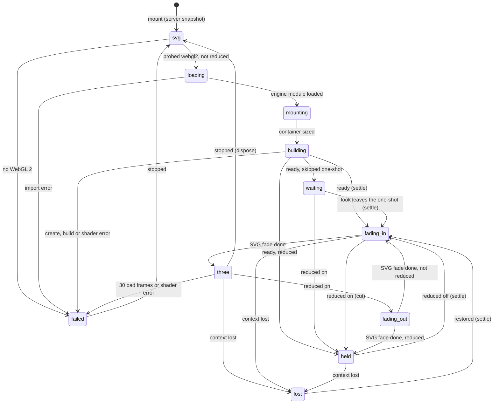
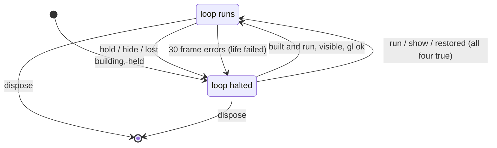

# Brief 013 design: the three.js avatar in the app

This note designs the port of the three.js prototype into the app, behind the Avatar_Contract. It comes from brief 013, the three maps of the prototype and the app, reads of the prototype and the app code, and two reviews of the first pass (answered in §12). Prototype line numbers are `franki.html` line numbers (3489 lines; the engine lives entirely in that file, and `serve.mjs` is only its local server). App paths are repo-relative.

**State:** second pass. The dependency is installed and the scaffold (WP0) is written: every file of §3 exists with its final exported types, and every body that is not yet ported throws `not ported yet`. The scaffold typechecks, lints and passes the guards and the existing tests. Nothing else is built or run. §11 lists what this note did not check.

**The scaffold is the contract.** The exported types in the scaffold files are the interfaces between packages. §3 summarizes them; where the two differ, the file wins and this note is wrong.

## 0. The decisions on one page

1. **Approach:** the prototype's engine moves almost verbatim into 27 files under `apps/web/src/components/avatar/three/`. Each file is a factory that destructures its dependencies from one shared rig context and then holds the prototype's code unchanged. The cuts fall only on the seams the maps found safe. React sees one typed facade: `createEngine`, `setTargets`, `settle`, `resize`, `pause`, `dispose`.
2. **One decider:** the app's Look_Mapper (`look.ts`) and Event_Controller (`events.ts`) stay the only code that decides the look and times events. The prototype's own decider is removed: the override pin, the call, sim and Listen priority chain, the voice gate and the cheer. A new pure function, `actingFor(look)` in `ui/avatar/acting.ts`, maps each look onto the prototype's pose, overlay, one-shot and the two audio gates. The engine decides only *how* to animate.
3. **The voice drives the mouth through the prototype's own analysis (decision D-1, for the director).** A read-only `AvatarAudioSource` rides beside the props, as `FrameTimeContext` already does. The Level_Meter gains a second analyser per stream, configured as the prototype's (FFT 1024, smoothing 0). The prototype's `Probe` runs verbatim on it, gated by the look. A level-only path would visibly flatten the mouth (§2.4), which the house rules forbid.
4. **Contract gaps, named:** the prototype has no acting for Dormant, Recovery, Presenting or Awaiting_Approval. Dormant becomes the wake's first frame, held, with the head stilled. Recovery and Awaiting_Approval take the art direction's numbers. Presenting gets no acting yet. All go to the owner for review (§10).
5. **Render density:** bloom, grain and every `fwidth` edge are measured in render pixels, so the engine renders at a reference height (`REF_FRAME_H` 900) and the browser scales the canvas down (edit E10).
6. **Fallback:** one pure function decides SVG or three.js from WebGL 2 support, the engine's status, `reducedMotion` and one-shot sync. A pure phase machine adds the fades. The SVG ghost is always the server and first render. The two layers share one box that never changes size. The canvas fades in under the still-opaque SVG, only after the engine has drawn a real frame of the current look, and the swap never starts in the middle of a one-shot.
7. **Lifecycle:** each mount gets one controller. The engine owns its canvas, so Strict Mode's second mount and Fast Refresh get a fresh canvas and context. An engine-side loop machine pauses on a hidden tab, a hold or a lost context, and gives up after 30 bad frames in a row. The stage stays mounted across sign-in, so the engine is built once per page load.
8. **Loading:** `three@0.187.0` is pinned exactly. The engine loads only through `import("./three/engine")`, after a WebGL 2 probe and only while reduced motion is off. No file outside `three/` value-imports a file inside it. A postbuild check proves the chunk exists and is not in the first load of `/`.
9. **Guards:** no guard is weakened. Three pure modules join `PURE_MODULES`. CPU timing goes through the Clock_Port. One prototype comment holds a `#hex` and is reworded. An optional token-check rule for `0x` colours comes with one directory entry and a reason.

**Decisions only the director can make:** D-1 the audio source against brief rule 2 (§2.4), D-2 a dev-only copy of the prototype's speech simulator on the specimens page against brief rule 7 (§8.2), D-3 the mouth in the docs before I1 (§10).

---

## 1. Approach: fidelity first

### 1.1 The two candidates

**(a) The engine moved nearly verbatim behind a typed facade, cut only at safe seams.** Each prototype section becomes one or two TypeScript files. Every file exports one factory, `createX(rc)`. The factory opens with `const { … } = rc;`, which binds exactly the names the prototype used as top-level variables. The prototype's code for that line range follows unchanged, so `CH.up.t`, `U.uGlow.value` and `emitSparks(b, …)` read exactly as in the prototype.

**(b) A full modular port.** The code is rewritten into idiomatic modules with typed classes, no shared mutable bags, renamed symbols and per-module state.

### 1.2 Choice: (a)

(a) keeps the look and the acting identical with the least risk:

- **The failure modes are silent.** Map A §15 lists about fifteen cuts that change the look with no error: cloning or rebuilding `U`, `hairU`, `brassU`, `groundU` or `userData.u` (the uniforms are shared by reference); splitting or reordering the one `rnd` stream; changing the `hrand` draw order; moving `emitSparks`, `writeRibbons` or `updateCatchLights` across the frame's single `scene.updateMatrixWorld()`; renumbering the brass `aPart` ids; toggling `transparent` or `alphaToCoverage`; changing a `renderOrder`; adding or removing a light; replacing `setEffects`; "fixing" `smooth()`'s inversion or `uEyeO`. A rewrite crosses most of these seams. A verbatim move crosses none.
- **It can be checked mechanically.** A verbatim body can be diffed against its prototype range after TypeScript's types are stripped (§8.3), and every shader string and shader hook output is pinned by hash (§8.1).
- **Pixel parity becomes possible.** With the call order and the `rnd` order kept, the port's still frames (`still: true`) can be pixel-compared with the prototype's `?still=1` frames (§8.2).
- **It can be done in parallel.** The seams give file-disjoint work packages (§9).
- **Nothing is lost later.** A later modular rewrite could happen behind the same facade, file by file, with the parity frames as its test.

The cost is 27 files of prototype-shaped code: closures over a shared context, short names and dense lines. Four things keep that readable for people and agents: a header in every file naming its prototype range and the edits allowed in it; a typed `Part` interface per factory; the typed facade; and the edit list below, so a later reader knows "tidying" is forbidden and why.

### 1.3 What "verbatim" allows

These are the only edits a porter may make to a prototype range. Each one shows up in the normalized diff (§8.3), and a reviewer accepts it there. Every line that is not the prototype's and is not E1-E3 is marked `// contract:`.

| # | Edit | Why |
|---|---|---|
| E1 | Type annotations on parameters and declarations, generic arguments on empty literals (`[] as Strip[]`, `new Set<string>()`), and `!` where TypeScript cannot see a value is set (`null!` for the ribbon pool's first `pts`). A typing three's package lacks is declared once in `three/three-compat.d.ts` by module augmentation, never with `any` and never by changing the call; the porter reports the declaration and the lead adds the file (§9). | `strict` TypeScript. Expressions and statements stay byte-identical |
| E2 | `let` → `const` only where lint's `prefer-const` reports that line | `prefer-const` is an error in this lint config (checked with `eslint --print-config`), and `npm run lint` must exit 0 |
| E3 | The factory wrapper: `export function createX(rc) { const { … } = rc; … return { … }; }` | Replaces module top level: one context per engine |
| E4 | `T` → `clock.T` (the only top-level `let` shared across sections) | `T` is reassigned by the loop and read by `triggerBlink` (2577) and the pointer handler (3271) |
| E5 | Page reads become host inputs: `innerWidth`/`innerHeight` → `size.w`/`size.h` (in `applyQuality`, `resize`, `frameInner`); `document.hidden` at 3164 → `!host.visibility.isVisible()`; `$('dock')…top` → `dockTop()`; `ui.muted` → `targets.ghost`; the call, sim and Listen branches → `targets.pose`. **Except the pointer handler (3270), which keeps `window.innerWidth`/`innerHeight` for `gaze.pointerWin`** (§2.4) | The engine sits in a box, not a window, and the app decides the state |
| E6 | DOM writes removed: `ui.setTag`, `$('qualNow')`, `$('qualSel')`, `notify`, `#fallback` | Page chrome is not ported |
| E7 | Wall-clock reads replaced: `performance.now()` → `host.mono()` for CPU time; `THREE.Timer` → deltas of the rAF timestamp `ts` | ui-boundaries rule 4, brief rule 8 |
| E8 | The named contract edits of §2.3 | The contract has looks and inputs the prototype lacks |
| E9 | Comments: drop or reword any that name a wall-clock call or contain a `#hex`; keep the rest | Guards scan comments (§7) |
| E10 | `applyQuality` (3135-3153): `const pr = e.dpr * renderScaleFor(size.h, L[0].dpr)`; then `renderer.setPixelRatio(pr)`, `moteMat.uniforms.uPR.value = pr` and `gradePass.uniforms.uRes.value.set(size.w * pr, size.h * pr)` | Bloom lobes, grain and `fwidth` edges are measured in render pixels (§4.3 item 3) |
| E11 | A scratch object the prototype shares across a cut is re-declared in the second file, because every use writes it before reading it: `_view` in `fx-catch.ts` (from 2409) and `_proj` in `loop.ts` (from 2868). No other name qualifies (checked by a cross-reference of every top-level name against the cuts) | The two factories cannot share a closure |

Everything else stays byte-identical: numbers, operators, statement order, call order, names, `renderOrder`, flags, seeds, cache keys and GLSL.

---

## 2. Who decides what

### 2.1 Ownership

There is exactly one decider for each question. The engine never decides a look, so it cannot disagree with the app.

| Decision | Owner | Where |
|---|---|---|
| The LookName, ghost, follows, drive, electric and label | Look_Mapper (unchanged) | `ui/avatar/look.ts` |
| When an event starts and ends | Event_Controller (unchanged) | `ui/avatar/events.ts` |
| The prototype pose, overlay and one-shot for a look; the two audio gates | Acting mapper (new, pure) | `ui/avatar/acting.ts` `actingFor` |
| Whether a one-shot starts, is cut or was missed | One-shot edge machine (new, pure) | `ui/avatar/acting.ts` `oneShotStep` |
| Whether SVG or three.js shows, and the fade phase | Renderer phase machine (new, pure) | `ui/avatar/renderer-phase.ts` `rendererStep`, `fallbackFor` |
| Whether the engine's frame loop runs | Loop machine (new, pure) | `ui/avatar/renderer-phase.ts` `loopStep`, `loopRuns` |
| How a pose is animated: springs, blink, gaze, mouth driver, celebrate and wake playback, arcs, sparks, quality tier | The engine (prototype, verbatim) | `components/avatar/three/*` |

The prototype keeps `sm.base` and `sm.shown`, but only as memos. `resolveState` rewrites `base` from `targets.pose` every frame and uses the memo only to detect a change, which retunes the spring omegas and fires the change blink.

**Removed from the prototype, because the app decides these:** `setOverride` and the live use of `sm.override` (2758, 3329-3334), the base chain over `call.active`, `call.connecting`, `sim.on` and `listen.on` (2786-2790), `voiceGate` (744-764, 2783), `listenState`, `startle` and the cheer (2760-2778), and the boot wake (3480). The voice gate forced `speaking` when remote audio was loud and the call said otherwise. In the app that would move the body during a reply that admission held, which UI direction forbids: "A reply that admission held or cancelled must not move the body" (`ui-direction.md:109`).

### 2.2 The mapping: every LookName, the ghost overlay, every event and the two gates

`actingFor(look)` returns `{ name, pose, overlay, oneShot, ghost, mic, voice, electric }` from the look alone. `pose` is a row of the prototype's expression table `ST` (2553-2558). For the three event looks (Presenting, Awaiting_Approval, Celebrate) the pose comes from `look.follows`: `input` → `listening`, `output` → `speaking`, `none` → `thinking`. That is the state rule `look.ts` already applied (speaking with output muted follows `none`, so it acts Thinking; closed and recovery win the name, so they never sit under an event look). `ghost = look.ghost`, `mic = look.follows === "input"`, `voice = look.follows === "output"`, `electric = look.electric` (the controller ANDs it with the Electricity grant, §4.4). The engine never reads `name`; it is there for tests and specimens.

| LookName | Pose (`ST` row) | Overlay | One-shot on entry | What the prototype does in it | Notes |
|---|---|---|---|---|---|
| Dormant | `idle` | `dormant` | none | Idle pose. The `doze` spring (w 4) pulls toward 1. At 1 it reproduces `wakeCurves(0)` exactly: lids shut (`closed` = 1), glow × 0.2, body −0.15. Head pointer-follow, saccade head turns and the brass glint are stilled; breathing, bob and sway go on. | **Not in the prototype.** Built from the wake's own start pose, which matches the app's row (eyes closed, glow dim, posture sunk). Falling asleep after a call is a new ~1.2 s spring. Owner review. |
| Waking | `idle` | none | `wake` | `wakeCurves` (2701-2710): eyes shut, glow 0.2, the strike at 0.35 s (both bolts flash, an arc from above, 14 sparks per bolt, heat), glow flare to 2.0, eyes pop open at 0.55-0.64 s, rise; it ends at 1.4 s (2893-2904). `doze` snaps to 0 at the start, which hands over the identical pose. | The app's Waking lasts 1.2 s and the engine's wake 1.4 s. The prototype plays the wake out under any base. Its last 0.2 s is a glow multiplier of 1.05 → 1 and no sink, so it is kept. |
| Connecting | `thinking` | none | none | The prototype's own mapping: `call.connecting` → `'thinking'` (2787). Arcs after 0.1 s, slow blinks, the up-and-aside gaze pair. | The app's row (half eyes, flicker) differs from Thinking. In three.js the two look the same. Owner call (§10). |
| Listening | `listening` | none | none | `ST.listening`; anticipatory widen `up.vel −= 2.2` (2802); camera gaze with micro-saccades; the mic analysis (below). | |
| Thinking | `thinking` | none | none | `ST.thinking`, arcs, heat, gaze pair, thinking mouth slit (0.3). | Also speaking with output muted, which the app already maps to Thinking. |
| Speaking | `speaking` | none | none | `ST.speaking`; the voice analysis (below); mouth on (`SHOW_MOUTH = true`). | |
| Recovery | `idle` | `recovery` | none | `up.t = 0.30`, `tilt.t = −8` unless ghost, plus the prototype's muted fizzle beat (`emitSparks(b, 3, 0.5, 0.35)`, flash 0.25, every 4-7 s). | **Not in the prototype.** Lid numbers from art direction §4 ("recovery (optional): upper 0.30, tilt -8 (worried), wobble"). No wobble. Owner review. |
| Presenting | from `follows` | none | none | The underlying state's acting. No arcs even over a thinking state, because `look.electric` is false (pinned in `acting.test.ts`). | **No acting yet.** "Glance at the card" needs a card position, and no card source reaches the browser. Later (§10). |
| Awaiting_Approval | from `follows` | `awaiting` | none | `up.t = 0`, `pupil.t = 0.5` unless ghost; the `approve` weight spring (w 6) fades in a head nod of `2° · sin(2π · 0.8 · t)`, added to head pitch and to the hair follow-through. No arcs, as Presenting. | **Not in the prototype.** Art direction §5 ("upper 0.0, pupil 0.5, a small 2 deg nod loop at 0.8 Hz"). Owner review. |
| Celebrate | from `follows` | none | `celebrate` | `startCelebrate` (2698): anticipation, launch, apex, fall, land, settle (`celebCurves`, 2676-2697); burst at 0.38 s; blink at 1.25 s; grin; it ends at 1.6 s (2797). If the look leaves Celebrate early, `cutAt = T` and every offset fades over `CELEB_CUT` 0.25 s, the prototype's own cut (3329-3334). | The app's 1.6 s equals the prototype's. The pinned hold (2853-2858) is not used. A celebrate re-triggered while Celebrate shows is not replayed (§2.4). |
| **Ghost overlay** (`look.ghost`) | any | any | any | `muted = true` (2782): the `ghost` channel (in w 6.8, out w 9.2), muted lids over idle and listening, pupil 0.40, pitch +2, slower and bigger bob, body drifts back 0.06, rim × 1.6, glow × 0.8, hue −0.04, hair, brass and key light faded, prepasses on, fur off past 0.75, fizzle every 4-7 s except while speaking, gaze omega 36 and saccades × 1.5. | `look.bodyOpacity` (0.35) is not read: the prototype's dissolve is the three.js ghost mode. The ghost never changes the pose, and the recovery and approve lid numbers yield to it. |

**Events.** The engine sees an event only through its LookName. The app's priority decides which name wins.

| AvatarEvent | Through | In the engine |
|---|---|---|
| `wake` | Waking | the `wake` one-shot |
| `present-card` | Presenting | nothing yet |
| `await-approval` | Awaiting_Approval | the `awaiting` overlay |
| `celebrate` | Celebrate | the `celebrate` one-shot |

**`eventElapsedMs` and `firstConnecting` are not read.** The look is republished only when a discrete field or `drive` changes (`frame-loop.ts:33-41`), so the elapsed time in the props is stale. The engine times a one-shot from the edge it saw, on its own clock. Leaving the look always cuts Celebrate. Leaving Waking cuts the wake when it started: before the strike the engine hands the identical pose to the doze spring, so a first call that fails or is cancelled within the first 0.35 s never plays the strike over Recovery or Dormant; after the strike the wake plays out (a call that ends between 0.35 s and 1.2 s still shows the rest of the wake, then eases into the new look; cutting a flare mid-way would pop), and its tail after the app's 1.2 s (a glow multiplier of 1.05 → 1, no sink) is invisible. So the two clocks cannot disagree in a way that shows. The one exception is a re-trigger inside the same look (§2.4).

**The two gates.** The engine reads the audio source only while the look's gate for that stream is open, so a held reply never moves the body. The gates mirror `look.drive` exactly: `look.drive` is the output level only when `follows === "output"`, and the voice gate opens only then.

| Gate | Opens when | Stream | Prototype channels it drives |
|---|---|---|---|
| `voice` | `look.follows === "output"` | Franki's output | `level`, `a` (the mouth envelope), `cent` (vowel weights), `syllable`, `plosive`, `lastLoud` → mouth open, overshoot and snap, vowel shape, tongue, visibility (`updateMouth`); glow `+0.3·vA²`, halo `+0.2·vA`, lower lid `+0.06·vA`, pupil `+0.04·vA`, bolt emissive `+0.25·vA`, squash `vsq 1 − 0.035·vA`, hem `+0.01·vA`; head nod per syllable; brow lift; phrase-boundary blinks |
| `mic` | `look.follows === "input"` | the user's mic | `level` → rim `+0.6·micL`, halo `+0.15·micL`, upper lid `−0.06·smooth`, pupil `+0.04·smooth`; `onset` → the listening nod (over 0.35, at most one per 350 ms) |

A closed gate reads silence (`probe.silence()`), exactly as the prototype does with no stream.

### 2.3 The contract edits to prototype code (E8)

| File (prototype lines) | Edit |
|---|---|
| `rig.ts` (2534-2547) | Two channels appended to `CH`: `doze: new Chan(0, 4)` and `approve: new Chan(0, 6)`. They join `CH_LIST` (`Object.values(CH)`, 2548), not `BODY_CH`. `doze` starts at 0; the settle frames at create snap it to 1 under Dormant. |
| `rig.ts` (2564) | `gaze` gains `pointerWin: new THREE.Vector2()`. |
| `state.ts` (2780-2810) | `sm.override = STILL ? stillOverride(targets) : null;` before the verbatim `const ov = sm.override;`; `const muted = targets.ghost \|\| ov === 'muted';`; the voice-gate line is removed; the base chain becomes `if (ov && ov !== 'muted' && ov !== 'celebrate') base = ov; else base = targets.pose;`; `ui.setTag(shown)` is removed. Lines 2791-2809 stay verbatim. `stillOverride` returns `'muted'` for ghost, `'celebrate'` for the celebrate one-shot and the pose otherwise, so still frames take the prototype's `?state=` paths (§8.2). |
| `state.ts` (after 2862) | A block appended after the verbatim `setTargets` body: if overlay is `recovery` and not muted, `CH.up.t = 0.30; CH.tilt.t = -8`; if `awaiting` and not muted, `CH.up.t = 0; CH.pupil.t = 0.5`; `CH.approve.t = awaiting ? 1 : 0`; `CH.doze.t = dormant ? 1 : 0`; if dormant, `CH.lookYaw.t = 0; CH.lookPitch.t = 0; CH.headSac.t = 0; CH.glint.t = 0` (targets only, so the springs ease; the block runs after `updateGaze`, so it wins each frame); `if (!STILL && !targets.electric) CH.arc.t = 0`. |
| `state.ts` (new `applyTargets`) | `Object.assign(targets, next)`, then, not under `STILL`: a `cut` sets `celeb.cutAt = clock.T` when `celeb.active && celeb.cutAt < 0` (the rule of 3329-3334); `wake: cut` and `wake: start` as in the two rows below; `wake: start` sets `wake.active = true; wake.t0 = clock.T; wake.fired.clear(); CH.doze.snap(0)`; `celebrate: start` calls `startCelebrate(clock.T)`. |
| `state.ts` (new `endOneShots`) | `celeb.active = false; celeb.cutAt = -1; wake.active = false`. Used only by `settle`. |
| `apply.ts` (2919) | `bodyY = … + wo.sink - 0.15 * CH.doze.v` |
| `apply.ts` (2934, 2938) | `const nodLoop = 2 * Math.sin(2 * Math.PI * 0.8 * t) * CH.approve.v`, added inside the head's x term and inside `rollNow` |
| `apply.ts` (2945) | `… * wo.glow * lerp(1, 0.2, CH.doze.v)` |
| `apply.ts` (2965) | `Math.max(blink.v, wo.closed, CH.doze.v)` |
| `apply.ts` (3078) | The fizzle gate's `muted` → `(muted \|\| targets.overlay === 'recovery')` |
| `apply.ts` (3089) | The camera parallax reads `gaze.pointerWin.x` and `.y` |
| `loop.ts` (3270, in `attach`) | `gaze.pointer` is set from the canvas's own `getBoundingClientRect()`, unclamped; `gaze.pointerWin` is set as 3270 sets `gaze.pointer` today, from `window.innerWidth`/`innerHeight` |
| `loop.ts` (3346-3355 `feedProbes`) | `const mr = targets.mic ? host.audio.read('mic', dt, m.time, m.db) : 0; if (mr > 0) m.sr = mr; else m.silence();`, the same for `voice`, then the verbatim `m.analyse(dt, clock.T); v.analyse(dt, clock.T);`. The sim branches are removed. |
| `loop.ts` (3380, and after `applyRig`) | `if (STILL \|\| settling) for (const c of CH_LIST) c.snap(c.t);` at 3380, and `if (settling) for (const c of CH_LIST) c.snap(c.t);` after `applyRig`, so the follow-through channels it targets (`hemY`, `hairRoll`, `hairY`, `hairYaw`, 2939) start at rest |
| `loop.ts` (new `settle`) | `settling = true`, two `frameInner` calls with `dt` 0, `settling = false`, `prevTs = null`. Not run after a hidden tab: the prototype just continues there. |
| `loop.ts` (3395) | `tickQuality(dms, c0 / 1000)` is stored after the draw and run at the top of the next `frameInner`, after the pending size. A tier change calls `setPixelRatio` and `setSize`, which reallocates and clears the drawing buffer; run after the draw (as the prototype does) it threw away the frame just drawn, so the ghost blinked out for one frame on every probe or drop. The ladder reads the same inputs one frame later (`perf.cpu` is still the previous frame's). |
| `loop.ts` (`settle`, still mode only) | Before the two settle frames, `feedProbes(1/60)` runs `STILL_PREROLL` (240) times, so the probes reach the fixed point of the still signal before `updateMouth` first sees it. Without it, the mouth driver's 45 ms dominant-shape hold (2742-2743) never releases under the frozen clock, so the shape latched on the first open frame depends on the early frames' timing. The prototype has the same dependence (see §8.2 item 1). Live engines skip it. |
| `state.ts` (`applyTargets`, wake `cut`) | A `cut` before the strike (`wake.active && !wake.fired.has('strike')`) ends the playback: `wake.active = false; CH.doze.snap(1)`. Before the strike the wake pose and the doze pose are identical (lids shut, glow × 0.2, body −0.15), so the doze spring takes the pose over without a pop and eases to the new look's target. After the strike, the wake plays out as before. |
| `state.ts` (`applyTargets`, wake `start`) | Also re-arms the two timers as the prototype's boot does (3481, and `gaze.next` 0 at boot): `blink.doubleAt = -1; scheduleBlink(clock.T, 'idle'); gaze.next = 0`, so no timed or double blink lands on the eye-pop at 0.55-0.64 s. A blink already in flight ends within 0.22 s, under the shut lids. |

New numbers that need the owner's eye: `doze` w 4, `approve` w 6, the nod loop 2° at 0.8 Hz, recovery lids 0.30 / −8, the Dormant dimness (glow × 0.2) and the Dormant stilling.

### 2.4 Named gaps between the contract and the prototype

**D-1, the audio source (decision, before the build).** The prototype's acting reads two analysers per stream: float time-domain samples and float dB bins, FFT 1024, smoothing 0 (`audio.tap`/`fill`, 470-487). The contract gives a renderer one smoothed scalar per publish. The choice:

- `ui/levels/audio-source.ts` (pure, in the scaffold) defines `AvatarAudioSource.read(which, dt, time, db)`: it fills the two arrays with the newest analysis of one stream and returns the sample rate, or 0 when there is nothing to read.
- `ui/levels/level-meter.ts` (WP16) gains a second `AnalyserNode` per tap, created on first read and configured exactly as line 474 (`fftSize` 1024, `smoothingTimeConstant` 0, `minDecibels` −140, `maxDecibels` 0), read as 485-486. `createLevelMeter()` returns `LevelMeter & { audio: AvatarAudioSource }`. The `LevelMeter` interface, the 512-sample analyser, `sample()` and `rawInput()` do not change. The source returns 0 while paused, with no stream, or unless the context is running.
- `components/avatar/avatar-audio.ts` (in the scaffold) holds `AvatarAudioContext`. `App.tsx` provides `meter.audio` around the screen in I1. `SvgGhost` ignores it. Without a provider the three.js ghost reads silence: there is no level-only fallback.
- `three/probe.ts` is the prototype's 299-370 verbatim (`Probe`, `silence`, `analyse`). `feedProbes` is 3346-3355 with the gate edit of §2.3.

It conflicts with brief rule 2 as written ("driven only by look and input"). Our reading: the source decides nothing (it is read only while the look's gate is open), it is a third input carried by context exactly as `FrameTimeContext` is, and the Avatar_Contract props do not change. **The director confirms this reading or rules otherwise.**

The rejected level-only path, with the reviewer's numbers (computed from the constants, not measured): the app's level is 8-bit RMS over 512 samples, smoothed with release 0.12 per frame (about −1.1 dB per frame), sample-and-held with a 1/32 deadband, one or two frames late. The mouth envelope maps the top 16 dB under the running peak (339-342), so a full close takes about 14 frames (240 ms) where the prototype's level drops inside its 21 ms window. A 10 dB dip for 80 ms between syllables moves the prototype's mouth from 1.0 to 0.55 and the level-only port's from 1.0 to 0.87. `syllable` (366) would fire almost only at phrase starts, so the per-syllable nod, the overshoot and the brow lift would mostly vanish; `plosive` (368) could not fire, so the 50 ms snap would be gone; and with no centroid the mouth would always be the wide "ah", with the tongue on every wide opening. That is an animation-quality trade, so it is not taken.

| Gap | Choice | Effect |
|---|---|---|
| Levels reach the renderer only on a publish | The engine reads the audio source every frame while a gate is open; the published `drive` only opens the gate | The mouth follows the voice at frame rate, as in the prototype |
| The pointer | The engine keeps the prototype's window `pointermove` listener (3269-3272). `gaze.pointer` is taken in the canvas's own normalized coordinates, unclamped, so the idle gaze ray aims at the real pointer (`gazeToward` clamps to `GAZE_MAX` and `headLookAt` to ±12°). `gaze.pointerWin` keeps the prototype's window normalization for the camera parallax (3089), so the parallax keeps the prototype's range on an off-centre stage. | The one input outside `look` and `input`. It decides nothing, and the listener is removed on dispose. |
| A timed event re-triggered while its look already shows | Not replayed; the first playback runs out | No source feeds celebrate on the main screen today. Same class of contract question as D-1 (§10). |
| The square canvas frame | The camera and framing are the prototype's at the canvas's aspect, so the aspect-relative set dressing moves: the bottle at `0.78·asp`, the coil at `−0.82·asp`, bokeh and lamp (2095-2110), and the vignette footprint (890). They land inside or at the edge of the masked disc. | Accepted, for owner review at I3 (§10). |

### 2.5 Implicit state machines found, and what the port does with each

| Machine | Encoded today as | In the port |
|---|---|---|
| Avatar base pose | Priority chain in `resolveState`, `sm.base` | **Replaced** by the app's `lookFor` → `actingFor`. `sm.base` stays a memo (§2.1). |
| Shown overlay | `sm.shown` plus `ui.muted`, `celeb.active`, `cutAt` and `override` | **Derived** each frame from targets. Kept verbatim for the change blink and the ghost omega. |
| Override pin | `sm.override`, `lastCelebLoop`, `setOverride` | **Removed** live. Mirrored only in still mode for parity (`stillOverride`). |
| Call lifecycle, sim phase, Listen acquisition, voice gate | Booleans and strings | **Not ported.** The app's voice machine (`packages/core`) and `look.ts` own them. |
| Celebrate and wake **triggers** | Keys, boot, pin, cheer | **New explicit machine:** `oneShotStep(EdgeState, next, running)` → `{ state, command }`, pure. |
| Celebrate and wake **playback** (off, playing, cutting) | `celeb.active`, `cutAt`, `fired`; `wake.active`, `fired` | **Kept verbatim.** It is animation, and the beats' exact firing is part of the look. Only `applyTargets`, `endOneShots` and the verbatim end checks write it. |
| Blink (open, closing, hold, opening, plus a pending double) | Numeric `blink.phase` 0-3 | **Kept verbatim.** Animation-internal; its timing is the acting. |
| Gaze mode, mouth dominant shape, arc generations, quality ladder | Branches and timers | **Kept verbatim**, for the same reason, with E5, E7 and E10 applied. |
| Render loop (running, hidden, lost, failing) | `running` plus `document.hidden` plus listener toggles (3439-3453) | **New explicit machine:** `LoopState` + `loopStep` + `loopRuns` (§5.2). |
| Which renderer shows, and the fades | `Avatar`'s default prop | **New explicit machine:** `RendererState` + `rendererStep`, with `fallbackFor` as its truth table and `rendererView` as its view (§4). |
| Electricity grant for the three.js ghost | None (new consumer) | One token held by the controller, synced from one effect (§4.4). |
| App: `FrameLoop` (`running`, `handle`, `unsubscribe`), `LevelMeter` taps (`analyser` null, connected or failed, plus `paused`), `ScreenController.lastElectricAt`, the ring spark's token | Loose flags | **Found and left as they are.** They are outside this port and work today. WP16 adds a second analyser beside each tap's first and changes none of its flags. Making them explicit is a candidate for its own brief, so that no change here risks the voice path. |

The rule "a status or phase is a closed union with one pure function that decides every transition" applies to everything new: `EdgeState`, `RendererState` and `LoopState`. The prototype's playback state is not new; rewriting it would risk the acting and gain no look.

---

## 3. Module layout

### 3.1 The tree

```
apps/web/src/ui/avatar/
  acting.ts               NEW pure   actingFor, oneShotStep                       (in PURE_MODULES)
  renderer-phase.ts       NEW pure   fallbackFor, statusOf, rendererStep, seesOneShots,
                                     rendererView, loopStep, loopRuns             (in PURE_MODULES)
apps/web/src/ui/levels/
  audio-source.ts         NEW pure   AvatarAudioSource and the analyser settings  (in PURE_MODULES)
  level-meter.ts          EDIT       the second analyser per tap, `audio`         (WP16)
apps/web/src/components/avatar/
  ThreeGhost.tsx          NEW        the AvatarRenderer: SVG layer + canvas layer
  three-ghost-controller.ts NEW      one per mount: machines, engine handle, grant, size
  three-host.ts           NEW        browser dependencies: probe, loader, host, size observer, budget
  canvas-frame.ts         NEW        CANVAS_FRAME and REF_FRAME_H; imports nothing
  avatar-audio.ts         NEW        AvatarAudioContext
  Avatar.tsx              EDIT (I1)  default renderer → ThreeGhost
  three/                  NEW        the engine; only these files value-import `three`
    errors config math probe context stage glsl uniforms materials-body materials-hair-brass
    surface character brass hair mouth fx-world fx-sparks fx-lightning fx-catch rig state
    apply quality loop dispose layout engine                                   (27 .ts files)
```

### 3.2 The shared rig context

The prototype's top-level `const`s become fields of one object, `rc: Rig`, built once per engine by `buildRig` (`three/context.ts`, real code in the scaffold). Each factory returns a `Part`, and `buildRig` merges it into the same object with `Object.assign`. That copies references, so `U`, `hairU`, `brassU` and `groundU` stay single shared objects (map A finding 2). Every scratch vector, seeded stream and pool is created inside a factory, so it belongs to that one engine. That matters because the specimens page runs several engines at once, Strict Mode builds twice, and a module-level `hrand` would continue its stream into a second build and grow different hair.

**Holders.** Mutable values that cross sections live in holder objects created once in `HostPart` and only ever mutated in place: `clock` (`{ T: opts.still ? STILL_T : 0 }`), `size` (`size.w = w; size.h = h`) and `targets` (`Object.assign(targets, next)`). No code assigns `rc.targets`, `rc.size` or `rc.clock` after `buildRig`; `holders.test.ts` scans `three/` for such assignments. `REDUCED` is a constant `false`, because the app shows the SVG under reduced motion. `STILL` is fixed at create. `URLP` survives as an object with fixed values (`zoom` 1, `fy` and `lids` NaN), so verbatim reads need no edit. The loop-local `let`s (`acc`, `frameN`, `running`, `dprMQ`, `prevTs`, `settling`) and `arcPrevI` stay `let`s inside their own factory's closure.

`HostPart` (in `context.ts`): `host: EngineHost`, `canvas`, `size`, `clock`, `targets: Acting`, `errors: string[]` (newest last, at most 20), `recordError(kind: "shader" | "frame", msg)` (replaces `boot.record`, 258-259; the two kinds the ported ranges raise, at 809 and 3360) and `dockTop()` (0 in the app, so `frameAboveDock` returns at once, 3412).

`EngineHost`: `scheduler: FrameScheduler` (rAF timestamps), `visibility` (`VisibilityGate`), `mono()` (the Clock_Port's monotonic read), `yieldNow(): Promise<void>`, `audio: AvatarAudioSource` and `onEvent(e: EngineEvent)`. `EngineEvent` is `lost | restored | failed(reason, detail) | error(where: "frame" | "shader", detail)`. There is no first-frame event: `createEngine`'s resolution is `ready`.

**Build order is part of the look.** Material ids come from three's global counter at construction and break ties in the opaque sort among the beads, lids and fur (all `renderOrder` 0, map A §8), and the seeded streams are drawn in construction order. `BUILD_STEPS` names one step per factory, in the prototype's order: `config`, `random`, `probes`, `stage`, `uniforms`, `materials-body`, `materials-hair-brass`, `surface`, `character` (bead L, lid L, bead R, lid R), `brass`, `hair` (hair, hairPre, fur), `brass-pre`, `mouth`, `fx-world`, `fx-sparks`, `fx-lightning`, `fx-catch`, `rig`, `state`, `apply`, `quality`, `loop`. `hairU` (1307-1310) and `brassU` (1384) move into `uniforms`; they hold no textures and no materials, so ids do not move. `buildRig(host, canvas, size, initial, opts, signal, onRecord)` checks the signal before and after every step, yields between steps, and on any error frees what was built (`disposeRig(partial)`) and rethrows as `EngineError` (`build` unless the error already names a reason). A cross-reference of every top-level name confirms that no factory reads a name a later factory defines, except `T` (E4).

### 3.3 Files, exports and prototype ranges

The scaffold files hold the exact signatures; this table is the map. "Edits" lists the allowed edits beyond E1-E3.

| File | Prototype lines | Exports (scaffold) | Edits |
|---|---|---|---|
| `three/errors.ts` | new (replaces `fatal`, 793-798) | `EngineError(reason, detail)`, `EngineFailure` (re-exported from `renderer-phase.ts`), `NOT_PORTED`, `notPorted` (removed at I2) | |
| `three/config.ts` | 181-222, URL parsing replaced by options | `SHOW_MOUTH`, `QualityMode`, `EngineOptions { still; quality }`, `Urlp`, `ConfigPart`, `createConfig`, `STILL_T`, `C`, `COL`, `ColName`, `HOVER`, `TURN`, `HEAD_PIVOT`, `EYE_X`, `EYE_Y`, `BOLT_Y`, `DEG` (real code) | E9 at 210 |
| `three/math.ts` | 224-256 | `clamp`, `lerp`, `smooth`, `gauss`, `angDist`, `easeOutCubic`, `easeInQuad`, `easeInOut`, `mulberry32`, `RandomPart`, `createRandom`, `Chan` (real code) | |
| `three/probe.ts` | 269-270, 299-370 | `FFT_N`, `SIM_RATE`, `Probe`, `ProbesPart { audio: { mic; voice } }`, `createProbes` | none |
| `three/context.ts` | new | `Size`, `Visibility`, `EngineEvent`, `ErrorKind`, `EngineHost`, `HostPart`, `createHostPart`, `Rig`, `BUILD_STEPS`, `BuildStep`, `StepTiming`, `buildRig` (real code) | |
| `three/stage.ts` | 790-899 (not 793-800: `fatal` and the WebGL 2 check) | `StagePart`, `createStage(rc: HostPart & ConfigPart)`; throws `EngineError("create")` when the renderer can't be made | E5 (canvas from HostPart, aspect and bloom size from `size`) |
| `three/glsl.ts` | 904-952, 971-1034 | `GLSL_NOISE`, `GLSL_DISPLACE`, `GLSL_SKIN`, `GLSL_BODY_FRAG` (interpolates `EYE_X.toFixed(3)` at 1028) | |
| `three/uniforms.ts` | 954-969, 1307-1310, 1384 | `BodyUniform` (the 41 names), `HairUniform`, `BrassUniform`, `UniformsPart { V3, U, hairU, brassU }`, `createUniforms()` | moved earlier, unchanged |
| `three/materials-body.ts` | 1036-1304 | `BodyMaterialsPart` (`injectCommon`, `bodyMat`, `bodyPreMat`, `bodyDepthMat`, `BEAD_LID`, `makeLidMat`, `makeBeadMat`, `corneaMat`), `createBodyMaterials(rc: ConfigPart & UniformsPart)`; no renderer, node-testable | |
| `three/materials-hair-brass.ts` | 1306-1421 without `hairU`, `brassU` | `HairBrassMaterialsPart`, `createHairBrassMaterials(rc: ConfigPart & UniformsPart & StagePart)` | |
| `three/surface.ts` | 1423-1530 | `SurfacePart` (`PROFILE_PTS: number[][]`, `solveXY`/`solveArc` return `{ th, y }`, …), `createSurface()`; pure CPU | |
| `three/character.ts` | 1532-1588 | `Eye`, `CharacterPart`, `createCharacter(rc: Config & Stage & Uniforms & BodyMaterials & Surface)`; writes `U.uEyeC` (1588); keeps the `uEyeO` line inside its comment (map A finding 1) | |
| `three/brass.ts` | 1590-1727, 1990-1993 | `Bolt`, `BrassPart`, `createBrass`, `BrassPrePart`, `createBrassPre(rc: Character & Brass)` (built after the fur) | merge failure → `EngineError("merge")` |
| `three/hair.ts` | 1729-1988 | `HairPart`, `createHair`; `hrand = mulberry32(4242)` inside the factory | merge failures → `EngineError("merge")` |
| `three/mouth.ts` | 1995-2074 | `MouthPart`, `createMouth` | |
| `three/fx-world.ts` | 2076-2201 | `GroundUniform`, `WorldFxPart`, `createWorldFx(rc: Config & Stage & Uniforms)`; `mulberry32(909)` inside | |
| `three/fx-sparks.ts` | 2203-2310 | `SparkPool`, `SparksPart`, `createSparks(rc: Config & Random & Stage & Character)` | |
| `three/fx-lightning.ts` | 2312-2445 | `Strip`, `ArcShot`, `Arcs`, `Ribbon`, `LightningPart`, `createLightning(rc: Config & Random & Stage & Character & Brass)` | |
| `three/fx-catch.ts` | 2447-2529 | `CatchPart`, `createCatch(rc: StagePart & BodyMaterialsPart & CharacterPart)`; its JS copy of `fk_lidTop`/`fk_lidBot` (2517) stays in step with `glsl.ts` (map A finding 5) | E11 (`_view`) |
| `three/rig.ts` | 2531-2753 | `PrototypeChannel` (52 names), `ContractChannel`, `Channels`, `Expression`, `Phases`, `GazeState`, `BlinkState`, `CelebState`, `WakeState`, `MouthDriver`, `FxState`, `CelebOffsets`, `WakeOffsets`, `RigPart`, `createRig(rc: Host & Config & Random & Probes & Stage & Character)` | E4 at 2577; §2.3 |
| `three/state.ts` | 2755-2862 minus 2760-2778 | `Shown`, `StateMemo` (`override: Pose \| "muted" \| "celebrate" \| null`), `StatePart` (`stillOverride`, `resolveState`, `setTargets`, `applyTargets`, `endOneShots`), `createState(rc: Host & Config & Probes & Rig & Lightning)` | E5; §2.3 |
| `three/apply.ts` | 2864-3109 | `RigOut`, `CamState`, `ApplyPart`, `createApply(rc: Omit<Rig, keyof Apply \| Quality \| Loop>)` | E5; §2.3 |
| `three/quality.ts` | 3111-3207, `perf` (3343) | `Tier`, `LadderEntry`, `QualityState`, `Perf`, `QualityPart`, `renderScaleFor(cssHeight, topDpr)` (pure: `clamp(REF_FRAME_H / (cssHeight · topDpr), 1, 3)`), `createQuality(rc: Host & Config & Stage & Uniforms & Hair & WorldFx)`; `buildLadder` keeps its `window.devicePixelRatio` read | E5, E6, E7, E10 |
| `three/loop.ts` | 3337-3454, 3269-3272, 3473-3477, 3481 | `EngineStats`, `LoopPart` (`SUB`, `feedProbes`, `frame`, `frameInner`, `stats`, `frameAboveDock`, `resize`, `queueResize`, `watchDpr`, `onDprChange`, `boot`, `settle`, `loopState`, `send`, `attach`, `detach`, `run`, `halt`), `createLoop(rc: Omit<Rig, keyof LoopPart>)` | E4-E7, E11 (`_proj`); §2.3 |
| `three/dispose.ts` | new (map A §13) | `disposeRig(rig: Partial<Rig>)` | |
| `three/layout.ts` | new | `GhostBounds`, `ghostBounds(aspect)`; re-exports `CanvasFrame` | |
| `three/engine.ts` | new | `EngineTargets`, `EngineTimings`, `AvatarEngine`, `createEngine(container, size, initial, options, host, signal)` | |
| `ui/avatar/acting.ts` | new | `Pose`, `Overlay`, `OneShot`, `Acting`, `actingFor(look)`, `OneShotCommand`, `NO_COMMAND`, `EdgeState`, `INITIAL_EDGE`, `oneShotStep` | |
| `ui/avatar/renderer-phase.ts` | new | `EngineFailure`, `GlSupport`, `EngineStatus`, `fallbackFor`, `Phase`, `RendererState`, `INITIAL_RENDERER`, `RendererEvent`, `statusOf`, `rendererStep`, `seesOneShots`, `SvgLayer`, `CanvasLayer`, `EngineAction`, `LoopView`, `RendererView`, `rendererView`, `LoopState`, `INITIAL_LOOP`, `LoopEvent`, `FRAME_ERROR_LIMIT`, `loopStep`, `loopRuns` | |
| `ui/levels/audio-source.ts` | new | `AudioReader`, `AvatarAudioSource`, `AUDIO_FFT_SIZE`, `AUDIO_SMOOTHING`, `AUDIO_MIN_DB`, `AUDIO_MAX_DB`, `NO_AUDIO` (real code) | |
| `components/avatar/canvas-frame.ts` | new | `CanvasFrame`, `CANVAS_FRAME` (first estimate `{ left: -0.3, top: -0.25, width: 1.6, height: 1.6 }`), `REF_FRAME_H` (900) (real code, calibrated at I3) | |
| `components/avatar/avatar-audio.ts` | new | `AvatarAudioContext`, `useAvatarAudio` (real code) | |
| `components/avatar/three-host.ts` | new | `LoadedEngine`, `ThreeHostDeps { options, probeWebGL2, loadEngine, engineHost(audio, onEvent), observeSize, budget, onEngine? }`, `browserThreeHost()` | |
| `components/avatar/three-ghost-controller.ts` | new | `ThreeGhostView extends RendererView { phase, failure, granted }`, `ThreeGhostController` (`subscribe`, `getSnapshot`, `getServerSnapshot`, `start`, `stop`, `setLook`, `setAudio`, `attach`, `fadeDone`, `syncGrant`) | |
| `components/avatar/ThreeGhost.tsx` | new | `createThreeGhost(makeDeps = browserThreeHost): AvatarRenderer`, `ThreeGhost`; the scaffold renders `SvgGhost` | |

**The loop** (`loop.ts`). `frameInner(ts)`: apply a pending size (`queueResize`) first; `c0 = host.mono()`; `rawDt = prevTs === null ? 0 : (ts − prevTs) / 1000`, unclamped; `dt = clamp(rawDt, 0, 0.05)`; then the prototype's order: the zero-size check, `T += dt` unless still, `renderer.info.reset()`, `feedProbes`, `resolveState`, `updateBlink`, `updateGaze`, `updateMouth`, `setTargets`, the `headSac` decay, the springs (or the snap), `updateCamera`, `applyRig`, the settle snap, `scene.updateMatrixWorld()`, `applyWorldFX`, `updateFX`, `updateCatchLights`, grade `uTime`, the shadow cadence, `renderer.render`, `frameN++`, `perf.cpu = host.mono() − c0`, `perf.ema` and `tickQuality(rawDt · 1000, c0 / 1000)` as 3392-3395. `prevTs` is null after every `run()`, so the first frame back has `dt` 0; that stands in for `timer.reset()`. The `try { frameInner } catch` wrapper (3358-3361) stays and reports to the loop machine. Removed: `sim.update`, `call.tick`, `ui.tick`, `renderer.setAnimationLoop` and the window `resize` listener (the ResizeObserver replaces it). `boot()` runs 3474-3477 and 3481: `buildLadder`, `watchDpr`, `setQualityMode(quality.mode)`, `resize`, `scheduleBlink(0, 'idle')`.

**The facade** (`engine.ts`). `createEngine(container, size, initial, options, host, signal)`:
1. Creates its canvas (`aria-hidden`, no tab stop) and styles it once, as the prototype's page CSS does: `display: block; width: 100%; height: 100%`. Every `setSize` keeps its third argument `false`, so only the backing store follows the pixel ratio. Appends it to the container.
2. `buildRig`, with the loop held (`INITIAL_LOOP.hold` is `"hold"`).
3. `loop.attach()`, then `loop.boot()`.
4. Warms the programs under the key the output path uses: `const warm = new THREE.WebGLRenderTarget(1, 1); renderer.setRenderTarget(warm); const ready = renderer.compileAsync(scene, camera); renderer.setRenderTarget(null); await ready; warm.dispose();`. `compile()` takes its program keys synchronously inside the call, and any non-XR target gives the working colour space and no tone mapping, as WebGLOutput's own target does. Shadow-depth, PMREM, bloom, grade and output programs are not covered; they compile in the stage step and the settle frames.
5. `settle(initial)`: `applyTargets(initial, NO_COMMAND)`, `endOneShots()`, then the loop's two snapping frames.
6. Resolves only if no shader error was recorded, the context is not lost (`renderer.getContext().isContextLost()`), and the settle frames rendered. Otherwise it frees everything and rejects: `shader`, `create` or `frames`. Aborting at any yield rejects with `aborted`.

After ready, a shader error emits `failed("shader")`, 30 bad frames in a row emit `failed("frames")`, and a lost context emits `lost` (then `restored` after the first good frame back). `timings()` reports `steps`, `warmMs`, `settleMs`, `totalMs`, `longestCpuStepMs` (every step but `stage`, which holds the PMREM and the renderer's setup) and `programs: { afterWarm, afterSettle }`.

`AvatarEngine`: `canvas`, `setTargets({ acting, command })` (calls `applyTargets`; not the per-frame `setTargets` inside `state.ts`), `settle(acting)`, `resize(w, h)` (records a pending size), `pause(paused)` (the host hold), `dispose()` (idempotent), `timings()`, `stats()`.

**Dispose** (`dispose.ts`). Each part is freed only if present, so a half-built rig is freed by the same function: every geometry, material and texture reachable from the scene (`customDepthMaterial` and uniform textures included), the environment texture, `brushTex`, both passes, the shadow map and the renderer; then `forceContextLoss`, which is never skipped, because r187's `renderer.dispose()` does not free its own output targets or the PMREM target (reviewer's reading of r187, confirmed at I3); then the canvas is removed. Idempotent.

**The pure modules.**

- `oneShotStep(s, next, running)`: entering `celebrate` gives `start` if running, otherwise `skipped`. Leaving `celebrate` gives `cut`, always. Entering `wake` gives `start` if running, otherwise `skipped`. Staying in the same one-shot keeps `skipped`. Any non-one-shot clears it. `running` is `seesOneShots(rendererState)`, true exactly in `waiting`, `fading-in`, `three` and `fading-out`. A hidden tab does not make it false: while hidden, the app's Frame_Time and the engine's `clock.T` both stand still and no look is published, and `applyTargets` stamps `t0 = clock.T`, so a one-shot that begins plays from its start on return.
- `rendererStep`, `rendererView`, `fallbackFor`, `statusOf`: §4.
- `loopStep`, `loopRuns`: §5.2.

---

## 4. The fallback decision and the swap

### 4.1 The pure truth table

`fallbackFor({ gl, engine, reducedMotion, oneShotSkipped })`:

| gl | engine | reducedMotion | oneShotSkipped | Shows | Covers |
|---|---|---|---|---|---|
| unknown | any | any | any | svg | Server render, first paint, before the probe |
| none | any | any | any | svg | No WebGL 2, or no float colour buffer (`EXT_color_buffer_float` or `EXT_color_buffer_half_float`); the chunk is never fetched |
| webgl2 | absent, loading or building | any | any | svg | Still loading |
| webgl2 | failed | any | any | svg | The import failed, context creation failed, the build threw, a shader failed to compile or link, or 30 bad frames |
| webgl2 | lost | any | any | svg | Context lost and not restored |
| webgl2 | ready | true | any | svg | Reduced motion (the engine is held, not disposed) |
| webgl2 | ready | false | true | svg | The look is a one-shot the engine did not see start |
| webgl2 | ready | false | false | **three** | The only row that shows three.js |

`statusOf(s)` reads the inputs off the phase: `svg` is unknown/absent; `loading` and `mounting` are webgl2/loading; `building` is webgl2/building; `waiting`, `fading-in`, `three`, `fading-out` and `held` are webgl2/ready; `lost` is webgl2/lost; `failed` is none/failed when the failure is `no-webgl2`, otherwise webgl2/failed. `rendererStep` takes its settled target from `fallbackFor(statusOf(s), s.reduced, s.skipped)` instead of restating the table.

The first paint is SVG twice over: the server snapshot is the SVG view, and `ScreenController` starts with `reducedMotion: true` (`screen-controller.ts:44-47`), as does `INITIAL_RENDERER`.

### 4.2 The phase machine around it

`RendererState = { phase, reduced, skipped, failure }`, `Phase = svg | loading | mounting | building | waiting | fading-in | three | fading-out | held | lost | failed`. Events: `reduced(value)`, `probed(ok)`, `loaded`, `sized`, `ready`, `failed(reason)`, `fade-done`, `lost`, `restored`, `one-shot(skipped)`, `stopped`. `rendererStep(s, e)` is total: every pair not listed only records `reduced` or `skipped`.

| From | Event | To |
|---|---|---|
| any | stopped | svg (failure null, skipped false, reduced kept) |
| svg | probed(true), while not reduced | loading |
| svg | probed(false) | failed (`no-webgl2`) |
| loading | loaded | mounting (the canvas container is rendered, empty, waiting for a non-zero box) |
| mounting | sized | building (`createEngine` is called on this transition only) |
| building | ready | reduced ? held : skipped ? waiting : fading-in |
| building | lost | building (ignored: `createEngine` rejects with `create` if the context is lost at its end) |
| waiting | one-shot(false) | fading-in |
| waiting | reduced(true) | held |
| fading-in | fade-done | three |
| fading-in | reduced(true) | held (a cut) |
| three | reduced(true) | fading-out |
| fading-out | fade-done | reduced ? held : fading-in |
| held | reduced(false) | skipped ? waiting : fading-in |
| waiting, fading-in, three, fading-out, held | lost | lost |
| lost | restored | reduced ? held : skipped ? waiting : fading-in |
| loading, mounting, building, waiting, fading-in, three, fading-out, held, lost | failed(r) | failed |
| failed | anything but stopped | failed (absorbing until stopped) |

**Every entry into `fading-in` from `building`, `waiting`, `held` or `lost` calls `engine.settle(latestActing)` first,** while the canvas is at opacity 0, so the first visible 3D frame is a real frame of the current look. Entry from `fading-out` needs no settle: the engine was running and visible.

**Invariant:** `skipped` is false in `fading-in`, `three` and `fading-out` (the only ways in require it false, and `seesOneShots` is true there, so `oneShotStep` never sets it). A property test pins it.

`rendererView(s)`:

| Phase | SVG layer | Canvas layer | Engine | Loop |
|---|---|---|---|---|
| svg | shown | absent | probe if not reduced, else none | none |
| loading | shown | absent | load | none |
| mounting | shown | hidden (container mounted at opacity 0, empty) | await-size | none |
| building | shown | hidden | build | not-yet |
| waiting | shown | hidden | keep | runs |
| fading-in | leaving | entering | keep | runs |
| three | absent (unmounted) | shown | keep | runs |
| fading-out | entering | shown | keep | runs |
| held | shown | hidden | keep | held |
| lost | shown, at once | hidden, at once | keep | stopped |
| failed | shown | absent | dispose | none |

### 4.3 How the swap avoids a jump or a flash

1. **One box that never changes size.** `ThreeGhost`'s root is `relative w-full aspect-[10/11] isolate`, the SVG's own box (viewBox 200 × 220), so the stage keeps its size and layout in every phase, including `three`, when the SVG is unmounted. It carries `data-three-phase={phase}`.
2. **Two layers in the box.** The canvas layer comes first in the DOM: `absolute pointer-events-none`, `data-three-layer="canvas"`, positioned by `CANVAS_FRAME` from `canvas-frame.ts`, which imports nothing, so `ThreeGhost` reads it at first render without pulling three into the page. The SVG layer comes second: `absolute inset-0`, `data-three-layer="svg"`, holding the unchanged `SvgGhost`, so it paints over the canvas. The canvas layer has a radial mask that blends the prototype's background into the app's backdrop: `[mask-image:radial-gradient(closest-side,black_72%,transparent)]`, the stop calibrated in I3.
3. **The silhouettes are aligned, and the render density is fixed.** `CANVAS_FRAME` is calibrated so the 3D ghost's rest silhouette (`ghostBounds`) covers the SVG ghost's body box. The camera, fov, `CAM_BASE`, `CAM_LOOK` and the portrait fit stay the prototype's. Geometry and framing are unchanged. **Bloom lobes, film grain and every `fwidth` term (hair 1330, fur 1954-1966, lid and mouth edges) are measured in render pixels,** so the engine renders at a reference density and the browser scales the canvas down (E10): `renderScaleFor(size.h, ladder[0].dpr)` makes the top tier draw the frame `REF_FRAME_H` = 900 device pixels tall, the prototype's 1280 × 900 parity frame. At 1280 × 900 the scale is 1, so parity is unaffected. A 384 px canvas on a DPR-1 display renders about 900 px tall, fewer pixels than the prototype's own full window, and the ladder's lower tiers still scale it down. The square frame also moves the aspect-relative set dressing (§2.4). The box is larger than the avatar box because the wake strike comes from above the hair (about 0.75 units over the bolts) and the SVG's electricity also overflows its box.
4. **Nothing shows before a real frame of the current look.** The canvas is at opacity 0 until `createEngine` resolves and the controller's `settle` has drawn the current look.
5. **The fade is sequential, so the backdrop never shows through.** `fading-in`: the canvas fades 0 → 1 under the still-opaque SVG (`opacity-100 transition-opacity duration-(--dur-base) ease-(--ease-ecto)`), then the SVG fades 1 → 0 after one base duration (`opacity-0 transition-opacity duration-(--dur-base) delay-(--dur-base) ease-(--ease-ecto)`); `fade-done` is the SVG layer's own `transitionend`. About 640 ms in all. `fading-out` (from `three`): the SVG layer mounts with the existing `franki-fade` keyframe (0 → 1 over `--dur-base`, defined for both motion settings in `globals.css`) over the opaque canvas; `fade-done` is its `animationend`; the canvas hides at once in `held`. About 320 ms. Handlers ignore events whose `target` is not the layer itself. Both class strings pass token-check (the reviewer ran them).
6. **Never mid one-shot.** `waiting` holds the SVG while the look is a Waking or Celebrate the engine did not see start. Otherwise the 3D ghost would appear with its eyes shut at the start of a late wake, after the SVG had already opened them.
7. **The stage halo and floor.** `Stage` draws a CSS halo and floor timed to the SVG's float. In `three` the canvas covers them, so they are hidden, unseen, by one rule in `globals.css`: `[data-stage]:has([data-three-phase="three"]) > [data-part="halo"], … > [data-part="floor"] { visibility: hidden }`. `visibility`, because their keyframes animate `opacity`. They come back at the start of `fading-out`, while the canvas still covers them.
8. **A lost context is instant.** A lost canvas is blank, and fading a blank canvas would be the flash. So `lost` and `failed` show the SVG at once. This is the one hard cut, for a rare event.
9. **The layer never spills.** `body { overflow-x: clip }` in `globals.css` (I1), so the canvas layer never adds horizontal scroll on a narrow screen. Signed out, a second mask keeps the layer inside the gaps above the Wordmark and below the stage: one rule on `[data-screen="signed-out"] [data-three-layer="canvas"]` that intersects the radial mask with a vertical gradient reaching transparent before the Wordmark and the sign-in button (stops calibrated in I3). Signed in, the full frame stays, so the wake strike is not clipped.
10. **Known residue.** During a fade the SVG floats on its CSS clock (±6 px over 4 s) and the 3D ghost bobs on its own (±0.05 units). They can sit up to about 6 px apart in that window. This is a fade between two drawings that differ slightly, not a jump.

### 4.4 The Electricity budget (R10.3)

The SVG ghost's Electricity takes grants from `electricityBudget` (at most 2 on the screen). The three.js ghost is one consumer. While the phase is `fading-in`, `three` or `fading-out` and `look.electric` is true, the controller holds one grant. Without a grant, the engine's `targets.electric` is false and the appended block forces `CH.arc.t = 0` (never under `STILL`): a steady bolt glow, which is what the budget asks of a denied caller. The grant is synced by `ctl.syncGrant()` from a React effect in `ThreeGhost` keyed on `[view.phase, look.electric]`, which runs after the unmounted SVG layer's cleanup has released its tokens, and again on every `setLook` while wanted and denied. Today's consumers are the ghost (1) and the ring spark (1), so the grant is never denied once the SVG is gone. The specimens page gives each tile its own `createElectricityBudget(1)`.

---

## 5. Lifecycle

### 5.1 The controller and the component

```tsx
export function createThreeGhost(makeDeps: () => ThreeHostDeps = browserThreeHost): AvatarRenderer {
  return function ThreeGhost({ look, input }) {
    const [ctl] = useState(() => new ThreeGhostController(makeDeps()));   // no side effects
    const view = useSyncExternalStore(ctl.subscribe, ctl.getSnapshot, ctl.getServerSnapshot);
    const audio = useAvatarAudio();
    useEffect(() => { ctl.start(); return () => ctl.stop(); }, [ctl]);
    useEffect(() => { ctl.setLook(look, input); }, [ctl, look, input]);
    useEffect(() => { ctl.setAudio(audio); }, [ctl, audio]);
    useEffect(() => { ctl.syncGrant(); }, [ctl, view.phase, look.electric]);
    // root: data-three-phase={view.phase}; canvas layer (ref={ctl.attach}) when view.canvas !== "absent";
    // SVG layer when view.svg !== "absent", classes by view.svg, onTransitionEnd/onAnimationEnd → ctl.fadeDone
  };
}
export const ThreeGhost = createThreeGhost(browserThreeHost);
```

Effects call controller methods. They never set React state directly: the controller's store updates come from promise callbacks and engine events, which is the shape the react-hooks rules accept (as in `Electricity.tsx:133-150`). Opacity is set by class (`opacity-0`, `opacity-100`), never by an inline style. `browserThreeHost()` touches no browser global until a method is called, so it is safe in a server render. The engine reads a forwarding audio source, so a new context value needs no rebuild.

| Moment | What happens |
|---|---|
| **Server render, hydration** | The server snapshot is `svg`; `SvgGhost` renders. No canvas, no three. |
| **Mount** (`start`) | Records `reduced`. The screen's first input has `reducedMotion: true`, so the probe usually runs on the first `setLook` that brings `reduced` false. It runs once per page (memoised in `three-host.ts`). Then `probed(ok)`, `loadEngine()`, `loaded`; the container renders (`mounting`); the first non-zero size from `observeSize` sends `sized` and calls `createEngine(container, size, actingFor(look), deps.options, host, abort.signal)`; its resolution sends `ready`. |
| **Strict Mode double mount** | `start`, `stop`, `start` on the **same** controller. `stop` sends `stopped` and aborts. A pending import is ignored when it resolves. A pending `createEngine` sees `signal.aborted` at its next yield, frees what it built and rejects with `aborted`, which is not a failure. A ready engine is disposed. The second `start` makes a new engine with a **new canvas**. Exactly one engine is live. |
| **Fast Refresh** | React re-runs the refreshed component's effects: `stop` and `start` again, and the new `import()` picks up the updated engine module. The same one-live-engine rule holds. |
| **Unmount** (`stop`) | `stopped`, abort, then `engine.dispose()`: cancel the scheduled frame; remove the pointermove, DPR, visibility and context listeners; disconnect the size observer; release the grant; `disposeRig`. |
| **Sign-in** | The stage stays mounted (WP15: one screen component for both auth states), so the engine is built once per page load, during the signed-out screen. The stage now glides to its signed-in place instead of being replaced (owner review, §10). |
| **Tab hidden** | `host.visibility` sends `hide`; the loop machine stops scheduling frames; on `show`, `prevTs = null`, so the first `dt` is 0. Matches R10.7 and the prototype (3440-3443). No settle. |
| **Resize** | The size observer calls `engine.resize(w, h)`, which records a pending size. `frameInner` applies it first thing, before the zero-size check, by writing `size.w`/`size.h` and running the verbatim `resize()` (aspect, portrait fit, `frameAboveDock`, `bgMat.uRes`, `applyQuality`), so the cleared buffer is redrawn in the same frame. While the loop is halted the pending size waits for the next frame. A 0 × 0 box keeps the last good size, as at 3423. |
| **Device pixel ratio** | The verbatim `watchDpr` and `onDprChange` (3432-3438), with the media-query listener removed on dispose. The ratio is capped by the ladder relative to the reference frame (E10): never more pixels than the prototype's own 1280 × 900 frame at the same tier. |
| **Context lost** | `webglcontextlost`: `preventDefault()` as at 3445, loop event `lost`, engine event `lost`, phase `lost`: the SVG shows at once. |
| **Context restored** | `webglcontextrestored`: as at 3449-3451, plus dispose the old env texture first (a leak fix; nothing visible changes), then loop event `restored`, one good frame, then the engine event `restored`, phase `fading-in` (with settle). If it never comes back, the SVG stays. |
| **Bad frames** | Each caught frame error is recorded. 30 in a row (`FRAME_ERROR_LIMIT`) fail the engine, so the page never freezes on a stuck canvas. |

### 5.2 The engine's loop machine

`LoopState = { life: building | live | failed | disposed; hold: run | hold; page: visible | hidden; gl: ok | lost; errors }`, `INITIAL_LOOP` held and building. Events: `built`, `hold`, `run`, `hide`, `show`, `lost`, `restored`, `frame-error`, `frame-ok`, `dispose`. `loopStep` is total: `frame-ok` resets `errors`; `errors` reaching `FRAME_ERROR_LIMIT` (30) sets `life` failed; `dispose` is absorbing. `loopRuns(s)` is `life live && hold run && page visible && gl ok`.

It is a product of four closed unions and a counter, with one pure transition function. The facts are independent (a held engine can also be hidden and lost), so one flat union would need 24 states to say the same. After every event, `loop.send` calls `run()` or `halt()` from `loopRuns`, and nothing else starts or stops frames. `frame-ok` is sent only when `errors > 0`, so a normal frame allocates nothing. The engine starts held; the controller releases it with `pause(false)` when the view's loop is `runs`.

### 5.3 Diagram





---

## 6. Loading

- **Pinned dependency (done).** `apps/web/package.json`: `"three": "0.187.0"` in `dependencies` and `"@types/three": "0.187.0"` in `devDependencies`, both exact, installed with `npm install --save-exact … -w apps/web`. The prototype pins `three@0.187.0` in its import map (135-142). The lock file also gained `@types/three`'s own type dependencies (`@types/webxr`, `@types/stats.js`, `@tweenjs/tween.js`, `@dimforge/rapier3d-compat`, `fflate`, `meshoptimizer`), all dev-only.
- **Imports.** `import * as THREE from "three"`; `UnrealBloomPass` from `three/addons/postprocessing/UnrealBloomPass.js`; `ShaderPass` from `three/addons/postprocessing/ShaderPass.js`; `mergeGeometries` from `three/addons/utils/BufferGeometryUtils.js`: the prototype's four (175-179). The `three/addons/*` types resolve under TypeScript (the scaffold's `stage.ts` imports two of them); runtime resolution under the bundler is checked at the first build.
- **One way into the engine.** No file outside `components/avatar/three/` value-imports any file inside it. Outside files use `import type` only (`import type * as EngineModule` in `three-host.ts`). The controller reaches the engine only through `deps.loadEngine()`, which is `() => import("./three/engine")`. It runs only in an effect, after the WebGL 2 probe, and only while reduced motion is off. A user who keeps reduced motion on never downloads three.
- **Its own chunk.** A dynamic `import()` with a literal path is a split point, so the engine and three land in an async chunk. Turbopack is assumed to be Next 16's default bundler; not checked. The SSR compile may emit a server copy; it is never evaluated.
- **The build proves it.** `scripts/three-chunk-check.mjs` runs in `postbuild` after `specimens-absent.mjs`: it finds the client chunks under `.next/static/chunks` that contain a three-only marker (the `begin_vertex` text `vec3 transformed = vec3( position );`) and fails if there are none; it reads the entry JS list for `/` from the client reference manifest (`.next/server/app/page_client-reference-manifest.js`) and from `.next/server/app/index.html`'s script tags when prerendered, fails if any entry file contains the marker, and fails loudly if it finds neither source; it prints the three chunk files with raw and gzip sizes and the first-load total for `/`. `scripts/three-chunk-check.test.ts` runs it over fixture trees. File names are confirmed against the first real build.
- **The tests prove it too.** `ThreeGhost.test.tsx` mocks `three` with a factory that throws, server-renders the default `<Avatar>` for every look, and asserts `data-renderer="svg-ghost"`, `data-three-phase="svg"` and no `<canvas`. It also walks the static imports from `Avatar.tsx` (following `import … from` and side-effect imports, skipping `import type` and `import()`, using `importsOf` from `scripts/ui-boundaries.mjs` and a check of the text at each match) and fails if it reaches any file under `three/`.

---

## 7. Guards and lint

Run on the scaffold: `npm run typecheck -w apps/web`, ESLint over the new folders, `scripts/ui-boundaries.mjs`, `token-check.mjs`, `copy-check.mjs`, `clock-check.mjs` and `import-boundaries.mjs` all exit 0; the vitest suites under `scripts/`, `apps/web/src/components`, `ui` and `app` pass (74 files, 618 tests). The reviewer also ran the guards over the prototype's text; the results match the table below.

| Guard | What the port needs | Entry |
|---|---|---|
| **clock-check** (`Date.now(`, `new Date()`) | Nothing: the prototype has neither, and the port adds none. | none |
| **ui-boundaries rule 4** (`performance.now(` in components/ or ui/, comments included) | CPU and build timing use `host.mono()`, built in `three-host.ts` from `createBrowserClock().mono` (`client/clock.ts`, on the clock allow-list). Frame timing uses rAF `ts`. The prototype's comments at 2783 and 3395 that name the wall clock are not copied (E9). | none |
| **ui-boundaries rule 3** (pure modules) | `ui/avatar/acting.ts`, `ui/avatar/renderer-phase.ts` and `ui/levels/audio-source.ts` join `PURE_MODULES` (done in the scaffold). That **strengthens** the guard. They import only types and each other, and their text never names a browser global or a random source. The guard also reads `import"` followed by a quote as an import, so no string literal in a pure module may be the word `import` (the scaffold's engine action is named `load` for that reason). | `PURE_MODULES` += three lines |
| **ui-boundaries rule 2** (nothing reachable from the Main_Screen under `app/specimens`) | The engine and the controller import nothing from specimens. The simulator copy lives under `app/specimens/_sim/`. | none |
| **ui-boundaries rule 5, mascot** | Not affected. | none |
| **token-check: hex** | `#` plus 3, 4, 6 or 8 hex digits fails anywhere, comments included. The only hit in the ported ranges is the comment at **210**, reworded in the scaffold to `C99A4A rendered as orange plastic` (E9). GLSL directives never match. | none |
| **token-check: durations** | No `duration:` or `delay:` numeric keys and no `transition:`/`animation:` literals in the ported ranges (grep). The fades use `duration-(--dur-base)`, `delay-(--dur-base)` and `ease-(--ease-ecto)`, which pass. | none |
| **token-check: colours** (policy) | The engine's ~60 `0x` colour numbers stay exactly as in the prototype. Today's guard doesn't see `0x`. Tying tuned material and light colours to CSS tokens would let a token edit change the 3D look, which breaks rule 1. **Choice:** keep them, and record the exception in UI direction's avatar paragraph (I1). **Optional WP17:** a `0x` rule for components/ and ui/ with one directory entry, `apps/web/src/components/avatar/three/`, reason "the three.js engine's tuned palette, light colours and shader constants, ported verbatim from the prototype". Its tests go in a new file. | optional, one entry |
| **copy-check** (because, caused, thanks to, led to, won back) | Whole words only. The only hit in the ported ranges is the JS comment at 2906, which copy-check strips. `'shader program failed to link'` (809) does not match. `EngineError` strings must avoid the words. | none |
| **import-boundaries** | `three` and `three/addons/*` are allowed in the browser area. | none |
| **specimens-absent** | No specimens module is reachable from the engine. | none |
| **token-sync, ui-steering, next-config** | `COLOR` keeps its keys. If I1 adds a steering line, the file stays within its line limit. `next.config.ts` does not change. | none |
| **property-guard** (Kiro hook) | New properties go in new `*.property.test.ts` files. No tracked property test is edited. | none |

**Lint** (`eslint-config-next` core-web-vitals plus typescript, react-hooks 7), checked with `eslint --print-config`: `prefer-const`, `no-var` and `@typescript-eslint/no-this-alias` are errors (the prototype ranges have no `var` and no `this` alias); `no-unused-vars` and `no-unused-expressions` are warnings, which don't fail `npm run lint`. `react-hooks/purity`, `react-hooks/refs` and `react-hooks/set-state-in-effect` are errors: no `setState` in an effect body, no ref reads during render, no impure calls during render. Unused prototype helpers whose only caller isn't ported (`listenState`, `startle`) are not copied. The scaffold's one lint suppression (`createThreeGhost`'s unused parameter in `ThreeGhost.tsx`) goes away in WP12.

---

## 8. Tests

### 8.1 Pure, in node (vitest's default environment, so no new dependency)

| File | WP | What it pins |
|---|---|---|
| `three/math.test.ts` | WP1 | `Chan.step` values; `smooth`'s inversion (`smooth(0.9, 0.2, x)`); the first ten values of `mulberry32(0xF2A4C1)`, `(77)`, `(909)` and `(4242)` against the goldens |
| `three/glsl.test.ts` | WP2 | SHA-256 of each GLSL string (after interpolation) and of every `ShaderMaterial`'s `vertexShader` and `fragmentShader` built in `stage.ts`, equal to the goldens |
| `three/materials.test.ts` | WP3 | Every `onBeforeCompile`, run on three r187's `ShaderLib` source for its material type, produces vertex and fragment sources whose SHA-256 equals the goldens, so no replace silently missed and every shader is pinned; cache keys unique; the `transparent`, `alphaToCoverage`, `depthWrite` and `blending` flags equal the prototype's; the shared `U` objects are the same objects inside every material (identity) |
| `three/geometry-body.test.ts` | WP4 | Vertex and index counts plus a position checksum for the body; eye P and N; `solveXY`/`solveArc` at fixed points; all equal to the goldens. Real factories, dummy materials, no renderer. |
| `three/brass.test.ts` | WP5 | Bolt, staple and merged brass counts and checksums; bolt base, axis and tip; `uHoles`; the `aPart` ids |
| `three/hair-mouth.test.ts` | WP6 | Hair cap, tufts, merged hair, fur base and mouth counts and checksums; the `hrand` draw order (the first cell values) |
| `three/fx.test.ts` | WP7 | Mote geometry checksum (`mulberry32(909)`); spark, arc and catch-light buffer sizes; `ShaderMaterial` sources hashed as in `glsl.test.ts` |
| `three/probe.test.ts` | WP8 | `Probe.analyse` over synthetic float buffers (silence, a tone, a burst, a fall) against values computed from the prototype's formulas: `level`, `a` attack and release, `cent`, `syllable`, `plosive`, `onset`, `lastLoud` and the 60 Hz tick |
| `three/quality.test.ts` | WP9 | `renderScaleFor`: 1 at 900 px on DPR 1 and at 900 px on DPR 2; 900/384 at 384 px on DPR 1; never below 1 or above 3 |
| `three/layout.test.ts` | WP10 | `ghostBounds` for the prototype camera; `CANVAS_FRAME` puts the projected silhouette on the SVG body box within 4% of the box height |
| `three/holders.test.ts` | WP10 | A text scan of `three/*.ts`: no assignment to `rc.targets`, `rc.size`, `rc.clock`, `targets =`, `size =` or `clock =` outside `context.ts` |
| `ui/avatar/acting.test.ts` | WP11 | The §2.2 table, row by row, for every LookName × ghost × follows; Presenting and Awaiting_Approval have `electric` false over a thinking state; `oneShotStep` for every (previous, next, running) |
| `ui/avatar/acting.property.test.ts` | WP11 | Totality and determinism over `lookFor` outputs; `pose === "speaking"` ⇔ `follows === "output"` (P-A); `voice` ⇒ `follows === "output"`, so a held reply never moves the body (P-B); `mic` ⇒ `follows === "input"`; `ghost === look.ghost`; the one-shot follows the name |
| `ui/avatar/renderer-phase.test.ts` | WP11 | The §4.1 truth table and `statusOf`, row by row; the §4.2 transition and view tables; `seesOneShots`; `loopStep` and `loopRuns` |
| `ui/avatar/renderer-phase.property.test.ts` | WP11 | Every event from every state gives a valid state; a `three` phase implies `fallbackFor` says `three`; reduced ⇒ never `three`; `skipped` is false in `fading-in`, `three` and `fading-out`; `failed` is absorbing until `stopped`; `stopped` from any phase equals a fresh state with the same `reduced`; `lost` shows the SVG at once; no canvas `entering` or `shown` before `ready`; 30 consecutive frame errors ⇒ `failed` |
| `components/avatar/three-ghost-controller.test.ts` | WP12 | Fake deps (scheduler, visibility, loader, engine, size observer, budget). Sequences: probe fails; import fails; mount → sized → ready → settle → fade; start/stop/start from every phase ends equal to a fresh start with at most one undisposed engine; stop during import and during build leave none; reduced on and off; lost then restored (settle before the fade); a one-shot skipped during a build waits; shader error during build → failed → SVG stays; grant denied at fading-in, SVG unmounts, `syncGrant` grants without a look change |
| `components/avatar/ThreeGhost.test.tsx` | WP12 | SSR: no three import (throwing mock), SVG markup, no canvas, `data-three-phase="svg"`, one `role="img"` (through `Avatar`); the static-import walk of §6 |
| `ui/levels/level-meter-audio.test.ts` | WP16 | With a fake AudioContext: the second analyser's settings equal `AUDIO_FFT_SIZE`, `AUDIO_SMOOTHING`, `AUDIO_MIN_DB`, `AUDIO_MAX_DB`; `read` returns 0 while paused, with no stream or a context that is not running, and the sample rate otherwise; `sample()` and `rawInput()` read the first analyser as before |
| `scripts/three-chunk-check.test.ts` | WP13 | Passes on a fixture; fails on a leak into `/`; fails on a missing chunk |
| `scripts/token-check-0x.test.ts` | WP17 (optional) | The `0x` rule and its one directory entry |

**Every existing test stays unchanged and must pass.** The ones that see the change are `Avatar.test.tsx`, `SvgGhost.test.tsx`, `App.test.tsx`, `MainScreen.test.tsx`, `level-meter.test.ts` and `specimens.test.tsx`. The default `<Avatar>`'s server markup is still `SvgGhost`'s, plus a wrapper with no `mouth`, no `#hex`, no `<canvas`, no button and no float class.

### 8.2 Only in a browser

Use Chrome on `localhost` for timing. The built-in pane renders in the background, so its frame rates are not trustworthy.

1. **Pixel parity.** A dev-only parity panel on the specimens page calls `loadEngine` and `createEngine` directly, with `still: true`, in a fixed 1280 × 900 box, with Acting literals rather than looks (the engine never reads `name`): idle = `{ pose: "idle", overlay: "none", oneShot: null, ghost: false, mic: false, voice: false, electric: false }`; thinking = idle with `pose: "thinking", electric: true`; muted = idle with `ghost: true`; celebrate = idle with `oneShot: "celebrate"`; speaking and listening = the pose with its gate open and the simulated source (D-2), whose still pre-roll (412-418) comes with the copied class. Compare with the prototype at `?still=1&state=<s>` in a window of the same size, tall enough that the dock doesn't lift the framing. Expected: identical pixels on the same machine. Any difference means a broken seam. **Speaking is the one exception on the prototype's side.** Its still mouth depends on the prototype's early frame cadence: the clock is frozen, so the mouth driver's 45 ms dominant-shape hold (2742-2743) never releases, and the shape latched on the first open frame stays. Measured in the prototype at `?still=1&state=speaking`, 1280 × 900, with a timer-driven frame callback: a 16.7 ms cadence froze `mC 0.42, mE 0.58`, a 7 ms cadence gave the settled `mO 0.027, mA 0.973` with the tongue at 1 (`__franki.params`; `audio().voice.cent` 0.23107760999910593 in both). The port's still settle pre-rolls the probes (§2.3), so it always gives the settled shape: compare speaking with a prototype load that reads `mA` near 0.97 in `__franki.params`.
2. **The acting, side by side.** The specimens three.js section: every look, the SVG next to the three.js ghost. Speaking and Listening read the simulated source; the one-shots cycle. Judge the acting at the main screen's real size too, not only in the parity panel. Check the doze, recovery, approve and Dormant-stilling numbers with the owner.
3. **The real stage size.** The port's 384 px canvas against the prototype's 1280 × 900 still scaled to the same ghost height: the bloom halo on the thinking still and the hair strand contrast. At DPR 2 and at quality low (dpr 0.85) the canvas element's client size equals its layer's. The square frame's backdrop shift, for the owner.
4. **Lifecycle.** In `next dev` (Strict Mode): one `<canvas>` per ThreeGhost. After unmount no canvas remains, `renderer.info.memory.geometries` was 0 and `textures` at most the output targets' count before `forceContextLoss`, and 20 mount/unmount cycles (and 20 Fast Refresh edits) raise no "Too many active WebGL contexts" warning. A hidden tab schedules no frames. Resizing the window and moving it to another pixel ratio reframe it; dragging the window narrower than the stage shows no black frame. `WEBGL_lose_context.loseContext()` then `restoreContext()`: SVG at once, then a fade back. The float colour buffer extension name the probe uses matches what r187 needs.
5. **Timing.** `engine.timings()`, shown on specimens: `longestCpuStepMs` ≤ 50 ms, with `stage`, `warmMs` and `settleMs` recorded as measured; `programs.afterSettle` does not exceed `programs.afterWarm` by the scene materials' count (the warm-up hit). Clicking Call during a build stays responsive. Main-screen fps and tier with the ladder on auto.
6. **The swap.** Screen recordings at the 240 px main stage and the 144 px specimen tile: no size or position jump, no dark flash, the sequential fade (about 640 ms in, 320 ms out). Signed out at 1280 px and at a 360 px viewport: the Wordmark and the sign-in button are not darkened, and there is no horizontal scroll. No swap is visible on sign-in or sign-out.
7. **A live call** (the owner): the mouth and body move with Franki's voice, with vowel shapes and plosive snaps; the listening nods follow the owner's voice; the wake on the first call; ghost mode on mute; no motion during a held reply.

### 8.3 Review tools (team notes, not shipped)

In a local tools folder outside the repo, read-only over the prototype (WP1):

- **`extract-goldens.mjs`** evaluates the prototype in node with the repo's `three@0.187.0` and stubs for the renderer, the document and `URLP`: config and utils (181-256), the GLSL strings (904-1034), 790-899 and 1036-2529 with a stub renderer, surface and geometry. It writes `goldens.json`: counts, checksums, P and N, `uHoles`, PRNG prefixes, and a SHA-256 for every `ShaderMaterial` vertex and fragment shader and, for every material with `onBeforeCompile`, for the sources produced by running the hook on three r187's `ShaderLib` source for that material type. Porters copy the numbers into the committed tests as literals, because the repo can't read the prototype.
- **`verbatim-diff.mjs <file.ts> <start>-<end>`** strips types with TypeScript's `transpileModule`, drops the factory wrapper and the destructuring line, normalizes whitespace and diffs against the prototype range. Every hunk left must be one of E1-E11 or a `// contract:` line of §2.3. For `loop.ts`, line 3270 must show only the §2.3 pointer hunk and no E5 hunk. The reviewer of each WP runs it and attaches the output.

---

## 9. Work packages

These rules hold for every package: one commit per package, a plain message, no `Built-with: Kiro`, staging by path. Prototype ranges are read-only. Each WP writes only the files it names, and adds only the test files it names. A WP that needs another WP's interface changed stops and asks; it does not edit that file. A missing three typing (E1) is reported in the WP's return; the lead adds `three/three-compat.d.ts`, which no WP owns. Each WP's file header already names its range and edits.

**WP0 Scaffold (done).** `apps/web/package.json`, `package-lock.json`; `three/errors.ts`, `config.ts`, `math.ts`, `context.ts` (real); every other file of §3.3 as a stub with its final exported types; `ui/avatar/acting.ts`, `ui/avatar/renderer-phase.ts`, `ui/levels/audio-source.ts`, `canvas-frame.ts`, `avatar-audio.ts`; the three `PURE_MODULES` lines in `scripts/ui-boundaries.mjs`.

**WP1 Tools and goldens** runs first, alone: the goldens are inputs to the tests of WP2-WP8.

After WP1, these run **at once**, each touching only its own files:

| WP | Files | Prototype lines | Codes against | Tests |
|---|---|---|---|---|
| WP1 Tools and goldens | `extract-goldens.mjs`, `verbatim-diff.mjs`, `goldens.json` (outside the repo), `three/math.test.ts` | none ported; reads 181-2529 | none | `math.test.ts` |
| WP2 Stage and shaders | `three/stage.ts`, `three/glsl.ts` | 790-899, 904-952, 971-1034 | HostPart, ConfigPart | `glsl.test.ts` |
| WP3 Materials | `three/uniforms.ts`, `three/materials-body.ts`, `three/materials-hair-brass.ts` | 954-969, 1036-1421 | ConfigPart, StagePart (types), glsl exports | `materials.test.ts` |
| WP4 Body and eyes | `three/surface.ts`, `three/character.ts` | 1423-1588 | Config, Stage, Uniforms, BodyMaterials | `geometry-body.test.ts` |
| WP5 Brass | `three/brass.ts` | 1590-1727, 1990-1993 | Config, Uniforms, HairBrassMaterials, Surface, Character | `brass.test.ts` |
| WP6 Hair and mouth | `three/hair.ts`, `three/mouth.ts` | 1729-1988, 1995-2074 | Config, Uniforms, HairBrassMaterials, Surface, Character | `hair-mouth.test.ts` |
| WP7 Effects | `three/fx-world.ts`, `three/fx-sparks.ts`, `three/fx-lightning.ts`, `three/fx-catch.ts` | 2076-2529 | Config, Random, Stage, Uniforms, BodyMaterials, Character, Brass | `fx.test.ts` |
| WP8 Rig and acting | `three/probe.ts`, `three/rig.ts`, `three/state.ts` | 269-270, 299-370, 2531-2862 minus 2760-2778 | Host, Config, Random, Stage, Character, Lightning; `acting.ts` types | `probe.test.ts` |
| WP9 Apply and quality | `three/apply.ts`, `three/quality.ts` | 2864-3207, 3343 (`perf`) | the `Rig` before apply; `canvas-frame.ts` (`REF_FRAME_H`) | `quality.test.ts` |
| WP10 Loop and facade | `three/loop.ts`, `three/dispose.ts`, `three/engine.ts`, `three/layout.ts` | 3269-3272, 3337-3454 (minus 3343), 3473-3477, 3481 | the whole `Rig`; `renderer-phase.ts` loop machine; `canvas-frame.ts` | `layout.test.ts`, `holders.test.ts` |
| WP11 Pure decisions | `ui/avatar/acting.ts`, `ui/avatar/renderer-phase.ts` (bodies only; the types are final) | none | `look.ts`, `types.ts` | `acting.test.ts`, `acting.property.test.ts`, `renderer-phase.test.ts`, `renderer-phase.property.test.ts` |
| WP12 React side | `components/avatar/ThreeGhost.tsx`, `three-ghost-controller.ts`, `three-host.ts` | none | WP11's types, the engine facade types, `canvas-frame.ts`, `avatar-audio.ts` | `three-ghost-controller.test.ts`, `ThreeGhost.test.tsx` |
| WP13 Build check | `scripts/three-chunk-check.mjs` | none | none | `scripts/three-chunk-check.test.ts` |
| WP14 Specimens | `app/specimens/_sections/ThreeSection.tsx`, `app/specimens/_sim/speech-synth.ts`, `app/specimens/_sections/AvatarSection.tsx` (pass `renderer={SvgGhost}` so its tiles stay SVG), `app/specimens/page.dev.tsx` (add the section) | 227-228, 236-244 (its own `clamp`, `lerp`, `mulberry32` copies), 269-270, 273-296 (`spectrumDb`, `VOWELS`), 373-457 (`SpeechSynth`), verbatim, dev-only | `createThreeGhost`, `ThreeHostDeps`, `AvatarEngine`, `EngineOptions`, `Acting`, `AvatarAudioSource`, `Avatar`, `lookFor` | `specimens.test.tsx` unchanged must pass |
| WP15 One screen across sign-in | `components/App.tsx` | none | `MainScreen` props | `App.test.tsx`, `MainScreen.test.tsx` unchanged must pass |
| WP16 Audio taps | `ui/levels/level-meter.ts` | 470-487 (the analyser settings and `fill`, as reference) | `audio-source.ts` | `level-meter-audio.test.ts`; `level-meter.test.ts` unchanged must pass |
| WP17 (optional) Colour guard | `scripts/token-check.mjs` (`0x` rule, one directory entry) | none | none | `scripts/token-check-0x.test.ts` |

**WP14 detail.** `_sim/speech-synth.ts` copies `SpeechSynth`, `VOWELS` and `spectrumDb` verbatim with its own `clamp`, `lerp` and `mulberry32` (so it imports nothing from `three/`), behind `createSpeechSource({ still })`, an `AvatarAudioSource` whose `read` renders `dt` seconds of the Franki voice (`'voice'`) or the user voice (`'mic'`) into `time` and fills `db` with `spectrumDb`, returning `SIM_RATE`. It depends on director decision D-2. The section shows a pair, SVG and three.js (`data-specimen="avatar-three"`), for every LookName with reduced motion off, ghost over Listening and Speaking, and one reduced pair that shows the fallback. Its renderer is built once at module scope with `createThreeGhost(() => ({ ...browserThreeHost(), budget: createElectricityBudget(1) }))` per tile, wrapped in an `AvatarAudioContext.Provider` with the tile's own speech source. A tile mounts its engine only while it is on screen (IntersectionObserver). At most 15 engines exist at once: 12 tiles, the two main-screen specimens and the parity panel, under Chrome's assumed cap of 16. Waking and Celebrate cycle (a state look, then the one-shot, then the state look) so each edge happens while the engine runs. The section shows each engine's tier, fps and build timings, and holds the parity panel (§8.2).

**WP15 detail.** One screen component for both auth states, so `StageFor` keeps its place in the tree: hooks are called unconditionally through the existing `noSubscribe` and `SIGNED_OUT_VOICE` fallbacks, and the markup each state renders is unchanged, so `App.test.tsx` and `MainScreen.test.tsx` pass as they are.

**Integration tasks**, in order, after the WPs land:

1. **I1 Wire.** `Avatar.tsx`: default renderer `ThreeGhost`; comment "Rive" → three.js. `App.tsx`: `<AvatarAudioContext.Provider value={meter.audio}>` around the screen. `globals.css`: the halo and floor `:has()` rule, `body { overflow-x: clip }`, and the signed-out mask rule. Change the words per brief rule 10: `types.ts:86`, `docs/design/ui-direction.md:83` and `:196`, `docs/design/memory-spec-v3.md:423`; record the engine colour exception in UI direction's avatar paragraph; the mouth sentence if the director rules yes on D-3. Optionally one steering line saying the engine under `components/avatar/three/` is a verbatim port and is never tidied.
2. **I2 Green.** `npm test`, `npm run lint`, `npm run typecheck`, `npm run build`, with `postbuild` running specimens-absent then three-chunk-check (one line in `apps/web/package.json`). `three/errors.ts` drops `NOT_PORTED` and `notPorted`, and `grep -rn "not ported yet\|notPorted\|NOT_PORTED" apps/web/src` returns nothing. Run verbatim-diff for WP2-WP10, with every hunk accounted for.
3. **I3 Browser.** The checks of §8.2. Calibrate `canvas-frame.ts` (`CANVAS_FRAME`, and `REF_FRAME_H` with the owner), the radial mask stop in `ThreeGhost.tsx` and the signed-out mask stops in `globals.css`. Confirm the reviewer's r187 readings (warm-up keys, output targets, the float buffer extension). Record the timings and sizes.
4. **I4 Report.** `docs/briefs/013-report.md`: what was built and where, the mapping table, build time and bundle sizes, what was checked in a browser and what wasn't, and the owner's live-call steps.

---

## 10. Not ported, and left for later

**Not ported** (brief rule 7, and the maps' verdicts):
- The prototype's voice: `call`, `hangupRemote`, `checkVoiceAvailability`, the pagehide handler and the 5 s re-check (565-788, 3482-3484).
- Its audio plumbing (`audio.ensure`, `tap`, `untap`, `fill`) and the voice gate. The Level_Meter's second analyser replaces the taps (WP16).
- The simulator in the app: `SpeechSynth`, `spectrumDb`, `VOWELS`, `sim`, `setSim`. A dev-only copy serves the specimens page, if D-2 allows.
- Listen mode, `listenState`, `startle` and the cheer.
- The UI: buttons, keys, drawer, meters, notices, the state tag.
- The boot guard, `fatal`'s DOM and the fallback panel.
- URL parameters (fixed internal values only), `window.__franki` and `liveParams`.
- The page HTML and CSS, and `serve.mjs`.
- `THREE.Timer`.
- The pinned override and the pinned celebrate hold (reachable only in still mode).

**Director decisions:**
- **D-1** the audio source against brief rule 2 (§2.4).
- **D-2** a dev-only `SpeechSynth` copy under `app/specimens/_sim/` against brief rule 7 ("its simulator" is not ported; "the specimens page may drive levels from a simulated signal"). If no, WP14 drives the tiles with a numeric envelope built from SpeechSynth's phrase, gap and syllable constants through `smoothLevel`, and the parity panel covers only idle, thinking, muted and celebrate.
- **D-3** the mouth in the docs, before I1. `ui-direction.md:90,103` and steering principle 3 say Franki has no mouth; the prototype and brief 013 say the mouth moves while speaking. If yes, I1 adds one sentence to UI direction's avatar section (the three.js renderer has a mouth that shows only while speaking; the SVG ghost has none) and the matching words in steering principle 3, inside its line limit. The `SvgGhost` test that pins no mouth stays as it is.
- **Brief rule 8** says "through the existing frame-time helper". This design uses the existing Frame_Time helpers in `ui/hooks` (`FrameScheduler`, `browserScheduler`, `browserVisibility`), not `FrameTimeContext`, which advances only in 60 ms steps during electric looks and is 0 on specimens. The director confirms that reading.

**Owner calls:**
- **Stage size.** At the 240 px stage the 3D ghost is about 250 px tall. Keep it, or raise `Stage`'s max width; the SVG fallback scales with the same box.
- **`REF_FRAME_H`** (900) at I3.
- **The square frame's backdrop shift** (§2.4).
- **The stage glides on sign-in** instead of being replaced (WP15).
- **New acting:** Dormant (doze w 4, glow × 0.2, head and glint stilled; or leave the head live), Recovery (lids 0.30 / −8 and the fizzle, no wobble), Awaiting_Approval (lids, pupil, nod loop).
- **Connecting = Thinking** in three.js, the prototype's mapping, while the app's rows differ.
- **Presenting's glance** toward the card, once a card source exists.

**Contract questions:**
- A timed event re-triggered while its look already shows is not replayed (§2.4). A replay would need the Event_Controller to publish an event counter.

**Prototype oddities kept as they are** (changing them would change the look): the latent `uEyeO` bug (map A finding 1: the lids have no socket shade); the hair shadow ignores tip lag; the prototype's open visual items (hair shape, brass bolts, the closed-lid outline, the mouth at rest, the orange caps, the square catch-light, the ground line). Brief rule 1 says they are not fixed here.

**Later:**
- **Two `requestAnimationFrame` loops.** The lab-ui design names one loop for the screen (`design.md:423`). The engine takes a `FrameScheduler`, so a later change can feed it from `FrameLoop`'s `onFrame` instead.
- **Making the app-side implicit machines explicit** (`FrameLoop`, `LevelMeter` taps), in their own brief.
- **A three.js reduced-motion variant.** The engine keeps the prototype's `REDUCED` paths, but the app shows the SVG.
- **Staggering the specimens builds** if several builds at once make the dev page sluggish.

---

## 11. What this design did not check

- I built and ran only the scaffold: typecheck, lint, the guards and the existing tests (§7). No engine code beyond `config.ts`, `math.ts`, `context.ts` and `errors.ts` exists, so there are no build timings, bundle sizes, frame rates or pixel comparisons yet; I3 produces them.
- I did not read the three r187 source. The warm-up key behaviour, the output targets that `renderer.dispose()` leaves, the bloom kernel widths and the float buffer extension come from the reviewer, who read r187 through a summarising fetch tool, and from general knowledge. I3 confirms each with the check §8.2 names. The types exist: `WebGLProgramParametersWithUniforms`, `UnrealBloomPass` and `ShaderPass` resolve under `@types/three@0.187.0`.
- The reviewer's figures for the level-only path, the render density and the bloom lobes are computed from constants, not measured.
- I did not check Turbopack's chunking, the Next 16 manifest file names the build check reads, whether `/` is prerendered, Chrome's live-context cap (assumed 16), or that `three/addons/*` resolves at runtime under the bundler.
- I did not run the react-hooks 7 rules against a real `ThreeGhost`; the scaffold component has no hooks.
- I did not check that `MainScreen`'s glide wrapper creates a stacking context, which decides whether the canvas layer paints over the Wordmark; §4.3 item 9 handles it with masks and a browser check, not by proof. I did not read `MainScreen` again for WP15; the claim that one component keeps the markup unchanged rests on the reviewer's reading and the existing tests.
- The `ghostBounds` estimate and the first `CANVAS_FRAME` values are arithmetic from the camera (fov 30, distance 6.4) and the profile heights, not measured.
- I read the prototype through the maps, the review findings and these ranges: 181-270, 299-370, 790-812, 2076-2123, 2146-2160, 2199-2445, 2484-2569, 2571-2716, 2755-2818, 2864-2870, 2919-2965, 3029-3092, 3110-3170, 3266-3273 and 3337-3489, plus greps for page globals, wall-clock reads, copy words, hex comments, timing keys, `this` aliases and every top-level name's uses across the cuts. Line ranges per WP come from those reads; each porter confirms its own against the file header.
- I read the app's avatar types, frame loop, visibility gate, clock port, Electricity budget, Avatar, the level meter's exports, `App.tsx`'s screens and the ui-boundaries, token, copy and clock guards. I did not read `CallScreen.test.tsx`, `frame-loop.test.ts`, `level-meter.test.ts` or the lab-ui spec in full.

---

## 12. Review answers

Two reviewers read the first pass: one for fidelity (findings 1-17), one for the contract and the app (18-34). "Changed" names where the note or the scaffold now holds the answer.

| # | Finding | Answer |
|---|---|---|
| 1 | Speaking acting will visibly change: the app's smoothed level cannot drive the prototype's probe (blocker) | **Changed.** Adopted as D-1 (§0 item 3, §2.4): an `AvatarAudioSource` beside the props, a second analyser per Level_Meter tap configured as line 474 (WP16), the `Probe` verbatim (WP8), `Acting.mic`/`voice` as boolean gates. No level-only fallback: without a source the ghost reads silence, because a fallback would be the forbidden trade. The rejected path is described with your numbers. The director must rule against brief rule 2. |
| 2 | The look is not size-independent: bloom, hair strands, fur and grain are measured in render pixels | **Changed.** E10 (§1.3) with `renderScaleFor` in `quality.ts` and `REF_FRAME_H` in `canvas-frame.ts` (not `layout.ts`: it has no imports, so the React side and the engine read the same constant); §4.3 item 3 reworded; §5.1 DPR row reworded; §8.2 item 3 adds the real-size check; the backdrop shift is an owner call. `renderScaleFor` is computed inside `applyQuality` from the current `size.h` rather than stored in `resize()`: `applyQuality` runs on every resize, so the value is the same and no holder is needed. |
| 3 | `compileAsync` warms shader variants the render path never uses | **Changed.** §3.3 facade step 4 is your warm-up under a 1×1 render target; the uncovered programs are named; `EngineTimings` reports `warmMs`, `settleMs`, `longestCpuStepMs` (without `stage`) and `programs.afterWarm`/`afterSettle`; §8.2 item 5 checks that the warm-up hit. `BuildStep` now has one name per factory (`BUILD_STEPS`). |
| 4 | The canvas has no CSS size | **Changed.** §3.3 facade step 1 and §8.2 item 3. |
| 5 | E5 would rewrite the pointer handler's `innerWidth` | **Changed.** E5 names the exception; `gaze.pointerWin` keeps the window normalization for the parallax; verbatim-diff expects only the §2.3 pointer hunk at 3270. The idle gaze itself now uses the canvas's own coordinates (answer 30). |
| 6 | Three names cross the planned cuts | **Changed.** E11 (`_view`, `_proj`); `createCatch(rc: StagePart & BodyMaterialsPart & CharacterPart)` in the scaffold. A cross-reference of every top-level name confirms no other forward or cross-cut read except `T`. |
| 7 | Holder objects must be mutated in place | **Changed.** §3.2 Holders; §5.1 Resize writes `size.w`/`size.h`; `holders.test.ts` (WP10) scans for assignments, because the engine can't be built in node to assert identity. |
| 8 | Loop details: raw delta, the first frame, the clock's start | **Changed.** §3.3 loop paragraph (`rawDt`, `dt`, `renderer.info.reset()` in the order); the facade runs full `frameInner` frames in `settle`; `createHostPart` starts `clock.T` at `STILL_T` in still mode (real code in the scaffold). |
| 9 | The ghost fades in from the rest pose, not the current look | **Changed**, merged with 28: `settle(acting)` (§2.3, §3.3), called at create and on every entry into `fading-in` from `building`, `waiting`, `held` or `lost`; not after a hidden tab. |
| 10 | Resizing clears the canvas after the frame was drawn | **Changed.** `queueResize`, applied first in `frameInner` (§2.3, §5.1); §8.2 item 4. |
| 11 | The grant can be asked for before the SVG released its own; specimens share a budget of 2 | **Changed.** §4.4 (`syncGrant` from an effect keyed on `[view.phase, look.electric]`), §5.1 sketch, the controller test; specimens use one `createElectricityBudget(1)` per tile (answer 24), not 64. |
| 12 | No look maps to plain idle; the simulated level's shape is not specified | **Changed.** §8.2 item 1 uses Acting literals; `stillOverride` reads `ghost` and `oneShot`, not the name; WP14 copies `SpeechSynth`, `VOWELS` and `spectrumDb` verbatim as an `AvatarAudioSource`, subject to D-2, with the numeric fallback if D-2 is no. |
| 13 | Dormant keeps the idle behaviours running under the closed eyes | **Changed.** The appended block stills `lookYaw`, `lookPitch`, `headSac` and `glint` targets while dormant (§2.3); §2.2 row and §10 owner list. |
| 14 | r187 does not free the output targets in `renderer.dispose()` | **Changed.** `disposeRig(rig: Partial<Rig>)` in the scaffold, `forceContextLoss` never skipped (§3.3 Dispose); §8.2 item 4 reworded. |
| 15 | The probe ignores the float colour buffer; a shader failure still fades the canvas in | **Changed.** `probeWebGL2` requires one of the two extensions (§3.3, `three-host.ts`); `shader` is an `EngineFailure`; a shader error before ready rejects `createEngine` with `shader` (not `build`, so the failure says what happened), after ready it fails the engine; the controller test has the sequence. |
| 16 | Only four GLSL strings are pinned | **Changed.** §8.3 extract-goldens hashes every shader and every hook output; `glsl.test.ts`, `materials.test.ts` and `fx.test.ts` compare them (§8.1). |
| 17 | What this review checked and did not check | **No design change.** §11 lists your computed figures as claims to confirm at I3, each with its check. |
| 18 | WP0 cannot typecheck: the pure modules its stubs import don't exist (blocker) | **Changed and done.** WP0 wrote `acting.ts`, `renderer-phase.ts` and `audio-source.ts` as type-complete stubs, plus the three `PURE_MODULES` lines. `EngineFailure` lives in `renderer-phase.ts` and `three/errors.ts` imports the type. The scaffold typechecks. One deviation: the guard reads a string `"import"` beside a quote as an import, so the engine action is `load` and the event `loaded`. |
| 19 | `oneShotStep`'s `running` has no source; the phase table contradicts the truth table | **Changed.** `running = seesOneShots(state)`; the hidden-tab reasoning is in §3.3; the invariant on `skipped` and its property test are in §4.2 and §8.1; `rendererStep` takes its target from `fallbackFor(statusOf(s), …)`. |
| 20 | No stop or reset transition; the build's preconditions are loose flags | **Changed.** `stopped` and `mounting`/`sized` in the types, §4.2 tables, §5.3 diagram and §5.1 rows; "failed is absorbing until stopped"; the start/stop/start controller test. |
| 21 | The crossfade dips to the backdrop and cannot fade the SVG in | **Changed.** The sequential fade of §4.3 item 5, with your class strings and the `franki-fade` keyframe; `SvgLayer` and `CanvasLayer` in the scaffold name the four layer states. |
| 22 | `CANVAS_FRAME` sits in a file that imports three | **Changed and done.** `components/avatar/canvas-frame.ts` (no imports) in the scaffold; the one-way-in rule and the static walk test in §6; I3 commits to `canvas-frame.ts` and `ThreeGhost.tsx`. It belongs to WP0 now, not WP11, because both WP9 and WP12 read it. |
| 23 | Sign-in remount is a certain hard cut; I5 must not be conditional | **Changed.** I5 is now WP15 (`App.tsx` only), unconditional and parallel to the others; §5.1 Sign-in row; §8.2 item 6. It runs in the parallel wave rather than before I1: I1's only `App.tsx` edit (the audio provider) comes after it. |
| 24 | WP13 cannot be coded against ThreeGhost; the shared budget starves specimen engines | **Changed.** `createThreeGhost(makeDeps = browserThreeHost)` and `ThreeHostDeps.options`/`onEngine` in the scaffold; WP14 (was WP13) detail; `if (!STILL && !targets.electric)`; the probe memoised; tiles mount only on screen; the count corrected to at most 15; the "codes against" column lists the types. |
| 25 | A shader or render-target failure leaves a ghostless canvas | **Changed**, with one difference: instead of attaching the context listeners inside the stage step, `createEngine` resolves only if the context is not lost after the settle frames, and `building` ignores `lost`. That covers the same failure without moving loop code into `stage.ts`. |
| 26 | `actingFor` re-derives the state-to-pose rule beside `look.ts` | **Changed.** `actingFor(look)` only, in the scaffold; `statePose` is gone; the Presenting and Awaiting_Approval rows say no arcs; `acting.test.ts` pins it. |
| 27 | The canvas layer paints over its neighbours and overflows narrow screens | **Changed.** §4.3 item 9 (`overflow-x: clip`, the signed-out mask), I1, §8.2 item 6 with the 360 px viewport. |
| 28 | The first visible 3D frame can show a stale pose; `ready` has two signals | **Changed.** `AvatarEngine.settle(acting)`; the first-frame event is deleted (§3.2). |
| 29 | A celebrate re-triggered during Celebrate is not replayed | **Changed.** The §2.4 row and the softened §2.2 sentence; listed as a contract question in §10. |
| 30 | Pointer origin is undecided for an off-centre stage | **Changed**, partly as recommended: the gaze pointer is in the canvas's own coordinates, but **unclamped**, because `gazeToward` and `headLookAt` already clamp the angles and a ±1 clamp would make a pointer just past the canvas edge look the same as one across the screen; the parallax keeps the window normalization (answer 5). 3269-3272 belong to WP10, whose `attach` installs the listener. |
| 31 | Small interface gaps | **Changed.** (1) facade step 1; (2) `EngineHost.yieldNow`; (3) `StateMemo.override`; (4) E1 and the lead-owned `three-compat.d.ts`; (5) the fizzle gate is at 3078; (6) §8.1 lists every test with its WP; (7) §5.1 and the `three-host.ts` header; (8) `data-specimen="avatar-three"`. |
| 32 | The mouth contradiction is left in the docs | **Changed.** D-3 in §10, before I1. |
| 33 | The on-screen size of the 3D ghost is not named as a decision | **Changed.** §10 owner calls; §8.2 item 2. |
| 34 | What this review checked by running | **Kept in part.** §7 records the guard results. The suggestion to drop "`prefer-const` is an error" as E2's reason is not taken: `eslint --print-config` on a file under `three/` shows `prefer-const` at severity 2, so E2's reason stands as written. |
