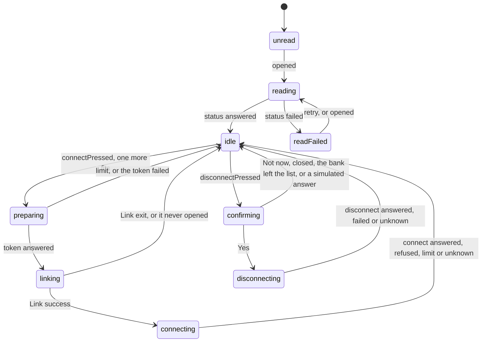

# UI: the bank sheet

The browser's half of a connected bank (brief 046 part B): the way in on the main screen, the modal bank sheet, Plaid Link opened from a click, and what the sheet says after it. The server's half is the five `/api/bank/*` routes in `packages/server/src/bank/routes.ts` (part A). Plaid's own window takes the bank sign-in; nothing here holds a bank password, a balance or an amount.

### `ui.bank`

| Field | Value |
|---|---|
| Status | explicit |
| File | `apps/web/src/ui/bank/bank-machine.ts` |
| Decides | `bankStep`, `canStartLink`, `bankBusy`, `bankPolls`, `importingIds` |
| States | `BankPhase` |
| Events | `BankEvent` |
| Tests | `apps/web/src/ui/bank/bank-machine.transitions.test.ts`, `apps/web/src/ui/bank/simulated.property.test.ts`, `apps/web/src/client/bank-watch.test.ts`, `apps/web/src/client/api.bank.test.ts`, `apps/web/src/components/bank/BankSheet.test.tsx`, `apps/web/src/components/demo.test.tsx`, `apps/web/src/app/specimens/bank-section.test.tsx` |

`unread` until the sheet is first opened: nothing is sent before then. Every open reads `GET /api/bank/status` (`reading` the first time); a first read that fails is `readFailed`, with Try again, and a failed re-read keeps the last answer. `idle` shows the banks exactly as the server last answered them, each changed only by a later answer (status, connect, sync or disconnect).

Connect: "Connect a bank" shows only when the server said one more fits (`canConnect`). It asks for a Link token (`preparing`); the 409 LIMIT answer ends in `idle` with the limit line and no Connect. With the token, `linking`: the shell mounts Plaid Link, which opens as soon as it is ready and says so (`linkOpened`); if it has not said so within `BANK_LINK_OPEN_MS` the try ends calmly. Link's exit (closed by the owner, or an error) returns to `idle` with one plain line, never Plaid's words. Link's success sends one connect with a new `requestId` (`connecting`); the public token is in that command only, never in state. A refused (409 STALE) answer is never sent again: Connect starts a new Link session. An answer that did not arrive reads the list again, which says what is true. Every Link answer names its session, so a late exit from an earlier session changes nothing.

Importing: while any connected bank is `importing`, a round of `POST /api/bank/sync` (one per importing bank) goes out every `BANK_POLL_MS`, one round at a time. It stops when none imports, after `BANK_SYNC_FAILURE_LIMIT` failed rounds in a row, or after `BANK_POLL_MAX_MS`; opening the sheet starts a new run. An expired bank (needs a new sign-in) is never polled, and a bank a pull found revoked leaves the list. Polling goes on while the sheet is closed, and stops at sign-out.

Disconnect: pressing it asks (`confirming`) with Yes and Not now, neither pre-selected. Not now, or closing the sheet, sends nothing. Yes sends one disconnect with a new `requestId` (`disconnecting`); the bank leaves the list only on the server's answer, and the list is read again after any answer.

Simulated (brief 054, a demo visit): a status answer may carry `simulated: true`, set by the server from the verified token. The state's `simulated` is that answer's mark, present only when true (absent in `INITIAL_BANK`), and a later status answer without it clears it; a failed status read keeps it, as it keeps the banks. While it is set, `canStartLink` is false and `disconnectPressed` does nothing, so neither Connect nor Disconnect is offered or sent, and a `confirming` ask open when a simulated answer lands goes back to `idle`. The sheet says the bank is simulated in place of the Plaid line, and leaves out the limit line (`canConnect` is false on a demo visit). Property: `apps/web/src/ui/bank/simulated.property.test.ts` (design property 21).

Every request carries a new `seq`; an answer with another seq changes nothing. Timers are `arm` commands with a deadline in state (`linkAt`, `pollAt`); a tick before a deadline does nothing. `bankStep` is total, and `reset` (sign-out) returns to the initial state from anywhere.

Resets: `reset` returns every field to `INITIAL_BANK` (so `simulated` is absent). `closed` clears `note` and drops an unanswered ask (`confirming` to `idle`, `confirmId` null); calls already out still land. `opened` clears `note` and `syncFailures`, and clears `pollSince` when no run is going. Leaving `linking` clears `link` and `linkAt`; leaving `disconnecting` or `confirming` clears `confirmId`; a finished sync round clears `syncAsk`, `syncWaiting` and `syncRoundFailed`.

The shell is `BankWatch` in `apps/web/src/client/bank-watch.ts`, one per signed-in user. It runs each command through `readBankStatus`, `requestBankLinkToken`, `connectBank`, `syncBank` and `disconnectBank` in `apps/web/src/client/api.ts`, arms one timer per `arm`, and drops every answer and timer from before a `stop`. The sheet is `BankSheet` in `apps/web/src/components/bank/BankSheet.tsx`, the way in is `BankWayIn` in `apps/web/src/components/bank/BankWayIn.tsx`, and Plaid Link is `BankLink` in `apps/web/src/components/bank/BankLink.tsx`, loaded lazily by `BankLinkHost` in `apps/web/src/components/bank/BankLinkHost.tsx` only while a Link session is out.
