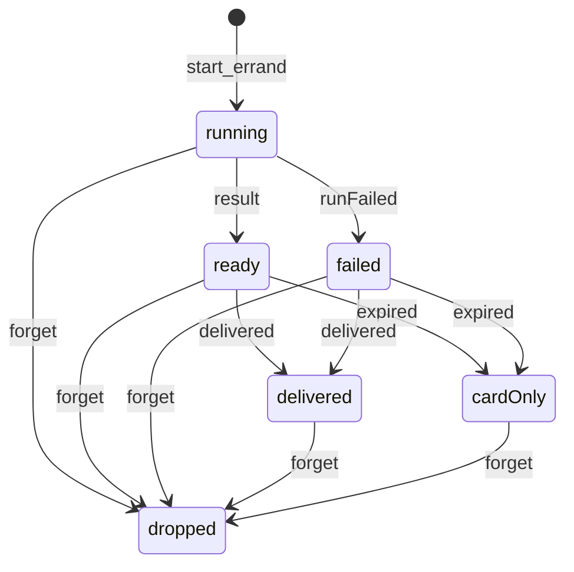

# Server: background errands

Brief 049 part A. The live model calls `start_errand`; the server answers at once and runs a bounded helper loop as a leased Job; the result is said later, once, at a pause, through the `proactive` path, with a card. The framework knows nothing about any provider: production's agent registry (`packages/server/src/errands/agent.ts`) is empty, so every `start_errand` answers `unavailable` until agents are registered.

### `server.errand`

| Field | Value |
|---|---|
| Status | explicit |
| File | `packages/core/src/errands/errand-machine.ts` |
| Decides | `nextErrandStatus`, `errandWaiting` |
| States | `ErrandState` |
| Events | `ErrandEvent` |
| Tests | `packages/core/src/errands/errand-machine.test.ts`, `packages/server/src/errands/errands.test.ts`, `packages/server/src/errands/said-once.property.test.ts`, `packages/server/src/errands/no-resurrection-errand.property.test.ts` |

Writers: `planErrand` (`packages/server/src/errands/start.ts`) plans the start, and its claim creates `running`, with its Job, one `errand` ledger row and the Session's mark (`errandMarks/{sessionId}`), inside `/api/tool`'s own transaction and only once the admission issued a Permit (review fix V9). The claim counts the owner's running Errands (at most `ERRAND_RUNNING_MAX`; one older than `ERRAND_RUN_SPAN_MS`, or of a Session that is no longer live, does not count). The runner (`packages/server/src/errands/run.ts`) ends it once, as `ready` or `failed`, in a transaction that rechecks its lease, the Errand and the epoch; a run picked up past `ERRAND_RUN_SPAN_MS`, or once its Session is not the live one, ends `failed` without running (review fix R4). The state poll (`packages/server/src/errands/deliver.ts`) offers a waiting result: the offer (attempt n, `ERRAND_OFFER_MS`) is recorded on the Errand with its decision row, and the status stays `ready` or `failed`. The receipt route (`packages/server/src/errands/receipt.ts`) moves it to `delivered` when a receipt names one of its offers (review fix V2); a result is offered again only after its offer expired with no receipt. The poll moves a waiting result to `cardOnly` when nobody heard it within `ERRAND_RESULT_TTL_MS`, strips a row past its `retainUntil` (status unchanged; review fix R12), and drops an Errand of an older epoch. The tick strips a non-running row past its `retainUntil` with no poll (a waiting one goes `cardOnly`; `stripStaleErrands`, review fix R12). The forget executor's close step (`packages/server/src/errands/forget.ts`) drops every Errand that still holds anything (`retainUntil` set, Q50), a chunk of `ERRANDS_DROP_CHUNK` per transaction with no cap, and settles its Job; a row already ended is stripped with its status kept. A drop or a strip erases the Errand's lines, reads, Gate inputs and offer, and clears `retainUntil`. Reset deletes Errands with the rest of the tenant.

