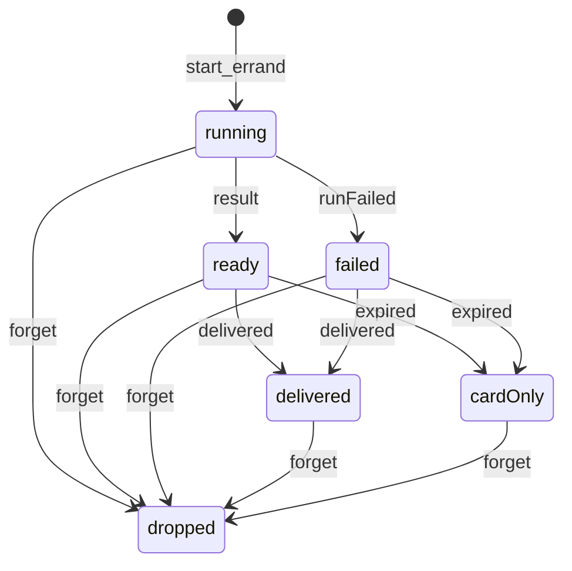

# Server: background errands

Brief 049 part A. The live model calls `start_errand`; the server answers at once and runs a bounded helper loop as a leased Job; the result is said later, once, at a pause, through the `proactive` path, with a card. The framework knows nothing about any provider: production's agent registry (`packages/server/src/errands/agent.ts`) is empty, so every `start_errand` answers `unavailable` until agents are registered.

### `server.errand`

| Field | Value |
|---|---|
| Status | explicit |
| File | `packages/core/src/errands/errand-machine.ts` |
| Decides | `nextErrandStatus`, `errandWaiting` |
| States | `ErrandState` |
| Events | `ErrandEvent` |
| Tests | `packages/core/src/errands/errand-machine.test.ts`, `packages/server/src/errands/errands.test.ts`, `packages/server/src/errands/said-once.property.test.ts`, `packages/server/src/errands/no-resurrection-errand.property.test.ts` |

Writers: `startErrand` (`packages/server/src/errands/start.ts`) creates `running`, with its Job and one `errand` ledger row, in one transaction that also counts the owner's running Errands (at most `ERRAND_RUNNING_MAX`). The runner (`packages/server/src/errands/run.ts`) ends it once, as `ready` or `failed`, in a transaction that rechecks its lease, the Errand and the epoch. The state poll (`packages/server/src/errands/deliver.ts`) moves a waiting result to `delivered` in the transaction that writes its decision row (the claim), or to `cardOnly` when nobody heard it within `ERRAND_RESULT_TTL_MS` or its Session is no longer the one polling; it drops an Errand of an older epoch. The forget executor's close step (`packages/server/src/errands/forget.ts`) drops every Errand that is not already dropped and settles its Job. A drop erases the Errand's lines and reads. Reset deletes Errands with the rest of the tenant.

