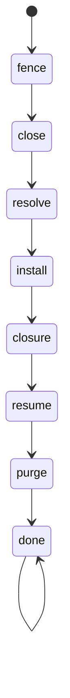

# Forget: the job and its phases

Forget, part one (brief 021; design note `docs/briefs/021-design.md`). The fence, resolve and install are built; closure, resume and purge are not, so no forget completes. No route calls this code yet.

### `forget.job`

| Field | Value |
|---|---|
| Status | table |
| File | `packages/core/src/forget/forget-phase.ts` |
| Decides | `nextForgetPhase`, `forgetPhaseBuilt` |
| State | `ForgetPhase` in `packages/core/src/forget/forget-phase.ts` |
| Tests | `packages/core/src/forget/forget-phase.transitions.test.ts`, `packages/server/src/forget/executor.test.ts` |

A forget job's `payload.phase` moves in the spec's order: `fence`, `close`, `resolve`, `install`, `closure`, `resume`, `purge`, `done`. Two file-private tables typed `Record<ForgetPhase, ...>` answer what comes next (`nextForgetPhase`) and whether this part's executor runs a phase (`forgetPhaseBuilt`). `done` is the only phase that maps to itself.

The fence (`fenceForget` in `packages/server/src/forget/fence.ts`) writes the job at `close`, in the transaction that raises the epoch and sets the barrier, so the job never runs `fence` itself. `advanceForget` in `packages/server/src/forget/executor.ts` leases the job and runs `close`, `resolve` and `install`, each committed with the job's new phase in a transaction that rechecks the lease and that the barrier is still this op's. Install commits page by page (`installPages`, at most 50 documents, one order each), recording the cursor. Then the job stops in `closure` (`FORGET_STOP_PHASE`) with status `blocked`, which `claimJob` never leases again, and the barrier is left at `closure`.

A failure in a phase puts the job in `retry` at the same phase (`FORGET_RETRY_MS`); a lost lease commits nothing; a barrier that is gone or owned by another op leaves the job `blocked` with `BARRIER`; more effects than `FORGET_EFFECTS_MAX`, or a sanitize page over 50 documents, leaves it `blocked` with `LIMIT`.

What is held back: closure (the `dependsOn` walk), resume (clearing the barrier through `releaseBarrier`, setting the receipt's `blockedAt`, "Gone" from the fresh call) and purge. The phases exist in the table so the reserved work only flips `forgetPhaseBuilt`.
