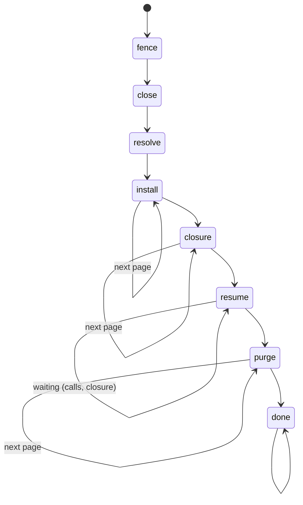

# Forget: the job and its phases

Forget, part one (brief 021; design note `docs/briefs/021-design.md`) built the fence, resolve and install. Part two (brief 047; report `docs/briefs/047-report.md`) built closure, resume and purge, so a forget now runs to `done`. No route calls this code yet.

### `forget.job`

| Field | Value |
|---|---|
| Status | table |
| File | `packages/core/src/forget/forget-phase.ts` |
| Decides | `nextForgetPhase`, `forgetPhaseRuns` (part one's `forgetPhaseBuilt` is kept for its committed test only) |
| State | `ForgetPhase` in `packages/core/src/forget/forget-phase.ts` |
| Tests | `packages/core/src/forget/forget-phase.transitions.test.ts`, `packages/core/src/forget/forget-runs.transitions.test.ts`, `packages/server/src/forget/executor.test.ts`, `packages/server/src/forget/no-resurrection.property.test.ts`, `packages/server/src/forget/closure-rerun.property.test.ts`, `packages/server/src/forget/barrier-clears.property.test.ts`, `packages/server/src/forget/purge-removes.property.test.ts`, `packages/server/src/forget/rule-outlives-closure.property.test.ts`, `packages/server/src/forget/restraint-closure.property.test.ts` |

A forget job's `payload.phase` moves in the spec's order: `fence`, `close`, `resolve`, `install`, `closure`, `resume`, `purge`, `done`. File-private tables typed `Record<ForgetPhase, ...>` answer what comes next (`nextForgetPhase`) and whether the executor runs a phase (`forgetPhaseRuns`: `close` through `purge`). `done` is the only phase that maps to itself.

The fence (`fenceForget` in `packages/server/src/forget/fence.ts`) writes the job at `close`, in the transaction that raises the epoch and sets the barrier, so the job never runs `fence` itself. `advanceForget` in `packages/server/src/forget/executor.ts` leases the job and runs one step at a time, each committed with the job's new phase and cursor in a transaction that rechecks the lease and (up to resume) that the barrier is still this op's:

- `close` records each registered call and asks the `CallClosePort` to hang it up.
- `resolve` and `install` are part one's; install commits one page per step.
- `closure` re-plans the whole closure each step (`planClosure`), drops the writes already in place and commits the next page (at most 50 writes, whole groups, withdrawals before restamps). The step that finds nothing left records the withdrawn count and, when another forget is queued, promotes it through `releaseBarrier` in the same transaction (its job, receipt and burned bundle are written there; `handedTo` names it).
- `resume` clears the barrier only when it is this op's, every call is confirmed closed, closure has nothing left and the survivors are restamped, and the queue is empty (`resumeDecision`). With a queued op it promotes instead. Otherwise the job waits as `retry`; there is no timeout. It stores the ack (`gone`, `goneExceptRule`, `ask`, `offerRetell`) and the carried turn IDs, and sets the receipt's `blockedAt`.
- `purge` commits removals (`planPurge`) after its cursor, which only advances, then sets `cleanupCompleteAt`, completes the receipt and the job.

A failure in a phase, or a row that moved under a page, puts the job in `retry` at the same phase (`FORGET_RETRY_MS`); a lost lease commits nothing; a barrier that is gone or owned by another op leaves the job `blocked` with `BARRIER`; more effects than `FORGET_EFFECTS_MAX`, a sanitize page over 50 documents, or a read over `FORGET_READ_MAX` leaves it `blocked` with `LIMIT`.

