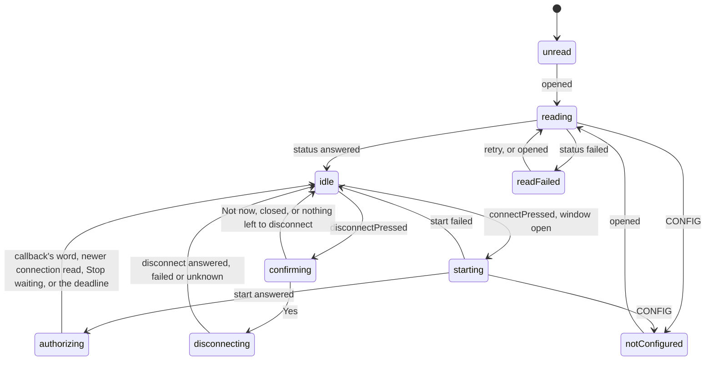

# UI: the Google sheet

The browser's half of a read-only Google connection (brief 049 part B): the way in on the main screen, the modal Google sheet, Google's own window opened from a click, the callback page that window lands on, and what the sheet says after it. The server's half is the four `/api/google/*` routes in `packages/server/src/google/routes.ts`. Google's own page takes the sign-in; nothing here holds a password, a code, a state or a token.

### `ui.google`

| Field | Value |
|---|---|
| Status | explicit |
| File | `apps/web/src/ui/google/google-machine.ts` |
| Decides | `googleStep`, `canConnectGoogle`, `googleBusy`, `googleHeld`, `googleIncomplete` |
| States | `GooglePhase` |
| Events | `GoogleEvent` |
| Tests | `apps/web/src/ui/google/google-machine.transitions.test.ts`, `apps/web/src/client/google-watch.test.ts`, `apps/web/src/components/google/GoogleSheet.test.tsx` |

`unread` until the sheet is first opened: nothing is sent before then. Every open reads `GET /api/google/status` (`reading` the first time); a first read that fails is `readFailed`, with Try again, and a failed re-read keeps the last answer. A `CONFIG` answer is `notConfigured`: the sheet says Google isn't set up and offers nothing. `idle` shows the connection exactly as the server last answered it (the address, and Gmail's and Calendar's states), changed only by a later answer.

Connect: "Connect Google" shows while some part is not connected (never connected, not granted at consent, or needing a new sign-in, as "Connect again"). The shell opens Google's window blank in the same press, since a window opened after a call is blocked; a blocked window ends the press with one plain line and sends nothing. With the window open, one `POST /api/google/start` goes out (`starting`); its answer's URL is checked by `client/google-api.ts` to be on `https://accounts.google.com` and rides on one `navigate` command, never in state (`authorizing`). The machine never sends the connect: the callback page does, and says how it went in one word on the `franki-google` BroadcastChannel. That word, a backup status read every `GOOGLE_AUTH_POLL_MS` that shows a newer connection, Stop waiting, or `GOOGLE_AUTH_MAX_MS` (the server's ten-minute pending authorization) ends the wait: the window closes, one plain line shows (never Google's words), and the status is read again for what is true.

Disconnect: pressing it asks (`confirming`) with Yes and Not now, neither pre-selected. Not now, or closing the sheet, sends nothing. Yes sends one disconnect with a new `requestId` (`disconnecting`); the connection changes only on the server's answer, and a failed or unknown answer reads the status again.

Every request carries a new `seq`; an answer with another seq changes nothing. Timers are `arm` commands with a deadline in state (`authUntil`, `pollAt`); a tick before a deadline, or outside `authorizing`, does nothing. `googleStep` is total, and `reset` (sign-out) returns to the initial state from anywhere.

Resets: `reset` returns every field to `INITIAL_GOOGLE`. `closed` clears `note` and drops an unanswered ask (`confirming` to `idle`); calls already out still land, and the wait for Google's window goes on. `opened` clears `note`. Leaving `authorizing` clears `authBefore`, `authUntil` and `pollAt`.

The shell is `GoogleWatch` in `apps/web/src/client/google-watch.ts`, one per signed-in user. It runs each command through `readGoogleStatus`, `startGoogle` and `disconnectGoogle` in `apps/web/src/client/google-api.ts`, holds Google's window (opened with `window.open`, never read for `closed`, since Google's page may cut it off from the opener), listens on the callback channel and accepts only its own message shape, arms one timer per `arm`, and drops every answer and timer from before a `stop`; `stop` also closes the window. The callback page is `apps/web/src/app/google/callback/page.tsx` (no referrer, not indexed) with `GoogleCallback` in `apps/web/src/components/google/GoogleCallback.tsx`, running `runGoogleCallback` in `apps/web/src/client/google-callback.ts`: it takes the query out of the address bar first, sends `POST /api/google/connect` once with the signed-in user's token, tells the sheet, and closes itself, showing only fixed words. The sheet is `GoogleSheet` in `apps/web/src/components/google/GoogleSheet.tsx`, and the way in is `GoogleWayIn` in `apps/web/src/components/google/GoogleWayIn.tsx`.
