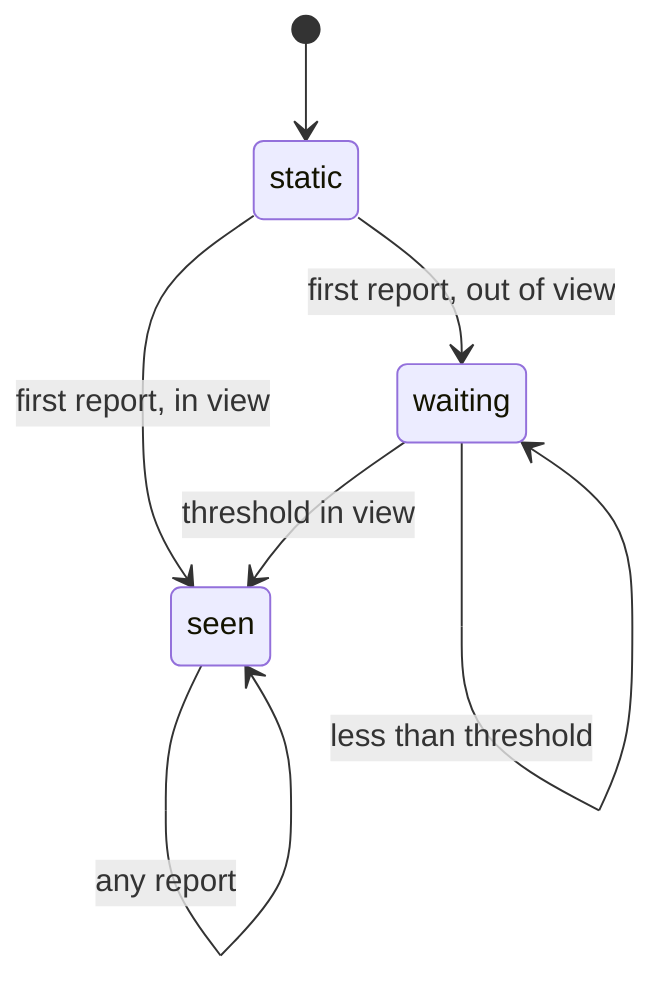
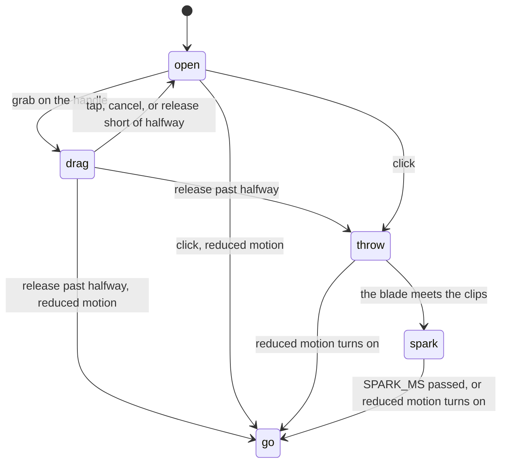

# Landing: the front door's machines

The front door at `/` (brief 015). Everything here runs on sample data and the page's own frame clock; nothing reaches a route. Nothing reachable from the lab imports these files (`scripts/ui-boundaries.mjs`).

### `landing.stepClock`

| Field | Value |
|---|---|
| Status | explicit |
| File | `apps/web/src/ui/landing/stage-script.ts` |
| Decides | `stepClock`, `freshClock` |
| State | `StepClock` |
| Tests | `apps/web/src/ui/landing/stage-script.test.ts` |

Where the stage is inside one visit to a story step: its beat (`beatAt`) and how many words of the spoken line are said (`wordsSpokenAt`). `stepClock(prev, { step, entry, at, plan })` is one frame. A new visit (another step, another `entry`, or no frame yet) starts again at this frame, at beat 0 with no words; otherwise the beat and words follow the time since the visit began. It returns `prev` itself when nothing it shows changed.

The shell is `DemoStage` in `apps/web/src/components/landing/DemoStage.tsx`: it counts visits (the `entry` goes up whenever the step changes, during render) and publishes a clock only when `stepClock` returns a new object whose step and entry are the current ones.

### `landing.stageDriver`

| Field | Value |
|---|---|
| Status | explicit |
| File | `apps/web/src/ui/landing/stage-script.ts` |
| Decides | `driverStep`, `wakeDecision`, `driverInput` |
| State | `DriverState` |
| Events | `SceneFranki`, `SceneEvent` |
| Tests | `apps/web/src/ui/landing/stage-script.test.ts` |

Turns the scene's Franki (`stageFor`) into the avatar's input, one frame at a time, through the lab's own `reduceEvents` (`ui.avatarEvents`). `driverStep` is pure; `DriverState` holds the Event_Controller's state, whether Franki is awake, the first frame's time, the scene event last fired and a one-shot waiting to fire.

- Asleep, Franki's state is `closed`. `wakeDecision` wakes him once: when the renderer phase reads `three`, `failed` or `lost`, or after `WAKE_WAIT_MS` of frame time. Under reduced motion he is simply awake, with no wake.
- A one-shot fires on entering a step. One already showing, or shown on the last frame, is cleared first (`signOut`) and the new one fires `CLEAR_FRAMES` frames later, so the renderer sees it start from another look. During the wake a one-shot waits. A `repeatMs` one fires again after that long.
- When the scene stops asking for a one-shot, a running present-card or celebrate is cut on that frame. An awaited approval the scene no longer shows is done.
- `driverInput` reads the result: the state, the current event, mic mute only once awake, the output level only while speaking, and `attend: "pointer"`. `asleepInput` is the server render and first paint.

The shell is `apps/web/src/components/landing/DemoAvatar.tsx`: its own requestAnimationFrame loop, paused while the page is hidden, reads `data-three-phase` and publishes the input only when it changes.

### `landing.toyKeys`

| Field | Value |
|---|---|
| Status | explicit |
| File | `apps/web/src/components/landing/StateToy.tsx` |
| Decides | `toyKeyStep` |
| State | `ToyState` in `apps/web/src/ui/landing/steps.ts` |
| Tests | `apps/web/src/components/landing/StateToy.test.tsx` |

The state toy's pick, a radio group over `TOY_STATES`. `toyKeyStep(current, key, mods)` is the pick after a key: Right or Down moves to the next state and Left or Up to the one before, wrapping at both ends; Home and End go to the first and last. Any other key, or any key with Alt, Ctrl or Meta held, returns null and the group leaves it to the browser. The pick lives in `Landing` (`apps/web/src/components/landing/Landing.tsx`); `StateToy` calls `onChange` with the new pick, and a click on a chip picks it.

### `landing.seen`

| Field | Value |
|---|---|
| Status | explicit |
| File | `apps/web/src/ui/landing/seen.ts` |
| Decides | `nextSeen` |
| State | `Seen` |
| States | `Seen` |
| Events | `SeenReport` |
| Tests | `apps/web/src/ui/landing/seen.test.ts` |

Whether a watched part of a lower front-door section has entered view, once. Before any report (the server, or scripting off) a part is `static` and drawn in full. The first report makes it `seen` if it is in view, otherwise `waiting`; a later report makes it `seen` once `threshold` of it shows. `seen` is never undone, and no report returns a part to `static`.

The shell is `useSeen` in `apps/web/src/components/landing/use-seen.ts`: one IntersectionObserver per section, every `data-seen-key` starting `static`, and a key that turns `seen` is no longer watched.

### `landing.switch`

| Field | Value |
|---|---|
| Status | explicit |
| File | `apps/web/src/ui/landing/switch-machine.ts` |
| Decides | `switchStep`, `switchInit` |
| State | `SwitchState` |
| States | `SwitchPhase` |
| Events | `SwitchEvent`, `SwitchCommand` |
| Tests | `apps/web/src/ui/landing/switch-machine.test.ts` |

The knife switch at the foot of the front door. `switchStep(state, event)` is pure and returns the next state and commands; it never reads the budget, a clock or the DOM. Phases: `open` (resting, or settling back), `drag` (the handle follows a pointer), `throw` (the blade swings shut), `spark` (one spark across the contacts), `go` (the page opens the lab).

- `thrown` is sent once, at contact, and `go` only after it. The spark lasts `SPARK_MS` of frame time. Under reduced motion contact sends `go` at once, with no spark, and turning reduced motion on mid-throw or mid-spark goes the same way.
- The spark's Electricity grant is asked for at contact (`request`) and held only in `spark`; `finish` and `unmount` release it, and a grant that arrives outside the spark, or a second one, goes straight back.
- A press that moved is a drag: releasing past halfway throws, short of it settles back, and the click that follows a drag's release never throws (`suppressClick`, cleared by `clickSettled`). A cancel, lost capture or a mouse move with no button down settles back.

The shell is `apps/web/src/components/landing/Switch.tsx`: it runs the commands (frames, pointer capture, the budget, the click window after a drag, `onThrown`, and the push to the lab) and re-renders only when the phase, the grant or `near` changes.
