# Server: Jobs and the extract drain

A Job is a stored record (`jobs/{jobId}`) with a status and a lease. Two kinds run on this branch: `hangup` (`packages/server/src/worker/hangup.ts`) and `extract` (`packages/server/src/worker/extract.ts`). Every status change is one store transaction that reads the Job first, so a writer that lost a race commits nothing (see [server-store-tx](server-store-tx.md)).

### `server.job`

| Field | Value |
|---|---|
| Status | documented |
| File | `packages/server/src/worker/jobs.ts` |
| States | `JobShape.status` in `packages/core/src/schema/records.ts` |
| Tests | `packages/server/src/worker/jobs.test.ts`, `packages/server/src/worker/hangup.test.ts`, `packages/server/src/worker/extract.test.ts`, `packages/server/src/worker/drain.test.ts` |

```mermaid
stateDiagram-v2
  [*] --> queued : workJob
  queued --> leased : claimJob, due
  retry --> leased : claimJob, due
  leased --> complete : the attempt succeeded
  leased --> retry : the attempt failed, or the lease ended (Q18, the drain, ensureHangupJob)
  leased --> failed : extract, after its last attempt or on a changed epoch
  leased --> queued : extract, policyRev rose since the Job was written
  complete --> queued : ensureHangupJob on a second close
  blocked
  note right of blocked : in the schema; no writer on this branch
```

**The lease.** `claimJob` takes a due `queued` or `retry` Job: `leased`, a new `leaseToken`, `generation + 1`, and `leaseUntil` of `LEASE_MS` (or `EXTRACT_LEASE_MS` for extract). A claim that loses the race returns null, the same as a Job that is not claimable. An attempt commits only while the Job still holds its token and generation; an attempt that lost its lease commits nothing and reports `requeued`.

**Per kind:**

| Kind | Fails to | Retry wait | Gives up |
|---|---|---|---|
| `hangup` | `retry` with `DEPENDENCY` | `hangupBackoff`: 1, 2, 5, 10 s, then `HANGUP_STEADY_MS` | never; a complete Job moves its Session from `closing` to `closed` |
| `extract` | `retry` with the ErrorCode | `EXTRACT_RETRY_MS` | `failed` after `EXTRACT_MAX_ATTEMPTS`; `failed` with `STALE` when the epoch or policyRev no longer match; back to `queued` at the new policyRev when policyRev rose in the same epoch |

`ensureHangupJob` writes the Session's one `hangup` Job, or makes an existing one due now: a `complete` one goes back to `queued`, a waiting `queued` or `retry` one is moved to now, and one whose lease ended goes to `retry`. A live lease is left to its runner.

### `server.drain`

| Field | Value |
|---|---|
| Status | documented |
| File | `packages/server/src/worker/drain.ts` |
| Tests | `packages/server/src/worker/drain.test.ts` |

`drainExtractJobs` runs an Owner's due extract Jobs one after another, at most 50 per call. It starts none while another extract Job is leased: it requeues every leased Job whose lease ended, then waits for the others, polling from `DRAIN_POLL_MS` doubling to `DRAIN_POLL_MAX_MS`, never past the earliest lease end. Drains wait for each other this way, so an Owner's extract Jobs run one after another and a Turn's extraction can read the Memories the Turns before it wrote. An attempt whose commit lost a race is left to whoever took the Job. The drain has no wait limit of its own; session open races it against its budget.
