# Server: store transactions and the request ledger

Every server write goes through the Store_Port (`packages/server/src/store/port.ts`). Two engines implement it, the Memory_Store for tests and the Firestore_Store for production, and one conformance suite (`packages/server/src/store/conformance.ts`) runs against both: `packages/server/src/store/memory-store.test.ts` in the unit suite and `tests/firestore/store-conformance.test.ts` on the emulator.

### `server.storeTx`

| Field | Value |
|---|---|
| Status | documented |
| File | `packages/server/src/store/port.ts` |
| Tests | `packages/server/src/store/memory-store.test.ts`, `tests/firestore/store-conformance.test.ts` |

**Rules.** Both engines enforce these in `transaction`.

1. **One attempt.** A transaction buffers its writes and applies them at commit, all or nothing. Neither engine retries: the Firestore_Store runs with `maxAttempts: 1` and maps contention and an existing record on create to `staleRevision`. The caller decides what a lost race means.
2. **A path is written once per transaction.** A second `create` or `update` of the same path throws `invalidInput` ("record written twice in one transaction") at the call. Two helpers that write the same record cannot share a transaction.
3. **An update needs a read or an expected rev.** `update` without `expectRev` on a path not read in this transaction throws `invalidInput` at the call.
4. **A read returns the stored record, never a pending write.** `get` and `query` inside a transaction do not see that transaction's own `create` or `update`. The one exception is the lineage check at commit, which finds Evidence created in the same transaction.
5. **Checked at commit, in this order; the first failure is the error.** Nothing is applied until every check passes.
   1. Every write: its closed schema (`invalidInput`), the 512 KiB cap (`oversize`), its `uid` against the caller's (`tenantMismatch`), in `checkRecord` (`packages/server/src/store/checks.ts`).
   2. Every Memory write: the lineage check (`invalidInput`, naming the failed checks).
   3. A path read twice with different revs (`staleRevision`).
   4. Each write in turn: a create on a path that exists, an update on a path that does not, an `expectRev` that does not match, a read rev that does not match (`staleRevision`); then the same record checks with its new `rev`, and the check that Evidence content and Memory value and args did not change in place (`invalidInput`).
6. **The store sets `rev`**: 1 on create, prior + 1 on update.
7. **Helpers take the transaction.** Functions that take a `Tx` (`beginCloseInTx`, `finishCloseInTx`, `ensureHangupJob`, `completeRequest`) read and write only through it, so their writes commit or fail with the caller's.

**What the tests cover.** Both engines implement these rules in `transaction`. The conformance suite covers the all-or-nothing commit and the `staleRevision` on an existing record in rule 1, rules 3 and 6, and the error kinds in rule 5, except a read rev that does not match in 5.4, which only the Memory_Store's own cases in `packages/server/src/store/memory-store.test.ts` check. The suite has no case for the single attempt in rule 1. No test covers rule 2, rule 4 apart from its lineage exception, rule 5.3, or the order of the checks in rule 5.

**How the two engines differ.** These are the places where they work differently.

| | Memory_Store (`packages/server/src/store/memory-store.ts`) | Firestore_Store (`packages/server/src/store/firestore-store.ts`) |
|---|---|---|
| A second `get` of a path in one transaction | Reads the live record again; a changed rev is "record changed between two reads" at commit | Returns the snapshot the transaction already holds |
| Paths only read, never written | Each read rev is compared with the stored rev at commit, before the per-write checks | Not compared by the store's code; Firestore's own transaction aborts on contention, mapped to `staleRevision` |
| `query` in a transaction | Runs over the live records on each call | Runs in the Firestore transaction on each call; a returned document is kept for later `get`s only if its path was not read before |
| Written paths never read | Looked up in the map at commit | Fetched together in one `getAll` before any write |
| `snapshot` | Plain reads of the live records | A read-only Firestore transaction: one consistent point in time, no locks |
| Error text | Its own `staleRevision` messages | Firestore's `ABORTED` and `ALREADY_EXISTS` become `staleRevision` ("transaction contention or existing record") |

**What each site does with a lost race (`staleRevision`):**

| Site | On a lost race |
|---|---|
| `claimJob` (`packages/server/src/worker/jobs.ts`) | returns null, the same as a Job that is not claimable |
| The tick's Q18 and each Q17 hangup Job (`packages/server/src/worker/tick.ts`) | logs `tick.lostRace` and goes on to the next step |
| Each Session's begin-close in the tick's Q13 (`packages/server/src/worker/tick.ts`) | logs `tick.lostRace` (step `expiry`) and goes on to the next Session; the next tick closes it |
| The drain's requeue and each extract attempt (`packages/server/src/worker/drain.ts`) | swallowed; the next pass looks again |
| `ensureCoreDocs` (`packages/server/src/core-docs.ts`) | up to 3 attempts; the next one finds the documents the other transaction wrote |
| The state and receipt routes (`retryStale`, `packages/server/src/routes/state.ts`) | up to 3 attempts |
| `/api/turn` (`packages/server/src/routes/turn.ts`) | up to `MAX_CAS_ATTEMPTS` (8), each against the new `nextClientSeq` |
| The Parse_Repair (`packages/server/src/intents/repair.ts`) | up to `REPAIR_TX_ATTEMPTS` (8) |
| Anything else | the route answers `STALE`, HTTP 409, with a 250 ms retry hint (`toRouteError`, `packages/server/src/routes/errors.ts`) |

### `server.request`

| Field | Value |
|---|---|
| Status | documented |
| File | `packages/server/src/ledger/request.ts` |
| States | `LedgerBase.state` in `packages/core/src/schema/records.ts` |
| Tests | `packages/server/src/ledger/request.test.ts` |

Every mutation route but `/api/session/state` runs inside `mutation` (`packages/server/src/routes/mutation.ts`), which keeps one ledger `request` entry per route and `requestId`.

```mermaid
stateDiagram-v2
  [*] --> pending : beginRequest, no entry
  pending --> complete : completeRequest, in the route's own transaction
  pending --> failed : releaseRequest after an error, or an Unrecorded answer
  pending --> pending : beginRequest after the 15 s lease lapsed
  failed --> pending : beginRequest
  complete --> pending : beginRequest after the 24 h retention ended
  blocked
  note right of blocked : in the shared ledger schema; not written for request entries
```

`beginRequest` runs in its own transaction before any route work:

| Entry found | Same body hash | Different body hash |
|---|---|---|
| none | runs | runs |
| `complete`, retained | replays the recorded response | 409 `HASH` |
| `pending`, lease held | 429 `LIMIT` | 409 `HASH` |
| `pending` with a lapsed lease, `failed`, or `complete` past retention | runs | runs |

`completeRequest` refuses unless the entry is still `pending` with the same hash, so the response and the route's records commit together or not at all. `releaseRequest` is best effort: if it fails, the lease lapses on its own. Only successful responses are recorded and replayed; an `Unrecorded` answer (such as a `hold` from `/api/turn`) leaves the `requestId` free for the retry.
