# Server: store transactions and the request ledger

Every server write goes through the Store_Port (`packages/server/src/store/port.ts`). Two engines implement it, the Memory_Store for tests and the Firestore_Store for production, and one conformance suite (`packages/server/src/store/conformance.ts`) runs against both: `packages/server/src/store/memory-store.test.ts` in the unit suite and `tests/firestore/store-conformance.test.ts` on the emulator.

### `server.storeTx`

| Field | Value |
|---|---|
| Status | documented |
| File | `packages/server/src/store/port.ts` |
| Tests | `packages/server/src/store/memory-store.test.ts`, `tests/firestore/store-conformance.test.ts` |

**Three rules.**

1. **One attempt.** A transaction buffers its writes and applies them at commit, all or nothing. Neither engine retries: the Firestore_Store runs with `maxAttempts: 1` and maps contention and an existing record on create to `staleRevision`. The caller decides what a lost race means.
2. **Checked at commit.** Every write is validated against its closed schema and size cap, its `uid` must be the caller's, and every record read and every expected `rev` must still match. The store sets `rev`: 1 on create, prior + 1 on update.
3. **Helpers take the transaction.** Functions that take a `Tx` (`beginCloseInTx`, `finishCloseInTx`, `ensureHangupJob`, `completeRequest`) read and write only through it, so their writes commit or fail with the caller's.

**What each site does with a lost race (`staleRevision`):**

| Site | On a lost race |
|---|---|
| `claimJob` (`packages/server/src/worker/jobs.ts`) | returns null, the same as a Job that is not claimable |
| The tick's Q18 and each Q17 hangup Job (`packages/server/src/worker/tick.ts`) | logs `tick.lostRace` and goes on to the next step |
| The drain's requeue and each extract attempt (`packages/server/src/worker/drain.ts`) | swallowed; the next pass looks again |
| `ensureCoreDocs` (`packages/server/src/core-docs.ts`) | up to 3 attempts; the next one finds the documents the other transaction wrote |
| The state and receipt routes (`retryStale`, `packages/server/src/routes/state.ts`) | up to 3 attempts |
| `/api/turn` (`packages/server/src/routes/turn.ts`) | up to `MAX_CAS_ATTEMPTS` (8), each against the new `nextClientSeq` |
| The Parse_Repair (`packages/server/src/intents/repair.ts`) | up to `REPAIR_TX_ATTEMPTS` (8) |
| Anything else | the route answers `STALE`, HTTP 409, with a 250 ms retry hint (`toRouteError`, `packages/server/src/routes/errors.ts`) |

### `server.request`

| Field | Value |
|---|---|
| Status | documented |
| File | `packages/server/src/ledger/request.ts` |
| States | `LedgerBase.state` in `packages/core/src/schema/records.ts` |
| Tests | `packages/server/src/ledger/request.test.ts` |

Every mutation route but `/api/session/state` runs inside `mutation` (`packages/server/src/routes/mutation.ts`), which keeps one ledger `request` entry per route and `requestId`.

```mermaid
stateDiagram-v2
  [*] --> pending : beginRequest, no entry
  pending --> complete : completeRequest, in the route's own transaction
  pending --> failed : releaseRequest after an error, or an Unrecorded answer
  pending --> pending : beginRequest after the 15 s lease lapsed
  failed --> pending : beginRequest
  complete --> pending : beginRequest after the 24 h retention ended
  blocked
  note right of blocked : in the shared ledger schema; not written for request entries
```

`beginRequest` runs in its own transaction before any route work:

| Entry found | Same body hash | Different body hash |
|---|---|---|
| none | runs | runs |
| `complete`, retained | replays the recorded response | 409 `HASH` |
| `pending`, lease held | 429 `LIMIT` | 409 `HASH` |
| `pending` with a lapsed lease, `failed`, or `complete` past retention | runs | runs |

`completeRequest` refuses unless the entry is still `pending` with the same hash, so the response and the route's records commit together or not at all. `releaseRequest` is best effort: if it fails, the lease lapses on its own. Only successful responses are recorded and replayed; an `Unrecorded` answer (such as a `hold` from `/api/turn`) leaves the `requestId` free for the retry.
