# Server: Sessions and the tick

A Session's stored status moves through the open, state, close and SDP routes, the tick's expiry close and the hangup Job. The open and turn routes are pipelines: their order of steps is written here, not modelled as a machine.

### `server.session`

| Field | Value |
|---|---|
| Status | documented |
| File | `packages/server/src/sessions.ts` |
| States | `SessionShape.status` in `packages/core/src/schema/records.ts` |
| Tests | `packages/server/src/routes/open.test.ts`, `packages/server/src/routes/close.test.ts`, `packages/server/src/routes/state.test.ts`, `packages/server/src/worker/hangup.test.ts` |

```mermaid
stateDiagram-v2
  [*] --> minting : newSession at open
  minting --> active : state route
  minting --> closing : beginCloseInTx, calls registered
  active --> closing : beginCloseInTx, calls registered
  quarantined --> closing : beginCloseInTx, calls registered
  minting --> closed : beginCloseInTx, no call registered
  active --> closed : beginCloseInTx, no call registered
  closing --> closed : finishCloseInTx, hangup Job, or beginCloseInTx with no call
  failed
  note right of failed : in the schema; no writer on this branch
```

- `LIVE_STATUSES` (`minting`, `active`, `quarantined`, `closing`) are the ones a close or the tick's expiry acts on. `beginCloseInTx` rewrites a `closing` Session only when it registered no call, which closes it.
- Closing is two steps around the hangups. `beginCloseInTx` marks the Session `closing`, or `closed` at once when it registered no call, and clears `core/epoch.activeSessionId` when it names this Session. `finishCloseInTx` records the outcome: `closed` when every hangup answered, or with `force` (the prior Session at a new open); otherwise it stays `closing` with a `hangup` Job.
- Every move to `closed` is followed by `afterClosed`, which ensures the Session's Extract_Jobs and schedules a drain.
- `quarantined` is read but not written on this branch.
- `expiresAt` is `SESSION_IDLE_MS` after the last push; the state route moves it forward (writing at most every `SESSION_WRITE_MIN_MS` when nothing else changed), as do playback receipts.

### `server.tick`

| Field | Value |
|---|---|
| Status | documented |
| File | `packages/server/src/worker/tick.ts` |
| Tests | `packages/server/src/worker/jobs.test.ts` |

At most once per ops minute per Owner, three steps:

| Step | Does | On a lost race |
|---|---|---|
| Q13 `expireSessions` | Closes live Sessions past `expiresAt`, at most `EXPIRY_BATCH` (100) a run, through `beginCloseInTx`; the hangups and `finishCloseInTx` run as scheduled work with a 1.5 s budget | throws |
| Q18 `requeueExpiredLeases` | Moves `leased` Jobs whose lease ended back to `retry` | logged as `tick.lostRace`, next step runs |
| Q17 `runDueJobs` | Runs due `hangup` Jobs one by one, then the extract drain | logged per Job, next Job runs |

- The gate is `takeTickSlot`: a map per Store_Port instance and Owner, holding the last ops minute. The slot is taken before any work, in this process only; a run in another process is not seen. Every step is a compare-and-set on the rows it touches.
- `startTick` returns the Q13 promise and schedules Q18 and Q17 after it. `packages/server/src/routes/open.ts` awaits that promise before the rest of the open; `packages/server/src/routes/state.ts` calls `scheduleTick`, which runs the whole tick after the response.

### `server.sdp`

| Field | Value |
|---|---|
| Status | documented |
| File | `packages/server/src/routes/sdp.ts` |
| Tests | `packages/server/src/routes/sdp.test.ts` |

A Session's Realtime calls are `Session.callId` and `registeredCallIds`. The SDP route checks the Session is `minting` or `active` with the same generation and fewer than four registered calls, posts the offer to OpenAI within `SDP_OPENAI_BUDGET_MS`, then registers the call in one transaction and answers only after it commits. A call that is not registered (a failed write, a late or malformed answer) is hung up at once within `SDP_HANGUP_BUDGET_MS`, and otherwise by `orphanHangup` in the background for up to `ORPHAN_RETRY_LIMIT_MS`.

### `server.open`

| Field | Value |
|---|---|
| Status | documented |
| File | `packages/server/src/routes/open.ts` |
| Tests | `packages/server/src/routes/open.test.ts` |

`openSession` runs in this order, logging each step's time as `open.phases`:

1. `ensureCoreDocs`, then the request ledger (`mutation`).
2. `startTick`, awaiting its Q13 part when the slot was free.
3. The extract drain, raced against what is left of `OPEN_BUDGET_MS` after keeping `OPEN_TAIL_RESERVE_MS`; a drain that loses keeps running as scheduled work.
4. One transaction: a forget barrier answers `blocked`. Otherwise the Head is compiled from a lock-free snapshot, the prior active Session begins closing, `core/bundle` gets `bundleRev + 1`, the new Session is created (`minting`, generation 1, with its StateAck), `core/epoch.activeSessionId` and `core/state.currentZone` are set, and the response is recorded.
5. After the commit, the prior Session's calls are hung up within `priorHangupBudget`, it is marked `closed` with `force`, and `afterClosed` runs; a failed hangup also schedules its Job.

### `server.turn`

| Field | Value |
|---|---|
| Status | documented |
| File | `packages/server/src/routes/turn.ts` |
| Tests | `packages/server/src/routes/turn.test.ts`, `packages/server/src/routes/turn.serialization.property.test.ts`, `packages/server/src/routes/supersede.test.ts` |

One transaction reads the Session and compare-and-sets `nextClientSeq == clientSeq`, then writes the user Turn, its Evidence, its Extract_Job, the Session update and the ledger entry together. A higher clientSeq answers `hold` with `HOLD_RETRY_MS` and no writes, leaving the `requestId` free (`Unrecorded`). A lost compare-and-set commits nothing and runs again, up to `MAX_CAS_ATTEMPTS`. A Superseding_Post whose slow parse is a hit that changes what is said raises `policyRev` in its transaction, so the next Deck cuts older speech; a Parse_Repair that finds such a hit does the same (`packages/server/src/intents/repair.ts`). The extract drain and any Parse_Repair run after the response.
