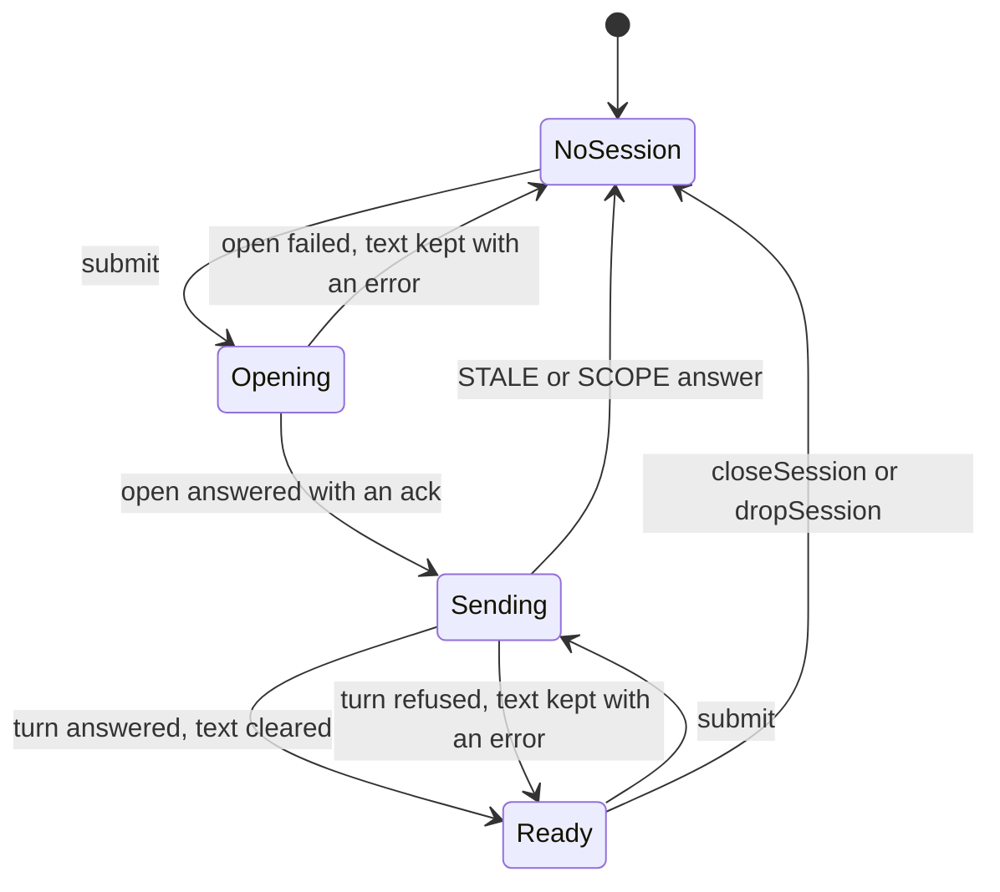

# Typed line

A typed line with no call open goes through `TypedTurns` in `apps/web/src/client/typed-turns.ts`. A typed line during a call goes through the voice reducer instead (`typedSubmitted`, see [voice-call](voice-call.md)); `VoiceClient.sendTyped` accepts one only in LISTENING. The event carries the line's source, `typed` or `pasted` (a paste event supplied it), and the post carries it on, so a pasted line in a call is third-party text on the server as it is with no call open (brief 040).

### `typed.line`

| Field | Value |
|---|---|
| Status | documented |
| File | `apps/web/src/client/typed-turns.ts` |
| State | `TypedState` |
| Tests | `apps/web/src/client/typed-to-server.test.ts`, `apps/web/src/components/TypedInput.test.tsx` |

The state is spread over three private fields and the public `TypedState`:

| Field | Holds |
|---|---|
| `stamp` | The typed Session's Stamp, or null when there is none |
| `pending` | The line being sent: `clientSeq`, `requestId`, `turnId` and its text, kept until the server answers it |
| `state.sending` | A submit is in progress; `canSend()` is false |
| `state.lastClientSeq`, `state.sessionId` | The last clientSeq this client assigned in the Session, and the Session |

The diagram's names are read from those fields; there is no union for them.

**What holds:**

- One press sends at most one request: `submit` returns false while `sending`.
- A line keeps its identity across retries: the same text reuses its `requestId`, `turnId` and `clientSeq` (`pendingFor`), so a request the server committed is replayed. Changed text keeps the `clientSeq` with new IDs. A new line after an answered one gets `lastClientSeq + 1`.
- Inside one submit, a `stale` answer is sent once more with the answer's Stamp, and a `hold` with a retry hint is retried up to eight times; after that the line fails with a message and stays in the box.
- `utteredWorldAt` is read once, when the line is first sent, and kept with its IDs, so a retry of the same text sends the same body even when the clock moved on. Only a `stale` answer's new Stamp changes the body, and the server recorded nothing for that attempt.
- `dropSession` forgets the Session without a request (a call open closes it on the server); `closeSession` posts a close and waits at most its timeout.
- `dropTurnCopies` clears every line and reply this client holds, after a completed forget.

Not modelled: a call starting while a typed submit is in progress. Each controller keeps its own Session.
