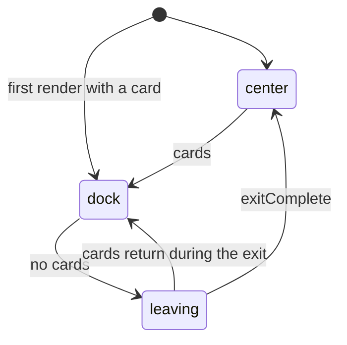

# UI: the lab's surfaces and the lab spider

Small machines inside the lab's Surfaces and the spider pointer (brief 015). Each is pure and is held by its component in React state, or by a frame loop. Rules: `.kiro/steering/ui-design.md`.

### `ui.dockLayout`

| Field | Value |
|---|---|
| Status | explicit |
| File | `apps/web/src/ui/dock-layout.ts` |
| Decides | `dockLayoutStep`, `dockLayoutInit`, `hasDockColumn` |
| States | `DockLayout` |
| Events | `DockLayoutEvent` |
| Tests | `apps/web/src/ui/dock-layout.transitions.test.ts`, `apps/web/src/ui/dock-layout.property.test.ts`, `apps/web/src/components/screen/MainScreen.test.tsx` |

Whether the Main_Screen's grid has the dock column (`GRID_WITH_DOCK`) or is centred (`GRID_CENTER`). `dock` while a card shows, `leaving` while the last one dematerializes, `center` otherwise; `hasDockColumn` is true in `dock` and `leaving`. An `exitComplete` outside `leaving` is stale and changes nothing.

The shell is `MainScreen` in `apps/web/src/components/screen/MainScreen.tsx`. It holds the layout in `useState`, starting from `dockLayoutInit`, and sends the `cards` event during render, so the column is there on the very render that brings the first card. The Card_Dock is always mounted (it renders nothing without a card) and its `onExitComplete`, fired by its outer `AnimatePresence` once the dock has left, sends `exitComplete`.

### `ui.cardSource`

| Field | Value |
|---|---|
| Status | explicit |
| File | `apps/web/src/components/surfaces/Card.tsx` |
| Decides | `nextOpenSource`, `hasRows` |
| Tests | `apps/web/src/components/surfaces/Card.test.tsx` |

Which source's rows show under a Card: none (null) or one source ID. `nextOpenSource(open, tapped, rows)` is the only move: a tap on a tag with rows opens them, or closes them when they are already open; a tag without rows leaves the card as it was. Opening one source closes any other, so at most one is open.

Two shells hold it. Without an `openSource` prop, an inner wrapper of `Card` keeps it in `useState`, starting from `defaultOpenSource` when that source has rows, and `tagTapHandler` moves it on and calls `onOpenSource` on every tap. With `openSource` (even null), the host holds it and the card keeps no state of its own; a held ID with no rows shows as closed. The Card_Dock passes these per card ID (`frontExtras` in `apps/web/src/components/surfaces/CardDock.tsx`).

### `ui.ruleForget`

| Field | Value |
|---|---|
| Status | explicit |
| File | `apps/web/src/components/surfaces/WhatIKnowSheet.tsx` |
| Decides | `ruleForgetPress`, `ruleForgetBlur` |
| Tests | `apps/web/src/components/surfaces/WhatIKnowSheet.test.tsx` |

The second tap a hard rule's Forget needs. The state is the armed rule's ID, or null. `ruleForgetPress(armed, id)` arms `id` (disarming any other rule) unless `id` is the armed one, when it disarms and says to forget. `ruleForgetBlur(armed, id)` disarms only when `id` is the armed one. Items that are not hard rules forget on the first press and never arm.

`WhatIKnowSheet` holds `armed` in `useState`. The armed button's blur sends `ruleForgetBlur`, and while a rule is armed a capture-phase `pointerdown` listener on `document` sends it for any press outside that rule's Forget, for touch browsers that do not blur on a tap; the listener goes when the rule disarms and on unmount. A `role="status"` span reads `COPY.sheet.confirmRule` while a hard rule in the list is armed. `nextFocusIndex` in the same file is the Tab wrap inside a modal sheet, arithmetic over the controls in the DOM, not part of this machine.

### `ui.spider`

| Field | Value |
|---|---|
| Status | explicit |
| File | `apps/web/src/ui/cursor/spider.ts` |
| Decides | `stepSpider`, `spiderPose` |
| State | `SpiderState` |
| Events | `SpiderInput` |
| Tests | `apps/web/src/ui/cursor/spider.test.ts` |

The lab spider, one pure step per frame. `stepSpider(state, input)` takes Frame_Time and the pointer (position, on the page, over something to touch, over a text field, pressed) and returns the next state; `spiderPose` draws it. Nothing else is stored, and the frame gap is clamped to `MAX_DT_MS`.

- The ring, the front-leg lift, the text tuck, the press, the rest drop and the presence are springs stepped toward 0 or 1 (the drop toward `REST_DROP`). Arrival is immediate; leaving fades on `spring.settle`.
- It rests after `REST_MS` without a move or press, lowering on a thread and swaying; the next move or press climbs it back.
- A reset (no origin yet, the pointer was off the page last frame, or a frame gap over `MAX_DT_MS`) zeroes the velocity and puts every foot at rest. A fast move is never a reset.
- Velocity and heading come from the two filters in `apps/web/src/ui/cursor/heading.ts`; the feet come from `ui.gait`.

The shell is `apps/web/src/components/cursor/SpiderCursor.tsx`: one requestAnimationFrame loop that steps the state and writes transforms and opacity to the DOM, stopping while the tab is hidden and once the spider has faded out.

### `ui.gait`

| Field | Value |
|---|---|
| Status | explicit |
| File | `apps/web/src/ui/cursor/gait.ts` |
| Decides | `stepGait` |
| State | `GaitState` |
| Events | `GaitInput` |
| Tests | `apps/web/src/ui/cursor/gait.property.test.ts` |

The spider's feet. Each foot is planted (its point stays put in viewport space) or swinging; the legs swing in two groups (`GROUPS`), and each group's current swing is in `GaitState.groups`, null while planted. `stepGait(state, input)` is pure.

- A foot needs a step when it is more than `STEP_FROM_REST` from its rest point, or its leg would stretch past `STEP_STRETCH`. A step lasts `STEP_MS`, lands ahead of rest by the travel during it (at most `MAX_LEAD`) and no further than `LAND_REACH` from its hip.
- A group lifts only when the other is planted, except above `GALLOP_SPEED`, when it may lift once the other is half way through a `GALLOP_STEP_MS` step; such a swing is marked `overlapped`. When only the group that stepped last is due, the other goes first if it is more than `DUE_FROM_REST` off rest, so the groups take turns.
- `reset` puts every foot at rest under the body.

Properties: feet stay within reach, the groups never swing together below gallop speed, a group lifts as one, and the same input gives the same feet.
