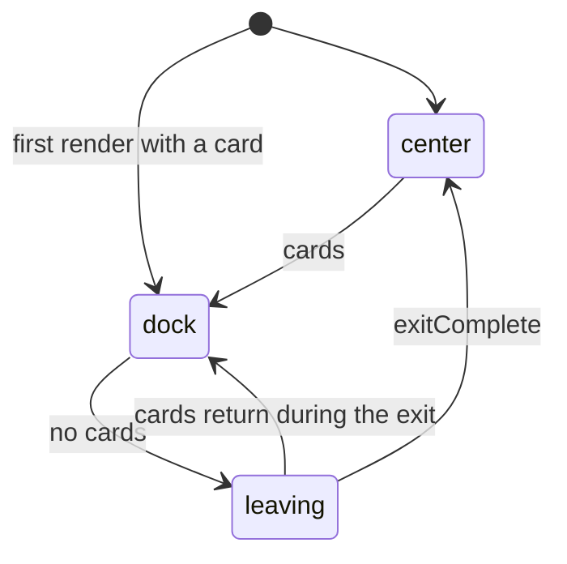
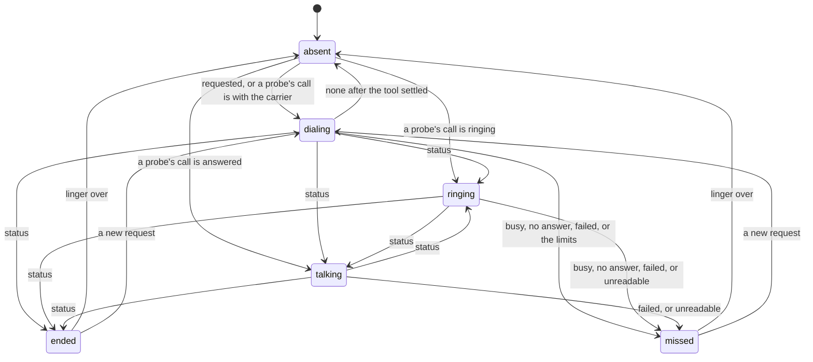
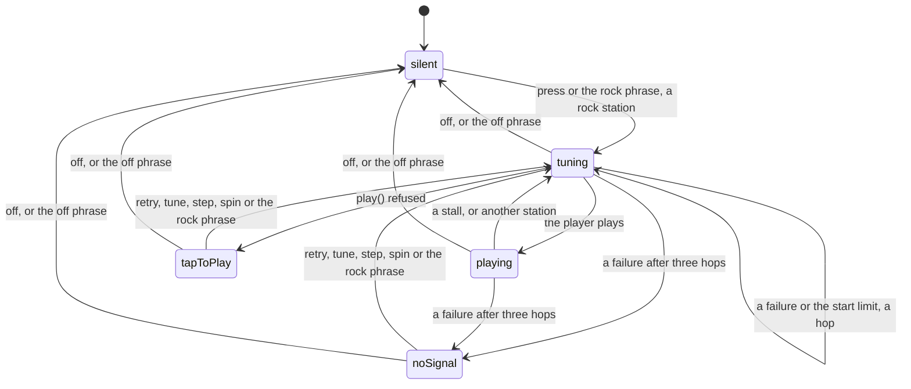

# UI: the lab's surfaces and the lab spider

Small machines inside the lab's Surfaces and the spider pointer (brief 015). Each is pure and is held by its component in React state, or by a frame loop. Rules: `.kiro/steering/ui-design.md`.

### `ui.dockLayout`

| Field | Value |
|---|---|
| Status | explicit |
| File | `apps/web/src/ui/dock-layout.ts` |
| Decides | `dockLayoutStep`, `dockLayoutInit`, `hasDockColumn` |
| States | `DockLayout` |
| Events | `DockLayoutEvent` |
| Tests | `apps/web/src/ui/dock-layout.transitions.test.ts`, `apps/web/src/ui/dock-layout.property.test.ts`, `apps/web/src/components/screen/MainScreen.test.tsx` |

Whether the Main_Screen's grid has the dock column (`GRID_WITH_DOCK`) or is centred (`GRID_CENTER`). `dock` while a card shows, `leaving` while the last one dematerializes, `center` otherwise; `hasDockColumn` is true in `dock` and `leaving`. An `exitComplete` outside `leaving` is stale and changes nothing.

The shell is `MainScreen` in `apps/web/src/components/screen/MainScreen.tsx`. It holds the layout in `useState`, starting from `dockLayoutInit`, and sends the `cards` event during render, so the column is there on the very render that brings the first card. The Card_Dock is always mounted (it renders nothing without a card) and its `onExitComplete`, fired by its outer `AnimatePresence` once the dock has left, sends `exitComplete`.

### `ui.phoneCall`

| Field | Value |
|---|---|
| Status | explicit |
| File | `apps/web/src/ui/phone/phone-call.ts` |
| Decides | `phoneStep`, `phonePolls`, `phoneShows` |
| States | `PhonePhase` |
| Events | `PhoneEvent` |
| Tests | `apps/web/src/ui/phone/phone-call.test.ts`, `apps/web/src/client/phone-watch.test.ts`, `apps/web/src/components/phone/PhoneOnStage.test.tsx` |

The phone on Franki's wall during an outbound phone call. `absent` while no call is on the screen; `dialing`, `ringing` and `talking` while one is live; `ended` after a conversation and `missed` (busy, no answer, failed, or unconfirmed) after a call without one. Both stay for `PHONE_LINGER_MS`, then the phone leaves.

There are two ways in. A spoken request is certain once the voice reducer has dispatched `make_phone_call`, so `requested` shows the phone at once, in `dialing`. A typed turn only might have placed a call, so `probe` tracks it in `absent` and the phone shows only when the server reports a call; a call that is already over when first read never shows. While a tool call is still out, the status `none` means the dial is not claimed yet; after `settled` it means this turn placed no call. A status for any other turn is ignored, an ended call never comes back for a late status, and a probe never replaces a live call. `PHONE_UNKNOWN_LIMIT` unreadable statuses in a row, or `PHONE_DIAL_LIMIT_MS` without leaving `dialing`, end the wait as `missed`. `phoneStep` is total, and `reset` returns to the initial state from anywhere.

The shell is `PhoneWatch` in `apps/web/src/client/phone-watch.ts`, one per signed-in user. It sends `requested` and `settled` from each voice snapshot (`pendingPhoneCall`), `probe` from each answered typed turn, and `status` from `GET /api/phone/status`, read once at the start and then every `PHONE_POLL_MS` while `phonePolls` is true; a failed or malformed read counts as `unknown`. It keeps one timer: the next read, or the tick that ends the linger. The phone is built in three.js (`apps/web/src/components/phone/three/model.ts`, moved by `motion.ts`) and hung on the Stage by `PhoneOnStage` in `apps/web/src/components/phone/PhoneOnStage.tsx`. The server's side of the status is `phoneStatus` in `packages/server/src/phone/status.ts`.

### `ui.radio`

| Field | Value |
|---|---|
| Status | explicit |
| File | `apps/web/src/ui/radio/radio-machine.ts` |
| Decides | `radioStep`, `radioView`, `radioEffects` |
| State | `RadioState` |
| States | `RadioSignal` in `apps/web/src/ui/radio/types.ts` |
| Events | `RadioEvent` |
| Tests | `apps/web/src/ui/radio/radio-machine.transitions.test.ts`, `apps/web/src/ui/radio/radio-stale.property.test.ts`, `apps/web/src/ui/radio/radio-off-silent.property.test.ts`, `apps/web/src/ui/radio/radio-station-known.property.test.ts`, `apps/web/src/ui/radio/radio-hops.property.test.ts`, `apps/web/src/ui/radio/radio-volume.property.test.ts`, `apps/web/src/ui/radio/radio-press-twice.property.test.ts`, `apps/web/src/client/radio-watch.test.ts` |

The radio on the stage and its globe of stations (brief 047). The state is the signal, with power, panel, station, volume, the call's duck level, a tune counter and the hop count beside it. `silent` exactly while off, and off means no station and the panel closed. A press from off, or the rock phrase, turns it on with the panel open and a rock station picked by the event's `pick` (0 to 1, so the machine stays pure); a press while on only opens or closes the panel, and closing it leaves the station playing. `tune`, `step` and `spin` act only while on, and `spin` always lands on a different station. Every tune and every switch off raises `tune`; a player report naming any other tune is stale and changes nothing. A failure, or `RADIO_START_LIMIT_MS` without sound, hops east to the next station of the same kind (rock stays rock while another exists), at most `RADIO_MAX_HOPS` times, then rests on `noSignal`; a stream that plays resets the count. A refused `play()` is `tapToPlay`, and `retry` (a press, so the browser lets sound start) tunes the same station again. The volume is clamped to 0 to 1; how far a call ducks it is `radioGain` in `apps/web/src/ui/radio/gain.ts`. `radioStep` is total and returns the same state when nothing changes.

The shell is `RadioWatch` in `apps/web/src/client/radio-watch.ts`, one for the app's life. It sends the controls, each player report from `apps/web/src/client/radio-player.ts`, the start limit's `timedOut`, the duck level from each voice snapshot (`radioDuck`), and the phrases: `radioPhrase` in `apps/web/src/ui/radio/phrase.ts` over each completed spoken item of an ASR Turn (once per item ID, the last `RADIO_FIRED_LIMIT` remembered) and each typed line passed to `onTypedLine`. `radioEffects` turns each step into the player's `load`, `stop` and gain and the one start timer; an event raised while those run waits its turn. The stations are the snapshot in `apps/web/src/ui/radio/stations.ts`, written by `scripts/radio-stations.mjs`.

### `ui.cardSource`

| Field | Value |
|---|---|
| Status | explicit |
| File | `apps/web/src/components/surfaces/Card.tsx` |
| Decides | `nextOpenSource`, `hasRows` |
| Tests | `apps/web/src/components/surfaces/Card.test.tsx` |

Which source's rows show under a Card: none (null) or one source ID. `nextOpenSource(open, tapped, rows)` is the only move: a tap on a tag with rows opens them, or closes them when they are already open; a tag without rows leaves the card as it was. Opening one source closes any other, so at most one is open.

Two shells hold it. Without an `openSource` prop, an inner wrapper of `Card` keeps it in `useState`, starting from `defaultOpenSource` when that source has rows, and `tagTapHandler` moves it on and calls `onOpenSource` on every tap. With `openSource` (even null), the host holds it and the card keeps no state of its own; a held ID with no rows shows as closed. The Card_Dock passes these per card ID (`frontExtras` in `apps/web/src/components/surfaces/CardDock.tsx`).

### `ui.ruleForget`

| Field | Value |
|---|---|
| Status | explicit |
| File | `apps/web/src/components/surfaces/WhatIKnowSheet.tsx` |
| Decides | `ruleForgetPress`, `ruleForgetBlur` |
| Tests | `apps/web/src/components/surfaces/WhatIKnowSheet.test.tsx` |

The second tap a hard rule's Forget needs. The state is the armed rule's ID, or null. `ruleForgetPress(armed, id)` arms `id` (disarming any other rule) unless `id` is the armed one, when it disarms and says to forget. `ruleForgetBlur(armed, id)` disarms only when `id` is the armed one. Items that are not hard rules forget on the first press and never arm.

`WhatIKnowSheet` holds `armed` in `useState`. The armed button's blur sends `ruleForgetBlur`, and while a rule is armed a capture-phase `pointerdown` listener on `document` sends it for any press outside that rule's Forget, for touch browsers that do not blur on a tap; the listener goes when the rule disarms and on unmount. A `role="status"` span reads `COPY.sheet.confirmRule` while a hard rule in the list is armed. `nextFocusIndex` in the same file is the Tab wrap inside a modal sheet, arithmetic over the controls in the DOM, not part of this machine.

### `ui.spider`

| Field | Value |
|---|---|
| Status | explicit |
| File | `apps/web/src/ui/cursor/spider.ts` |
| Decides | `stepSpider`, `spiderPose` |
| State | `SpiderState` |
| Events | `SpiderInput` |
| Tests | `apps/web/src/ui/cursor/spider.test.ts` |

The lab spider, one pure step per frame. `stepSpider(state, input)` takes Frame_Time and the pointer (position, on the page, over something to touch, over a text field, pressed) and returns the next state; `spiderPose` draws it. Nothing else is stored, and the frame gap is clamped to `MAX_DT_MS`.

- The ring, the front-leg lift, the text tuck, the press, the rest drop and the presence are springs stepped toward 0 or 1 (the drop toward `REST_DROP`). Arrival is immediate; leaving fades on `spring.settle`.
- It rests after `REST_MS` without a move or press, lowering on a thread and swaying; the next move or press climbs it back.
- A reset (no origin yet, the pointer was off the page last frame, or a frame gap over `MAX_DT_MS`) zeroes the velocity and puts every foot at rest. A fast move is never a reset.
- Velocity and heading come from the two filters in `apps/web/src/ui/cursor/heading.ts`; the feet come from `ui.gait`.

The shell is `apps/web/src/components/cursor/SpiderCursor.tsx`: one requestAnimationFrame loop that steps the state and writes transforms and opacity to the DOM, stopping while the tab is hidden and once the spider has faded out.

### `ui.gait`

| Field | Value |
|---|---|
| Status | explicit |
| File | `apps/web/src/ui/cursor/gait.ts` |
| Decides | `stepGait` |
| State | `GaitState` |
| Events | `GaitInput` |
| Tests | `apps/web/src/ui/cursor/gait.property.test.ts` |

The spider's feet. Each foot is planted (its point stays put in viewport space) or swinging; the legs swing in two groups (`GROUPS`), and each group's current swing is in `GaitState.groups`, null while planted. `stepGait(state, input)` is pure.

- A foot needs a step when it is more than `STEP_FROM_REST` from its rest point, or its leg would stretch past `STEP_STRETCH`. A step lasts `STEP_MS`, lands ahead of rest by the travel during it (at most `MAX_LEAD`) and no further than `LAND_REACH` from its hip.
- A group lifts only when the other is planted, except above `GALLOP_SPEED`, when it may lift once the other is half way through a `GALLOP_STEP_MS` step; such a swing is marked `overlapped`. When only the group that stepped last is due, the other goes first if it is more than `DUE_FROM_REST` off rest, so the groups take turns.
- `reset` puts every foot at rest under the body.

Properties: feet stay within reach, the groups never swing together below gallop speed, a group lifts as one, and the same input gives the same feet.
