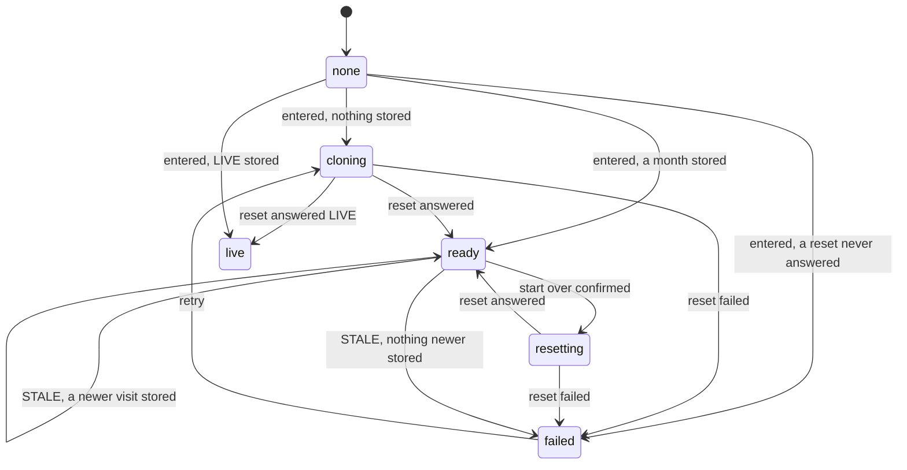

# UI: the visit, the time bolt and start over

The browser's half of a demo visit (brief 027, spec §15): one clone of the seeded persona per visit, kept across a reload, a world clock that only moves forward, and a reset after one confirmation. The server's half is `POST /api/seed/reset` and `POST /api/seed/advance` (seed lane). Names guessed ahead of the seed lane are in `apps/web/src/client/seed-guesses.ts`.

### `ui.visit`

| Field | Value |
|---|---|
| Status | explicit |
| File | `apps/web/src/ui/visit/visit-machine.ts` |
| Decides | `visitStep`, `visitBadge`, `badgeFor`, `boltEnabled`, `shownClock`, `inputAllowed` |
| States | `VisitPhase` |
| Events | `VisitEvent` |
| Tests | `apps/web/src/ui/visit/visit-machine.test.ts`, `apps/web/src/ui/visit/clock-forward.property.test.ts`, `apps/web/src/ui/visit/one-clone.property.test.ts`, `apps/web/src/ui/visit/simulated-label.property.test.ts`, `apps/web/src/ui/visit/bolt-targets.test.ts`, `apps/web/src/client/visit-model.test.ts`, `apps/web/src/components/surfaces/VisitBar.test.tsx`, `apps/web/src/ui/visit/shown-clock.property.test.ts`, `packages/server/src/seed/live-or-clone.property.test.ts` |

`none` before the lab is entered. On the first entry with nothing stored, the machine stores a new visit ID and then calls reset, in that order, so a reload finds the ID and never makes a second clone; `cloning` until the answer, then `ready` with the month's world clock stored. A reload with a stored month is `ready` at once and sends nothing. A reload that finds an ID whose reset never answered is `failed` (`interrupted`) and sends nothing until the visitor presses "Try again"; so is a clone that timed out, failed or met a barrier. `failed` never looks like a finished lab.

`live` (brief 038 finding 1): the reset answered LIVE, so this is a real account, which is never reset. It is stored with the visit, so a reload is `live` at once and sends nothing. A real account has no start over and no bolt, and takes input as it does without a visit.

The input gate (`inputAllowed`, brief 038 finding 1): the screen takes input (a chip, a typed line, a new call) only in `ready` and `live`, once the server has said which account this is. In `none`, `cloning`, `resetting` and `failed` no Session is opened and no turn is sent, so nothing a visitor does writes to a fresh account before its clone.

Start over is pressed, then confirmed once (`confirming`), then `resetting`: the stored visit is marked unconfirmed first, and if a call is open the machine asks the shell to end it (`endingCall`) and sends the reset only after `callEnded`. Start over and "Try again" each store and reset a new visit ID (brief 038 finding 4), so a tab still holding the old ID is STALE against the new clone.

`staleVisit` (brief 038 finding 4): a visit call (an open naming the visit, a reset or a bolt) was answered STALE, and the shell read the stored visit again. A newer visit stored by another tab is taken up (`ready`, and the screen of the old one is dropped with `afterReset`); a stored LIVE answer is `live`; with nothing newer stored the visit is `failed` (`interrupted`), and "Try again" makes a new one.

The bolt (`BoltPhase`: `idle`, `moving`, `waiting`) runs only in `ready`. A press asks advance for a time strictly after the world clock of the last accepted answer, and is ignored otherwise; `moving` until the answer. An answer stores the new world clock (never lower than the last) and, with a proactive line, asks the shell to show it. A barrier answer is `waiting` for its `retryAfterMs`, or `BARRIER_WAIT_MS`; any other failure is `idle` with `boltFailed`, the clock unchanged.

Every request carries a new `seq`; an answer with another `seq` is stale and changes nothing. `visitStep` is total.

`visitBadge` is the Time_Badge: present exactly when the shown clock (`shownClock`: the world clock once known, else the real one) differs from the real clock.

`badgeFor` (brief 038 finding 5) is what the screen shows: no clock at all until the server has said which clock the account runs on. `ready` shows the clone's world clock, marked simulated; `live` shows the real clock, not simulated; `none`, `cloning`, `resetting` and `failed` show no clock, so the real time is never shown as the clone's and the old clone's time never as the new one's.

The shell is `VisitModel` in `apps/web/src/client/visit-model.ts`, one per signed-in user. It reads and writes the stored visit in `localStorage` under `VISIT_STORAGE_PREFIX` plus the user's ID, calls `resetVisit` and `advanceVisit` in `client/api.ts`, runs `endCall` through the voice client's hang-up and waits for its phase to close (at most `CALL_END_LIMIT_MS`), and runs `wait` with one timer. The bolt's targets are `boltTargets` in `apps/web/src/ui/visit/bolt-targets.ts`. The drawing is `VisitBar` in `apps/web/src/components/surfaces/VisitBar.tsx`.
