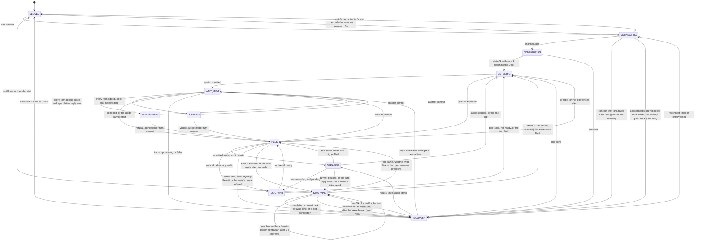

# Voice: the call

The browser's call is one pure reducer, `step(state, event, now)` in `packages/core/src/voice/machine.ts`. The Voice_Client (`apps/web/src/client/voice-client.ts`) runs the commands it returns, in order, and feeds every answer back as an event. Nothing in the reducer reads a clock, a random source or the network: `now` is the browser opsClock, a new Turn's ID arrives on the event as `freshId`, and hashing is a command (`verifyPermit`, `hashPayload`) whose answer comes back as an event.

Rules: `.kiro/steering/voice-control.md` (what may be heard) and `.kiro/steering/state-machines.md` (how a machine is shaped).

### `voice.call`

| Field | Value |
|---|---|
| Status | explicit |
| File | `packages/core/src/voice/machine.ts` |
| Decides | `step` |
| State | `VoiceState`, `VoicePhase`, `TimerName` |
| Events | `VoiceEvent`, `RealtimeServerEvent`, `VoiceCommand` |
| States | `VoicePhase` |
| Tests | `packages/core/src/voice/machine.test.ts`, `packages/core/src/voice/outstanding-reconnect.test.ts`, `packages/core/src/voice/testing/arb-call.test.ts`, `packages/core/src/voice/no-permit-no-sound.property.test.ts`, `packages/core/src/voice/every-wait-ends.property.test.ts`, `packages/core/src/voice/stale-inert.property.test.ts`, `packages/core/src/voice/held-never-resumes.property.test.ts`, `packages/core/src/voice/late-permit.property.test.ts`, `packages/core/src/voice/no-clipped-suffix.property.test.ts`, `packages/core/src/voice/no-dispatch-before-admission.property.test.ts`, `packages/core/src/voice/fast-o-fresh-ack.property.test.ts`, `packages/core/src/voice/admitted-turn-posted.property.test.ts`, `packages/core/src/voice/voice-unlisted.transitions.test.ts`, `packages/core/src/voice/voice-swap.transitions.test.ts`, `packages/core/src/voice/narrowing.property.test.ts`, `packages/core/src/voice/swap-fresh-open.property.test.ts`, `packages/core/src/voice/a-tool-is-a-tool.property.test.ts`, `packages/core/src/voice/every-open-names-the-visit.property.test.ts`, `packages/core/src/voice/only-hangup-says-user.property.test.ts`, `packages/core/src/voice/old-visit-never-talks.property.test.ts`, `packages/core/src/voice/voice-visit.transitions.test.ts`, `apps/web/src/client/voice-client.test.ts`, `apps/web/src/components/app-controllers.voice-stale.test.ts` |

The diagram shows the transitions `step` makes between phases. Three more apply from every phase of a live call and are left out of the drawing: `hangupPressed` goes to CLOSED, a lost connection (`connectionLost`, `sdpFailed`) goes to RECOVERY, and speech that starts while a reply, a check or a wait is in progress (barge-in) goes to LISTENING.

**The call swap** (wave B; R14; questions 81 and 86; built by brief 017). A `blocked` answer (`onBlocked`) means a narrowing closed the call. From any phase but CLOSED, the call swaps (`startSwap`) at once: mute, cancel and clear what is in flight, tear down, and open a fresh call naming the narrowed Session as `previousSessionId`, with no close for it (the server hangs it up). A different Session the call held (a reconnect opened before the answer) is closed. An open already in flight is never the swap's, since the server may have handled it before the narrowing committed: `staleOpen` marks it, its answer is closed and dropped (`dropStaleOpen`), and the swap's own open goes out then, so only one open is ever in flight; that open keeps its own `openWait`, which ends the swap in connection recovery if it never answers (brief 031, finding 1). With a care Permit for the current Turn (crisis was also a candidate), the care reply plays first under `afterReply: "swap"`, and the swap follows when it ends or is interrupted, however it ends (`toListening`, `bargeIn`). While that care reply is under way, another `blocked` for the same Session (a stale resend of the Turn, or another of its posts) does nothing (brief 031, finding 3). The fresh call opens, connects and configures inside SWAPPING (the avatar shows `thinking`, the button `hang up`, the mute works); `swap` (12 s) bounds it, and any failure goes to connection recovery. When the ack matches, the open answer's `proactive`, if any, plays as a synthetic Turn's reply: the COMPANY Fixed_Line, spoken verbatim. A later `blocked` for any Session this call already swapped away from (`swappedFrom`, which holds `narrowedFrom` and every earlier one) does nothing. A lost connection with an Outstanding_Turn goes to connection recovery as before; if that Turn's answer is `blocked`, the recovery turns into the swap (R14.6). Brief 031 replaced ruling V-163: recovery may go on, but a swap never adopts an open that was sent before the `blocked` answer arrived.

**A forget in a call** (brief 048, rulings 3 and 7; built by Claude Code, not Kiro). The server answers the forget's post `blocked` with no Permit, so the call swaps as above and nothing more is sent on the old call but the cancel of what it had playing. While the forget's barrier is up the server answers the fresh open `blocked` (the open's BARRIER answer). In SWAPPING that is not a failure (`barrierInSwap`): the call stays muted with the avatar on `thinking`, and the same open goes out again `BARRIER_RETRY_MS` (1 s) later (`barrierRetry`), until `BARRIER_WAIT_MS` (5 s) from the swap's start (its `swap` deadline less `SWAP_LIMIT_MS`); then the call goes to connection recovery and stays muted. In connection recovery a blocked open gives its attempt back (`barrierInRecovery`), so the same reconnect delay runs again for as long as the barrier lasts; "Try again" still shows at 30 s. The old call is never resumed: every open names the forgotten Session as `previousSessionId` and the server makes a new one. The first open after the receipt's `blockedAt` carries the acknowledgment in `proactive` ("Gone.", or another of the forget's Fixed_Lines), which plays as the fresh call's first words, exactly as the swap line does. The property `old-call-silent.property.test.ts` holds both halves over `testing/arb-forget.ts`.

**What a call sends** (brief 040). The tools offered are `CALL_TOOLS`: `recall`, `make_phone_call`, `suggest`, `answer`, `read_money` (brief 046) and `start_errand` (brief 049), all six dispatched by `dispatchTool` under one rule (arguments that don't parse send nothing; `answer` sends both IDs null, H-186), and a reply after any result but `make_phone_call`'s, `read_money`'s or `start_errand`'s offers all six again. A typed line carries its source (`typed` or `pasted`) to its post. The visit reaches the reducer as `visitSet` from the controller, is kept as `visitId` through every exit, and every open names it. Only the Owner's hang-up closes with `user`; the machine's own closes (a Session the swap leaves, a stale open's answer, an open answered after the call stopped waiting) say `replace` (`MACHINE_CLOSE_REASON`), so a company Session stays company.

**A visit that is gone** (brief 044, item 2). The server answers STALE (409) to an open that names a visit a reset has replaced (brief 038). The Voice_Client sends that answer as `visitGone`, with the visit the open carried, in place of `openFailed`. For the tab's own visit (`visitId`), the call ends from whatever phase it is in (`visitGone`): mute, tear down, close a Session still held with `replace`, every deadline cleared, no retry and no reconnect, `error: "visit"`; the visit is kept as `goneVisitId`, which no exit resets, and a `callPressed` while it is still the tab's visit opens nothing. A `visitSet` to a new visit lets calls open again. For an older visit (the tab has moved on), `visitGone` is a failed open like any other. The controller's gate (`gatedApi`) has already told the visit model to reload (brief 038, finding 4).

**What always holds** (the header of `packages/core/src/voice/machine.ts`, and the tests above):

- Output audio is muted unless the phase is SPEAKING under a Permit that passed its checks. `avatarState` never says `speaking` while output is muted.
- Every timer wait is an `armTimer` command plus a deadline in `deadlines`. Three more deadlines are kept in state with no timer and read only when a later event looks at them: `outstanding[].deadline`, `missing[].until` and `stateSentAt + STATE_STALE_MS`. A `timer` event whose deadline is absent does nothing; one that arrives before its deadline re-arms the same deadline.
- Realtime events are read only while a Session is held, the phase is past CONFIGURING, not SWAPPING, and the call is not in connection recovery. A `response.created` is matched to the judge, the speculative reply or the active reply by the `eventId` and `generation` in its metadata; one that matches none of them is cancelled, and so is audio that starts for a response the call does not own.
- A Deck of another generation is ignored. A higher Deck (epoch, policyRev, bundleRev or rulesRev raised) cancels every recorded response by ID and clears output audio (`adoptDeck`, `cancelAll`).
- `mutePressed` only flips `micMuted` and sends `setMic`; it never touches output audio.
- Never two `/api/session/state` requests in flight for one Session while every state answer is that Session's own: `postState` sends nothing while one went out less than `STATE_STALE_MS` ago. `stateOk` and `stateFailed` do not name their request, and `onState` and `onStateFailed` clear `stateSentAt` before they check whose answer it is, so a late answer from an earlier Session ends the wait early.
- `step` does not throw on a well-typed `VoiceEvent`. Six listed Realtime types throw today when they arrive without their fields: `conversation.item.added`, `response.created`, `response.done`, `response.output_audio_transcript.done`, `error`, and `conversation.item.input_audio_transcription.completed` with no `transcript` for an item of the current unposted Turn. That last one stores the missing transcript, and `maybeAdmit` throws on it, then or on a later event, once every item is recorded and has a transcript and no earlier item has text. The six are what a scratch run found, not a proof that no other type throws. The Voice_Client checks only that `type` is a string before it dispatches.

**Unprompted lines** (brief 045, finding 3). Delivery's line comes as a `proactive` in an open answer (the session's opening line) or a state answer (an idle whisper). Its Permit is of kind `proactive`, bound to the hash of the payload the machine checks: the stamp, the Head and safe turns of the Deck in the same answer, the whisper as the one note, no audio and no tool output (`proactiveOf` in `packages/server/src/time/proactive.ts`). An open answer's line plays when setup reaches its ack, as the swap line does. A state answer's line plays only from LISTENING, with no Turn, reply, judge, speculation, held-back speech or other line under way, no speech open and none started since the state request went out, for this Session and generation (`proactiveDropOf`); otherwise it is dropped and `proactiveDropped` names why. A state answer's line that can't be offered at all also ends by name: `session` when the answer is for no Session or another one (after a lost connection, a hang-up, a failed open or visitGone), `phase` when it comes during setup. No line ends in silence. Either way it plays on a synthetic Turn (no text) and is checked like any reply: `permitProblem` accepts `proactive` only for one unprompted `moment` note the Permit names on that Turn, and a hash that is not the Permit's drops it. The line was worded by code, so it is spoken verbatim like a Fixed_Line. Its `admitted` receipt, and its transcript receipt, name its moments and notes, so the server admits it and records it said.

**Third-party text** (brief 045, finding 1; question V-193). A pasted line, or typed text the server would class T (a line feed, `From:`, `Subject:`, a URL, over 280 characters; `isThirdPartyLine`), is posted to `/api/turn` as written. The reply's `response.create` carries `THIRD_PARTY_STAND_IN`, worded by code, in its place, never the text, and the server leaves a T Turn out of every Deck's `turns`.

**The exits and what they reset.** Three functions end a stretch of the call. `closedFields` (hang-up, a failed open), `connectionRecovery` (a lost connection, a failed post of this Session, the connect and ack limits) and `onOpen` (a new Session):

| Field | `onOpen` | `connectionRecovery` | `closedFields` |
|---|---|---|---|
| `outstanding` | kept | kept | kept |
| `turn`, `pending`, `active`, `judge`, `spec`, `heldBack`, `missing` | cleared | cleared | cleared |
| `deadlines` | `openWait` disarmed, `connect` armed, others kept | cleared, then `retryUi` armed unless "Try again" already shows, and `reconnect` while an attempt remains | cleared |
| `recovery` | kept | `connection`, attempts kept | null |
| `retryVisible` | kept | kept | false |
| `stateFailures`, `stateRetryVisible` | cleared | cleared: with no Session the state retry can't act, so its "Try again" goes | cleared |
| `micMuted` | as set by `startOpen` | kept | false |
| `lastSessionId` | the new Session | the Session that ended | the Session that ended |
| `proactive` | the answer's | cleared | cleared |
| `narrowedFrom`, `swappedFrom` | kept | kept | cleared |

`startOpen` (a press of Call, and every reconnect) sets `error: null`, and keeps `recovery`, `retryVisible` and `micMuted` only when it is a reconnect; a press of Call sets `micMuted: false`. So only `mutePressed` or the end of the call changes the mute, and the Voice_Client's `connect` applies it to the new microphone track. When CONFIGURING reaches LISTENING, `onState` sets `recovery` to null and `retryVisible` to false, and disarms `ack`, `connect`, `retryUi` and `reconnect`.

**Where the tables live.** In `packages/core/src/voice/machine.ts`: the full reset table, with a cell for every `VoiceState` field in each of the closed, recovery, open and press exits, is the comment above `closedFields`; what each `TimerName` means, by the phase it is armed in, is the comment on that type; the file's `@machine voice.call` header says what always holds and what it never does. The three switches over a closed union, in `step` (over `VoiceEvent`), `onTimer` (over `TimerName`) and `onRealtime` (over `RealtimeServerEvent`), end in `satisfies never`, so a member with no case fails `npm run typecheck`; at run time an unknown value changes nothing. `onRealtime`'s default is where every Realtime type the union does not list lands; `packages/core/src/voice/voice-unlisted.transitions.test.ts` pins that it returns the same state and no commands. `onTimer` returns before its switch for a name with no deadline, so its default is not reached at run time.

**Not modelled here:** the microphone prompt. `getMicrophone` runs inside the `connect` command, after the open answer armed the 5 s `connect` limit, so the browser's permission prompt runs inside that limit: an Allow later than 5 s ends in connection recovery. A refused microphone reaches the reducer as `sdpFailed`.

### `voice.permit`

| Field | Value |
|---|---|
| Status | explicit |
| File | `packages/core/src/voice/machine.ts` |
| Decides | `permitProblem` |
| State | `PermitProblem` |
| Tests | `packages/core/src/voice/machine.test.ts` |

`permitProblem(state, reply, hash, now, checkAck)` returns null or the first of `stamp`, `expired`, `deckExpired`, `kind`, `ack`, `hash`. The Stamp is compared with the one the held Session and Deck make (`localStamp`). The `fastO` ack check runs only when the Permit is issued; the checks at the hash answer, at unmute and at a function call pass `checkAck: false`. An empty hash never matches.

### `voice.fastO`

| Field | Value |
|---|---|
| Status | explicit |
| File | `packages/core/src/voice/fast-o.ts` |
| Decides | `fastOProblem`, `issueFastO` |
| Tests | `packages/core/src/voice/fast-o.test.ts`, `packages/core/src/voice/fast-o-fresh-ack.property.test.ts` |

The browser half of admission. `fastOProblem` returns the first refusal by name, or null: `verdict` (no valid `O` for this Turn and generation before t0 plus the judge deadline), `staleAck` or `ack` (no StateAck, one whose four revisions differ from the Deck, or one 2.5 s old or more), `outstanding` (another post has no answer yet) and `noteWaiting`. The hash is checked later, at `permitChecked`. `tryFastO` in the reducer counts only the posts of other Turns, so a Turn's own post never refuses it.

### `voice.judge`

| Field | Value |
|---|---|
| Status | explicit |
| File | `packages/core/src/voice/judge.ts` |
| Decides | `parseJudgeDone`, `judgeCreate` |
| Tests | `packages/core/src/voice/judge.test.ts` |

`judgeCreate` builds the out-of-band judge request over the Unadmitted_Fragments and the Deck's safe turns. It throws a `RangeError` rather than truncate (more than eight fragments, more than four turns, none, or duplicates), and the reducer then holds the Turn for the slow path. `parseJudgeDone` accepts a completed response with one message whose trimmed text is `O`, `H` or `U`; anything else is invalid, with a reason, and counts as `U`. A refused judge (an `error` naming its event) also counts as `U`. Once a Turn is held, a later verdict changes nothing.

### `voice.avatar`

| Field | Value |
|---|---|
| Status | view |
| File | `packages/core/src/voice/machine.ts` |
| Decides | `avatarState`, `callButton`, `muteVisible` |
| State | `AvatarState` |
| Tests | `packages/core/src/voice/machine.test.ts`, `apps/web/src/components/CallScreen.test.tsx` |

Read-only views over `VoiceState`, never written. `avatarState` maps connection recovery to `recovery` in every phase but CLOSED; CONNECTING and CONFIGURING to `connecting`; the waiting phases (WAIT_ITEM, JUDGING, SPECULATING, HELD, TOOL_WAIT, SWAPPING) to `thinking`; SPEAKING to `speaking` only while output is unmuted. `callButton` is the start form only in CLOSED, disabled while `hangingUp` or `awaitingOpen`. `muteVisible` follows `avatarState`.

### `voice.turn`

| Field | Value |
|---|---|
| Status | documented |
| File | `packages/core/src/voice/machine.ts` |
| State | `VoiceTurn`, `MissingTurn` |

A Turn lives in four places, written by several functions:

| Field | Holds | Written by |
|---|---|---|
| `turn` | The current Turn, from its first commit (or a typed line) until it is posted and answered | `onCommitted`, `typedSubmitted`, `postTurn`, `toListening`, `bargeIn`, the `permit` limit |
| `heldBack` | A once-admitted Turn that left `turn` unposted: its reply ended before its transcript came, a higher Deck cut the reply and the permit wait ended, or Realtime refused the reply's create and the recovery screen ended. Posted `final` when the transcript arrives or `missing` at t0 + 5 s. `VoiceTurn.admitted` marks a Turn whose reply was admitted, since a cut or a refusal clears `admittedTurnId`; noise with an empty transcript clears it (contract question Q-SM18) | `toListening`, the `permit` timer, `parkAdmitted`, `postHeldBack` |
| `missing` | Turns posted `missing` whose transcript may still come (at most two, 10 s each); the transcript is sent as a Superseding_Post | `postTurn`, `postHeldBack`, `onLateTranscript` |
| `admittedTurnId` | The Turn whose reply is admitted | `admit`; cleared by `toListening`, `bargeIn`, a cut in `onTurn`, a refused create |

A commit while a reply is admitted or being checked is a barge-in. A commit while the judge runs grows the Turn and starts the judge again over every fragment. A Turn kept after a barge-in waits in LISTENING for the next commit. Noise with an empty transcript is no Turn and takes no clientSeq.

### `voice.posts`

| Field | Value |
|---|---|
| Status | documented |
| File | `packages/core/src/voice/machine.ts` |
| State | `VoiceState` |

`pushTurn` sends a TurnRequest and records it in `outstanding` with the Session it was sent on and a 5 s deadline. Every answer (`turnOk`, `turnFailed`) removes it, sets `lastTurnResponseAt` and drops the held ack as stale. `outstanding` survives a reconnect: a post sent on the old connection still refuses `fastO` on the new one until it is answered or its deadline passes. `nextClientSeq` is one per Session, set to 1 by `onOpen`. For the current Turn: a `stale` answer is sent once more with the answer's revisions, and the resend gets a fresh 5 s answer wait; the 2.5 s hold a higher Deck arms never shortens an answer wait or hash check already running; a Permit that arrives inside the answer wait keeps its own 5 s hash check (`pending.checkUntil`) when the answer wait ends during it; a second `stale`, an `error` or a `turnFailed` for a post of this Session reconnects; `hold` with a retry hint arms `turnRetry`, also for a Turn whose reply is admitted and playing, and the resend goes while that reply plays. A posted Turn that leaves `turn` with the hint still armed (its reply ended first, `toListening`) keeps its post as `retryPost`, sent at the same deadline by the `retryPost` timer whatever Turn is current; another `hold` with a hint for it waits again, and any other answer ends it and is read as an answer for a Turn that is no longer current (brief 031, finding 2). An answer for a Turn that is no longer current still gives its Deck, and reconnects when the post was outstanding and nothing was recorded. A Superseding_Post (a late transcript for a Turn posted `missing`) sits in `outstanding` beside its Turn's ordinary post, marked `supersede`; `turnOk` and `turnFailed` carry `supersede`, set by the Voice_Client from the request it answered, and `answerOf` matches the post of that kind only, so the two answers can land in either order; an answer with `supersede` and no entry left gives its Deck only and never reconnects. An answer without the flag is matched by order: the ordinary post while that one is unanswered, then the Superseding_Post (brief 031, finding 4). The Superseding_Post reuses the `missing` post's clientSeq, so its answers never reconnect and never speak: a `stale` answer resends it once, as a Superseding_Post, under the answer's revisions, and a second `stale`, an error or a `turnFailed` ends it with the late transcript unrecorded.

### `voice.stateAck`

| Field | Value |
|---|---|
| Status | documented |
| File | `packages/core/src/voice/machine.ts` |
| State | `VoiceState` |

`poll` asks for state once a second while a call is live, `refresh` 45 s after the last answer, and `stateRetry` after a failure (1, 2 and 5 s, with "Try again" for the state at 30 s). An answer requested before the last `/api/turn` answer (`stateSentAt <= lastTurnResponseAt`) gives only a higher Deck, and its ack is dropped with `ackDroppedStale: true`. In CONFIGURING, the call reaches LISTENING on the first answer whose ack matches the Deck; an answer whose ack is dropped as older than the last turn answer (often a late answer from an earlier Session) sends one more state request at once; a failure there waits for the 1.5 s ack limit, which bounds CONFIGURING either way.

### `voice.recovery`

| Field | Value |
|---|---|
| Status | documented |
| File | `packages/core/src/voice/machine.ts` |
| State | `VoiceState` |

`recovery.kind` is `connection` (the connection is gone: reconnect after 1, 2 and 5 s, "Try again" at 30 s) or `line` (the neutral-line screen: RECOVERY shows, a `recoveryOnly` reply may play, then LISTENING). `retryPressed` reconnects only in connection recovery with `retryVisible`; otherwise it asks for state when `stateRetryVisible`. A failed open during connection recovery stays in RECOVERY and schedules the next attempt.

### `voice.latency`

| Field | Value |
|---|---|
| Status | documented |
| File | `packages/core/src/voice/latency.ts` |
| Tests | `packages/core/src/voice/latency.test.ts` |

`latency.current` opens at a commit (`onCommitted`) and collects the judge, Permit and audible times through `setLatency`. `finishLatency` closes it into `latency.rows` when the call returns to LISTENING through `toListening`, or when a commit starts a different Turn.

### `voice.transport`

| Field | Value |
|---|---|
| Status | documented |
| File | `apps/web/src/client/voice-client.ts` |
| Tests | `apps/web/src/client/voice-client.test.ts`, `apps/web/src/client/voice-client.streams.test.ts` |

The Voice_Client holds the mic stream, the peer connection and the data channel. A counter, `connection`, is raised by every `connect` and every `teardown`; a callback of an older connection does nothing. The peer connection's `failed` state and a data channel close without a hang-up dispatch `connectionLost`; any throw during setup dispatches `sdpFailed`. A timer command clears the earlier timer of the same name before arming. The reducer's state is replaced before the listeners run and before the commands run.

Not modelled: the ICE `disconnected` state and a microphone track that ends; neither dispatches an event.

### `voice.turnAnswer`

| Field | Value |
|---|---|
| Status | planned |
| File | `packages/core/src/voice/turn-answer.ts` |

A pure classifier for a `/api/turn` answer and the request that asked, so the reducer reads one closed union instead of re-deriving it at each site.

### `voice.turnMode`

| Field | Value |
|---|---|
| Status | view |
| File | `packages/core/src/voice/testing/turn-mode.ts` |
| Decides | `turnMode` |
| State | `TurnMode`, `LegalTurnMode`, `IllegalTurnMode` |
| Tests | `packages/core/src/voice/testing/turn-mode.test.ts`, `packages/core/src/voice/turn-mode-legal.property.test.ts` |

A test-side view, under `testing/`; the reducer never reads it. `turnMode(state)` reads `turn`, `heldBack`, `admittedTurnId`, `active` and `phase` and names what the current voice Turn is doing: six legal modes (`LEGAL_TURN_MODES`) and eight illegal ones (`ILLEGAL_TURN_MODES`), each illegal mode the break of one invariant. The property runs every step of the wide generator and of `arbCall` and allows an illegal mode only when `TURN_MODES_ALLOWED` names it. Three are allowed today: `admittedWithoutReply` and `admittedWithoutTurn` (a cut reply leaves `admittedTurnId` set) and `unpostedInRecovery` (a Turn still waiting for its words on the recovery screen; since V2 a once-admitted one is held back and posted when the screen ends). The list only shrinks: `turn-mode.test.ts` fails when an allowed mode is no longer reached over 1,000 wide calls at seed 7. The file's header calls it a view of `voice.turn`.

### `voice.replyStage`

| Field | Value |
|---|---|
| Status | view |
| File | `packages/core/src/voice/testing/reply-stage.ts` |
| Decides | `replyStage` |
| State | `ReplyStage`, `LegalReplyStage`, `IllegalReplyStage` |
| Tests | `packages/core/src/voice/reply-stage-legal.property.test.ts` |

A test-side view, like `voice.turnMode`. `replyStage(state)` reads the four reply slots (`judge`, `spec`, `pending`, `active`), the phase and the output mute and names where the current reply is: thirteen legal stages (`LEGAL_REPLY_STAGES`, from `offCall` and `idle` through `racing`, the checks, `admittedMuted`, `speaking`, `toolWait` and `recoveryLine`) and eleven illegal ones (`ILLEGAL_REPLY_STAGES`, such as `audibleOutsideSpeaking` or `pendingAndActive`). The property runs every step of the wide generator and of `arbCall`; its allow-list is empty, so no illegal stage is produced on either. The file's header calls it a view of `voice.reply`.
