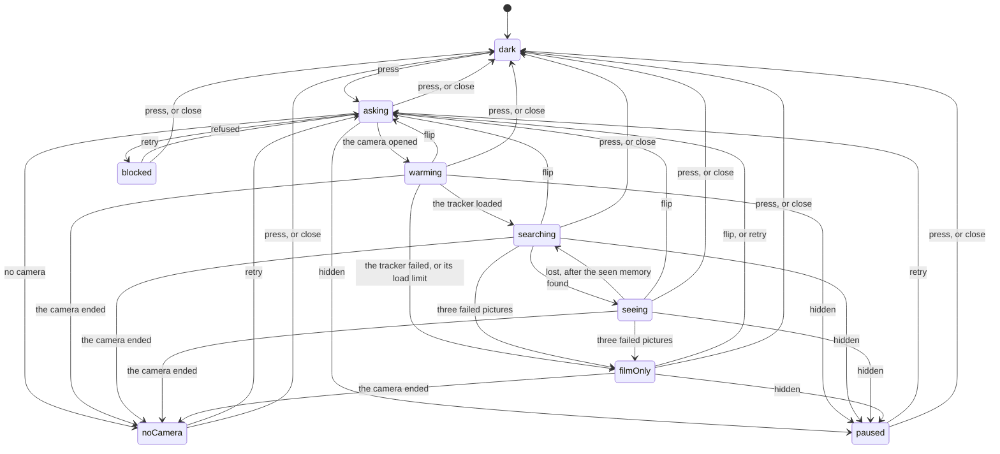

# UI: the X-ray machine

The X-ray machine on the stage and its screen (brief 051): a press turns it on and asks for the camera, the picture shows as film, and a face and hand tracker draws bones over it. Client only: no route, no tool, nothing stored, and the picture never leaves the browser.

### `ui.xray`

| Field | Value |
|---|---|
| Status | explicit |
| File | `apps/web/src/ui/xray/xray-machine.ts` |
| Decides | `xrayStep`, `xrayView`, `xrayDetecting` |
| State | `XrayState` |
| States | `XraySignal` in `apps/web/src/ui/xray/types.ts` |
| Events | `XrayEvent` |
| Tests | `apps/web/src/ui/xray/xray-machine.transitions.test.ts`, `apps/web/src/ui/xray/xray-off-dark.property.test.ts`, `apps/web/src/ui/xray/xray-stale.property.test.ts`, `apps/web/src/ui/xray/xray-press-twice.property.test.ts`, `apps/web/src/ui/xray/xray-live-signal.property.test.ts`, `apps/web/src/ui/xray/xray-hidden.property.test.ts`, `apps/web/src/ui/xray/xray-flip-order.property.test.ts`, `apps/web/src/client/xray-watch.test.ts`, `apps/web/src/client/xray-one-stream.property.test.ts`, `apps/web/src/client/xray-off-no-stream.property.test.ts`, `apps/web/src/client/xray-late-stream.property.test.ts`, `apps/web/src/client/xray-dispose.property.test.ts` |

On means the screen is open (ruling 4); `dark` exactly while off, and off means no camera is open. The state is the signal, with power, the facing, the device's camera count, whether a camera is open and a session counter beside it. A press from off turns it on facing `XRAY_FIRST_FACING` (the selfie camera) and asks for the camera (`asking`); a press while on, or `close`, turns it off. The camera's picture shows (`warming`) while the tracker loads; a loaded tracker is `searching`, and `seeing` while it finds a face or a hand. A tracker that fails to load, or does not load within `XRAY_LOAD_LIMIT_MS`, or fails on three pictures in a row, leaves the film alone (`filmOnly`). A refused camera is `blocked`; no camera, or one that stopped on its own, is `noCamera`. A hidden tab stops the camera (`paused`), and coming back changes nothing. `retry` from `blocked`, `noCamera`, `paused` or `filmOnly` asks for the camera again, facing the same way. `flip` acts only while a camera is open and the device has two or more.

Every new camera life (a press that asks, a flip, a retry) and every stop (off, hidden, a refusal, a camera that ended) raises `session`; a camera or tracker report naming any other session changes nothing, and a camera handed over that the machine does not take comes back as `dropStream`, to be stopped at once. Each step returns its commands as data (`openCamera`, `stopCamera`, `dropStream`, `loadTracker`, `closeTracker`, `armLoadLimit`, `clearLoadLimit`); a step that ends a camera life stops the open camera before it asks for another. `warming`, `searching` and `seeing` hold only while a camera is open. `xrayStep` is total and returns the same state, with no commands, when nothing changes.

Resets: off returns every field to `INITIAL_XRAY` but `session`, which is raised. Leaving a camera life (off, hidden, flip, retry, a camera that ended) clears `cameraOpen`; `cameras` is kept until off.

The shell is `XrayWatch` in `apps/web/src/client/xray-watch.ts`, one for the app's life (made by `createLiveXray` and held by `createXrayHost` in `apps/web/src/client/xray-live.ts`). It runs each command through the camera port (`apps/web/src/client/xray-camera.ts`), the tracker port (`apps/web/src/client/xray-tracker.ts`) and one load-limit timer, holds the one stream the machine counts as open, plays it in the element the screen attaches through `feed`, and stops any other stream in the step it arrives. While `xrayDetecting` holds, an element is attached and the tab is shown, it runs the tracker once for each new picture, one at a time; a picture with a face or a hand sends `found`, and `XRAY_SEEN_MEMORY_MS` without one sends `lost` (ruling 13); `XRAY_DETECT_FAILURE_LIMIT` thrown detections in a row send the tracker's `failed`. The tracker's addresses are in `apps/web/src/ui/xray/sources.ts`.
